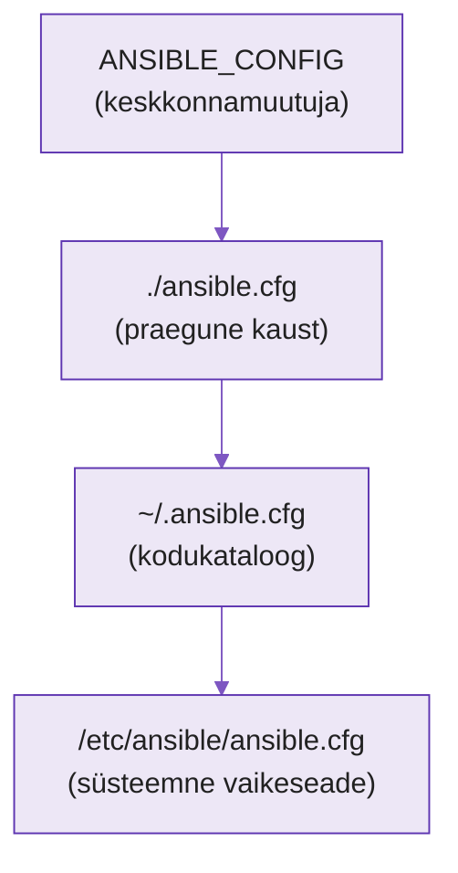

---
tags:
  - Ansible
  - Konfiguratsioon
---

# Ansible'i seaded: `ansible.cfg`

See leht on **viiteleht**. Seda ei pea pähe õppima, siia saab vajaduse korral tagasi tulla. 3. nädala praktikumis piisab paarist reast failis `ansible.cfg`. Siin on kirjeldatud, kuidas Ansible oma seaded leiab ja kuidas neid ümber määrata.

---

## Mis on `ansible.cfg`

Ansible'i paigaldamisel luuakse juhtmasinasse vaikimisi konfiguratsioonifail `/etc/ansible/ansible.cfg`. Selle faili parameetrid määravad, kuidas Ansible vaikimisi töötab. Kui muudad siin mõnda väärtust, mõjutab see **kõiki** playbooke, mida sellel masinal käivitatakse.

Fail on jagatud sektsioonideks:

```ini
[defaults]
inventory = ./inventory.ini
host_key_checking = False

[privilege_escalation]
become = True

[ssh_connection]
timeout = 20
```

Näites on sektsioonid `[defaults]` (vaikeseaded), `[privilege_escalation]` ja `[ssh_connection]`. Lisaks on olemas näiteks `[inventory]` ja `[colors]`. Igas sektsioonis määratakse parameetrid ja nende väärtused: kus asub inventar, kuhu salvestatakse logid ja rollid, kas Ansible kogub fakte automaatselt, kui kaua SSH-ühendust oodatakse ja mitut hosti korraga töödeldakse. Kõiki valikuid ei pea teadma. Piisab, kui tead, et fail koosneb sektsioonidest ja igas sektsioonis on muudetavad seaded.

---

## Kolm viisi seadete ümbermääramiseks

Oletame, et eri kaustades on eri playbookide kogumid: üks veebiserverite, teine andmebaaside ja kolmas võrguseadmete jaoks. Igaüks vajab veidi erinevaid seadeid. Veebiserverite puhul ei ole vaja fakte koguda. Andmebaaside puhul on faktid vajalikud, kuid värvilist väljundit ei soovita. Võrguseadmete puhul tuleb SSH ooteaeg pikendada 20 sekundini. Seadeid saab ümber määrata kolmel viisil.

### 1. Kohalik `ansible.cfg` playbooki kaustas

See on kõige lihtsam viis. Kopeeri `ansible.cfg` playbooki kausta ja muuda seal ainult vajalikke seadeid. Kui käivitad playbooki sellest kaustast, loeb Ansible seaded sealsest failist. **Sellel kursusel kasutame seda viisi.** Fail lisatakse koos playbookidega Giti, nii et seadete muudatused on versioonihalduses ja kõigil masinatel ning kasutajatel on samad seaded.

### 2. `ANSIBLE_CONFIG` keskkonnamuutuja

Kui konfiguratsioonifail peab asuma mujal (nt `/opt/ansible-web.cfg`, et kasutada seda mitme playbookiga), määra enne käivitamist keskkonnamuutuja, mis osutab faili asukohale:

```bash
export ANSIBLE_CONFIG=/opt/ansible-web.cfg
```

Nüüd kasutab Ansible seda faili vaikimisi asukoha asemel.

### 3. Üksik parameeter keskkonnamuutujana

Kui on vaja muuta ainult üht seadet, ei pea kogu faili kopeerima. Sel juhul määra see parameeter keskkonnamuutujaga. Muutuja nime saad enamasti nii: kirjuta parameetri nimi suurtähtedega ja lisa selle ette `ANSIBLE_`. Näiteks parameetrist `gathering` saab `ANSIBLE_GATHERING`:

```bash
export ANSIBLE_GATHERING=explicit
```

Muutuja saab edastada mitmel viisil. Kui kirjutad selle otse käsu ette, kehtib see ainult selle ühe käivituse ajal. Käsuga `export` määratud muutuja kehtib kogu shelli seansi jooksul. Kõige kindlam on lisada parameeter kohalikku faili `ansible.cfg`, sest see fail salvestatakse repositooriumisse.

---

## Prioriteedijärjekord

Kui mitu konfiguratsioonifaili on korraga olemas ja neis on erinevad väärtused, kasutab Ansible kindlat järjekorda. Allolevas loendis on kõige kõrgema prioriteediga allikas esimesena:

1. **`ANSIBLE_CONFIG`** keskkonnamuutujaga määratud fail
2. **`ansible.cfg`** praeguses kataloogis
3. **`.ansible.cfg`** kodukataloogis (`~/.ansible.cfg`)
4. **`/etc/ansible/ansible.cfg`**: süsteemi vaikeseadistus

<figure markdown="span">

  <figcaption>Joonis. Ansible otsib konfiguratsioonifaili ülalt alla ja kasutab esimest leitud faili. Üksik keskkonnamuutuja (nt ANSIBLE_GATHERING) kaalub üle kõigi nende failide väärtused (Talvik, 2025).</figcaption>
</figure>

Failis ei pea olema kõiki väärtusi. Määra ainult need, mida soovid muuta. Ansible loeb ainult ühte konfiguratsioonifaili ega liida faile kokku: väärtused, mida leitud failis pole, võetakse Ansible'i sisseehitatud vaikeväärtustest. Üksiku parameetri keskkonnamuutuja (viis 3) on kõrgema prioriteediga kui ükskõik milline konfiguratsioonifail.

---

## Kuidas kontrollida, mis kehtib

Järgmised kolm käsku näitavad, milliseid seadeid Ansible kasutab:

```bash
ansible-config list    # kõik valikud, vaikeväärtused ja võimalikud seadistused
ansible-config view    # milline konfiguratsioonifail on hetkel aktiivne
ansible-config dump    # kõik praegused väärtused ja nende päritolu
```

Kõige kasulikum on **`ansible-config dump`**, sest see näitab iga väärtust koos selle päritoluga. Näiteks kui määrad `ANSIBLE_GATHERING=explicit`, käivitad `ansible-config dump` ja otsid väljundist rida `GATHERING`, on näha, et väärtus pärineb keskkonnamuutujast. Kui seaded ei toimi ootuspäraselt, näitab see käsk, milliseid väärtusi Ansible kasutab ja kust need pärinevad.

---

## Allikad

| Allikas | URL |
|---|---|
| Ansible konfiguratsiooniseaded | <https://docs.ansible.com/ansible/latest/reference_appendices/config.html> |
| `ansible-config` käsk | <https://docs.ansible.com/ansible/latest/cli/ansible-config.html> |
