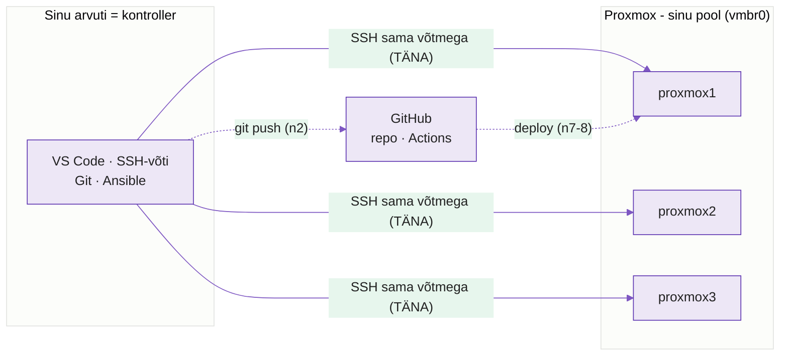

---
tags:
  - Keskkond
  - SSH
  - Ligipääs
---

# Praktikum: SSH-ligipääs kolme Proxmoxi masinasse

**Õpilane:** ______________________________  **Kuupäev:** ____________

**Kestus:** 4 A-t · **Tase:** 3. aasta · **Esitamine:** vt lõpp

**Eelteadmised:** Linuxi käsurida, sudo ja VS Code. Selles praktikumis on uued teemad võtmepõhine SSH-ühendus kolme masinasse, nimega hostid failis `~/.ssh/config` ja VS Code Remote-SSH.

---

## 🎯 Tänase tunni eesmärk

**Tunni eesmärk on seada üles töökeskkond, mida kasutad kogu kursuse jooksul.** Tunni lõpuks on sul olemas järgmine:

- **Proxmox:** kolm sõlme, millele sul on ligipääs.
- **SSH:** üks võti, mis on kopeeritud kõigisse sõlmedesse, nii et sisselogimiseks pole parooli vaja.
- **VS Code:** vajaduse korral saad töötada sõlme sees (Remote-SSH).
- **Git:** Git on sinu arvutis seadistatud ja 2. nädalaks valmis.
- **Kontroller:** Ansible on sinu arvutisse paigaldatud ja käsule `ansible -m ping` vastavad kõik kolm sõlme.

Pärast tänast tundi keskkonda enam uuesti üles ei seata. Kogu ülejäänud kursus **põhineb** sellel keskkonnal.

> **Kus failid asuvad (oluline):** Giti repo, Ansible'i failid ja GitHubi ligipääs on kursusel vaikimisi **sinu arvutis** (kontrolleris). Proxmoxi sõlmed on **ainult SSH-sihtmärgid**: neist ei tehta push'i, nendega ainult ühendutakse. **Üks ja sama SSH-võti kopeeritakse kõigisse sõlmedesse** ja Ansible kasutab sedasama võtit. VS Code Remote-SSH on tööriist sõlme sisu vaatamiseks. Kursuse põhitöö toimub sinu arvutis.

> **🎯 Tänane tund on õnnestunud, kui kolm asja töötavad.** Kõik muu on lisaülesanded:
> 1. `ssh proxmox1`, `ssh proxmox2`, `ssh proxmox3` töötavad ilma serveri-paroolita;
> 2. `ansible -i inventory.ini all -m ansible.builtin.ping` tagastab **kolm korda `pong`**;
> 3. oskad selgitada, **miks privaatvõtit kunagi serverisse ei kopeerita**.

---

## Topoloogia: mida kursuse jooksul ehitame

<figure markdown="span">

  <figcaption>Joonis 1. Sinu arvutist (kontrollerist) ühendutakse sama SSH-võtmega kolme Proxmoxi sõlme. Git ja Ansible asuvad sinu arvutis, sõlmed on SSH-sihtmärgid. Täna lood ühenduse, ülejäänud osad lisanduvad järgmistel nädalatel.</figcaption>
</figure>

Kursuse jooksul lisanduvad sõlmedele järgmised kihid: **Terraform** loob sõlmed (n10-11) → **Ansible** seadistab need ja paigaldab Dockeri (n3-4) → **Docker** käitab rakendust (n5-6) → **GitHub Actions** juurutab rakenduse (n7-8). 13. nädalal (lõpuprojekt, capstone) paned kõik osad kokku. **Täna lood ühenduse sõlmedega.**

*Tänased kolm sõlme on õpetaja juba ette loonud ja need on sinu töö- ja testkeskkond. 10.–11. nädalal õpid Terraformiga samasugust infrastruktuuri ise kirjeldama ja looma.*

---

## Õpiväljundid

Praktikumi lõpuks oskad:

1. selgitada, **kuidas SSH-võtmepaar töötab** ja **miks saab ilma paroolita sisse logida**;
2. kopeerida **ühe võtme kõigisse kolme sõlme** ja seadistada failis `~/.ssh/config` nimega hostid;
3. ühenduda ühe käsuga (`ssh proxmox1`) igasse sõlme ilma paroolita;
4. ühenduda vajaduse korral sõlmega **VS Code Remote-SSH** abil;
5. seadistada oma arvutis **Ansible'i kontrolleri** ja saada moodulilt `ansible.builtin.ping` vastuse `pong` kõigilt kolmelt sõlmelt.

---

## Kuidas SSH töötab ja miks parooli pole vaja

SSH-võti on **paar**. **Privaatvõti** jääb sinu arvutisse ega lahku sealt kunagi, **avaliku võtme** paned serverisse. Sisselogimisel saadab server väljakutse, millele saab õigesti vastata ainult vastav privaatvõti. Nii **tõestad oma identiteeti privaatvõtmega ja parool üle võrgu ei liigu**.

Seepärast on võtmepõhine sisselogimine **turvalisem** kui parool: parooli saab jõuründega (brute-force) ära arvata, privaatvõtit aga kunagi välja ei saadeta. Lisalugemist: [Ubuntu OpenSSH key-based auth](https://documentation.ubuntu.com/server/how-to/security/openssh-server/), [OpenSSH `ssh` manuaal](https://man.openbsd.org/ssh).

---

> Käskudes on `<kasutaja>` sõlme kasutajanimi ja `<proxmox1-IP>` / `<proxmox2-IP>` / `<proxmox3-IP>` vastavate sõlmede IP-aadressid (need annab õpetaja). Asenda need oma väärtustega.

## Osa 1. Kolm masinat: nimeta ja leia IP-aadress

Õpetaja annab sulle **kolm Proxmoxi sõlme** (bridged-võrgus, igaühel oma IP-aadress). *Sõlm on Proxmoxis loodud virtuaalmasin või konteiner, hüperviisor ise ei ole sõlm.* Logi igasse sõlme sisse **Proxmoxi konsoolis** ja tee kaks asja:

```bash
sudo hostnamectl set-hostname proxmox1   # anna selge nimi (teises proxmox2, kolmandas proxmox3)
ip a                                      # leia IP (nt inet 192.168.35.x), märgi üles
```

[`hostnamectl`](https://man7.org/linux/man-pages/man1/hostnamectl.1.html)

> **Isikupärastamine:** kui õpetaja nii ütleb, kasuta hostinimes nimede `proxmox1/2/3` asemel oma nime (nt `mari-node1`, `mari-node2`, `mari-node3`). Siis on kohe näha, kelle sõlmega on tegu, ja töö on isikupärane. Sel juhul asenda allpool kõikjal `proxmoxN` oma hostinimega.

---

## Osa 2. Loo üks võti kõigi sõlmede jaoks

```bash
ssh-keygen -t ed25519 -C "eesnimi@kool" -f ~/.ssh/kursus_ed25519   # loo üks võtmepaar
ls -l ~/.ssh/kursus_ed25519 ~/.ssh/kursus_ed25519.pub             # privaat jääb, .pub kopeeritakse sõlmedesse
```

[`ssh-keygen`](https://man.openbsd.org/ssh-keygen). Sama võtit kasutad kõigi kolme sõlme jaoks, eraldi võtmeid pole vaja.

💡 **Võtmele on soovitatav määrata salafraas (passphrase).** Kui määrad selle, lisa võti pärast loomist SSH-agenti käsuga `ssh-add ~/.ssh/kursus_ed25519`. Siis ei küsita salafraasi iga kord.

---

## Osa 3. Sama sisselogimine kõigisse kolme masinasse

```bash
ssh-copy-id -i ~/.ssh/kursus_ed25519.pub <kasutaja>@<proxmox1-IP>   # vii SAMA võti (esmakord parooliga)
ssh-copy-id -i ~/.ssh/kursus_ed25519.pub <kasutaja>@<proxmox2-IP>
ssh-copy-id -i ~/.ssh/kursus_ed25519.pub <kasutaja>@<proxmox3-IP>
```

Anna kõigile sõlmedele failis `~/.ssh/config` **nimed** ([`ssh_config`](https://man.openbsd.org/ssh_config)):

```
Host proxmox1
    HostName <proxmox1-IP>
    User <kasutaja>
    IdentityFile ~/.ssh/kursus_ed25519

Host proxmox2
    HostName <proxmox2-IP>
    User <kasutaja>
    IdentityFile ~/.ssh/kursus_ed25519

Host proxmox3
    HostName <proxmox3-IP>
    User <kasutaja>
    IdentityFile ~/.ssh/kursus_ed25519
```

```bash
ssh proxmox1    # logi sisse nime kaudu, ilma paroolita (hostname näitab masinat)
ssh proxmox2
ssh proxmox3
```

Ükski sõlm ei tohi küsida **serveri kasutajakonto** parooli. (Kui määrasid võtmele salafraasi, võib SSH seda küsida. See on normaalne ja `ssh-agent` jätab salafraasi seansi ajaks meelde.) Tõrke korral käivita `ssh -vvv proxmox1` ([`ssh`](https://man.openbsd.org/ssh)).

📸 **Ekraanipilt (esitamiseks):** kolm `ssh proxmoxN` sisselogimist, millel on näha `hostname` ja see, et parooli ei küsitud. **See on ainus kohustuslik ekraanipilt.**

💡 Kui lisad võtme käsuga `ssh-add ~/.ssh/kursus_ed25519` SSH-agenti, ei küsita salafraasi iga kord.

---

## Osa 4. VS Code Remote-SSH sõlme uurimiseks · *kui aega jääb*

Remote-SSH avab VS Code'is **sõlme failisüsteemi**. See on eraldi oskus, kursuse põhitöö (Git, Ansible) toimub sinu arvutis. [Ametlik dokumentatsioon](https://code.visualstudio.com/docs/remote/ssh):

1. Ava Extensions (`Ctrl+Shift+X`), otsi **Remote - SSH** (Microsoft) ja vajuta Install.
2. Vajuta `F1`, vali **Remote-SSH: Connect to Host** ja seejärel `proxmox1`.
3. Akna all vasakus nurgas peab olema **roheline** `SSH: proxmox1`. Ava kaust: `File → Open Folder`.
4. Ava terminal (`` Ctrl+` ``) ja käivita `hostname`.

---

## Osa 5. Giti seadistamine (sinu arvutis)

Git töötab **sinu arvutis**, kus on internetiühendus. **Sõlmedes** Giti ei kasutata, sest need võivad olla ilma internetita. [Giti esmane seadistus](https://git-scm.com/book/en/v2/Getting-Started-First-Time-Git-Setup):

```bash
git --version                                        # kas Git on olemas (Git for Windows)
git config --global user.name  "Ees Perekonnanimi"   # commit'i autori nimi
git config --global user.email "eesnimi@kool"        # commit'i autori e-post
git config --global init.defaultBranch main          # uue repo peaharu = main
git config --global --list                           # kontroll: näita seaded
```

---

## Osa 6. Kas sõlmed on automatiseerimiseks valmis?

Alates 3. nädalast ühendub **Ansible** sinu arvutist nendesse sõlmedesse **sama SSH-võtmega**. Igas sõlmes peavad olemas olema **SSH**, **Python** ja **sudo** (vt [Ansible getting started](https://docs.ansible.com/ansible/latest/getting_started/index.html)).

```bash
ping -c1 <proxmox1-IP>        # ulatuvus: kas võrk vastab
nc -zv  <proxmox1-IP> 22      # kas SSH-port 22 avatud
```

Kontrolli kõiki kolme sõlme ja salvesta tulemus logifaili (sinu arvutis):

```bash
mkdir -p logid                              # kaust logidele (kui pole)
for h in proxmox1 proxmox2 proxmox3; do
  echo "=== $h ==="
  ssh $h hostname                           # SSH + võti (ligipääs)
  ssh $h python3 --version                  # Python (Ansible vajab)
  ssh $h 'sudo -n true 2>/dev/null && echo "sudo: paroolita OK" || echo "sudo: paroolita ei tööta (õigused või NOPASSWD?)"'
done | tee logid/ansible-valmis.txt
```

💡 Kui sudo küsib parooli, **ei tähenda see, et sõlme ei saa hallata**. Sel juhul saab Ansible'ile parooli anda võtmega `--ask-become-pass`.

💡 **Ulatuvus ja ligipääs:** `ping` ja `nc` näitavad, kas paketid jõuavad sõlmeni. `ssh $h hostname` näitab, kas server tunneb sinu võtit. Ansible vajab mõlemat.

---

## Osa 7. Ansible'i kontrolleri seadistamine (sinu arvutis)

**Kontroller** on masin, kust Ansible'it käivitatakse, ehk **sinu arvuti**. Ansible paigaldatakse **ainult kontrollerisse**, sõlmedes piisab Pythonist. Windowsis Ansible otse ei tööta, seega kasuta Linuxit või WSL2-te. [Ansible'i paigaldamine](https://docs.ansible.com/ansible/latest/installation_guide/intro_installation.html):

```bash
sudo apt update && sudo apt install -y ansible   # ainult kontrolleris
ansible --version
```

Loo inventarifail `inventory.ini` ([inventar](https://docs.ansible.com/ansible/latest/inventory_guide/intro_inventory.html)). Hostinimed on samad, mis failis `~/.ssh/config`:

```ini
[proxmox]
proxmox1
proxmox2
proxmox3
```

Testi ühendust mooduliga [`ansible.builtin.ping`](https://docs.ansible.com/ansible/latest/collections/ansible/builtin/ping_module.html). See moodul **ei ole** ICMP `ping`, see kontrollib SSH-ühendust ja Pythoni olemasolu:

```bash
mkdir -p logid
ansible -i inventory.ini all -m ansible.builtin.ping | tee logid/ansible-ping.txt
```

Iga sõlm peab vastama **`"ping": "pong"`**. Ansible kasutab **sama SSH-ühendust** (`User` ja võti võetakse failist `~/.ssh/config`). Nii jõuab kontroller ühe võtmega kõigi sõlmedeni. Tõrke korral näitab võti `-vvv`, kas viga on SSH-s või Pythonis.

---

## Osa 8. Kas sõlm jõuab GitHubini? (lisaülesanne)

*Tee see osa siis, kui kohustuslikud eesmärgid on täidetud.* Enne kui eeldad, et sõlmest on GitHubile ligipääs, **kontrolli seda**. Käivita sõlmes:

```bash
ping -c1 github.com                                       # DNS + ICMP
nc -zv github.com 443                                     # TCP HTTPS-porti
git ls-remote https://github.com/<kasutaja>/<repo>.git    # kas git jõuab repo-ni
```

([`git ls-remote`](https://git-scm.com/docs/git-ls-remote) pärib repo andmed ilma seda kloonimata.)

**Tõlgenda tulemusi ise** (iga test kontrollib erinevat asja):

| Test | Mida kontrollib | Kui ebaõnnestub |
|---|---|---|
| `ping` | DNS ja ICMP-vastus | ICMP võib olla filtreeritud, seega ainult selle põhjal ei saa järeldada, et internetiühendust pole |
| `nc ... 443` | TCP-ühendus HTTPS-porti | port võib olla tulemüüri või proxy taga |
| `git ls-remote` | kas Git jõuab tegelikult repoga ühendust võtta | kõige otsesem tõend |

Erista kaht veatüüpi: **võrguviga** (`Could not resolve host`, timeout) ja **autentimisviga** (401/403). Autentimisviga tähendab, et võrk töötab, aga repole puuduvad õigused.

**Järeldus:** kui sõlm ei jõua GitHubini, tehakse kogu töö Gitiga **sinu arvutis** (kontrolleris). Seepärast kasutame Giti lokaalselt.

---

## Osa 9. Iseseisev ülesanne (kui keskkond on valmis)

Kui keskkond töötab, kasuta õpitut iseseisvalt. Vali vähemalt **kaks** ülesannet:

**A. Üks käsk kõigis kolmes sõlmes.** Kirjuta üherealine tsükkel, mis käivitab sama käsu kõigis kolmes sõlmes ja salvestab väljundi:

```bash
for h in proxmox1 proxmox2 proxmox3; do echo "=== $h ==="; ssh $h "uptime; df -h /"; done | tee logid/tervis.txt
```

Sama teeb Ansible 3. nädalal. Praegu teed seda käsitsi, et mõista, mis Ansible'i töö käigus tegelikult toimub.

**B. Turva kõik kolm sõlme.** Rakenda lisa „Serveri turvamine“ juhised **kõigile kolmele** sõlmele (paroolisisselogimine ja root-kasutaja sisselogimine keelatud). Tõesta iga sõlme kohta, et parooliga enam sisse ei saa. ⚠️ Testi uut ühendust enne vana seansi sulgemist.

**C. Lisa neljas host.** Lisa faili `~/.ssh/config` uus host (nt teise pordi või kasutaja jaoks) ja selgita, mida iga rida teeb.

**D. ssh-agent ja ControlMaster.** Seadista SSH-agent nii, et salafraasi ei küsitaks. Uuri, mida teeb konfiguratsioonifailis seade `ControlMaster auto` (Linuxis ja macOS-is; Windowsi SSH-klient seda ei toeta).

💭 **Mõtle ja kirjuta iga valitud ülesande kohta üks lause:**

- Mille poolest on tsükkel (A) parem kui sama käsu käsitsi kolm korda käivitamine? Mille poolest on see halvem kui Ansible?
- Miks on paroolisisselogimise keelamine (B) tootmisserverites tavapärane?
- Kui pead homme seadistama samamoodi **50 sõlme**, mida teeksid teisiti?

---

## ✅ Kontroll

- [ ] oskad selgitada, kuidas võtmepaar töötab ja miks parooli pole vaja
- [ ] üks võti on kopeeritud kõigisse sõlmedesse ja `ssh proxmox1/2/3` ühendub ilma paroolita
- [ ] VS Code Remote-SSH töötab (`hostname` näitab õiget masinat)
- [ ] `git config --global --list` näitab sinu nime ja e-posti (sinu arvutis)
- [ ] `ansible -i inventory.ini all -m ansible.builtin.ping` tagastab `pong` kõigilt kolmelt sõlmelt
- [ ] kontrollisid (ping / nc / git ls-remote), kus Git tegelikult töötab
- [ ] tegid vähemalt kaks Osa 9 ülesannet ja kirjutasid refleksiooni
- [ ] tegid vähemalt ühe Osa 10 (SSH põhjalikumalt) katse
- [ ] tõendid on sinu repos **commit'itud ja push'itud** (privaatvõtit repos EI ole)

---

## Osa 10. SSH põhjalikumalt (kolmanda aasta tase)

Keskkonna seadistamine oli suuresti kordamine. Selles osas uurid SSH-d **põhjalikumalt**. Kõik katsed saab teha oma kolmes sõlmes ja lisataristut pole vaja. Vali vähemalt üks.

### 10.1 Kuidas SSH kätlus tegelikult toimub

Privaatvõti serverisse ei liigu. *Kuidas* server sinu identiteedis siis veendub? Uuri ühenduse üksikasjalikku väljundit:

```bash
ssh -vvv proxmox1 exit 2> logid/handshake.txt
grep -iE "kex|host key|server accepts|authenticat|offering|Server host key" logid/handshake.txt
```

Leia väljundist sammude järjekord: **võtmevahetus** (KEX, nt curve25519) loob seansile ühekordse krüptovõtme → server saadab oma **hostivõtme** (host key), mida sinu klient kontrollib failist `known_hosts` → klient tõestab, et tal on **privaatvõti**, allkirjastades seansi andmed, ilma et võti ise üle võrgu liiguks. Vt [OpenSSH protokoll](https://man.openbsd.org/ssh).

💭 **Mõtle:** mis kaitseb sinu privaatvõtit isegi siis, kui keegi kogu liiklust pealt kuulab?

### 10.2 known_hosts ja MITM (võltsserver)

Esimesel ühendusel salvestas SSH serveri **hostivõtme** faili `~/.ssh/known_hosts`. See kaitseb võltsserveri (man-in-the-middle) eest: kui hostivõti muutub, SSH **hoiatab ja keeldub ühendumast**.

Proovi järele: vaata kirjet ja simuleeri seejärel muutust.

```bash
ssh-keygen -F <proxmox1-IP>              # näita proxmox1 host-key kirjet
ssh-keygen -R <proxmox1-IP>              # eemalda kirje (nagu server oleks taasehitatud)
ssh proxmox1                             # SSH küsib host-key uuesti kinnitada
```

💭 **Mõtle:** kui saad ühel päeval hoiatuse **"REMOTE HOST IDENTIFICATION HAS CHANGED"**, kuigi serverit ei ole uuesti paigaldatud, mida see võib tähendada?

### 10.3 SSH-tunnel (port forwarding)

SSH-ga saab lisaks sisselogimisele ka **teenuseid tunneldada**. Käivita masinas proxmox1 lihtne veebiteenus ja ava see oma arvutist tunneli kaudu:

```bash
ssh proxmox1 'python3 -m http.server 8000 &'        # proxmox1-s veebiteenus pordil 8000
ssh -L 9000:localhost:8000 proxmox1                 # local forward: sinu 9000 -> proxmox1 8000
# uues terminalis / brauseris: http://localhost:9000
```

Sinu arvuti port 9000 ühendub krüpteeritud SSH-ühenduse kaudu masina proxmox1 pordiga 8000. Vt [ssh `-L`](https://man.openbsd.org/ssh). Teised variandid on `-R` (remote forward) ja `-D` (dynamic ehk SOCKS-proxy).

💭 **Mõtle:** miks on tunnel turvalisem kui teenuse pordi otse internetti avamine?

### 10.4 Hüppemasin (ainult siis, kui klassis on jump-host)

Kui õpetaja ütleb, et klassis on eraldi bastion-masin, proovi **ProxyJump** võimalust ja ühendu selle kaudu sõlme: `ssh -J <jump> proxmox1`. Muul juhul jäta see osa vahele.

---

## Esitamine: commit ja push oma reposse

Sinu repo luuakse, kui võtad vastu õpetaja jagatud **Classroom 50 kutselingi** (accept-link). Link loob sulle malli `lab01-starter` põhjal privaatse repo organisatsioonis `hkhk-automation`. Repos on juba olemas `README.md`, `.gitignore` ja tühi kaust `logid/`.

1. **Klooni oma repo** (enda repo, starter-repot ei kloonita):

```bash
git clone <sinu-repo-URL>       # URL on su assignment-repo lehelt GitHubis
cd <repo>
```

2. **Täida ja lisa failid:**
   - `README.md`: kirjuta oma **nimi** ja lühike vastus küsimusele, kuidas SSH-võtmepaar töötab ja miks saab sisse logida ilma paroolita.
   - `logid/ansible-valmis.txt` ja `logid/ansible-ping.txt` (osade 6 ja 7 väljundid).
   - `inventory.ini`: sinu Ansible'i inventar.
   - `toend.png`: üks ekraanipilt (kolm `ssh proxmoxN` sisselogimist ilma paroolita).
   - `.gitignore` on juba olemas ja välistab võtmefailid. Ära seda kustuta.

3. **Tee commit ja push:**

```bash
git add .
git commit -m "Lab 01: keskkond valmis, SSH kolme sõlme"
git push
```

Iga push loetakse esituseks (Classroom 50 jälgib vaikeharu push'e). ⚠️ **Ära kunagi commit'i privaatvõtit** (`~/.ssh/kursus_ed25519`). `.gitignore` välistab selle, aga kui lisasid selle kogemata, eemalda see enne push'i.

Git töötab **sinu arvutis**, kus on internetiühendus. Sõlmedes, millel võib internet puududa, Giti ei kasutata.

---

## Lisa: serveri turvamine (lisaülesanne)

> ⚠️ **Tee seda ainult pärast õpetaja kinnitust.** Ära muuda SSH autentimise reegleid enne, kui õpetaja on kontrollinud, et võtmega sisselogimine töötab ja sul on võimalus ligipääs taastada. Esimese päeva ülesanne on saada **õige võti serverisse**. Parooliga sisselogimise keelamine ei ole tänane kohustus.

Lisa serverisse fail `/etc/ssh/sshd_config.d/60-kursus.conf` ([`sshd_config`](https://man.openbsd.org/sshd_config), [Mozilla OpenSSH](https://infosec.mozilla.org/guidelines/openssh)):

```
PasswordAuthentication no
KbdInteractiveAuthentication no
PermitRootLogin no
```
```bash
sudo sshd -t && sudo systemctl restart ssh     # kontrolli süntaks enne restart'i
```
⚠️ Ära sulge töötavat seanssi enne, kui uus võtmega ühendus töötab. Kontrolli ka õigusi: `chmod 700 ~/.ssh`, `chmod 600 ~/.ssh/authorized_keys`.

---

## Veaotsing

| Sümptom | Lahendus |
|---|---|
| `Connection refused` | `sudo systemctl enable --now ssh` |
| `Permission denied (publickey)` | `ssh-copy-id` uuesti; `chmod 700 ~/.ssh`, `600 authorized_keys`; `ssh -vvv proxmoxN` |
| Server keeldub ühendusest, põhjus pole selge | `sudo journalctl -u ssh -e` |
| VS Code jääb kinni | `F1 → Remote-SSH: Kill VS Code Server on Host` |
