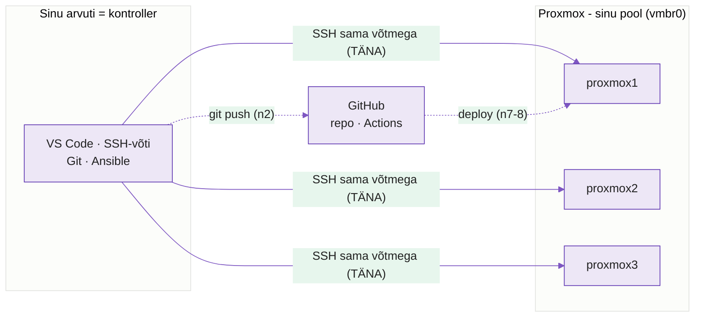

---
tags:
  - Keskkond
  - SSH
  - Ligipääs
  - Praktikum
---

# Praktikum: SSH-ligipääs kolme Proxmoxi masinasse

Täna seadistad töökeskkonna, mida kasutad kogu kursuse jooksul. Sinu arvutist saab ühe SSH-võtmega ilma paroolita sisse logida kolme Proxmoxi masinasse ning Git ja Ansible on sinu arvutis kasutamiseks valmis.

**Edenemine:** laboritahvel <http://192.168.125.187:8091/> (VPN-iga).

??? abstract "Õpiväljundid"
    Praktikumi lõpuks oskad:

    1. selgitada, kuidas SSH-võtmepaar töötab ja miks saab ilma paroolita sisse logida;
    2. kopeerida ühe võtme kõigisse kolme sõlme ja seadistada failis `~/.ssh/config` nimega hostid;
    3. ühenduda ühe käsuga (`ssh proxmox1`) igasse sõlme ilma paroolita;
    4. ühenduda vajaduse korral sõlmega VS Code Remote-SSH abil;
    5. seadistada oma arvutis Ansible'i kontrolleri ja saada moodulilt `ansible.builtin.ping` vastuse `pong` kõigilt kolmelt sõlmelt.

Praktikum on tehtud, kui käsud `ssh proxmox1`, `ssh proxmox2` ja `ssh proxmox3` töötavad ilma serveri parooli küsimata ning käsk `ansible -i inventory.ini all -m ansible.builtin.ping` tagastab kolm korda `pong`.

**Sõlm** on Proxmoxis loodud virtuaalmasin või konteiner. Hüperviisor ise ei ole sõlm. Kolm sõlme on õpetaja juba ette loonud ja need on sinu töö- ja testkeskkond.

<figure markdown="span">

  <figcaption>Joonis 1.1. Sinu arvutist (kontrollerist) ühendutakse sama SSH-võtmega kolme Proxmoxi sõlme. Git ja Ansible asuvad sinu arvutis, sõlmed on SSH-sihtmärgid. Täna lood ühenduse, ülejäänud osad lisanduvad järgmistel nädalatel (Talvik, 2026).</figcaption>
</figure>

Giti repositoorium, Ansible'i failid ja GitHubi ligipääs on sinu arvutis, mis on kursusel **kontroller**. Proxmoxi sõlmedega ainult ühendutakse ja neist ei tehta push'i. Üks ja sama SSH-võti kopeeritakse kõigisse sõlmedesse ning Ansible kasutab sedasama võtit.

Kursuse jooksul lisanduvad sõlmedele uued kihid. Ansible seadistab sõlmed ja paigaldab neile Dockeri (N3–N4), Docker käitab rakendust (N5–N6) ja GitHub Actions juurutab rakenduse (N7–N8). N10–N11 õpid OpenTofuga samasuguseid sõlmi ise kirjeldama ja looma, ning lõpuprojektis (N13) paned kõik osad kokku.

Käskudes on `<kasutaja>` sõlme kasutajanimi ning `<proxmox1-IP>`, `<proxmox2-IP>` ja `<proxmox3-IP>` on sõlmede IP-aadressid, mille annab õpetaja. Asenda need oma väärtustega.

Kõik käsud on Bashi käsud. Windowsis tee kogu praktikum WSL2 Ubuntus, sest osas 7 vajab Ansible Linuxit ([WSL-i paigaldamine](https://learn.microsoft.com/en-us/windows/wsl/install)).

Võta Classroom 50-s ülesanne vastu ja klooni repositoorium. Logid ja inventari teed selle repositooriumi kausta:

```bash
git clone <sinu-repo-URL> lab01     # URL on sinu repositooriumi lehel GitHubis
cd lab01
mkdir -p logid
```

## Osa 1 · Kolm masinat: nimeta ja leia IP-aadress

Õpetaja annab sulle kolm Proxmoxi sõlme, mis on bridged-võrgus ja millest igaühel on oma IP-aadress. Selge hostinimi näitab hiljem igas käsus, millises masinas oled. Logi igasse sõlme sisse Proxmoxi konsoolis, anna sõlmele nimi ja leia selle IP-aadress:

```bash
sudo hostnamectl set-hostname proxmox1   # anna selge nimi (teises proxmox2, kolmandas proxmox3)
ip a                                      # leia IP (nt inet 192.168.35.x), märgi üles
```

Käsu võtmed on kirjas [`hostnamectl` manuaalis](https://man7.org/linux/man-pages/man1/hostnamectl.1.html).

Kui õpetaja nii ütleb, kasuta hostinimes nimede `proxmox1/2/3` asemel oma nime (näiteks `mari-node1`, `mari-node2`, `mari-node3`). Siis on kohe näha, kelle sõlmega on tegu. Sel juhul asenda allpool kõikjal `proxmoxN` oma hostinimega.

## Osa 2 · Loo üks võti kõigi sõlmede jaoks

SSH-võti on paar. **Privaatvõti** jääb sinu arvutisse ega lahku sealt kunagi, **avaliku võtme** paned serverisse. Sisselogimisel saadab server väljakutse, millele saab õigesti vastata ainult vastav privaatvõti. Nii tõestad oma identiteeti privaatvõtmega ja parool üle võrgu ei liigu.

Seepärast on võtmepõhine sisselogimine turvalisem kui parool: parooli saab jõuründega (brute-force) ära arvata, privaatvõtit aga kunagi välja ei saadeta. Võtmepõhise sisselogimise seadistus on kirjas [Ubuntu OpenSSH juhendis](https://documentation.ubuntu.com/server/how-to/security/openssh-server/) ja kõik kliendi võtmed [`ssh` manuaalis](https://man.openbsd.org/ssh).

Sama võtit kasutad kõigi kolme sõlme jaoks, eraldi võtmeid pole vaja. Loo võtmepaar oma arvutis:

```bash
ssh-keygen -t ed25519 -C "eesnimi@kool" -f ~/.ssh/kursus_ed25519   # loo üks võtmepaar
ls -l ~/.ssh/kursus_ed25519 ~/.ssh/kursus_ed25519.pub             # privaat jääb, .pub kopeeritakse sõlmedesse
```

Käsu võtmed on kirjas [`ssh-keygen` manuaalis](https://man.openbsd.org/ssh-keygen).

Võtmele on soovitatav määrata salafraas (passphrase). Kui määrad selle, lisa võti pärast loomist SSH-agenti käsuga `ssh-add ~/.ssh/kursus_ed25519`. Siis ei küsita salafraasi iga kord.

## Osa 3 · Sama sisselogimine kõigisse kolme masinasse

Avalik võti tuleb kopeerida igasse sõlme. Esimesel korral küsib `ssh-copy-id` sõlme kasutaja parooli, edaspidi enam mitte:

```bash
ssh-copy-id -i ~/.ssh/kursus_ed25519.pub <kasutaja>@<proxmox1-IP>   # vii SAMA võti (esmakord parooliga)
ssh-copy-id -i ~/.ssh/kursus_ed25519.pub <kasutaja>@<proxmox2-IP>
ssh-copy-id -i ~/.ssh/kursus_ed25519.pub <kasutaja>@<proxmox3-IP>
```

WSL2 Ubuntus on `ssh-copy-id` olemas. Kui teed SSH-i siiski Windowsi PowerShellis, kus seda käsku ei ole, kopeeri võti juhendi [SSH-võtme lisamine Linuxi serverisse PowerShelli kaudu](ssh-powershell.md) järgi.

IP-aadresse ja kasutajanime ei pea iga kord sisse trükkima, kui anname sõlmedele failis `~/.ssh/config` nimed ([`ssh_config`](https://man.openbsd.org/ssh_config)):

```
Host proxmox1
    HostName <proxmox1-IP>
    User <kasutaja>
    IdentityFile ~/.ssh/kursus_ed25519

Host proxmox2
    HostName <proxmox2-IP>
    User <kasutaja>
    IdentityFile ~/.ssh/kursus_ed25519

Host proxmox3
    HostName <proxmox3-IP>
    User <kasutaja>
    IdentityFile ~/.ssh/kursus_ed25519
```

Logi nüüd igasse sõlme sisse nime kaudu:

```bash
ssh proxmox1    # logi sisse nime kaudu, ilma paroolita (hostname näitab masinat)
ssh proxmox2
ssh proxmox3
```

??? success "Oodatav tulemus"
    Ükski sõlm ei küsi serveri kasutajakonto parooli. Kui määrasid võtmele salafraasi, võib SSH küsida salafraasi. See on normaalne ja `ssh-agent` jätab salafraasi seansi ajaks meelde.

??? warning "Kui `ssh proxmoxN` ei õnnestu"
    Käivita `ssh -vvv proxmox1`, väljund näitab, millises sammus ühendus katkeb.

    | Sümptom | Lahendus |
    |---|---|
    | `Connection refused` | Sõlmes ei tööta SSH-teenus: `sudo systemctl enable --now ssh` |
    | `Permission denied (publickey)` | Käivita `ssh-copy-id` uuesti ja kontrolli sõlmes õigusi: `chmod 700 ~/.ssh`, `chmod 600 ~/.ssh/authorized_keys` |
    | Server keeldub ühendusest, põhjus pole selge | Vaata sõlme konsoolis logi: `sudo journalctl -u sshd -e` |

Tee ekraanipilt, kus on näha kolm `ssh proxmoxN` sisselogimist ja käsu `hostname` väljund ning et parooli ei küsitud. Ekraanipilt läheb esitamisel faili `toend.png`.

## Osa 4 · VS Code Remote-SSH sõlme uurimiseks

Remote-SSH avab VS Code'is sõlme failisüsteemi, nii et saad sõlme faile vaadata ja muuta nagu oma arvutis. Kursuse põhitöö (Git, Ansible) tehakse siiski sinu arvutis. Sammud on pärit [VS Code'i Remote-SSH dokumentatsioonist](https://code.visualstudio.com/docs/remote/ssh):

1. Ava Extensions (`Ctrl+Shift+X`), otsi **Remote - SSH** (Microsoft) ja vajuta **Install**.
2. Vajuta `F1`, vali **Remote-SSH: Connect to Host** ja seejärel `proxmox1`.
3. Akna all vasakus nurgas peab olema roheline `SSH: proxmox1`. Ava kaust menüüst **File → Open Folder**.
4. Ava terminal (`` Ctrl+` ``) ja käivita `hostname`.

??? warning "Kui VS Code jääb ühendumisel kinni"
    Vajuta `F1`, vali **Remote-SSH: Kill VS Code Server on Host** ja ühendu uuesti.

## Osa 5 · Giti seadistamine (sinu arvutis)

Git töötab sinu arvutis, kus on internetiühendus. Sõlmedes Giti ei kasutata, sest need võivad olla ilma internetita. Nimi ja e-post, mille siin seadistad, salvestatakse iga commit'i juurde autori andmetena ([Giti esmane seadistus](https://git-scm.com/book/en/v2/Getting-Started-First-Time-Git-Setup)):

```bash
git --version                                        # kas Git on olemas (Git for Windows)
git config --global user.name  "Ees Perekonnanimi"   # commit'i autori nimi
git config --global user.email "eesnimi@kool"        # commit'i autori e-post
git config --global init.defaultBranch main          # uue repo peaharu = main
git config --global --list                           # kontroll: näita seaded
```

## Osa 6 · Kas sõlmed on automatiseerimiseks valmis?

Alates 3. nädalast ühendub Ansible sinu arvutist nendesse sõlmedesse sama SSH-võtmega. Igas sõlmes peavad olemas olema SSH, Python ja sudo (vaata [Ansible getting started](https://docs.ansible.com/ansible/latest/getting_started/index.html)). Kõigepealt kontrolli, kas sõlm on võrgus kättesaadav ja kas SSH-port on avatud:

```bash
ping -c1 <proxmox1-IP>        # ulatuvus: kas võrk vastab
nc -zv  <proxmox1-IP> 22      # kas SSH-port 22 avatud
```

Käsud `ping` ja `nc` näitavad, kas paketid jõuavad sõlmeni. Käsk `ssh $h hostname` näitab, kas server tunneb sinu võtit. Ansible vajab mõlemat. Kontrolli kõiki kolme sõlme korraga ja salvesta tulemus oma arvutis logifaili:

??? example "Käsk: kolme sõlme kontroll, väljund faili `logid/ansible-valmis.txt`"
    ```bash
    mkdir -p logid                              # kaust logidele (kui pole)
    for h in proxmox1 proxmox2 proxmox3; do
      echo "=== $h ==="
      ssh $h hostname                           # SSH + võti (ligipääs)
      ssh $h python3 --version                  # Python (Ansible vajab)
      ssh $h 'sudo -n true 2>/dev/null && echo "sudo: paroolita OK" || echo "sudo: paroolita ei tööta (õigused või NOPASSWD?)"'
    done | tee logid/ansible-valmis.txt
    ```

Kui sudo küsib parooli, saab sõlme siiski hallata. Sel juhul saab Ansible'ile parooli anda võtmega `--ask-become-pass`.

## Osa 7 · Ansible'i kontrolleri seadistamine (sinu arvutis)

Ansible paigaldatakse ainult kontrollerisse, sõlmedes piisab Pythonist. Windowsis Ansible otse ei tööta, seega kasuta Linuxit või WSL2-te ([Ansible'i paigaldamine](https://docs.ansible.com/ansible/latest/installation_guide/intro_installation.html)):

```bash
sudo apt update && sudo apt install -y ansible   # ainult kontrolleris
ansible --version
```

Ansible peab teadma, milliseid masinaid ta haldab. Masinate nimekiri on inventarifailis `inventory.ini` ([inventar](https://docs.ansible.com/ansible/latest/inventory_guide/intro_inventory.html)). Hostinimed on samad, mis failis `~/.ssh/config`:

```ini
[proxmox]
proxmox1
proxmox2
proxmox3
```

Testi ühendust mooduliga [`ansible.builtin.ping`](https://docs.ansible.com/ansible/latest/collections/ansible/builtin/ping_module.html). Moodul kontrollib SSH-ühendust ja Pythoni olemasolu sõlmes, ICMP-paketti see ei saada:

```bash
mkdir -p logid
ansible -i inventory.ini all -m ansible.builtin.ping | tee logid/ansible-ping.txt
```

??? success "Oodatav tulemus"
    Iga sõlm vastab `"ping": "pong"`. Ansible kasutab sama SSH-ühendust, kasutajanimi (`User`) ja võti võetakse failist `~/.ssh/config`. Nii jõuab kontroller ühe võtmega kõigi sõlmedeni.

??? warning "Kui mõni sõlm ei vasta"
    Lisa käsule võti `-vvv`. Väljundist on näha, kas viga on SSH-ühenduses või Pythonis.

## Osa 8 · Iseseisev ülesanne

Kui keskkond töötab, vali vähemalt kaks ülesannet.

### A. Üks käsk kõigis kolmes sõlmes

Kirjuta üherealine tsükkel, mis käivitab sama käsu kõigis kolmes sõlmes ja salvestab väljundi:

```bash
for h in proxmox1 proxmox2 proxmox3; do echo "=== $h ==="; ssh $h "uptime; df -h /"; done | tee logid/tervis.txt
```

Sama teeb Ansible 3. nädalal. Praegu teed seda käsitsi, et mõista, mida Ansible iga sõlmega teeb.

### B. Turva kõik kolm sõlme

Rakenda [lisaülesande](#lisaulesanded) 2 „Serveri turvamine“ juhised kõigile kolmele sõlmele, nii et parooliga ja root-kasutajana sisse logida ei saa. Tõesta iga sõlme kohta, et parooliga enam sisse ei saa. Testi uut ühendust enne vana seansi sulgemist.

### C. Lisa neljas host

Lisa faili `~/.ssh/config` uus host (näiteks teise pordi või kasutaja jaoks) ja selgita, mida iga rida teeb.

### D. ssh-agent ja ControlMaster

Seadista SSH-agent nii, et salafraasi ei küsitaks. Uuri, mida teeb konfiguratsioonifailis seade `ControlMaster auto` (Linuxis ja macOS-is; Windowsi SSH-klient seda ei toeta).

??? question "Mõtle valitud ülesannete kohta"
    - Mille poolest on tsükkel (A) parem kui sama käsu käsitsi kolm korda käivitamine? Mille poolest on see halvem kui Ansible?
    - Miks on paroolisisselogimise keelamine (B) tootmisserverites tavapärane?
    - Kui pead homme seadistama samamoodi 50 sõlme, mida teeksid teisiti?

## Osa 9 · SSH põhjalikumalt

Kõik katsed saab teha oma kolmes sõlmes ja lisataristut pole vaja. Vali vähemalt üks.

### 9.1 Kuidas SSH kätlus käib

Privaatvõti serverisse ei liigu, aga server peab siiski veenduma, et sul on see võti olemas. Kuidas see käib, on näha ühenduse üksikasjalikust väljundist:

```bash
ssh -vvv proxmox1 exit 2> logid/handshake.txt
grep -iE "kex|host key|server accepts|authenticat|offering|Server host key" logid/handshake.txt
```

Leia väljundist kolm sammu. Esmalt loob **võtmevahetus** (KEX, näiteks curve25519) seansile ühekordse krüptovõtme. Seejärel saadab server oma **hostivõtme** (host key), mida sinu klient kontrollib failist `known_hosts`. Lõpuks tõestab klient, et tal on privaatvõti, allkirjastades sellega seansi andmed, ja võti ise üle võrgu ei liigu. Võtmevahetuse ja autentimise kirjeldus on [`ssh` manuaalis](https://man.openbsd.org/ssh).

??? question "Mõtle"
    Mis kaitseb sinu privaatvõtit isegi siis, kui keegi kogu liiklust pealt kuulab?

### 9.2 known_hosts ja MITM (võltsserver)

Esimesel ühendusel salvestas SSH serveri hostivõtme faili `~/.ssh/known_hosts`. See kaitseb võltsserveri (man-in-the-middle) eest: kui hostivõti muutub, SSH hoiatab ja keeldub ühendumast. Vaata kirjet ja simuleeri seejärel muutust:

```bash
ssh-keygen -F <proxmox1-IP>              # näita proxmox1 host-key kirjet
ssh-keygen -R <proxmox1-IP>              # eemalda kirje (nagu server oleks taasehitatud)
ssh proxmox1                             # SSH küsib host-key uuesti kinnitada
```

??? question "Mõtle"
    Kui saad ühel päeval hoiatuse "REMOTE HOST IDENTIFICATION HAS CHANGED", kuigi serverit ei ole uuesti paigaldatud, mida see võib tähendada?

### 9.3 SSH-tunnel (port forwarding)

SSH-ga saab lisaks sisselogimisele ka teenuseid tunneldada. Käivita masinas proxmox1 lihtne veebiteenus ja ava see oma arvutist tunneli kaudu:

```bash
ssh proxmox1 'python3 -m http.server 8000 &'        # proxmox1-s veebiteenus pordil 8000
ssh -L 9000:localhost:8000 proxmox1                 # local forward: sinu 9000 -> proxmox1 8000
# uues terminalis / brauseris: http://localhost:9000
```

Sinu arvuti port 9000 ühendub krüpteeritud SSH-ühenduse kaudu masina proxmox1 pordiga 8000. Võti `-L` on kirjeldatud [`ssh` manuaalis](https://man.openbsd.org/ssh). Teised variandid on `-R` (remote forward) ja `-D` (dynamic ehk SOCKS-proxy).

??? question "Mõtle"
    Miks on tunnel turvalisem kui teenuse pordi otse internetti avamine?

### 9.4 Hüppemasin (ainult siis, kui klassis on jump-host)

Kui õpetaja ütleb, et klassis on eraldi bastion-masin, proovi **ProxyJump** võimalust ja ühendu selle kaudu sõlme: `ssh -J <jump> proxmox1`. Muul juhul jäta see osa vahele.

??? note "Kontrollnimekiri"
    - [ ] oskad selgitada, kuidas võtmepaar töötab ja miks parooli pole vaja
    - [ ] üks võti on kopeeritud kõigisse sõlmedesse ja `ssh proxmox1/2/3` ühendub ilma paroolita
    - [ ] VS Code Remote-SSH töötab (`hostname` näitab õiget masinat)
    - [ ] `git config --global --list` näitab sinu nime ja e-posti (sinu arvutis)
    - [ ] `ansible -i inventory.ini all -m ansible.builtin.ping` tagastab `pong` kõigilt kolmelt sõlmelt
    - [ ] tegid vähemalt kaks osa 8 ülesannet
    - [ ] tegid vähemalt ühe osa 9 (SSH põhjalikumalt) katse
    - [ ] logid, inventar ja ekraanipilt on sinu repositooriumis (privaatvõtit seal ei ole)

## Töö esitamine

Lisa repositooriumi logid, inventar, ekraanipilt ja README-s lühike vastus küsimusele, kuidas SSH-võtmepaar töötab. Privaatvõtit (`~/.ssh/kursus_ed25519`) ära commit'i, olemasolev `.gitignore` välistab selle.

??? note "Failid repositooriumis"
    - `README.md`: sinu nimi ja lühike vastus küsimusele, kuidas SSH-võtmepaar töötab ja miks saab sisse logida ilma paroolita.
    - `logid/ansible-valmis.txt` ja `logid/ansible-ping.txt`: osade 6 ja 7 väljundid.
    - `inventory.ini`: sinu Ansible'i inventar.
    - `toend.png`: ekraanipilt kolmest `ssh proxmoxN` sisselogimisest ilma paroolita.

```bash
git add .
git commit -m "Lab 01: keskkond valmis, SSH kolme sõlme"
git push
```

Tulemuse näed Classroom 50-s.

## Lisaülesanded

??? example "1 · Kas sõlm jõuab GitHubini?"
    Enne kui eeldad, et sõlmest on GitHubile ligipääs, kontrolli seda. Käivita sõlmes:

    ```bash
    ping -c1 github.com                                       # DNS + ICMP
    nc -zv github.com 443                                     # TCP HTTPS-porti
    git ls-remote https://github.com/<kasutaja>/<repo>.git    # kas git jõuab repo-ni
    ```

    Käsk [`git ls-remote`](https://git-scm.com/docs/git-ls-remote) pärib repositooriumi andmed ilma seda kloonimata. Iga test kontrollib erinevat asja, seega tõlgenda tulemusi eraldi.

    ??? success "Kuidas tulemusi tõlgendada"
        | Test | Mida kontrollib | Kui ebaõnnestub |
        |---|---|---|
        | `ping` | DNS ja ICMP-vastus | ICMP võib olla filtreeritud, seega ainult selle põhjal ei saa järeldada, et internetiühendust pole |
        | `nc ... 443` | TCP-ühendus HTTPS-porti | port võib olla tulemüüri või proxy taga |
        | `git ls-remote` | kas Git jõuab tegelikult repoga ühendust võtta | kõige otsesem tõend |

        Erista kaht veatüüpi. Võrguviga (`Could not resolve host`, timeout) tähendab, et sõlm ei jõua GitHubini. Autentimisviga (401/403) tähendab, et võrk töötab, aga repositooriumile puuduvad õigused.

        Kui sõlm ei jõua GitHubini, tehakse kogu töö Gitiga sinu arvutis (kontrolleris).

??? example "2 · Serveri turvamine"
    !!! warning "Enne muutmist"
        Tee seda ainult pärast õpetaja kinnitust. Ära muuda SSH autentimise reegleid enne, kui õpetaja on kontrollinud, et võtmega sisselogimine töötab ja sul on võimalus ligipääs taastada.

    Kui võtmega sisselogimine töötab, saab parooliga ja root-kasutajana sisselogimise keelata. Lisa serverisse fail `/etc/ssh/sshd_config.d/60-kursus.conf` ([`sshd_config`](https://man.openbsd.org/sshd_config), [Mozilla OpenSSH](https://infosec.mozilla.org/guidelines/openssh)):

    ```
    PasswordAuthentication no
    KbdInteractiveAuthentication no
    PermitRootLogin no
    ```

    Kontrolli konfiguratsioonifaili süntaksit ja taaskäivita SSH-teenus:

    ```bash
    sudo sshd -t && sudo systemctl restart ssh     # kontrolli süntaks enne restart'i
    ```

    Ära sulge töötavat seanssi enne, kui uus võtmega ühendus töötab. Kontrolli ka õigusi: `chmod 700 ~/.ssh`, `chmod 600 ~/.ssh/authorized_keys`.
