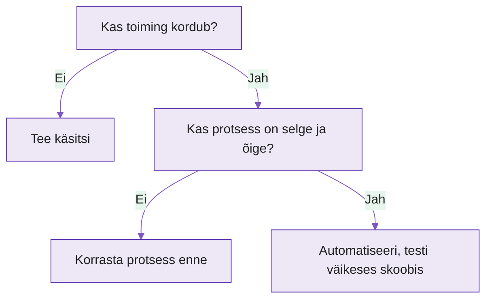
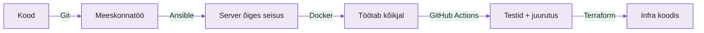

---
tags:
  - Automatiseerimine
  - DevOps
  - Sissejuhatus
---

# Loeng: miks automatiseerida?

*Kuidas käsitsi tehtud IT-töö jäi suurenevale koormusele alla ja mis tuli selle asemele*

??? abstract "Õpiväljundid"
    Tunni lõpuks oskad selgitada järgmist:

    1. mis on automatiseerimine (arvuti teeb korduvat ja selgete reeglitega tööd alati ühtemoodi);
    2. miks käsitsi tehtud töö ei skaleeru;
    3. millal automatiseerida ja millal mitte;
    4. mille poolest erineb käsitsi tehtud töö koodiga tehtud tööst;
    5. mida tähendavad **idempotentsus** ning **deklaratiivne ja imperatiivne** lähenemine;
    6. kuidas Git, Ansible, Docker, CI/CD ja Terraform viivad teenuse arendusest tootmiskeskkonda.

## 1. Näidisstsenaarium

!!! abstract "Miks see oluline on?"
    Iga rakendus jõuab serverisse mingi protsessi kaudu. Kui protsess tehakse käsitsi ja see püsib ainult kellegi mälus, läheb see varem või hiljem katki ja kedagi kutsutakse öösel kell kolm appi.

!!! example "Reede, 23:00"
    Kati on arendaja. Ta kirjutas veebipoele uue makselehe, mis töötab tema sülearvutis veatult. Testid läbivad ja kolleeg on koodi üle vaadanud.

    Kell 23:00 logib süsteemiadministraator Mati serverisse sisse ja kopeerib Kati failid käsitsi tootmisserverisse. Ta teeb seda iga kord veidi erinevalt, sest juhend on ainult tema peas. Seekord unustab ta väsimuse tõttu ühe seadistuse.

    Veebipood lakkab töötamast ja kliendid ei saa maksta. Ainus, kes teab, mis valesti läks, on Mati, kes läks just magama.

Mõtle kolmele küsimusele.

- **Mis läks valesti?** Kood oli korras. Valesti läks **protsess**, ehk viis, kuidas kood serverisse jõuab.
- **Mis sõltus mälust?** Failide kopeerimine, seadistamine ja taaskäivitus olid kõik ainult Mati peas.
- Mida võiks arvuti korrata? Peaaegu kõike. Arvuti ei väsi kell 23:00 ega unusta ühtegi sammu.

Oluline on see, et probleem ei seisne Mati hooletuses. Probleem on **süsteemis**, mis lubas kriitilisel sammul sõltuda ainult ühe väsinud inimese mälust.

!!! quote
    Eesmärk ei ole leida Matit, keda süüdistada. Eesmärk on ehitada süsteem, kus üks unustatud samm ei saa märkamatult tootmiskeskkonda rivist välja viia.

Lähtepunkt on järgmine: käsitsi tehtud töö on ebaühtlane ja aeglane, automatiseeritud ja üle vaadatud protsess on korratav ja turvalisem. Vastutus jääb inimestele, aga automatiseerimise korral on näha, kes mida muutis.

??? question "Kontrolli ennast"
    1. Kati kood töötas tema arvutis. Miks veebipood siiski rivist välja läks?
    2. Nimeta üks samm, mis sõltus ainult Mati mälust.
    3. Miks ei ole „Mati peab olema hoolikam“ hea lahendus?

## 2. Mis käsitsi tehtud töös valesti läheb

!!! abstract "Miks see oluline on?"
    Ühte serverit ja ühte muudatust saab hallata käsitsi. Probleemid tekivad mahu kasvades ja just see on automatiseerimise peamine põhjus.

Ühte serverit ja ühekordset muudatust saab hallata käsitsi. Kui servereid, kasutajaid, muudatusi ja keskkondi lisandub, kasvavad koos nendega ka järgmised probleemid:

- **kordamine:** sama tööd tuleb teha ikka ja jälle;
- **unustamine:** mõni samm jääb tegemata;
- **erinevused:** serverite seadistus hakkab aja jooksul üksteisest erinema;
- **sõltuvus ühest inimesest:** protsess on ühe inimese peas ja kirja panemata;
- **väsimus:** kell 23:00 teeb inimene rohkem vigu.

Käsitöö ei skaleeru sellepärast, et inimene ei suuda sama tegevust sada korda täpselt ühtemoodi korrata. Arvuti suudab. Asi ei ole selles, et inimesed teeksid halba tööd.

??? question "Kontrolli ennast"
    1. Miks saab ühte serverit hallata käsitsi, aga sadat serverit mitte?
    2. Mida tähendab, et serverite seadistus hakkab üksteisest erinema?
    3. Miks on riskantne, kui protsessi tunneb ainult üks inimene?

## 3. Millal automatiseerida ja millal mitte

!!! abstract "Miks see oluline on?"
    Algaja arvab sageli, et kõik tuleb kohe automatiseerida. Kogenud insener oskab hinnata, millal see end ära tasub ja millal mitte.

Automatiseerimiseks sobib hästi töö, mis on:

- korduv;
- piisavalt sage või suure mõjuga;
- selgelt kirjeldatav;
- stabiilse protsessiga;
- kontrollitava tulemusega.

Ühekordset, ebamäärast või pidevalt muutuvat ülesannet ei pruugi olla mõistlik automatiseerida.

!!! warning "Kõige tähtsam reegel"
    Kõigepealt tee protsess korda ja alles siis kirjuta see koodiks. Vastasel juhul kordad sama viga kiiremini ja suuremas mahus.

**Kolme korra reegel** on lihtne rusikareegel: esimesel korral tee töö käsitsi, teisel korral pane tähele, et see kordub, ja kolmandal korral automatiseeri. Arv kolm ei ole range nõue. Mõte on selles, et paari korduse järel on selge, et toiming tuleb ette veel ja selle automatiseerimine tasub ära.

<figure markdown="span">

  <figcaption>Joonis 3.1. Millal tasub automatiseerida (Talvik, 2025).</figcaption>
</figure>

Ole ettevaatlik: vigane protsess jääb vigaseks ka siis, kui see on automatiseeritud. Viga lihtsalt jõuab kiiremini ja korraga sajasse serverisse. Automatiseerimine võimendab olemasolevat protsessi nii heas kui ka halvas.

??? question "Kontrolli ennast"
    1. Nimeta kolm tunnust, mille järgi töö sobib automatiseerimiseks.
    2. Miks tuleb protsess enne automatiseerimist korda teha?
    3. Millal EI tasu automatiseerida?

## 4. Automatiseerimise lühike ajalugu

!!! abstract "Miks see oluline on?"
    Automatiseerimine ei alanud DevOpsi ega tehisintellektiga. Iga uus lähenemine tekkis siis, kui eelmine ei tulnud kasvava mahuga enam toime.

Iga samm tekkis siis, kui eelmine ei tulnud kasvava mahuga toime. Sammud on koos probleemide ja lahendustega tabelis 4.1.

??? info "Tabel 4.1. Automatiseerimise areng"
    | Samm | Milline probleem tekkis? | Milline lahendus tekkis? |
    |---|---|---|
    | Käsitsi administreerimine | Inimene käivitab serveris samu käske | SSH, runbook'id, käsitsi seadistus |
    | Skriptimine | Sama käsku tuleb käivitada kümnetes kohtades | Bash, PowerShell, cron |
    | Konfiguratsioonihaldus | Serverite seadistus hakkab üksteisest erinema | Puppet, Chef, Ansible |
    | DevOps ja CI/CD | Töö üleandmine arendusest käitusse on aeglane ja riskantne | Git, automaattestid, pipeline'id, automaatne juurutus |
    | IaC ja pilv | Taristu luuakse pilvekonsoolis käsitsi ja keegi ei tea, mida muudeti | Terraform, CloudFormation, versioonihaldus |
    | GitOps ja platvormid | Paljud tiimid teevad sama taristu- ja juurutustööd korduvalt | Git kui soovitud seisu allikas, „golden path“ |
    | AIOps | Logisid ja häireid on inimese jaoks liiga palju | Anomaaliate tuvastus, sündmuste seostamine, automaatne esmane analüüs |

    *Tabel 4.1. Automatiseerimise areng.*

!!! quote
    Uus tehnoloogia ei kaota vana. Ansible ei asenda SSH-d, Terraform ei kaota vajadust võrke tunda ja CI/CD ei võta ära vastutust testimise eest. Automatiseerimine tugineb põhiteadmistele ja võimaldab neid rakendada suuremas mahus.

??? question "Kontrolli ennast"
    1. Miks tekkis iga uus automatiseerimise lähenemine?
    2. Kas Ansible asendab SSH? Selgita.
    3. Millise probleemi lahendas konfiguratsioonihaldus?

## 5. Sama töö käsitsi ja Ansible'iga

!!! abstract "Miks see oluline on?"
    See on loengu tehniline keskpunkt. Erinevus on kõige selgemini näha, kui sama ülesannet tehakse kahel viisil.

Ülesanne: paigalda kolmele serverile nginx ja käivita see.

**Käsitsi (imperatiivne, ei skaleeru):**

```bash
ssh server1
sudo apt update && sudo apt install -y nginx
sudo systemctl enable --now nginx
exit
# server2 - sama uuesti
# server3 - sama uuesti
```

Selle lähenemise probleemid: sama tööd tuleb korrata, kuskil võib tekkida viga, mõni server võib meelest minna ja hiljem ei tea keegi, millises seisus iga masin on.

**Koodiga (deklaratiivne, skaleerub):**

??? example "Fail `veebiserver.yml`"
    ```yaml
    - name: Veebiserver kõigis masinates
      hosts: koik_serverid
      become: true
      tasks:
        - name: nginx on paigaldatud
          ansible.builtin.apt:
            name: nginx
            state: present
            update_cache: true
        - name: nginx tootab ja kaivitub buutimisel
          ansible.builtin.service:
            name: nginx
            state: started
            enabled: true
    ```

Erinevused on koondatud tabelisse 5.1.

??? note "Tabel 5.1. Käsitsi ja koodiga tehtud töö võrdlus"
    | Käsitsi | Koodiga |
    |---|---|
    | Inimene teeb samme iga serveri jaoks eraldi | Üks kirjeldus rakendub kõigile serveritele |
    | Tulemus võib serveriti erineda | Soovitud seis on kõigis serverites sama |
    | Teadmine on inimese peas | Teadmine on failis ja Giti ajaloos |
    | Vea leidmine sõltub mälust | Muudatusi saab üle vaadata ja võrrelda |
    | Kordamine tähendab uut käsitööd | Sama konfiguratsiooni saab uuesti käivitada |

Sama fail sobib nii kolme kui ka kolmesaja serveri jaoks, muuta tuleb ainult inventari. Sellepärast õpitakse kursusel Giti, Ansible'it, Dockerit, CI/CD-d ja Terraformi.

??? question "Kontrolli ennast"
    1. Nimeta käsitsi tehtud versiooni kolm probleemi.
    2. Mis muutub, kui serverite arv kasvab 3-lt 300-ni?
    3. Kus asub teadmine koodiga tehtud versioonis?

## 6. Idempotentsus

!!! abstract "Miks see oluline on?"
    Idempotentsus on automatiseerimise keskne mõiste. Kui automaatika käivitatakse uuesti, ei tohi see süsteemi iga korraga üha rohkem muuta ega seda rikkuda.

```bash
echo "x" >> fail    # EI ole idempotentne: iga käivitus lisab rea
echo "x" > fail     # ON idempotentne: iga käivitus annab sama tulemuse
```

Esimene käsk lisab igal käivitusel faili uue rea, teine kirjutab faili sisu üle. Hea automaatika on idempotentne: kui käivitad seda kümme korda, on süsteemi seis ikka sama ja midagi ei lähe katki.

Ansible on üles ehitatud just sellele põhimõttele. Näiteks kirjeldatakse, et teenus **peab olema** käivitatud: kui teenus juba töötab, ei tee Ansible midagi, ja kui ei tööta, käivitab Ansible selle. Nii on idempotentsus otseselt seotud **soovitud seisundi** ideega.

??? question "Kontrolli ennast"
    1. Mida tähendab idempotentne?
    2. Miks `echo >>` ei ole idempotentne, aga `echo >` on?
    3. Miks võib Ansible'i playbook'i julgelt uuesti käivitada?

## 7. Deklaratiivne ja imperatiivne lähenemine

!!! abstract "Miks see oluline on?"
    See selgitab, miks konfiguratsioonihaldus ja IaC ei ole lihtsalt „palju käske ühes failis“. See on otsene üleminek Bashilt Ansible'ile.

- **Imperatiivne:** „tee need sammud selles järjekorras“ (näiteks Bashi skript).
- **Deklaratiivne:** „süsteem peab olema sellises lõppseisus“ (näiteks Ansible, Terraform, Docker Compose).

Deklaratiivne kirjeldus ütleb, *mis peab olema*, ja ei ütle, *kuidas seda teha*. Tööriist otsustab sammud ise ning jätab vahele selle, mis on juba õiges seisus.

!!! note "Täpsustus edaspidiseks"
    Ansible'i playbook on üldiselt deklaratiivne ja enamik mooduleid on idempotentsed, kuid moodulid `command` ja `shell` käivitavad lihtsalt antud käsu ning võivad olla imperatiivsed. Seega on väide „Ansible on alati deklaratiivne“ lihtsustus.

??? question "Kontrolli ennast"
    1. Mille poolest erinevad imperatiivne ja deklaratiivne lähenemine?
    2. Miks on deklaratiivne lähenemine korduval käivitamisel turvalisem?
    3. Nimeta üks deklaratiivne tööriist, mida kursusel kasutatakse.

## 8. DevOps kui põhimõte

!!! abstract "Miks see oluline on?"
    Automatiseerimine ei lahenda ainult tehnilist probleemi. Kui arendaja kirjutab koodi ja käitusmeeskond haldab teenust, peab tarneahel olema ühine, nähtav ja tagasisidega.

Lühidalt:

- enne DevOpsi töötasid arendus (**Dev**) ja käitus (**Ops**) sageli teineteisest eraldi;
- arendus soovis muudatusi kiiresti välja anda, käitus soovis stabiilsust;
- kui arendus andis valmis koodi lihtsalt käitusele üle („viskas üle müüri“), olid väljalasked aeglased ja riskantsed ning vigade korral otsiti süüdlast;
- DevOps ühendab koostöö, jagatud vastutuse, automatiseerimise, mõõtmise ja teadmiste jagamise;
- DevOps **ei ole** üks tööriist, eraldi tiim ega ametinimetus.

!!! quote
    Hea automatiseerimine vajab lisaks uuele tööriistale ka inimesi, toimivat koostööd, mõõtmist ja jagatud teadmisi.

*DevOpsi päritolu, CAMS-mudelit, SRE-d, platvormi-inseneeriat ja teisi Ops-valdkondi käsitleb allpool olev jaotis **Taust ja edasijõudnutele**.*

??? question "Kontrolli ennast"
    1. Mis oli probleem, kui arendus „viskas koodi üle müüri“?
    2. Mida pakub DevOps selle asemel?
    3. Miks ei ole DevOps üks tööriist?

## 9. Infrastruktuur koodina ja kursuse tööriistaahel

!!! abstract "Miks see oluline on?"
    IaC on kursuse üks kesksemaid ideid ja tööriistaahel näitab, kuidas eri tööriistad omavahel seotud on.

**Infrastruktuur koodina (IaC)** tähendab, et serverid, võrgud ja õigused kirjeldatakse failides, mida saab hoida versioonihalduses, üle vaadata ja automaatselt rakendada.

!!! quote
    Selle asemel et teha server pilvekonsoolis kümne nupuvajutusega, kirjeldatakse server, võrk ja õigused koodina. Kood vaadatakse üle ja automaatika loob taristu iga kord ühtemoodi.

IaC ning automatiseeritud ja üle vaadatud juurutus oleksid Kati ja Mati vea tõenäosust tunduvalt vähendanud. Ka automaatikas võib olla vigu, kuid siis on viga nähtav ja korratav ega ole peidus ühe inimese mälus.

Kursuse tööriistad moodustavad ühe tarneahela:

<figure markdown="span">

  <figcaption>Joonis 9.1. Kursuse tööriistad ühe tarneahela osadena (Talvik, 2025).</figcaption>
</figure>

??? note "Tabel 9.1. Kursuse tööriistad ja nädalad"
    | Tööriist | Millist käsitöö probleemi lahendab | Kursuses |
    |---|---|---|
    | Git | Kes muutis, mida ja millal | Nädal 2 |
    | Ansible | Sama seadistus paljudes masinates | Nädal 3-4 |
    | Docker | Rakendus käivitub igal pool ühtemoodi („minu arvutis töötas“) | Nädal 5-6 |
    | GitHub Actions | Testimine ja juurutus ei sõltu kellegi õhtusest käsitööst | Nädal 7-8 |
    | Terraform | Ka infrastruktuur on kirjeldatud, üle vaadatud ja korratav | Nädal 10-11 |

13. nädalal ehitad kogu ahela ise.

??? question "Kontrolli ennast"
    1. Mida tähendab IaC? Selgita ühe lausega.
    2. Millise probleemi lahendab Git ja millal seda kursusel õpitakse?
    3. Miks moodustavad tööriistad ühe ahela ega ole üksteisest sõltumatud?

## 10. Kokkuvõte

??? abstract "Kokkuvõte"
    | Mõiste | Selgitus |
    |---|---|
    | **Automatiseerimine** | Arvuti teeb korduvat tööd reeglite järgi ja alati ühtemoodi |
    | **Miks käsitöö ei skaleeru** | Kordamine, unustamine, erinevused, sõltuvus ühest inimesest, väsimus |
    | **Kolme korra reegel** | Kui toiming on paar korda kordunud, tasub see automatiseerida |
    | **Automatiseeritud viga** | Viga levib kiiremini ja suuremas mahus, seega tuleb protsess enne korda teha |
    | **Idempotentsus** | Sama toiming mitu korda järjest annab sama tulemuse |
    | **Deklaratiivne** | Kirjeldatakse lõppseisundit, mitte samme |
    | **DevOps** | Ühine, nähtav ja tagasisidega tarneahel; pigem töökultuur kui tööriist |
    | **IaC** | Infrastruktuur koodina |

??? question "Lõplik kontroll: kolm põhiküsimust"
    1. Miks käsitsi tehtud IT-töö ei skaleeru?
    2. Miks automatiseerimine ei ole lihtsalt „kiirem käsitöö“?
    3. Kuidas viivad Git, Ansible, Docker ja CI/CD teenuse arendusest tootmiskeskkonda?

## 11. Enne praktikumi

Loeng selgitas, miks automatiseerida. Praktikumis õpid, kuidas seda teha. Täna seadistad töökeskkonna, mis on ahela **esimene osa**: SSH-võti, nimega hostid failis `~/.ssh/config`, VS Code Remote-SSH, Git ja Ansible'i kontroller.

See võib tunduda väikese tehnilise detailina, kuid see on eeldus, et sama tegevust saaks hiljem korrata kümnetes serverites. Kui töökeskkond täna ei tööta, ei saa ka ülejäänud kursuse töid teha.

*Nüüd võid alustada [praktikumiga](lab.md). Töökeskkond on ahela esimene osa ja kõik järgmised nädalad tuginevad sellele.*

## Taust ja edasijõudnutele

Need teemad süvendavad loengut ega kuulu esimese tunni põhiosa juurde. Neist on lihtsam aru saada pärast seda, kui juurutus, pipeline, konfiguratsioon ja monitooring on tuttavad.

??? info "DevOpsi päritolu"
    DevOps on suhteliselt noor valdkond. Enne 2008. aastat olid arendus ja käitus selgelt teineteisest eraldatud. Arendus (**Dev**) soovis uusi funktsioone kiiresti välja anda, käitus (**Ops**) soovis stabiilsust. Arendaja andis koodi käitusele üle („viskas üle müüri“) ja rikke korral otsiti süüdlast.

    | Aasta | Mis juhtus |
    |---|---|
    | 2008 | Andrew Shafer kutsub Toronto Agile-konverentsil kokku „Agile Infrastructure“ sessiooni; kohale tuleb ainult üks inimene, Patrick Debois |
    | 2009 | Allspaw ja Hammond esinevad Velocity konverentsil ettekandega „10+ deploys a day“ Flickri kogemusest |
    | 2009 okt | Debois korraldab Gentis esimese DevOpsDays konverentsi; Twitteris tekib silt #DevOps |
    | 2010- | DevOpsDays konverentsid levivad, ilmub Jez Humble'i raamat „Continuous Delivery“, suurettevõtted võtavad DevOpsi põhimõtted kasutusele |

    *Tabel. DevOpsi algus (Devopedia, 2022).*

    Google'i [SRE raamatutes](https://sre.google/books/) nimetatakse korduvat käsitööd sõnaga **toil** (rutiinitöö). See on käsitsi tehtav, korduv ja automatiseeritav töö, mis ei loo püsivat väärtust ja mille hulk kasvab koos teenusega.

    DevOpsi algusest räägivad videod [History of DevOps](https://www.youtube.com/watch?v=o7-IuYS0iSE) (Damon Edwards) ja [The Origins of DevOps](https://www.youtube.com/watch?v=4ROs_A6Vj9o) (Cisco). Olulisemad sündmused on koondatud lehele [Devopedia: DevOps milestones](https://devopedia.org/devops#milestones).

??? info "Kaks vaadet veale (blameless)"
    **Vana vaate (blame)** järgi tegi vea inimene ja tuleb leida süüdlane. **Uue vaate (blameless)** järgi on viga sümptom: süsteem lubas sellel juhtuda. Küsimuse „kes?“ asemel küsitakse: „Miks tundus see tegevus tol hetkel mõistlik ja mis süsteemis lasi veal suureks kasvada?“ Inimeste hoolikus ei skaleeru. Selline mõtteviisi muutus on DevOpsi üks alustalasid (Davis & Daniels, 2016).

??? info "Mis DevOps EI ole (müüdid)"
    | Müüt | Miks see ei pea paika |
    |---|---|
    | **ametinimetus** („DevOps engineer“) | Nimetus tähistab liikumist; „arendaja ja süsteemiadministraator ühe palga eest“ ei skaleeru |
    | **eraldi tiim** | Uus „DevOpsi tiim“ tekitab kahe eraldatud tiimi kõrvale kolmanda |
    | **tööriistad** | Tööriistad aitavad põhimõtteid rakendada, kuid ei defineeri DevOpsi |
    | **automatiseerimine** | Automatiseerimine on tulemus; ilma koostöökultuurita tehakse vigu lihtsalt kiiremini |
    | **üks õige viis** | Teise ettevõtte praktikate pime kopeerimine tekitab taas eraldatud tiime |
    | **poole vähem inimesi sama töö jaoks** | DevOpsi eesmärk on kvaliteet ja kiirus. Palgakulu see ei vähenda |

    *Tabel. DevOpsi müüdid (Davis & Daniels, 2016).*

??? info "Mis DevOps siis on (CAMS ja kokkulepe)"
    **CAMS** tähendab Culture, Automation, Measurement, Sharing (kultuur, automatiseerimine, mõõtmine, jagamine). Kultuur on tööriistadest tähtsam.

    DevOpsi aluseks on meeskondadevaheline **kokkulepe** (compact): ühine eesmärk, pidev suhtlus ja jooksev parendamine. Davis ja Daniels kasutavad selle selgitamiseks kaljuronimise näidet. Ronija ronib ja julgestaja hoiab köit. Enne ronimist kontrollivad mõlemad sõlmi ja nad kasutavad kokkulepitud märguandeid („on belay?“, „belay on“).

    !!! note "Folk model"
        DevOps on mõiste, mida eri inimesed kasutavad eri tähenduses, ja definitsiooni üle vaieldakse sageli rohkem kui ideede üle. Seetõttu tasub küsida: „Millist probleemi me lahendame?“

??? info "DevOpsi tsükkel"
    Tsükkel koosneb etappidest plan → code → build → test → release → deploy → operate → monitor, misjärel algab see uuesti. Kõige tähtsam osa on **tagasiside**: info rikete kohta jõuab tagasi planeerimisse. Seetõttu on tegemist tsükliga ja protsess ei lõpe juurutamisega.

??? info "Ops-valdkonnad"
    DevOpsi ideed on levinud ka teistesse valdkondadesse. Tabelis on [LiveActioni jaotus](https://www.liveaction.com/resources/solution-briefs/netops-devops-secops-aiopswho-does-what-and-why/):

    | Rühm | Nimi | Fookus |
    |---|---|---|
    | Algne | ITOps | Taristu, monitooring, juurutus |
    | Algne | DevOps | Arendus ja käitus CI/CD tsüklis |
    | Algne | NetOps | Võrgu seisund, automatiseerimine |
    | Algne | SecOps | Riskide vähendamine kogu organisatsioonis |
    | Uus | CloudOps | Pilveressursside loomine ja optimeerimine |
    | Uus | EdgeOps | Servavõrgud, kaugharukontorid |
    | Uus | AIOps | Suurandmed ja masinõpe käituse jaoks |
    | Uus | NoOps | Arendaja haldab ise kõike, eraldi käitust pole (ei ole laialt levinud) |
    | Hübriid | DevSecOps | Turvalisus arenduses algusest peale |
    | Hübriid | NetSecOps | Võrguturbe automaatne testimine |
    | Hübriid | NetDevOps | Automatiseerimine ja jälgitavus (observability) võrgus |

    *Tabel (LiveAction, 2022).*

    !!! warning "Iga uus Ops ei tohi muutuda eraldi tiimiks"
        Liide `-Ops` ei tähenda automaatselt uut ametit, tiimi ega tööriista. Tavaliselt tähendab see, et samu põhimõtteid (koostöö, automatiseerimine, mõõtmine, tagasiside) rakendatakse teises valdkonnas.

    DevSecOps ei ole DevOpsi järgmine versioon. See tähendab DevOpsi põhimõtete rakendamist turvalisusele: turvalisus on tarneahela osa algusest peale ega ole ainult kontroll lõpus. Näiteks skannitakse pipeline'is sõltuvusi ja otsitakse koodi sattunud salasõnu (secret'eid).

??? info "DevOps, SRE ja platvormi-inseneeria"
    | Distsipliin | Mis see on | Põhimõisted |
    |---|---|---|
    | DevOps | Kultuur ja põhimõtted | CAMS, CI/CD |
    | SRE | Google'ist alguse saanud mõõdetav rakendusviis | SLI/SLO, veaeelarve, toil |
    | Platvormi-inseneeria | Viis põhimõtteid suures organisatsioonis rakendada | Iseteenindusplatvorm, kuldsed teed |

    **SRE** on üks mõjukas Google'ist alguse saanud viis, kuidas DevOpsi põhimõtteid töökindluse tagamisel praktikas rakendada. See ei ole ainus viis.

    **Platvormi-inseneeria** puhul ehitab platvormitiim iseteenindusplatvormi koos kuldsete teedega (golden path), et vähendada tootetiimide kognitiivset koormust (Team Topologies, 2019). Platvormitiim hoolitseb ühise taristu eest ja tootetiimid kasutavad seda oma teenuste arendamiseks ja juurutamiseks.

??? info "SRE täpsemalt: SLI, SLO ja veaeelarve"
    - **SLI** on mõõdik, näiteks kui suur osa päringutest õnnestus.
    - **SLO** on eesmärk, näiteks 99,9% päringutest õnnestub.
    - **Veaeelarve** on 100% ja SLO vahe ehk lubatud ebaõnnestumiste osa.

    !!! example "Näidisarvutus"
        SLO on 99,9% kuus. Kui kaua tohib teenus kuu jooksul maas olla?
        Kuus on umbes 30 päeva ehk 43 200 minutit. Veaeelarve = 0,1% × 43 200 = umbes 43 minutit kuus.
        Kui veaeelarve on ära kasutatud, peatatakse uute funktsioonide väljalase ja tiim tegeleb stabiilsusega. Võrdluseks: 99% korral on veaeelarve umbes 7,2 tundi kuus, 99,99% korral umbes 4,3 minutit. Iga lisanduv üheksa muudab nõude kümme korda rangemaks ja kallimaks.

??? info "AIOps, MLOps ja agentne AIOps"
    **AIOps** (AI for IT Operations) tähendab masinõppe rakendamist käituse andmetele. Lahendatav probleem on **häireväsimus**: kui häireid on liiga palju, jääb kõige olulisem neist teiste vahele ja rikke lahendamine võtab kauem aega (MTTR kasvab). AIOpsil on kolm etappi: andmete kogumine ja puhastamine, masinõpe ja analüüs (anomaaliad, algpõhjuse analüüs ehk RCA) ning automaatne reageerimine ([Red Hat: What is AIOps](https://www.redhat.com/en/topics/ai/what-is-aiops)).

    MLOps on midagi muud. MLOps tegeleb masinõppemudelite elutsükli haldamisega ja selle kasutajad on andmeteadlased. Lühidalt: MLOps hooldab mudelit, AIOps kasutab mudelit käituse jaoks.

    **Agentne AIOps** tähendab, et tarkvaraagent tegutseb iseseisvalt kindlaksmääratud piirides. Kallid või tagasipööramatud otsused jäävad inimese teha ([LogicMonitor: AIOps, DevOps, MLOps ja agentne AIOps](https://www.logicmonitor.com/blog/aiops-devops-mlops-and-agentic-aiops)).

    !!! note "Täpsustus"
        Need ei ole järjestikused küpsusastmed. Tegemist on paralleelsete lähenemistega.

??? info "Automatiseerimine ei lahenda kõike"
    Automatiseerimine ilma protsessi mõistmata suurendab riski. Käsitsi tehtud viga mõjutab ühte serverit, automatiseeritud viga mõjutab kõiki servereid korraga.

    !!! warning "Õppetund lennundusest"
        2013. aastal tabas Asiana Airlinesi lend 214 San Francisco lennujaamas maandumisel kaldakindlustust. Üks põhjus oli see, et piloodid usaldasid automaatikat, mille tööd nad täielikult ei mõistnud. James Reason on kirjeldanud, et automaatika loojad tekitasid tahtmatult uusi ja tõsisemaid veatüüpe. Automatiseeri alles siis, kui mõistad protsessi. Vaata ka [XKCD 1205](https://xkcd.com/1205).

??? info "Rike kui õppimise võimalus: postmortem"
    Blameless-kultuuris ei ole algpõhjuse analüüsi (RCA) eesmärk süüdlase leidmine. „Inimlik viga“ on uurimise **algus**, mitte lõpp.

    - **5 korda miks (5 Whys):** *Veebipood lakkas töötamast. Miks? Seadistus oli vale. Miks? Mati unustas ühe sammu. Miks? Samm oli ainult tema peas ja kirja panemata. Miks? Juurutus tehti käsitsi. Miks? Automaatset juurutust ei olnud.* Seega on vastus „automaatset juurutust ei olnud“ ja Mati ei ole algpõhjus.
    - **Ishikawa diagramm (kalaluu):** põhjused rühmitatakse kategooriatesse (inimesed, protsess, tööriistad, keskkond).

??? info "DORA"
    [DORA](https://dora.dev/) mõõdikuid on neli: juurutamise sagedus, muudatuse tarneaeg, muudatuste tõrkemäär ja taastumisaeg. Meeskonnad, kes on oma töö automatiseerinud, saavutavad üldjuhul kõigis neljas paremaid tulemusi.

    !!! warning "Tähtis"
        DORA mõõdikud on mõeldud arutelu toetamiseks ja süsteemi parandamiseks ning neid ei kasutata töötajate hindamiseks. Mõõdikud näitavad, kus protsess takerdub, ja ei näita, kes on „halb“ töötaja.

??? abstract "Sõnastik"
    - **Agentne AIOps:** AIOps, kus tarkvaraagent tegutseb iseseisvalt kindlaksmääratud piirides.
    - **AIOps:** masinõppe rakendamine käituse andmetele; anomaaliate tuvastus, automaatne reageerimine.
    - **Ansible:** deklaratiivne konfiguratsioonihalduse tööriist, mis töötab üle SSH.
    - **Blameless:** töökultuur, kus rikke järel uuritakse süsteemi ega otsita süüdlast.
    - **CAMS:** Culture, Automation, Measurement, Sharing.
    - **CI/CD:** koodi automaatne testimine (CI) ja juurutamine (CD).
    - **Deklaratiivne:** kirjeldatakse soovitud lõppseisundit.
    - **Deploy (juurutus):** koodi viimine serverisse.
    - **DevOps:** töökultuur ja põhimõtted, mis ühendavad arenduse ja käituse.
    - **DevSecOps:** turvalisuse lõimimine tarneahelasse algusest peale.
    - **DORA:** neli mõõdikut tarneprotsessi seisundi hindamiseks.
    - **Docker:** tööriist rakenduse pakendamiseks konteinerisse.
    - **Git:** versioonihaldussüsteem, mis hoiab muudatuste ajalugu.
    - **Idempotentsus:** toimingu korduval käivitamisel on tulemus sama.
    - **Imperatiivne:** kirjeldatakse samme ehk seda, kuidas tulemuseni jõuda.
    - **IaC:** infrastruktuur koodina.
    - **Kokkulepe (compact):** tiimide kokkulepe ühise eesmärgi, suhtluse ja parendamise kohta.
    - **MLOps:** masinõppemudelite elutsükli haldamine.
    - **MTTR:** keskmine aeg rikke lahendamiseks.
    - **NetOps:** DevOpsi põhimõtete rakendamine võrguhalduses.
    - **Platvormi-inseneeria:** iseteenindusplatvormi loomine tootetiimide koormuse vähendamiseks.
    - **Postmortem:** rikke järelanalüüs, mille eesmärk on õppimine.
    - **SecOps:** turvalisuse lõimimine käitusse ja arendusse.
    - **SLI / SLO:** mõõdik ja eesmärk.
    - **SRE:** Google'ist alguse saanud töökindluse inseneeria.
    - **Terraform:** deklaratiivne IaC tööriist.
    - **Toil:** korduv käsitsi tehtav töö, mis ei loo püsivat väärtust.
    - **Veaeelarve:** lubatud ebaõnnestumiste osa, 100% ja SLO vahe.
