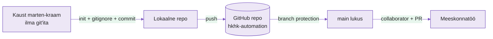

---
tags:
  - Git
  - Versioonihaldus
  - Meeskonnatöö
  - GitHub
  - Praktikum
---

# Praktikum: versioonihalduseta kaustast meeskonnatööni

Täna teed versioonihaldusest väljas olnud monitooringufailidest kaitstud `main`-haruga GitHubi repositooriumi ja parandad skripti `monitor.sh` pull request'i kaudu. Repositoorium on sinu arvutis ja töö käib VS Code'is. Skripti käivitad sihtmärgil, milleks sobib mõni [töökeskkonna](../kodulabor.md) masin, kuhu pääsed SSH-ga.

**Edenemine:** laboritahvel <http://192.168.125.187:8091/> (VPN-iga).

??? abstract "Õpiväljundid"
    Praktikumi lõpuks oskad:

    1. luua repositooriumi algusest peale ja selgitada, miks repositoorium on kaust `.git/` sinu masinas ja GitHub on selle koopia;
    2. vältida `.gitignore`-i abil saladuse lisamist versioonihaldusse enne esimest push'i;
    3. kaitsta `main`-haru ja kontrollida, et reegel kehtib ka sinu enda kohta;
    4. leida skripti käivitades nelja vea põhjused. Iga viga annab eri tüüpi signaali (veateade, vaikne tõrge, õiguste viga, kaudne kontroll);
    5. lahendada liitmiskonflikti ja selgitada, miks Git ei vali versiooni sinu eest.

Õpetaja jagatud kaustas `marten-kraam` on paar skripti, `.env` fail andmebaasi parooliga ja monitooringu skript `monitor.sh`, mis kommentaari järgi "peaks töötama". Giti ajalugu kaustal ei ole. Skriptis on neli viga, mis tulevad välja skripti käivitades ükshaaval, ja igaüks neist annab endast märku erineval viisil.

## Osa 1 · Failid versioonihaldusse

Kausta `marten-kraam` failid ei ole kunagi olnud versioonihalduses. Esimene samm on teha neist repositoorium.

<figure markdown="span">

  <figcaption>Joonis 2.1. Praktikumi käik: versioonihalduseta kaustast kaitstud meeskonnaprojektini (Talvik, 2025).</figcaption>
</figure>

### 1.1 Loo GitHubis tühi repo

Ava organisatsioon `github.com/hkhk-automation` ja vajuta **New repository**. Seaded:

- nimi `marten-monitor-<sinu-eesnimi>`;
- nähtavus **Private**;
- README-faili, `.gitignore`-i ega litsentsi ära lisa.

Kui need lisada, teeb GitHub esimese commit'i sinu eest ja sa ei näe, kuidas repositoorium algusest peale luuakse. GitHub näitab pärast loomist juhiseid. Järgmised sammud teevad sama, aga ükshaaval ja koos selgitusega.

### 1.2 Seo kaust repositooriumiga

Ava kaust VS Code'is (`code marten-kraam`) ja ava terminal. Käsk `git init` teeb kaustast Giti repositooriumi:

```bash
git init
git branch -M main
```

See lõi kausta `.git/`. See kaust ongi repositoorium ja GitHubis on selle koopia. Seo need kaks omavahel:

```bash
git remote add origin git@github.com:hkhk-automation/marten-monitor-<sinu-eesnimi>.git
git remote -v
```

??? question "Mõtle"
    Kui kustutaksid kausta `.git/` (`rm -rf .git/`), mis kaob ja mis jääb alles?

    ??? success "Vastus"
        Failid jäävad. Ajalugu ja harud kaovad ning Git ei jälgi kausta enam.

## Osa 2 · `.gitignore` enne, kui `.env` lekib

Kaustas on `.env` fail, milles on andmebaasi parool. See fail ei tohi GitHubi jõuda.

Avalikku repositooriumi saadetud parool leitakse väga kiiresti, sest uusi avalikke commit'e skannitakse automaatselt just selliste andmete leidmiseks. Parooli eemaldamine Giti ajaloost tagantjärele on keeruline. Lihtsam on hoida see repositooriumi jõudmast.

Vaata, mida Git praegu näeb:

```bash
git status
```

`.env` on nimekirjas. Loo enne commit'i fail `.gitignore` ([mustrite süntaks](https://git-scm.com/docs/gitignore)):

```
# Saladused
.env
*.key

# Logifailid
*.log

# macOS-i abifailid
.DS_Store
```

Kontrolli uuesti, mida Git näeb:

```bash
git status
```

`.env` on nimekirjast kadunud. Fail on kaustas alles, kuid Git ei jälgi seda enam.

!!! warning "Kui `.env` on juba GitHubis"
    `.gitignore` takistab ainult jälgimata failide lisamist ega eemalda faili, mis on juba GitHubi saadetud. Kui parool on korra GitHubis olnud, loe see lekkinuks ja vaheta parool välja. Seejärel eemalda fail jälgimisest käsuga `git rm --cached .env` ja tee commit.

??? question "Mõtle"
    Miks peab `.gitignore` ise olema Gitis (commititud), aga `.env` mitte? Mõlemad on samas kaustas asuvad failid. Mis neid põhimõtteliselt eristab?

## Osa 3 · Esimene commit

Lisa fail `README.md`, et iga lugeja teaks, mis projektiga on tegu. Piisab paarist reast: mis projekt see on, kes on autor ja mida `monitor.sh` peaks tegema.

Salvesta failid esimesse commit'i ja saada need GitHubi:

```bash
git add .
git status
git commit -m "init: monitooringu failid versioonihaldusse"
git push -u origin main
```

??? warning "Kui `git push` annab `Permission denied`"
    Käivita `ssh -T git@github.com` ja kontrolli, kas 1. nädala SSH-võti on GitHubis ja töötab.

Commit-sõnum kirjeldab muudatust. Sõnum `asjad` ei ütle lugejale midagi. Vaata ajalugu terminalis:

```bash
git log --oneline
```

??? success "Oodatav tulemus"
    Ajaloos on üks commit. GitHubis on failid olemas ja `.env` faili seal ei ole.

??? question "Mõtle"
    Miks pidi enne `main`-haru kaitsmist olema vähemalt üks commit? Mida GitHub kaitseks, kui `main`-haru veel ei olegi?

## Osa 4 · Kaitse `main`-haru ja kontrolli reeglit

Praegu saab igaüks, ka sina ise, teha push'i otse `main`-i ilma, et keegi muudatust üle vaataks. Haru kaitse lubab `main`-i muuta ainult pull request'i kaudu.

Ava GitHubis **Settings → Branches → Add classic branch protection rule**. Seaded on kirjeldatud GitHubi juhendis [About protected branches](https://docs.github.com/en/repositories/configuring-branches-and-merges-in-your-repository/managing-protected-branches).

- **Branch name pattern**: `main`;
- **Require a pull request before merging**: sisse;
- **Require approvals: 1**: sisse;
- **Do not allow bypassing the above settings**: sisse. Ilma selleta ei kehti reegel repositooriumi administraatorile, ka sinule. Õpetaja saab organisatsiooni omanikuna reeglit vajaduse korral muuta.

Salvesta. Kontrolli reeglit ja proovi teadlikult teha push otse `main`-i:

```bash
echo "test" >> README.md
git add README.md
git commit -m "test: kas main on lukus"
git push origin main
```

??? success "Oodatav tulemus"
    GitHub lükkab push'i tagasi: `remote: error: GH006: Protected branch update failed` või `protected branch hook declined`.

??? question "Leia põhjus enne parandamist"
    Loe veateadet: eesliide `remote:` näitab, kes keeldus. Sinu masin lubas commit'i teha ja lokaalne ajalugu on olemas. Miks lokaalne Git seda ei takistanud? Kus reegel kehtib?

Reegel peatas push'i, aga lokaalne commit on alles. Eemalda see käsuga `git reset --hard`. See käsk kustutab ka kõik commit'imata muudatused jälgitavates failides, seega kontrolli enne, et sul pole muud tööd pooleli:

```bash
git status
git log --oneline -3
git reset --hard origin/main
git log --oneline
```

??? success "Oodatav tulemus"
    Testcommit on kadunud ja ajalugu ühtib jälle GitHubiga.

## Osa 5 · Rollid ja õigused

### 5.1 Lisa paariline kaastöötajaks

Pull request'i ülevaatuseks on vaja teist inimest. Ava **Settings → Collaborators → Add people** ja sisesta paarilise GitHubi kasutajanimi.

??? note "Tabel 2.1. GitHubi õigustasemed"
    | Tase | Õigused |
    |---|---|
    | Read | Näeb ja kloonib |
    | Write | Teeb push'i harudesse, avab PR-e |
    | Admin | Kõik eelnev ning lisaks seaded, haru kaitse ja repo kustutamine |

Anna paarilisele **Write**-õigus. Ta saab luua harusid ja PR-e, kuid ei saa sinu reegleid välja lülitada ega repot kustutada. Õiguse taseme määrab see, mida inimene oma töös vajab ([õigustasemed GitHubi dokumentatsioonis](https://docs.github.com/en/account-and-profile/setting-up-and-managing-your-personal-account-on-github/managing-access-to-your-personal-repositories)).

### 5.2 Lisa õpetaja

Lisa samas kohas õpetaja kasutajanimi **Admin**-õigusega, et õpetaja saaks töö üle vaadata ja vajaduse korral aidata.

??? question "Mõtle"
    Miks ei anta igale kaastöötajale Admin-õigust "igaks juhuks"?

### 5.3 Vahetatud rollid

Oma repos oled sina admin ja paariline kaastöötaja, tema repos vastupidi. Nii näed mõlemat poolt ja töökohal ei tule üllatusena, miks `Read`-õigusega on liitmisnupp hall.

Klooni paarilise repositoorium, seda on vaja osas 7:

```bash
git clone git@github.com:hkhk-automation/marten-monitor-<paarilise-nimi>.git
```

## Osa 6 · Skript `monitor.sh`: neli viga, neli signaali

`main` on lukus, seega lähevad parandused läbi haru ja pull request'i. Vead leiad skripti käivitades, sest lugedes jääb osa neist märkamata.

### 6.1 Oma haru

Loo parandustele eraldi haru:

```bash
git switch -c fix/monitor-parandused
```

### 6.2 Kopeeri skript sihtmärgile ja käivita

Monitooringuskript peab töötama serveris, seepärast kopeeri see sihtmärgile ja käivita seal:

```bash
scp monitor.sh <kasutaja>@<sihtmärk>:~/
ssh <kasutaja>@<sihtmärk>
bash monitor.sh
exit
```

Pärast `exit` oled tagasi oma arvutis. Parandused teed oma arvutis VS Code'is ja kopeerid faili uuesti sihtmärgile.

??? warning "Kui `scp` või `ssh` sihtmärgiga ühendust ei saa"
    Kontrolli 1. nädala SSH-ühendust käsuga `ssh <kasutaja>@<sihtmärk>`.

Loe skript läbi, kuid ära seda veel paranda.

??? example "Fail `monitor.sh` (algne versioon)"
    ```bash
    #!/bin/bash
    # servermonitor v1.0
    # kirjutatud kiiruga, testimata
    # peaks töötama

    SERVIIS=nginx
    LOG=/var/log/monitor.log
    KUUPÄEV=$(date)

    # kontrollin kas teenus töötab, google ütles nii
    servis $SERVIIS status

    if [ $? = 0 ]
    then
        echo "$KUUPÄEV - $SERVIIS töötab" >> $LOG
    else
        echo "$KUUPÄEV - $SERVIIS EI tööta" >> $LOQ
    fi
    ```

Kommentaarid, milles autor oma lahendust põhjendab, viitavad kohtadele, kus midagi on katki. Otsingutulemuse järgi kirjutatud rida ei ole testitud rida.

### 6.3 Viga 1: command not found

Esimene käivitus annab tulemuseks:

```
monitor.sh: line 11: servis: command not found
```

??? question "Leia põhjus enne parandamist"
    Veateates on fail, rea number ja käsk, mis ebaõnnestus. Käsku `servis` Linuxis ei ole, see on kirjutatud mälu järgi. Mis on õige käsk teenuse oleku kontrollimiseks?

Paranda viga oma arvutis VS Code'is. Repositoorium asub sinu arvutis ja parandus peab jõudma Giti ajalukku. Õige rida on:

```bash
systemctl status $SERVIIS
```

Kopeeri parandatud fail uuesti sihtmärgile ja käivita:

```bash
scp monitor.sh <kasutaja>@<sihtmärk>:~/ && ssh <kasutaja>@<sihtmärk> bash monitor.sh
```

Nüüd käivitub `systemctl` ja teatab `nginx.service could not be found`. See on õige vastus, sest nginx ei ole veel paigaldatud (selle paigaldab 3. nädala playbook). Teenus ei tööta ja skript peaks selle logisse kirjutama. Kontrolli:

```bash
ssh <kasutaja>@<sihtmärk> cat /var/log/monitor.log
```

```
cat: /var/log/monitor.log: No such file or directory
```

Skript lõpetas töö, kuid logifaili ei tekkinud. Skripti väljundis oli `systemctl` teate järel ka lühike rida `monitor.sh: line 17: $LOQ: ambiguous redirect`, mis jääb kergesti märkamata.

### 6.4 Viga 2: vaikne tõrge

??? question "Leia põhjus enne parandamist"
    Vaata `else`-haru tähelepanelikult: muutuja nimes on Q, kuigi peaks olema G. Bash ei anna defineerimata muutuja kohta hoiatust ja `$LOQ` on tühi string. Kuhu läheb väljund, kui `>> ` järel on tühi nimi? Miks on see viga ohtlikum kui viga 1 ja kumba neist märkad kiiremini?

See on **vaikne tõrge**: skript töötab lõpuni, aga tulemust ei ole ja ainus märk on kergesti kahe silma vahele jääv rida. Viga tekib just siis, kui teenus ei tööta, ehk olukorras, kus logi on kõige rohkem vaja. Skript ei salvestanud teenuse tõrget.

Asenda `$LOQ` muutujaga `$LOG`, kopeeri fail `scp`-ga uuesti ja käivita. Nüüd ilmub kolmas veateade:

```
monitor.sh: line 17: /var/log/monitor.log: Permission denied
```

### 6.5 Viga 3: Permission denied

??? question "Leia põhjus enne parandamist"
    Kaust `/var/log/` kuulub root'ile, sina käivitad skripti tavakasutajana. Võimalikke parandusi on kaks: (a) käivita skript sudo'ga, (b) kirjuta logi kohta, kuhu sul on kirjutusõigus. Kumb sobib paremini monitooringuskriptile, mis peaks käivituma iga minut? Miks ei ole "anna lihtsalt sudo" hea lahendus?

Monitooringuskript ei vaja root-õigusi, seega kirjuta logi oma kodukausta:

```bash
LOG=$HOME/monitor.log
```

Kopeeri fail `scp`-ga, käivita ja kontrolli:

```bash
ssh <kasutaja>@<sihtmärk> "bash monitor.sh && cat ~/monitor.log"
```

??? success "Oodatav tulemus"
    ```
    ... - nginx EI tööta
    ```

Nüüd teeb skript esimest korda seda, mida peab. Selles on siiski veel üks viga, mis avaldub ainult teatud olukorras.

### 6.6 Viga 4: kaudne kontroll

Skript kontrollib teenust kahes sammus: käivitab `systemctl status` ja vaatab siis järgmisel real eelmise käsu väljumiskoodi `$?`. Kui nende ridade vahele lisatakse kunagi mõni muu käsk, näiteks logirida, kontrollib `$?` hoopis seda käsku ja tulemus on vale. Kolm eelmist viga andsid endast märku veateate või puuduva tulemusega, see viga ei anna endast ise märku. Selliseid vigu leiab koodi lugedes või linteriga ([ShellCheck SC2181](https://www.shellcheck.net/wiki/SC2181)).

Paranda: kasuta käsku otse `if`-tingimuses ja pane muutujad jutumärkidesse. Asenda rida `systemctl status $SERVIIS` ja kogu `if`-plokk järgmisega:

```bash
if systemctl is-active --quiet "$SERVIIS"; then
    echo "$KUUPÄEV - $SERVIIS töötab" >> "$LOG"
else
    echo "$KUUPÄEV - $SERVIIS EI tööta" >> "$LOG"
fi
```

`systemctl is-active --quiet` ei prindi midagi ja annab ainult väljumiskoodi: 0, kui teenus töötab. Kopeeri fail sihtmärgile ja käivita: logis on jälle rida `nginx EI tööta`.

??? question "Mõtle"
    Mõni skript algab reaga `set -e`, mis peatab skripti esimese ebaõnnestunud käsu juures ([`set -e` kirjeldus](https://man7.org/linux/man-pages/man1/set.1p.html)). Mis oleks juhtunud, kui `set -e` oleks olnud vanas skriptis, kus `systemctl status` oli eraldi real ja teenus ei töötanud? Miks `if`-tingimuses olev käsk skripti ei peata?

### 6.7 Commit: neli parandust ühes commit'is

Vaata muudatus enne commit'i üle. Käsk `git diff` näitab, millised muudatused lähevad commit'i:

```bash
git diff
git add monitor.sh
git commit -m "fix: systemctl, LOQ, logi koju, if systemctl is-active"
git push -u origin fix/monitor-parandused
```

## Osa 7 · Pull request, ülevaatus ja konflikt

### 7.1 Pull request ja ülevaatus

Töö käib [GitHub flow](https://docs.github.com/en/get-started/using-github/github-flow) järgi: haru, pull request, ülevaatus ja liitmine. Vajuta GitHubis **Compare & pull request**.

- Title: `Fix: monitor.sh parandused`
- Description: vasta kirjelduses järgmistele küsimustele.
    - Mis tüüpi oli iga neljast veast (veateade, vaikne tõrge, õiguste viga, kaudne kontroll)?
    - Milline viga oli tootmiskeskkonnas kõige ohtlikum ja miks?
    - Mis järjekorras vead välja tulid ja miks just selles järjekorras?

Määra ülevaatajaks (reviewer) paariline. Ta avab sinu PR-i, vaatab vahekaarti **Files changed**, jätab ühe sisulise kommentaari ja vajutab **Approve**. Haru kaitse nõuab ühte kinnitust. Ära oma PR-i veel liida: järgmises osas kasutad seda konfliktikatses. Ülevaatus on teine kontroll enne, kui muudatus jõuab `main`-i ja sealt tootmisse.

??? warning "Kui liitmisnupp on hall"
    Kinnitus puudub. Paariline peab sinu PR-is vajutama **Approve**.

### 7.2 Liitmiskonflikt: kontrollitud katse

Konflikti tekitab paariline. Ta kloonib sinu repositooriumi, teeb haru `fix/teine-variant`, muudab failis `monitor.sh` sama `if`-rida teisiti (näiteks `if service "$SERVIIS" status > /dev/null; then`) ja avab pull request'i. Sina kinnitad ja liidad tema PR-i enne oma PR-i.

Nüüd näitab sinu PR teadet *"This branch has conflicts."* Git ei vali versiooni sinu eest, valiku teed ise. Too `main`-i muudatused oma harusse:

```bash
git switch main
git pull origin main
git switch fix/monitor-parandused
git merge main
```

Failis on nüüd mõlemad versioonid:

```
<<<<<<< HEAD
if systemctl is-active --quiet "$SERVIIS"; then
=======
if service "$SERVIIS" status > /dev/null; then
>>>>>>> main
```

??? question "Leia põhjus enne parandamist"
    Read `<<<<<<<`, `=======` ja `>>>>>>>` on Giti konfliktimarkerid. `HEAD` on sinu versioon, teisel pool on see, mis vahepeal `main`-i jõudis. Kumb rida on õige ja kuidas sa seda tead ilma arvamata? (Üht neist käivitasid just sihtmärgil.)

Jäta alles õige rida, kustuta markerid, kontrolli tulemust käsuga `git diff` ja lõpeta liitmine:

```bash
git add monitor.sh
git commit -m "fix: lahenda monitor.sh liitmiskonflikt"
git push
```

??? warning "Kui faili jäid markerid `<<<<<<<`"
    Kustuta kõik kolm markeririda ning kontrolli tulemust käsuga `git diff`.

PR uueneb ja liitmise saab lõpetada. Vaata kogu ajalugu:

```bash
git switch main && git pull
git log --oneline --graph
```

??? success "Oodatav tulemus"
    Ajaloos on esimene commit, neli parandust, konflikti lahendus ja liitmine.

??? note "Kontrollnimekiri: oskad ilma juhendita"
    - [ ] Repositoorium on organisatsioonis `hkhk-automation` ja `git log --oneline` näitab kogu päeva tööd
    - [ ] `.env` ei ole GitHubis, `.gitignore` takistab selle lisamist
    - [ ] `main` on kaitstud: otse tehtud push lükatakse tagasi ja tead, kes selle tagasi lükkab
    - [ ] Paarilisel on Write-õigus, õpetajal Admin-õigus ja oskad põhjendada mõlemat taset
    - [ ] Oskad nimetada neli veatüüpi (veateade, vaikne tõrge, õiguste viga, kaudne kontroll) ja tuua igaühe kohta näite
    - [ ] `monitor.sh` töötab sihtmärgil ja kirjutab logi
    - [ ] Liitmiskonflikt on lokaalselt lahendatud ja valik on põhjendatud
    - [ ] Ükski sinu commit'i sõnum ei ole `asjad`

## Töö esitamine

Töö on sinu repositoorium `hkhk-automation/marten-monitor-<sinu-eesnimi>`, kus `main` on kaitstud ja parandused on liidetud pull request'i kaudu. Kontrolli, et sinu arvuti ja GitHub on samas seisus:

```bash
git switch main && git pull
git status
```

Tulemuse näed Classroom 50-s.

## Lisaülesanded

??? example "1 · Muudatuste tagasivõtmine"
    Tee vigane commit. Millal kasutada käsku `git restore`, `git reset --soft` või `git revert`? Proovi kõiki kolme ja kirjuta igaühe erinevuse kohta üks lause. Vihje: ainult üks neist on ohutu pärast push'i.

??? example "2 · shellcheck"
    Paigalda [shellcheck](https://www.shellcheck.net/) (või kasuta veebiversiooni) ja kontrolli sellega algset skripti `monitor.sh`. Mitu neljast veast leiab see ilma käivitamata? Milline jääb leidmata?

??? example "3 · CODEOWNERS"
    Lisa fail `.github/CODEOWNERS`, mis nõuab, et `monitor.sh` muudatused vaatab üle kindel inimene. Testi seda.

??? example "4 · `git stash`"
    Tee pooleli olev muudatus ja käivita `git stash`. Kuhu muudatus kadus? `git stash pop` toob selle tagasi. Millal on see kasulik?
