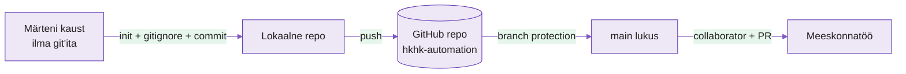

---
tags:
  - Git
  - Versioonihaldus
  - Meeskonnatöö
  - GitHub
---

# Praktikum: tühjast repost meeskonnatööni

**Eeldused:** loeng on läbitud (commit, haru, kaugrepo, pull request). 1. nädala töö on tehtud: SSH-võti on GitHubis ja sihtmärk töötab. Tead, mida teevad `git clone`, `git add`, `git commit` ja `git push`.

**Kontrollsõlm:** sinu arvuti, kogu töö käib VS Code'is. Repo asub sinu masinas.
**Sihtmärk:** sinu valik (vt [Töökeskkond](../kodulabor.md)). Märteni skripti käivitame sihtmärgil, sest monitooringuskripti, mida on kontrollitud ainult lugedes, ei saa pidada testituks.

??? abstract "Õpiväljundid"
    Praktikumi lõpuks oskad:

    1. luua repo algusest peale ja selgitada, miks repo on kaust `.git/` sinu masinas ja GitHub on selle koopia;
    2. peatada saladuse `.gitignore`-i abil enne esimest push'i;
    3. kaitsta `main`-haru ja kontrollida, et reegel kehtib ka sinu enda kohta;
    4. leida skripti käivitades nelja vea põhjuse. Iga viga annab eri tüüpi signaali (veateade, vaikne tõrge, õiguste viga, eksitav kontroll);
    5. lahendada liitmiskonflikti ja selgitada, miks Git ei vali versiooni sinu eest.

Vigu ei ole ette loetletud. Need tulevad välja skripti käivitades ükshaaval ja igaüks annab märku erineval viisil. Sinu ülesanne on õppida neid signaale lugema.

!!! example "Näidisstsenaarium: Märten"
    Märten oli suvepraktikant. Ta tegi push'i otse `main`-i, sest harude kasutamine tundus talle tülikas, ja kirjutas commit-sõnumiteks `asjad`, `veelkord` ja `nüüd lõpuks`.

    Märten lahkus augustis. Temast jäi maha kaust `marten-kraam`: paar skripti, `.env` fail andmebaasi parooliga ja Giti ajalugu puudus täielikult. Tema viimane töö oli `monitor.sh`, mis kommentaari järgi "peaks töötama".

    Nüüd võtate selle paarilisega üle. Teie ülesanne on teha Märteni failidest korralik projekt: viia need versioonihaldusse, kaitsta `main`-haru ja kehtestada reeglid, et sama olukord ei korduks.

## Osa 1 · Märteni failid versioonihaldusse

Märteni failid on sinu masinas (õpetaja jagatud kaust `marten-kraam`). Need ei ole kunagi olnud versioonihalduses. Esimene ülesanne on teha neist repo.

<figure markdown="span">

  <figcaption>Joonis 2.1. Praktikumi käik: Märteni kaustast kaitstud meeskonnaprojektini (Talvik, 2025).</figcaption>
</figure>

### 1.1 Loo GitHubis tühi repo

Ava `github.com/hkhk-automation` → **New repository**.

- Nimi: `marten-monitor-<sinu-eesnimi>`
- **Private**
- Ära lisa README-faili, `.gitignore`-i ega litsentsi. Kui need lisada, teeb GitHub esimese commiti sinu eest ja sa ei näe, kuidas repo algusest peale luuakse. Repo peab jääma täiesti tühjaks.

GitHub näitab nüüd juhiseid. Ära kopeeri neid mõtlemata. Teeme sammud läbi ükshaaval, sest neid samme kordad hiljem väga palju kordi.

### 1.2 Seo Märteni kaust repoga

Ava kaust VS Code'is (`code marten-kraam`) ja ava terminal:

```bash
git init
git branch -M main
```

`git init` lõi kausta `.git/`. See kaust ongi repo. GitHub on selle koopia, mis asub teises kohas. Seo need kaks omavahel:

```bash
git remote add origin git@github.com:hkhk-automation/marten-monitor-<sinu-eesnimi>.git
git remote -v
```

??? question "Mõtle"
    Kui kustutaksid kausta `.git/` (`rm -rf .git/`), mis kaob ja mis jääb alles? Failid jäävad. Kõik muu kaob: ajalugu, harud ja ka see, et Git üldse seda kausta jälgib. Seda juhtub ka kogemata ja ilma varukoopiata.

## Osa 2 · `.gitignore` enne, kui `.env` lekib

Märten jättis maha `.env` faili, milles on andmebaasi parool. Kõige lihtsam tundub kõik failid commitida ja edasi minna. Ära tee seda.

Avalikku reposse saadetud parool leitakse väga kiiresti, sest uusi avalikke commit'e skannitakse automaatselt just selliste andmete leidmiseks. Parooli eemaldamine Giti ajaloost tagantjärele on keeruline. Lihtsam on hoida see reposse jõudmast.

Vaata, mida Git praegu näeb:

```bash
git status
```

`.env` on nimekirjas. Peata see enne commiti ja loo `.gitignore` ([mustrite süntaks](https://git-scm.com/docs/gitignore)):

```
# Saladused: Märteni pärand
.env
*.key

# Logifailid
*.log

# macOS rämps, mida keegi ei taha näha
.DS_Store
```

```bash
git status
```

`.env` on nimekirjast kadunud. Fail on kaustas alles, kuid Git ei jälgi seda enam.

!!! warning
    `.gitignore` ei eemalda faili, mis on juba GitHubi saadetud: see takistab ainult jälgimata failide lisamist. Kui parool on korra GitHubis olnud, loe see lekkinuks ja vaheta parool välja. Hiljem lisatud `.gitignore` lekkinud parooli enam ei kaitse. Kui `.env` on juba GitHubis, vaheta parool, seejärel eemalda fail jälgimisest käsuga `git rm --cached .env` ja tee commit.

??? question "Mõtle"
    Miks peab `.gitignore` ise olema Gitis (commititud), aga `.env` mitte? Mõlemad on samas kaustas asuvad failid. Mis neid põhimõtteliselt eristab?

## Osa 3 · Esimene commit

Lisa fail `README.md`, et iga lugeja (ka sina ise kolme kuu pärast) teaks, mis projektiga on tegu. Piisab paarist reast: mis projekt see on, kes on autor ja mida `monitor.sh` peaks tegema.

Vii Märteni failid versioonihaldusse:

```bash
git add .
git status
git commit -m "init: päästa Märteni kraam versioonihaldusesse"
git push -u origin main
```

??? warning "Kui `git push` annab `Permission denied`"
    Käivita `ssh -T git@github.com` ja kontrolli, kas 1. nädala SSH-võti on GitHubis ja töötab.

Commit-sõnum on terve lause, mis kirjeldab muudatust. Märteni sõnum `asjad` ei ütle midagi.

Ava GitHub ja kontrolli, et failid on seal ja `.env` faili ei ole. Vaata ajalugu ka terminalis:

```bash
git log --oneline
```

Ajaloos on üks rida ja üks korralik commit. Praktikumi jooksul lisandub mitu commiti ja lõpus saad ajaloost lugeda kogu päeva töö.

??? question "Mõtle"
    Miks pidi enne `main`-haru kaitsmist olema vähemalt üks commit? Mida GitHub kaitseks, kui `main`-haru veel ei olegi?

## Osa 4 · Kaitse `main`-haru ja kontrolli reeglit

Praegu saab igaüks, ka sina ise reede pärastlõunal väsinuna, teha push'i otse `main`-i. Just nii tekkis Märteni olukord. Kaitse `main`-haru.

GitHubis: **Settings → Branches → Add branch ruleset** (või *Add rule*). Seaded on kirjeldatud GitHubi juhendis [About protected branches](https://docs.github.com/en/repositories/configuring-branches-and-merges-in-your-repository/managing-protected-branches).

- Branch name pattern: `main`
- **Require a pull request before merging**: sisse
- **Require approvals: 1**: sisse
- **Do not allow bypassing the above settings**: jäta praegu välja (nii pääseb õpetaja vajaduse korral ligi)

Salvesta. Nüüd korda Märteni viga ja proovi teadlikult teha push otse `main`-i:

```bash
echo "test" >> README.md
git add README.md
git commit -m "test: kas main on lukus"
git push origin main
```

**Viga:** `remote: error: GH006: Protected branch update failed` / `protected branch hook declined`.

??? question "Leia põhjus enne parandamist"
    Loe veateadet: eesliide `remote:` näitab, kes keeldus. Sinu masin lubas commiti teha ja lokaalne ajalugu on olemas. Miks lokaalne Git seda ei takistanud? Kus reegel tegelikult kehtib?

Sinu enda reegel peatas sinu push'i. Lokaalne commit on aga alles ja tuleb eemaldada:

```bash
git reset --hard origin/main
git log --oneline
```

Testcommit on kadunud ja ajalugu ühtib jälle GitHubiga.

!!! tip
    Haru kaitse (branch protection) ei ole bürokraatia. Kui `main` on lukus, saab muudatusi teha ainult pull request'i kaudu ja seepärast on funktsiooniharud üldse olemas. Reeglit, mille oled ise seadistanud ja kontrollinud, saad usaldada.

## Osa 5 · Rollid ja õigused

### 5.1 Lisa paariline kaastöötajaks

**Settings → Collaborators → Add people** → paarilise GitHubi kasutajanimi.

??? note "Tabel 2.1. GitHubi õigustasemed"
    | Tase | Õigused |
    |---|---|
    | Read | Näeb ja kloonib |
    | Write | Teeb push'i harudesse, avab PR-e |
    | Admin | Kõik eelnev ning lisaks seaded, haru kaitse ja repo kustutamine |

Anna paarilisele **Write**-õigus. Ta saab luua harusid ja PR-e, kuid ei saa sinu reegleid välja lülitada ega repot kustutada. Õiguse taseme määrab see, mida inimene oma töös vajab ([õigustasemed GitHubi dokumentatsioonis](https://docs.github.com/en/account-and-profile/setting-up-and-managing-your-personal-account-on-github/managing-access-to-your-personal-repositories)).

### 5.2 Lisa õpetaja

Lisa samas kohas õpetaja kasutajanimi **Admin**-õigusega. Seda on vaja hindamiseks ja hädaolukorras abistamiseks.

??? question "Mõtle"
    Märtenil oli Admin-õigus. Vaata, mis juhtus. Miks ei anta igale kaastöötajale Admin-õigust "igaks juhuks"?

### 5.3 Vahetatud rollid

Oma repos oled sina admin ja paariline kaastöötaja, tema repos vastupidi. Nii näed mõlemat poolt ja töökohal ei tule üllatusena, miks `Read`-õigusega on liitmisnupp hall.

Klooni paarilise repo, seda on vaja osas 7:

```bash
git clone git@github.com:hkhk-automation/marten-monitor-<paarilise-nimi>.git
```

## Osa 6 · Märteni skript: neli viga, neli signaali

`main` on lukus, seega käivad parandused õiget teed: haru → PR → ülevaatus → liitmine. Kõigepealt tuleb vead leida ja selleks tuleb skript käivitada. Märten kontrollis skripti ainult lugedes ja tulemus on teada.

### 6.1 Oma haru

```bash
git switch -c fix/monitor-parandused
```

### 6.2 Kopeeri skript sihtmärgile ja käivita

Monitooringuskript peab töötama serveris, seepärast kopeeri see sihtmärgile ja käivita seal:

```bash
scp monitor.sh <kasutaja>@<sihtmärk>:~/
ssh <kasutaja>@<sihtmärk>
bash monitor.sh
```

??? warning "Kui `scp` või `ssh` sihtmärgiga ühendust ei saa"
    Kontrolli 1. nädala SSH-ühendust käsuga `ssh <kasutaja>@<sihtmärk>`.

Loe skript läbi, kuid ära seda veel paranda.

??? example "Fail `monitor.sh` (Märteni versioon)"
    ```bash
    #!/bin/bash
    # Märteni servermonitor v1.0
    # kirjutatud reedel kell 16:55, varsti koju
    # peaks töötama

    SERVIIS=nginx
    LOG=/var/log/monitor.log
    KUUPÄEV=$(date)

    # kontrollin kas teenus töötab, google ütles nii
    servis $SERVIIS status

    if [ $? = 0 ]
    then
        echo "$KUUPÄEV - $SERVIIS töötab" >> $LOG
    else
        echo "$KUUPÄEV - $SERVIIS EI tööta" >> $LOQ
    fi
    ```

Kommentaarid, milles Märten oma lahendust põhjendab, viitavad kohtadele, kus midagi on katki. Otsingutulemuse järgi kirjutatud rida ei ole testitud rida.

### 6.3 Viga 1: command not found

Esimene käivitus annab tulemuseks:

```
monitor.sh: line 12: servis: command not found
```

??? question "Leia põhjus enne parandamist"
    Veateade annab kolm asja: faili, rea numbri ja käsu, mis ebaõnnestus. Käsku `servis` Linuxis ei ole, Märten kirjutas selle mälu järgi. Mis on õige käsk teenuse oleku kontrollimiseks? (1. nädalal kasutasid `systemctl`-i juba.)

Paranda viga oma masinas VS Code'is, mitte sihtmärgil, sest repo asub sinu masinas ja parandus peab jõudma ajalukku:

```bash
systemctl status $SERVIIS
```

Kopeeri parandatud fail uuesti sihtmärgile ja käivita:

```bash
scp monitor.sh <kasutaja>@<sihtmärk>:~/ && ssh <kasutaja>@<sihtmärk> bash monitor.sh
```

Nüüd käivitub `systemctl` ja teatab `nginx.service could not be found`. See on õige vastus, sest nginx ei ole veel paigaldatud (seda teeme 3. nädalal). Teenus ei tööta ja skript peaks selle logisse kirjutama. Kontrolli:

```bash
ssh <kasutaja>@<sihtmärk> cat /var/log/monitor.log
```

```
cat: /var/log/monitor.log: No such file or directory
```

Skript lõpetas töö, kuid logifaili ei tekkinud. See on järgmist tüüpi viga.

### 6.4 Viga 2: vaikne tõrge

??? question "Leia põhjus enne parandamist"
    Vaata `else`-haru tähelepanelikult. `$LOQ`: Q, mitte G. Bash ei anna defineerimata muutuja kohta hoiatust: `$LOQ` on lihtsalt tühi string. Kuhu läheb väljund, kui `>> ` järel on tühi nimi? Miks on see viga ohtlikum kui viga 1 ja kumba neist märkad kiiremini?

See on **vaikne tõrge**: skript ei anna märku probleemist, kuid tulemust ei ole. See viga tekib just siis, kui teenus ei tööta, ehk olukorras, kus logi on kõige rohkem vaja. Märteni monitooringuskript ei salvestanud teenuse tõrget.

Paranda `$LOQ` → `$LOG`, kopeeri fail `scp`-ga uuesti ja käivita. Nüüd ilmub kolmas veateade:

```
monitor.sh: line 18: /var/log/monitor.log: Permission denied
```

### 6.5 Viga 3: Permission denied

??? question "Leia põhjus enne parandamist"
    See veateade on tuttav 1. nädalast, kuid olukord on teine. Kaust `/var/log/` kuulub root'ile, sina käivitad skripti tavakasutajana. Võimalikke parandusi on kaks: (a) käivita skript sudo'ga, (b) kirjuta logi kohta, kuhu sul on kirjutusõigus. Kumb sobib paremini monitooringuskriptile, mis peaks käivituma iga minut? Miks on "anna lihtsalt sudo" Märteni stiilis lahendus?

Paranda viga. Skript ei vaja root-õigusi, kui need pole tööks vajalikud:

```bash
LOG=$HOME/monitor.log
```

Kopeeri fail `scp`-ga, käivita ja kontrolli:

```bash
ssh <kasutaja>@<sihtmärk> "bash monitor.sh && cat ~/monitor.log"
```

```
... - nginx EI tööta
```

Nüüd teeb skript esimest korda seda, mida peab. Siiski on selles veel üks viga, mis avaldub ainult teatud olukorras.

### 6.6 Viga 4: eksitav kontroll

`[ $? = 0 ]`: `=` võrdleb stringe, arvude võrdlemiseks on `-eq`. Enamasti on tulemus sama, kuid mitte alati. Viga, mis avaldub ainult mõnikord, on kõige raskem leida, sest pole teada, millal see esineb. Kolm eelmist viga andsid endast ise märku (kaks veateatega, üks puuduva tulemusega). See viga ei anna endast kunagi ise märku. Selliseid vigu leiab ainult teadmiste või linteri abil.

Paranda kaks asja korraga:

1. `[ $? = 0 ]` → `[ $? -eq 0 ]`
2. Lisa `set -e` kohe rea `#!/bin/bash` järele. Siis peatub skript esimese vea korral ega jätka tööd ([`set -e` kirjeldus](https://man7.org/linux/man-pages/man1/set.1p.html)).

??? question "Mõtle"
    Kui `set -e` oleks olnud skriptis algusest peale, millised neljast veast oleks skripti peatanud kohe sellel real, kus viga tekkis? Milline viga oleks jäänud märkamata ka `set -e`-ga?

### 6.7 Commit: neli parandust ühes commitis

Vaata muudatus enne commiti üle. `git diff` on viimane võimalus näha, mida tegelikult saadad:

```bash
git diff
git add monitor.sh
git commit -m "fix: systemctl, vaikne LOQ, logi koju, -eq + set -e"
git push -u origin fix/monitor-parandused
```

## Osa 7 · Pull request, ülevaatus ja konflikt

### 7.1 Pull request ja ülevaatus

Edasi läheb töö [GitHub flow](https://docs.github.com/en/get-started/using-github/github-flow) järgi: haru, pull request, ülevaatus ja liitmine. GitHubis vajuta **Compare & pull request**.

- Title: `Fix: Märteni monitor.sh parandused`
- Description on osa hindest. Kirjeldus `fixed stuff` ei lähe arvesse. Vasta kirjelduses järgmistele küsimustele:
    - Mis tüüpi oli iga neljast veast (veateade / vaikne / õigused / eksitav)?
    - Milline viga oli tootmiskeskkonnas kõige ohtlikum ja miks?
    - Mis järjekorras vead välja tulid ja miks just selles järjekorras?

Määra ülevaatajaks (reviewer) paariline. Ta avab sinu PR-i, vaatab vahekaarti **Files changed**, jätab ühe sisulise kommentaari ja vajutab **Approve**. Alles siis saad PR-i liita, sest seadistasid ise nõude, et vaja on ühte kinnitust. Ülevaatus ei ole kriitika isiku kohta: see on teine kontroll enne, kui muudatus jõuab `main`-i ja sealt tootmisse.

??? warning "Kui liitmisnupp on hall"
    Kinnitus puudub. Paariline peab sinu PR-is vajutama **Approve**.

### 7.2 Liitmiskonflikt: kontrollitud katse

Teie mõlema PR muudab sama rida. Üks teist liidab oma PR-i esimesena. Teine näeb teadet *"This branch has conflicts."* Konflikt ei ole viga ega kellegi süü: Git ei vali versiooni sinu eest.

```bash
git switch main
git pull origin main
git switch fix/monitor-parandused
git merge main
```

Failis:

```
<<<<<<< HEAD
systemctl status $SERVIIS
=======
service $SERVIIS status
>>>>>>> main
```

??? question "Leia põhjus enne parandamist"
    `<<<`, `===` ja `>>>` on Giti markerid, mitte kood. `HEAD` on sinu versioon, teisel pool on see, mis vahepeal `main`-i jõudis. Kumb rida on õige ja kuidas sa seda tead, ilma oletamata? (Üht neist käivitasid just sihtmärgil.)

Vali õige rida, kustuta markerid, kontrolli uuesti `git diff`-iga ja seejärel käivita:

```bash
git add monitor.sh
git commit -m "resolve: merge konflikt monitor.sh"
git push
```

??? warning "Kui faili jäid markerid `<<<<<<<`"
    Kustuta kõik `<<<`, `===` ja `>>>` read ning kontrolli tulemust käsuga `git diff`.

PR uueneb ja liitmine õnnestub. Lõpuks vaata kogu ajalugu:

```bash
git switch main && git pull
git log --oneline --graph
```

Esimene commit, kaitse test, neli parandust, konflikt ja liitmine: kogu päeva töö on ajaloost loetav. Märtenist jäi sama töö kohta maha ainult kaust `marten-kraam`.

??? note "Kontrollnimekiri: oskad ilma juhendita"
    - [ ] Repo on organisatsioonis `hkhk-automation` ja `git log --oneline` näitab kogu päeva tööd
    - [ ] `.env` ei ole GitHubis, `.gitignore` takistab selle lisamist
    - [ ] `main` on kaitstud: otse tehtud push lükatakse tagasi ja tead, kes selle tagasi lükkab
    - [ ] Paarilisel on Write-õigus, õpetajal Admin-õigus ja oskad põhjendada mõlemat taset
    - [ ] Oskad nimetada neli veatüüpi (veateade / vaikne / õigused / eksitav) ja tuua igaühe kohta näite
    - [ ] `monitor.sh` töötab sihtmärgil ja kirjutab logi
    - [ ] Liitmiskonflikt on lokaalselt lahendatud ja valik on põhjendatud
    - [ ] Ükski sinu commit-sõnum ei ole `asjad`

## Lisaülesanded

??? example "1 · Muudatuste tagasivõtmine"
    tee vigane commit (nagu Märten). Millal kasutada käsku `git restore`, `git reset --soft` või `git revert`? Proovi kõiki kolme ja kirjuta igaühe erinevuse kohta üks lause. Vihje: ainult üks neist on ohutu pärast push'i.

??? example "2 · shellcheck"
    paigalda [shellcheck](https://www.shellcheck.net/) (või kasuta veebiversiooni) ja kontrolli sellega Märteni algset skripti. Mitu neljast veast leiab see ilma käivitamata? Milline jääb leidmata?

??? example "3 · CODEOWNERS"
    lisa fail `.github/CODEOWNERS`, mis nõuab, et `monitor.sh` muudatused vaatab üle kindel inimene. Testi seda.

??? example "4 · `git stash`"
    tee pooleli olev muudatus ja käivita `git stash`. Kuhu muudatus kadus? `git stash pop` toob selle tagasi. Millal on see kasulik?

*Järgmine: 3. nädal, Ansible. Õpime Märteni käsitsi tehtud tööd automatiseerima, et järgmine praktikant ei peaks midagi mälu järgi kirjutama.*
