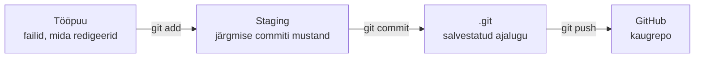
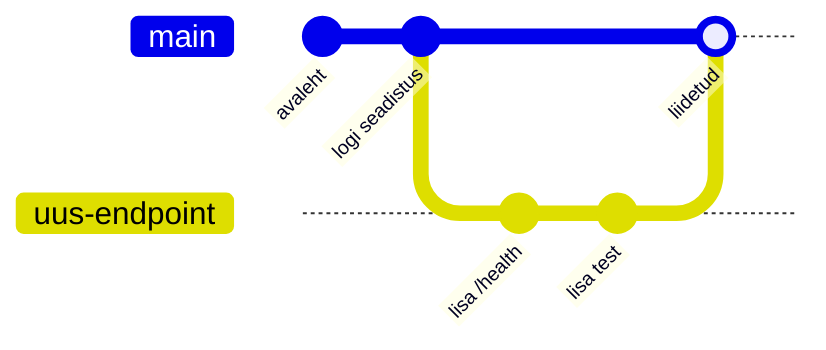
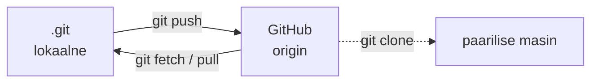
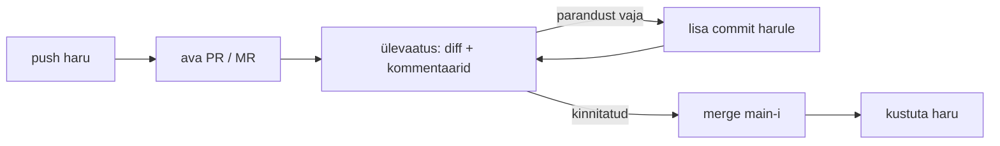

---
tags:
  - Automatiseerimine
  - DevOps
  - Git
---

# Loeng: versioonihaldus Giti ja GitHubiga

*Kuidas meeskond muudab sama koodi nii, et keegi ei kirjuta teise tööd üle*

??? abstract "Õpiväljundid"
    Tunni lõpuks oskad selgitada:

    1. miks versioonihaldus on meeskonnatöö ja automatiseerimise alus;
    2. mis on Giti kolm ala ja põhitsükkel `add → commit → log`;
    3. mida panna `.gitignore`-sse ja mida mitte;
    4. mis on haru ja kuidas liita ning lahendada liitmiskonflikt;
    5. mis vahe on lokaalsel Gitil ja kaugrepol, mis on `clone` ja `fork`;
    6. mis on pull request / merge request ja koodiülevaatus.

## 1. Näidisstsenaarium

!!! abstract "Miks see oluline on?"
    Ka kursuse järgmiste teemade (Ansible, Docker, CI/CD) failid on tekstifailid, mida meeskond koos muudab. Kui kaks inimest muudavad sama faili ilma versioonihalduseta, võib ühe inimese töö märkamatult kaduma minna. Git hoiab selle ära.

!!! example "Esmaspäev, rühmatöö"
    Kati ja Mati parandavad koos sama deploy-skripti. Kati saadab faili Matile, Mati muudab seda ja saadab tagasi. Vahepeal on Kati oma koopiat juba muutnud.

    Kaustas on failid `deploy.sh`, `deploy_v2.sh`, `deploy_MATI.sh` ja `deploy_LOPP.sh`. Keegi ei tea, milline neist on uusim. Kati salvestab oma paranduse vana faili peale ja Mati eilne töö kaob. Failinimest ei selgu, mis muutus ega miks.

Mõtle kahele küsimusele:

- **Mis läks kaotsi?** Mati töö, sest keegi kirjutas selle kogemata üle.
- **Mis puudus?** Ühine usaldusväärne versioon ja ülevaade sellest, kes mida muutis.

Git lahendab selle probleemi. Git salvestab iga commitiga projekti seisu, näitab kahe seisu vahet (diff: millised read lisandusid ja millised kadusid) ning võimaldab mitmel inimesel korraga töötada. Näiteks Boltis või Wise'is muudavad sajad insenerid sama koodibaasi iga päev ja see on võimalik ainult versioonihalduse abil. Giti põhjalik ja tasuta õpik on [Pro Git](https://git-scm.com/book/en/v2).

??? question "Kontrolli ennast"
    1. Miks ei aita failide ümbernimetamine (`deploy_LOPP.sh`) probleemi lahendada?
    2. Nimeta kaks asja, mida Git meeskonnale annab, mida käsitsi failivahetus ei anna.

## 2. Giti kolm ala ja commit

!!! abstract "Miks see oluline on?"
    Git ei salvesta muudatust kohe, kui faili muudad. Muudatus liigub läbi kolme ala. Alguses tekitab see segadust, aga just tänu sellele saad ühe töösessiooni jagada mitmeks selgeks commitiks.

<figure markdown="span">

  <figcaption>Joonis 2.1. Faili teekond: tööpuu → staging → .git → GitHub (Talvik, 2026).</figcaption>
</figure>

**Staging** (index) on järgmise commiti mustand: sinna lisad täpselt need muudatused, mis lähevad järgmisse commiti. Nii saad ühe töösessiooni jagada loogilisteks commitideks, näiteks veaparanduse ühte ja uue funktsiooni teise.

```bash
git status                                  # mis muutus, mis on staging'us
git add deploy.sh                           # üks fail staging'usse
git commit -m "Lisa restardi kontroll deploy skripti"
git log --oneline --graph                   # ajalugu
```

Iga käsu võtmed on kirjas [Giti dokumentatsioonis](https://git-scm.com/docs).

Commit-sõnum on **kohustuslik**: Git keeldub tühja sõnumiga commitist. `git log` on esimene koht, kuhu vea otsimisel vaatad, ja sõnum on selle ainus inimloetav sisu. Sõnum `paranda asjad` ei aita kuu aja pärast kedagi, sõnumist `Lisa restardi kontroll` on aga kohe näha, mis muutus.

??? question "Kontrolli ennast"
    1. Mis vahe on `git add` ja `git commit` vahel?
    2. Miks keeldub Git tühja commit-sõnumiga commitist?

## 3. Git-failid ja `.gitignore`

!!! abstract "Miks see oluline on?"
    Kõik failid ei kuulu versioonihaldusse: saladused ja logid tuleb sealt välja jätta. Saladus, mis on kord commiti sattunud, jääb ajalukku ka pärast faili kustutamist.

Repo juurkaustas on peidetud kaust `.git`. Selles on kogu ajalugu, commitid ja harud. Kui `.git` kustutada, jäävad failid alles, aga ajalugu kaob. Seda kausta käsitsi ei muudeta. Ainus Giti fail, mille ise kirjutad, on `.gitignore`: loend mustritest, mida Git ignoreerib. Mustrite süntaks on [`gitignore` dokumentatsioonis](https://git-scm.com/docs/gitignore). Tabelis on näha, mis sinna kuulub.

??? note "Mis kuulub `.gitignore`-sse"
    | Pane `.gitignore`-sse | Ära pane sinna |
    |-----------------------|----------------|
    | Saladused: `.env`, võtmed, paroolid | Lähtekood ja skriptid |
    | Logid: `*.log` | Jagatud konfiguratsioonifailid (`config.example`) |
    | Genereeritud failid: `build/`, `__pycache__/` | `.gitignore` ise (seda jälgitakse) |
    | Sõltuvused: `node_modules/`, `venv/` | README, Ansible'i, Dockeri ja CI-failid |
    | Operatsioonisüsteemi ja redaktori abifailid: `.DS_Store`, `.idea/` | |

!!! warning "Saladus ajaloos"
    Lisa `.env` `.gitignore`-sse **enne** esimest commiti. Kui saladus on kord commiti sattunud, saab selle vanast commitist kätte ka pärast faili kustutamist. Saladuste haldamisest räägime Ansible Vaulti moodulis.

## 4. Harud

!!! abstract "Miks see oluline on?"
    Kui kõik muudaksid otse `main`-i, segaks igaühe pooleli olev töö teisi. Harude abil saate paarilisega töötada korraga kahe eri asja kallal teineteist segamata.

Haru (branch) on eraldi tööliin, tehniliselt liikuv viit ühele commitile. `main` on ametlik töötav versioon. Töötad oma harus, kuni töö on valmis, ja siis liidad selle tagasi. Vahepeal jääb `main` töökorda.

<figure markdown="span">

  <figcaption>Joonis 4.1. Haru areneb main'ist eraldi ja liidetakse valmimisel tagasi (Talvik, 2026).</figcaption>
</figure>

```bash
git switch -c uus-endpoint      # loo haru ja mine sinna
git switch main                 # vaheta haru
git branch                      # loend, tärn = kus oled
```

Harusid on kahte liiki: lokaalne haru (`uus-endpoint` sinu masinas) ja kaugharu koopia (`origin/main`, mis näitab GitHubi seisu). `git status` võrdleb neid. Teade "ahead of origin/main by 2 commits" tähendab, et sul on kaks commiti, mida pole veel GitHubi saadetud.

## 5. Liitmine ja konfliktid

!!! abstract "Miks see oluline on?"
    Enamasti liidab Git harud ise kokku. Kui aga kaks inimest muutsid sama rida, ei saa Git otsustada, kumb versioon on õige, ja jätab valiku inimesele. Konflikti lahendamine on meeskonnatöös igapäevane oskus.

```bash
git switch main
git merge uus-endpoint
```

Kui `main` pole vahepeal muutunud, teeb Git *fast-forward*'i. Kui on muutunud, tekib *merge-commit*, mis ühendab kaks liini. Konflikt tekib siis, kui kaks inimest muutsid **sama rida** (või kõrvuti asuvaid ridu). Git märgib failis mõlemad versioonid:

```
<<<<<<< HEAD
port = 8080
=======
port = 3000
>>>>>>> uus-endpoint
```

`HEAD` on praeguse haru versioon, alumine osa on liidetava haru versioon. Vali õige variant, kustuta markerid (`<<<`, `===`, `>>>`) ja lõpeta liitmine:

```bash
git add config.py
git commit
```

??? question "Kontrolli ennast"
    1. Sina muutsid rida 5, paariline rida 40 samas failis. Kas liitmisel tekib konflikt?
    2. Kes otsustab, kumb versioon konflikti korral jääb?

## 6. Lokaalne ja kaugrepo: clone, push, pull, fetch

!!! abstract "Miks see oluline on?"
    Kaugrepo on meeskonna ühine kokkulepitud versioon. Lokaalne koopia võib olla vananenud, seepärast alusta tööpäeva käsuga `git pull` ja alles siis tee muudatusi.

- **Lokaalne Git** asub sinu masinas. Kogu repo koos ajalooga on sinu kettal ning commit, haru ja log töötavad ka ilma internetita. Git on hajus versioonihaldus: igal inimesel on täielik koopia.
- **Kaugrepo (remote)** asub GitHubis ja on meeskonna ühine koopia. Põhilise kaugrepo tavapärane nimi on **`origin`**.

<figure markdown="span">

  <figcaption>Joonis 6.1. clone teeb koopia, push saadab commitid GitHubi, fetch/pull toob teiste commitid (Talvik, 2026).</figcaption>
</figure>

`clone` teeb kaugrepost täieliku koopia sinu masinasse (failid, ajalugu ja seos `origin`-iga). Seda tehakse repoga töö alguses üks kord.

```bash
git clone https://github.com/hkhk-automation/tiimi-repo.git
git push -u origin uus-endpoint   # oma haru GitHubi
git fetch                         # too muudatused, ära liida
git pull                          # fetch + merge
```

`fetch` toob muudatused, kuid ei muuda sinu tööfaile, nii et saad need enne üle vaadata. `pull` toob muudatused ja liidab need kohe. Jagatud repos on töörütm järgmine: pull → töö → commit → push.

## 7. GitHub: pull request, fork, koodiülevaatus

!!! abstract "Miks see oluline on?"
    Valmis haru ei liideta main'i ilma kontrollita: keegi vaatab selle enne üle. Nii leitakse vead enne, kui need kõiki mõjutavad. CI/CD moodulis käivitab iga pull request lisaks automaattestid.

Kui haru on valmis, avad **pull request'i** (PR), millega palud muudatused üle vaadata ja liita. Nimetus sõltub platvormist: **GitHubis** on see pull request, **GitLabis** ja **Bitbucketis** merge request (MR). Mõiste on sama. Kogu töövoog on kirjeldatud GitHubi juhendis [GitHub flow](https://docs.github.com/en/get-started/using-github/github-flow).

<figure markdown="span">

  <figcaption>Joonis 7.1. Pull request on kontrollpunkt enne main'i: ülevaatus on enne liitmist (Talvik, 2026).</figcaption>
</figure>

PR-is näeb meeskond, millised read muutusid (rohelisega lisatud, punasega eemaldatud), saab kommenteerida ja parandusi paluda. Seda nimetatakse **koodiülevaatuseks** (code review): enne main'i jõudmist vaatab muudatuse üle veel üks inimene. Kui lisad harule uue commiti, uueneb PR automaatselt. **Issue'd** on ülesannete ja vigade jälgimiseks. PR viitab tavaliselt issue'le, mille see lahendab.

**Fork** on repo koopia **sinu GitHubi kontol**. Seda kasutatakse siis, kui sul pole originaalrepos kirjutusõigust, näiteks avatud lähtekoodiga projektides. Töövoog on järgmine: teed forki, kloonid oma forki, lood haru ja teed muudatused, saadad need push'iga oma forki ning avad PR-i originaalrepo poole ([Fork a repo](https://docs.github.com/en/get-started/quickstart/fork-a-repo)).

!!! note "Clone, fork, branch: mis vahe on?"
    **clone** on koopia sinu masinas, **fork** on eraldi koopia sinu GitHubi kontol ja **branch** on tööliin ühe repo sees.

??? question "Kontrolli ennast"
    1. GitHub nimetab seda pull request'iks, GitLab merge request'iks. Kas need on eri asjad?
    2. Tahad panustada projekti, kus sul pole kirjutusõigust. Mis on esimene samm: `clone` või `fork`?

## 8. Kokkuvõte

??? abstract "Kokkuvõte"
    - Git salvestab iga commitiga projekti seisu ja kogu ajalugu asub kaustas `.git`.
    - Kolm ala: tööpuu → staging (`git add`) → repo (`git commit`). Commit-sõnum on kohustuslik.
    - `.gitignore`: jälgi lähtekoodi ja jagatud konfiguratsioonifaile, ignoreeri saladusi, logisid ja genereeritud faile.
    - Harud on odavad: iga funktsioon on oma harus ja `main` on alati töökorras.
    - Konflikt tekib ainult siis, kui mõlemas harus on muudetud sama kohta. Valiku teeb inimene, Git ise ei otsusta.
    - Lokaalne ja kaugrepo: `origin` on meeskonna ühine repo, töörütm on `pull → töö → commit → push`.
    - Pull request (= merge request) on kontrollpunkt enne main'i: koodiülevaatus on enne liitmist.

## 9. Enne praktikumi

Praktikumis teete paarilisega läbi kogu töövoo: haru → push → pull request → koodiülevaatus → liitmine. Lisaks lahendate ühe liitmiskonflikti. Kontrolli, et Git teab sinu nime (`git config --global user.name`) ja et sul on GitHubi konto.

## Taust ja edasijõudnutele

Loe seda osa pärast tundi. Kõigi siinsete käskude kohta kehtib reegel: muuda ainult oma haru, mida keegi teine pole veel alla tõmmanud.

??? info "Merge ja rebase"
    Mõlemad liidavad harud kokku, kuid tulemuseks on erinev ajalugu. `merge` säilitab ühenduspunkti, `rebase` tõstab sinu commitid värske main'i otsa ja ajalugu jääb sirgeks.

    ```
    merge:                          rebase:
    main:  A---B---C---M            main:  A---B---C---D'---E'
                      /
    haru:      D---E
    ```

    ```bash
    git switch uus-endpoint
    git rebase main
    ```

    Rebase annab commitidele uued SHA-d, seega kasuta seda ainult isiklikus harus enne PR-i avamist. Jagatud main'is rebase'i ei kasutata.

??? info "Muudatuste tagasivõtmine kolmel tasandil"
    ```bash
    git restore fail.py          # enne commiti: viska muudatus ära
    git reset --soft HEAD~1      # oma harus: võta commit tagasi, jäta muudatus staging'usse
    git revert <sha>             # jagatud harus: uus commit, mis tühistab vana
    ```

    `reset` eemaldab commitid ajaloost, seega sobib see ainult jagamata töö jaoks. `revert` säilitab ajaloo ja lisab tühistava commiti, seega on see ohutu ka main'is. `HEAD` on sinu praegune asukoht, `HEAD~1` on üks samm tagasi.

??? info "Sarnased mõisted: mis vahe on?"
    | | | Vahe |
    |--------|--------|------|
    | **lokaalne** | **remote** | sinu masin vs GitHub (`origin`) |
    | **clone** | **fork** | koopia sinu masinas vs sinu GitHubi kontol |
    | **branch** | **fork** | tööliin repo sees vs eraldi repo sinu kontol |
    | **pull request** | **merge request** | sama asi; GitHub vs GitLab/Bitbucket |
    | **fetch** | **pull** | too vs too **ja** liida |
    | **merge** | **rebase** | säilita ajalugu vs kirjuta sirgeks |
    | **reset** | **revert** | eemalda ajaloost (jagamata töö) vs tühista uue commitiga (jagatud töö) |
