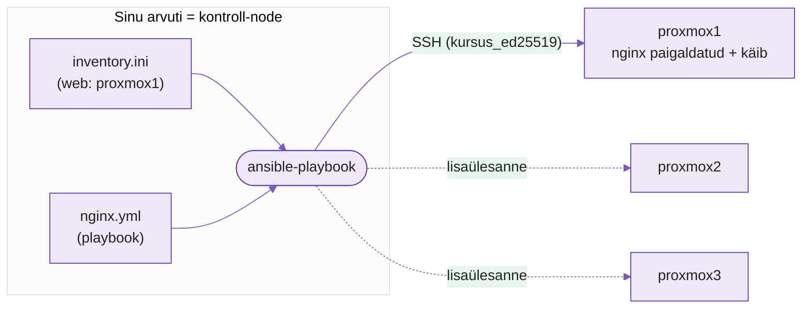

---
tags:
  - Ansible
  - Playbook
  - Praktikum
---

# Praktikum: esimene Ansible'i playbook

**Kestus:** 4 tundi
**Eeldused:** Loeng on läbi loetud (ptk 1–8: inventory, push-mudel, playbook, idempotentsus). 1. nädala töö on tehtud: `kursus_ed25519` võti on kolmes sõlmes ja `ansible -m ping` annab vastuseks `pong`. Kui mõni neist mõistetest pole selge, vaata enne praktikumi vastav [loenguosa](lecture.md) üle.
**Kontroll-node:** sinu arvuti. Kogu töö käib **VS Code'is**: failid on redaktoris ja käsud terminalis.
**Sihtmärk:** sinu Proxmoxi sõlmed `proxmox1` / `proxmox2` / `proxmox3` (nagu 1. nädalal). Kodus töötades sobib ka WSL2, virtuaalmasin või pilveserver. Playbook on kõigil sama.

---

!!! abstract "Õpiväljundid"

    Praktikumi lõpuks oskad:

    1. ehitada playbooki task'i kaupa ja testida seda igal sammul;
    2. **diagnoosida** veateate järgi kolme tüüpilist viga (permission denied, katkine idempotentsus, sisu ja olemasolu erinevus);
    3. selgitada idempotentsust näite põhjal: millal on tulemus `changed` ja millal `ok` ning miks `shell:` idempotentsuse lõhub;
    4. paigaldada playbookiga nginx'i nii, et Märteni monitor näitab teenust töötavana. Ansible teeb koodina ära selle, mida Märten käsitsi tehes ei dokumenteerinud.

---

!!! example "Näidisstsenaarium: Märten, teine vaatus"
    2. nädalal võtsid üle Märteni skripti `monitor.sh`. Skript kontrollib, kas nginx töötab, ja teatas kohe „nginx EI tööta“, sest nginx'i polnud sõlme kunagi paigaldatud. Käsitsi paigaldades on lihtne jätta teenus lubamata (`enable`) ja tehtud samme kuhugi üles kirjutamata.

    Selles praktikumis kirjutad **playbooki**, mis paigaldab ja käivitab nginx'i korratavalt ja dokumenteeritult, koodina. Praktikumi lõpus käivitad Märteni monitori uuesti ja see näitab, et nginx **töötab**.

---

Praktikumi käik: **seadistus → baas → viga → parandus → laiendus → viga → taastamine.** Valmis playbooki ei kopeerita. Ehitad selle task'i kaupa, lõhud selle olulistes kohtades meelega ja saad aru, **miks** see nii töötab.

<figure markdown="span">

  <figcaption>Joonis 1. Sinu arvuti loeb inventory ja playbooki ning saadab muudatuse SSH kaudu (1. nädala võtmega) sõlme. Sõlme Ansible'it ei paigaldata, seal on vaja ainult SSH-d ja Pythonit (Talvik, 2025).</figcaption>
</figure>

---

## Osa 1 · Seadistus: kontrolli ühendust

!!! warning "Ansible ei tööta Windowsi käsurealt"
    Ansible vajab *NIX-käsurida: **Mac, Linux või WSL2**. Windowsi cmd ega PowerShell ei sobi kontroll-node'iks. Võimalused on järgmised:

    - **Kui sul on WSL2, Mac või Linux**, käivita Ansible oma arvutist sõlme vastu. Nii tehakse seda ka töökeskkonnas.
    - **Kui *NIX-käsurida pole käepärast**, käivita Ansible **sõlmes endas sõlme enda vastu** (`localhost`). See pole tavapärane kasutus, kuid õppimiseks sobib.
    - Kahtluse korral küsi õpetajalt, kumb võimalus sinu arvutis sobib.

Ansible on sinu arvutis juba olemas (1. nädal). Ava projektikaust VS Code'is (`code .`) ja terminal klahvidega `` Ctrl+` ``. Fail `inventory.ini` on 1. nädalast:

```ini
[web]
proxmox1
```

Testi ühendust [`ping`](https://docs.ansible.com/ansible/latest/collections/ansible/builtin/ping_module.html) mooduliga. See moodul ei kasuta ICMP-d, see kontrollib SSH-ühendust ja Pythoni olemasolu:

```bash
ansible -i inventory.ini web -m ping
```

Kui väljundis on `SUCCESS` ja `"pong"`, on ühendus korras. **Ära liigu edasi enne, kui saad vastuseks `pong`.**

!!! info "Millise kasutajana Ansible sõlme logib?"
    Ansible logib sisse **sama kasutajana**, kellega töötab `ssh proxmox1`, sest `User` ja võti tulevad 1. nädala konfiguratsioonifailist `~/.ssh/config`. Teie sõlmedes on see `kasutaja`. Kontrolli seda:

    ```bash
    ansible -i inventory.ini web -m command -a "whoami"
    ```

    Väljund peab olema **`kasutaja`**, sama kasutaja, kellega ise SSH-ga ühendud. See näitab, et Ansible kasutab täpselt sama SSH-ühendust nagu sina.

    > Tootmiskeskkonnas on Ansible'il sageli **oma teenuskonto** (nt `ansible`) ja inimese isiklikku kontot ei kasutata. Nii on ligipääs auditeeritav ja piiratud. Meie kursusel piisab ühest kontost `kasutaja`, root-õigused saadakse `become` abil (Osa 3).

!!! tip
    Kas tuli `UNREACHABLE`? Kontrolli, kas `ssh proxmox1` töötab käsitsi. Ansible kasutab sama SSH-ühendust nagu sina: kui SSH käsitsi ei ühendu, ei ühendu ka Ansible.

---

## Osa 2 · Baas: esimene task

Loo fail `nginx.yml`. **Ainult siin on antud kogu fail**, edaspidi lisad sellele task'e:

```yaml
---
- name: Paigalda ja seadista nginx
  hosts: web
  become: true                        # root-õigused (sudo)

  tasks:
    - name: Paigalda nginx pakett
      ansible.builtin.package:         # valib ise dnf (Alma) või apt (Ubuntu)
        name: nginx
        state: present                 # "peab olemas olema"
```

Selles failis:

- `hosts: web` on grupp failist `inventory.ini`;
- `become: true` on vajalik, sest paketi paigaldamiseks on vaja root-õigusi;
- **`ansible.builtin.package`** on universaalne paketimoodul. Koolisõlmes on Alma (`dnf`), kuid sama task töötab ka Ubuntus (`apt`), seega pole eri distributsioonide jaoks vaja eraldi task'e kirjutada.

Käivita:

```bash
ansible-playbook -i inventory.ini nginx.yml
```

Tulemus on `changed=1` ja task on olekus **changed**. Kontrolli sõlmes:

```bash
ssh proxmox1 "nginx -v"
```

---

## Osa 3 · Become puudu: permission denied

Eemalda **meelega** rida `become: true`, muutes selle kommentaariks: `# become: true`. Käivita:

```bash
ansible-playbook -i inventory.ini nginx.yml
```

**Viga:** näed teadet, mis sarnaneb `Permission denied` või `This command has to be run under the root user`.

??? question "Diagnoosi enne parandamist"
    SSH-kasutaja ei ole root, kuid paketi paigaldamiseks on vaja root-õigusi. Milline rida ütles Ansible'ile, et käsk tuleb käivitada sudo abil, ja mis juhtus, kui selle eemaldasid? Miks Ansible ei kasuta sudo't vaikimisi?

**Paranda:** pane rida `become: true` tagasi, käivita playbook ja veendu, et see läbib. `Permission denied` puhul kontrolli kõigepealt, kas task vajab root-õigusi ja kas `become` on sisse lülitatud.

---

## Osa 4 · Laienda: teenus ja idempotentsus

Nginx on paigaldatud, kuid kas teenus töötab ja käivitub ka pärast taaskäivitust? **Lisa teine task** (`tasks:` alla):

```yaml
    - name: Käivita ja luba nginx
      ansible.builtin.service:
        name: nginx
        state: started         # käivita nüüd
        enabled: true          # käivitu ka pärast reboot'i
```

```bash
ansible-playbook -i inventory.ini nginx.yml
```

**Vaata `PLAY RECAP` hoolikalt.** Esimene task on **ok** (nginx on juba paigaldatud ja Ansible ei tee midagi), teine on **changed** (teenus käivitati esimest korda).

??? question "Mõtle"
    Käivita playbook **veel kord**. Nüüd on mõlemad task'id **ok**. Kust Ansible teadis, et midagi pole vaja teha? Seda nimetatakse idempotentsuseks. Osas 5 lõhume selle meelega.

`enabled: true` on just see seadistus, mis Märtenil jäi tegemata. Nüüd on see failis kirjas ega jää enam ununema.

---

## Osa 5 · Katkine idempotentsus: shell on alati changed

Oletame, et soovid kirjutada nginx'i versiooni faili. **Vale viis:** lisa task, mis kasutab moodulit `shell:`:

```yaml
    - name: Kirjuta nginx versioon faili
      ansible.builtin.shell: nginx -v 2> /tmp/nginx_version.txt
```

```bash
ansible-playbook -i inventory.ini nginx.yml
ansible-playbook -i inventory.ini nginx.yml
ansible-playbook -i inventory.ini nginx.yml
```

**Vaata tulemust:** see task on igal käivitusel **changed**. Kolm käivitust annavad kolm korda `changed`.

??? question "Diagnoosi"
    `package` ja `service` **kontrollivad olekut** enne tegutsemist. `shell:` ei kontrolli midagi: moodul käivitab käsu ja raporteerib vaikimisi `changed`, sest Ansible ei tea, mida käsk tegi. Miks on pidev `changed` halb, kui sul on 50 sõlme ja Märteni monitor käib cron'is?

**Paranda:** kui käsk peab käima ainult ühe korra, lisa `creates`. Siis jätab Ansible task'i vahele, kui fail on juba olemas:

```yaml
    - name: Kirjuta nginx versioon faili
      ansible.builtin.shell: nginx -v 2> /tmp/nginx_version.txt
      args:
        creates: /tmp/nginx_version.txt
```

Käivita playbook kaks korda. Teisel korral on task **ok** ja idempotentsus on taastatud.

!!! tip
    Enne kui kirjutad `shell:`, kontrolli, kas mõni moodul teeb sama asja. Kõige sagedamini läheb idempotentsus katki just `shell:` task'ides.

---

## Osa 6 · Oma leht

**Loo fail** `index.html`:

```html
<h1>Ansible töötab: [sinu nimi]</h1>
```

**Lisa task** (Alma nginx serveerib faile kaustast `/usr/share/nginx/html/`):

```yaml
    - name: Kopeeri index.html
      ansible.builtin.copy:
        src: index.html
        dest: /usr/share/nginx/html/index.html
        mode: '0644'
```

`src` on fail sinu arvutis, `dest` on sihtkoht sõlmes.

```bash
ansible-playbook -i inventory.ini nginx.yml
ssh proxmox1 "curl -s localhost"
```

Väljundis peaks olema sinu leht. `curl localhost` sõlme seest ei läbi tulemüüri. Väljast brauseriga avaneb leht ainult siis, kui port 80 on firewalld'is avatud (vt lisaülesandeid).

---

## Osa 7 · Taasta, lõpp-test ja Märteni monitor

Viimane idempotentsuse test: käivita playbook ilma midagi muutmata.

```bash
ansible-playbook -i inventory.ini nginx.yml
```

`PLAY RECAP` peab näitama: **kõik ok, changed=0**. Playbooki võib käivitada ükskõik mitu korda ja tulemus jääb samaks.

Nüüd käivita sõlmes **Märteni monitor**. See kontrollib teenust, mille kohta skript 2. nädalal teatas „EI tööta“:

```bash
ssh proxmox1 "bash ~/monitor.sh && cat ~/monitor.log"
```

```
... - nginx töötab
```

Nginx'i paigaldus on nüüd playbookis kirjas: seda saab korrata, see on dokumenteeritud ja hoitud Gitis.

??? question "Mõtle"
    Oletame, et sul on 50 sõlme ja see playbook käib cron'is iga tund. Mida ütleks monitooringule `changed=0` ja mida `changed=5`? Kumb tulemus viitaks sellele, et keegi on sõlme käsitsi muutnud?

---

## Lõppkontroll: oskad ilma juhendita

- [ ] `ansible -m ping` annab sinu sõlmest vastuseks `pong`
- [ ] `Permission denied` korral kontrollid kõigepealt `become` seadistust
- [ ] Oskad selgitada, miks `shell:` on vaikimisi alati `changed`, kuid `package` ja `copy` ei ole
- [ ] Tead, millal `creates` taastab idempotentsuse
- [ ] Lõpp-test: kõik `ok`, `changed=0`
- [ ] `curl localhost` näitab sinu lehte
- [ ] Märteni monitor ütleb "nginx töötab"

---

## Lisaülesanded (kui jõuad ette)

1. **Kolm sõlme korraga.** Lisa faili `inventory.ini` gruppi `[web]` sõlmed `proxmox2` ja `proxmox3` ning käivita sama playbook kõigis. Üks fail haldab kolme sõlme: selleks Ansible'it kasutataksegi.
2. **`--check`:** käivita `ansible-playbook -i inventory.ini nginx.yml --check`. Mida see režiim teeb, kui tegelikke muudatusi ei tehta? Millal on see enne tootmiskeskkonda kasulik?
3. **`--syntax-check`:** kustuta meelega üks koolon ja käivita `--syntax-check`. Kuidas Ansible vea esitab?
4. **Tulemüür:** ava Almas port 80 (`ansible.posix.firewalld` või `firewall-cmd`), et leht avaneks ka väljast brauseriga. Miks on port vaikimisi suletud?

---

## Veaotsing

| Veateade | Põhjus | Lahendus |
|---|---|---|
| `UNREACHABLE` | SSH-ühendus ei tööta või sõlm ei vasta | Proovi `ssh proxmox1` käsitsi, kontrolli inventory rida |
| `Permission denied` / root vajalik | `become` puudub | `become: true` |
| Task on alati `changed` | `shell:` ei kontrolli olekut | Kasuta moodulit või `args: creates:` |
| `No package nginx available` | Alma repositoorium puudub | `ssh proxmox1 "sudo dnf repolist"`, kontrolli appstream'i |
| `curl: Connection refused` | Teenus ei tööta | Kontrolli Osa 4 task'i, `ssh proxmox1 systemctl status nginx` |
| YAML süntaksiviga | Vale taane, tabulaatorid | VS Code näitab taanet; `--syntax-check` |

*Tabel 3.2. Vead, mida selles praktikumis tekitasid ja parandasid, ning mõned sagedased lisavead.*

---

## Esitamine: commit ja push oma repositooriumi

Töö esitatakse kursuse repositooriumis organisatsiooni `hkhk-automation` all haru ja PR-i kaudu (nagu 2. nädalal):

1. Salvesta **viimase, muutmata käivituse** väljund logifaili (automaatkontroll otsib seda faili):

```bash
ansible-playbook -i inventory.ini nginx.yml | tee logid/play_recap.txt
```

   `changed=0` tuleb ainult siis, kui kõik on juba paigas. Nii tõendab logi, et käivitasid playbooki **ja** et see on idempotentne.

2. Loo haru: `git switch -c n03-nginx`
3. Lisa failid `nginx.yml`, `index.html`, `inventory.ini` ja `logid/play_recap.txt` ning tee commit.
4. Käivita `git push -u origin n03-nginx` ja ava **Pull Request** haru `main` vastu.
5. Veendu, et automaatne **kontroll (Actions) on roheline**. See tähendab, et failid, süntaks, moodulid, nimi lehel ja `changed=0` on korras.
6. Pärast ülevaatust tee merge. Esita PR-i link GitHub Projectis.

---

## Allikad

| Allikas | URL | Miks |
|---|---|---|
| Getting Started | <https://docs.ansible.com/ansible/latest/getting_started/index.html> | Alustamine |
| `package` moodul | <https://docs.ansible.com/ansible/latest/collections/ansible/builtin/package_module.html> | Universaalne paigaldus |
| `service` moodul | <https://docs.ansible.com/ansible/latest/collections/ansible/builtin/service_module.html> | Teenuse haldus |
| `shell` vs `command` | <https://docs.ansible.com/ansible/latest/collections/ansible/builtin/shell_module.html> | Millal (mitte) kasutada |

---

*Järgmisel nädalal (N4): muutujad välisfailides, Jinja2 mallid ja saladuste kaitsmine (Vault).*
