---
tags:
  - Ansible
  - Automatiseerimine
  - Konfiguratsioonihaldus
---

# Loeng: serveri konfiguratsiooni automatiseerimine

N2-s panid skripti Giti ja tegid muudatusi pull request'iga. Täna seadistad serverit Ansible'iga: playbook kirjeldab soovitud olekut ja Ansible rakendab vajalikud muudatused.

??? abstract "Õpiväljundid"
    Pärast loengut ja praktikumi oskad:

    - selgitada, miks deklaratiivne lähenemine sobib serverite haldamiseks paremini kui käskude jada
    - kirjeldada, mida tähendab idempotentsus ja miks see on oluline
    - eristada push- ja pull-mudelit ning põhjendada, miks Ansible ei vaja agenti
    - eristada Ansible'i inventory't, playbook'i, play'd, task'i ja moodulit
    - lugeda lihtsat YAML-i ja `PLAY RECAP`-i väljundit (`ok` / `changed` / `failed`)
    - kirjutada lihtne playbook, mis paigaldab tarkvara ja käivitab teenuse
    - kasutada playbook'is muutujat (`vars:`, `{{ }}`)
    - selgitada, millal on vaja `become`-i ja mida teeb proovikäivitus (`--check`)

## 1. Probleem, mida Ansible lahendab

Inimesed teevad vigu, eriti keerukates tekstipõhistes süsteemides. Tänapäeva infrastruktuuris võib olla sadu omavahel seotud servereid. Küsimus on selles, kuidas automatiseerida tarkvara ja süsteemide haldust ning hoida iga server minimaalse käsitsi sekkumisega soovitud olekus.

<figure markdown="span">
  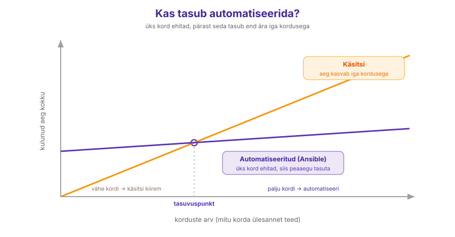
  <figcaption>Joonis 3.1. Käsitsi tehtav töö võtab aega igal kordamisel; automatiseeritud lahenduse ehitamine nõuab ühekordset tööd, kuid pärast tasuvuspunkti on iga kordus peaaegu tasuta (Talvik, 2025).</figcaption>
</figure>

Käsitsi seadistamisel on kolm püsivat probleemi. See ei skaleeru: kümne serveri käsitsi seadistamine on ajamahukas, kahesaja serveri puhul praktiliselt võimatu. Serverid triivivad: aja jooksul saab iga server veidi erinevad seaded ja seda nimetatakse **triiviks** (drift). Seadistus pole dokumenteeritud: "õiged" seaded on kirjas ainult serveris endas.

Ansible lahendab kõik kolm probleemi. Soovitud olek kirjeldatakse koodina üks kord (millised paketid, milline konfiguratsioon, millised teenused), see kood pannakse Giti (nagu eelmisel nädalal) ja Ansible rakendab selle kõigil serveritel ühtemoodi. Ansible ei asenda Giti: Git hoiab faile, Ansible loeb neid ja rakendab serverites failides kirjeldatud oleku.

## 2. Mis on Ansible

Ansible on avatud lähtekoodiga IT-automaatika platvorm. Seda kasutatakse konfiguratsioonihalduseks (serverite seadistamiseks), rakenduste paigaldamiseks, pilveressursside haldamiseks, võrguseadmete seadistamiseks ja mitme masina toimingute koordineerimiseks (orkestreerimine). Kasutusala on lai, kuid põhiidee on alati sama: kirjeldad soovitud olekut ja Ansible teeb süsteemis vajalikud muudatused.

Kõige lihtsamalt öeldes on Ansible programm, mis loeb kasutaja kirjutatud YAML-faile ja teeb nende järgi serverites muudatusi. Kõik mõisted ja moodulid on kirjeldatud [Ansible'i dokumentatsioonis](https://docs.ansible.com). Teise nurga alt selgitavad sama teemat ingliskeelne [Spacelift'i õpetus algajatele](https://spacelift.io/blog/ansible-tutorial) ja Tartu Ülikooli [süsteemihalduse kursuse Ansible'i peatükk](https://courses.cs.ut.ee/2022/sa/spring/Main/Ansible).

Ansible ei ole operatsioonisüsteem, pilveteenus ega veebirakendus. Algajad ajavad selle sageli segamini. Ansible on tööriist, mis käivitatakse kusagil (sinu arvutis, CI/CD-runneris või eraldi automaatikaserveris) ja mis ühendub sealt hallatavate serveritega. Ansible ei ole veebiteenus, kuhu kasutaja sisse logib: käivitad Ansible'i käsu ja see teeb töö ära.

??? info "Ansible'i taust"
    Ansible'i lõi Michael DeHaan 2012. aastal. Tema eesmärk oli teha automatiseerimistööriist, mida oleks lihtne kasutusele võtta, millel oleks võimalikult vähe eeldusi ja mille seadistusi saaks inimene lugeda. Krüptilise programmeerimiskeele asemel pidi see olema midagi, mida oskab lugeda ka sügava programmeerimistaustata administraator. Red Hat ostis Ansible'i 2015. aastal, kuid projekt on endiselt avatud lähtekoodiga ja seda arendatakse koos kogukonnaga.

??? info "Ametlik projekt ja meie projekt"
    Kursusel on kaks eri asja, mida ei tohi omavahel segi ajada.

    **Ametlik projekt** asub aadressil <https://github.com/ansible/ansible>. Seal on Ansible'i enda lähtekood, dokumentatsioon ja arendus. Seda me ei muuda: see on tööriist, mida kasutame.

    **Meie projekt** on sinu enda kursuse repositoorium, näiteks praktikumi repositoorium. Sinna lähevad meie inventory, playbook'id, konfiguratsioonifailid ja README.

    Teisisõnu ei kirjuta me Ansible'it ümber. Kirjutame Ansible'i abil oma infrastruktuuri kirjelduse ehk failid, mis ütlevad, millised meie serverid peavad olema.

## 3. Kust Ansible tuleb: konfiguratsioonihalduse maastik

Ansible ei ole esimene ega ainus tööriist, mis haldab servereid koodi abil. Enne seda olid juba olemas Puppet (2005) ja Chef (2009), tänapäeval kasutatakse ka Salti. Kõik need lahendavad sama probleemi (kuidas hoida paljusid servereid koodi järgi soovitud olekus), kuid Ansible levis kiiresti ühe konkreetse valiku tõttu: see ei vaja hallataval serveril agenti. Selle valiku tähtsust näitab kahe lähenemise erinevus ([How Ansible works](https://www.ansible.com/overview/how-ansible-works)).

**Pull-mudelis** (Puppet, Chef) töötab igas serveris väike agentprogramm, mis tuleb sinna eelnevalt paigaldada. Agent küsib perioodiliselt keskserverilt: "Milline on minu soovitud olek?" ja rakendab selle kohapeal ise. Server tõmbab (pull) konfiguratsiooni endale. See töötab hästi, kuid enne mis tahes muud tööd tuleb igasse serverisse agent paigaldada ja seda hiljem hooldada.

**Push-mudelis** (Ansible) serveris eraldi agenti ei tööta. Keskne masin (juhtsõlm) ühendub serveritega ise, tavaliselt SSH kaudu, saadab (push) käsud kohale ja käivitab need. Kui käsk on täidetud, kustutab Ansible ajutised failid. Püsivat agenti serverisse ei paigaldata. Eelnevalt ei pea midagi paigaldama: kui serveris on SSH ja Python (mis Linuxis on peaaegu alati olemas), saab Ansible sellega kohe suhelda.

<figure markdown="span">
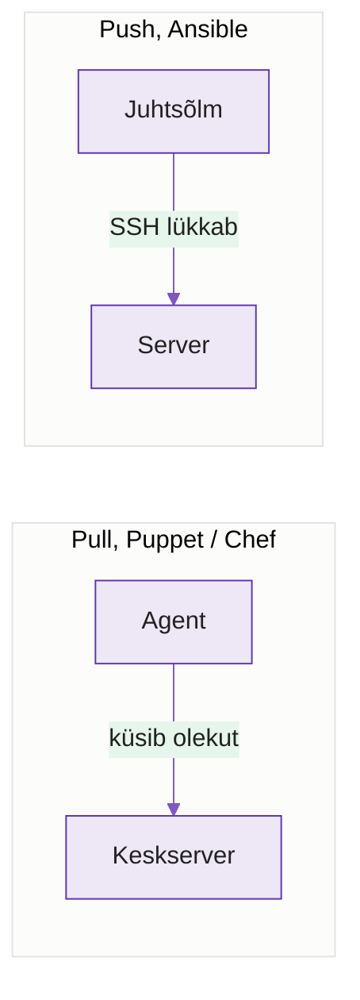
  <figcaption>Joonis 3.2. Pull-mudelis küsib serveri agent olekut ise; push-mudelis saadab juhtsõlm muudatuse SSH kaudu kohale (Talvik, 2025).</figcaption>
</figure>

Kumbki lähenemine ei ole absoluutselt parem, sest suurtes keskkondades on pull-mudelil omad eelised. Ansible'i madal sisenemislävi teeb selle siiski algajale ja väiksemale keskkonnale sobivaks. Tabel 3.1 võtab erinevused kokku.

??? note "Tabel 3.1. Push- ja pull-mudeli võrdlus"
    | Omadus | Push (Ansible) | Pull (Puppet, Chef) |
    |---|---|---|
    | Agent serveril | Pole vaja | Paigalda ja hoia töös |
    | Ühendus | SSH (juba olemas) | Agent + keskserver |
    | Alustamise lävi | Madal: paigalda ühte masinasse | Kõrgem: seadista kogu taristu |
    | Keel | YAML (loetav) | Oma DSL (Ruby-põhine) |
    | Kust muudatus algab | Käivitatakse käsitsi või CI-st | Agent ise, ajakava järgi |

Meie kursusel kasutame Ansible'it just seetõttu, et kõik vajalik on juba olemas: SSH-ühendus serveriga ja Python serveris. Rohkem pole vaja.

## 4. Deklaratiivne lähenemine

Ansible'i keskne mõte on mõtteviisi muutus, uus süntaks on teisejärguline. Harjumuspärane viis arvutile käske anda on **imperatiivne** ehk samm-sammuline: ütled täpselt, millised käsud ja millises järjekorras käivitada. Nii kirjutatakse ka Bashi skripte: "paigalda see, kopeeri too, käivita kolmas":

```bash
apt install nginx
cp nginx.conf /etc/nginx/nginx.conf
systemctl start nginx
```

Ansible töötab teisiti. Sammude loetlemise asemel kirjeldad **soovitud olekut**: milline peab server pärast olema. See on **deklaratiivne** lähenemine:

```yaml
- name: nginx on paigaldatud ja töötab
  hosts: webservers
  tasks:
    - name: nginx'i pakett on olemas
      ansible.builtin.package:
        name: nginx
        state: present

    - name: konfiguratsioon on paigas
      ansible.builtin.copy:
        src: nginx.conf
        dest: /etc/nginx/nginx.conf

    - name: teenus on käivitatud
      service:
        name: nginx
        state: started
        enabled: true
```

<figure markdown="span">
  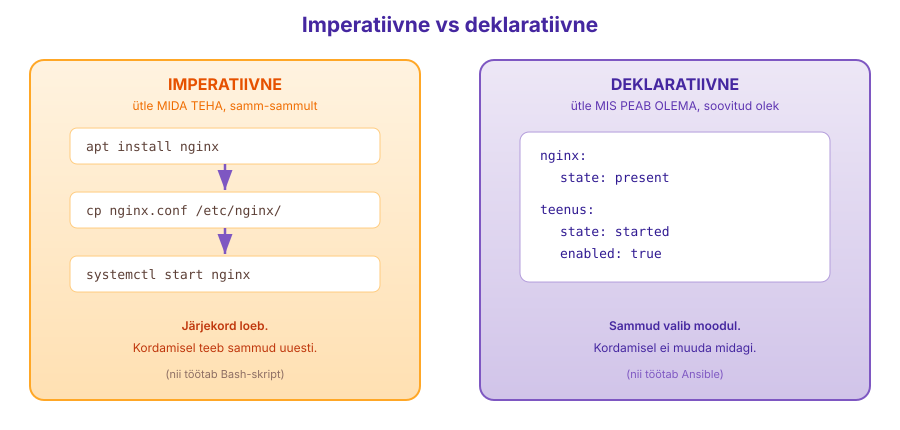
  <figcaption>Joonis 3.3. Imperatiivne lähenemine ütleb, mida ja mis järjekorras teha; deklaratiivne ütleb, mis peab olema, ja sammud valib moodul (Talvik, 2025).</figcaption>
</figure>

Pane tähele sõnastust. Käsu "paigalda nginx" asemel on kirjas "nginx `state: present`" (olgu olemas) ja käsu "käivita teenus" asemel "`state: started`" (olgu käimas). Erinevus on sisuline.

Käsk "paigalda" proovib paigaldada iga kord, ka siis, kui nginx on juba olemas. Kirjeldus "olgu olemas" paneb Ansible'i esmalt kontrollima, kas nginx on juba paigaldatud, ja midagi tehakse ainult siis, kui see on vajalik. Sellel erinevusel põhineb Ansible'i töökindlus.

Paljudes moodulites on parameeter `state`. Selle lubatud väärtused sõltuvad moodulist, kuid loogika on sama: kirjeldad, milline asi peab olema, ja tegevuse valib moodul ise (tabel 3.2).

??? note "Tabel 3.2. `state` väärtused moodulites"
    | Moodul | Levinud `state` väärtused | Tähendus |
    |---|---|---|
    | `apt` / `package` | `present`, `absent`, `latest` | olemas / eemaldatud / uusim versioon |
    | `service` | `started`, `stopped`, `restarted`, `reloaded` | käib / seisab / taaskäivita / laadi konfiguratsioon uuesti |
    | `file` | `file`, `absent`, `directory` | fail on olemas / kustutatud / kaust |

Deklaratiivse lähenemise eelis on see, et sama fail sobib eri algolekutega serveritele. Kui server on täiesti tühi, teeb Ansible kõik sammud. Kui osa on juba seadistatud, teeb see ainult puuduva osa.

Kui kõik on juba korras, ei tee Ansible midagi. Serveri praegust olekut ei pea teadma: piisab, kui kirjeldad soovitud oleku.

## 5. Idempotentsus

**Idempotentsus** tähendab, et sama toimingut võib teha mitu korda ja tulemus jääb samaks. Ansible töötab just nii ja see tuleneb otse deklaratiivsusest: moodulile on antud soovitud olek ja enne muutmist kontrollib moodul, kas see olek on juba olemas. Esimesel käivitamisel paigaldab Ansible nginx'i (`changed`), teisel näeb, et kõik on paigas, ega tee midagi (`ok`). Mõiste definitsioon on [Ansible'i sõnastikus](https://docs.ansible.com/ansible/latest/reference_appendices/glossary.html).

<figure markdown="span">
  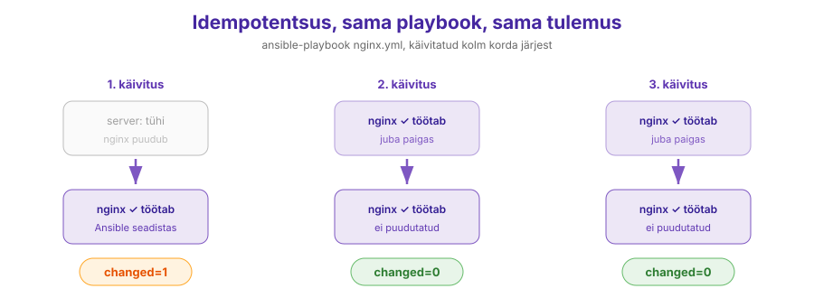
  <figcaption>Joonis 3.4. Esimene käivitamine rakendab serveris soovitud oleku (changed=1); järgmised käivitamised ei muuda enam midagi (changed=0) (Talvik, 2025).</figcaption>
</figure>

Praktikumis puutud kokku ühe erandiga. Moodulid `shell:` ja `command:` lihtsalt käivitavad käsu ega tea, mida see muutis. Seetõttu raporteerivad nad vaikimisi iga kord `changed`, kui task'ile pole lisatud `changed_when`-tingimust ega parameetrit `creates` või `removes`.

Selline task näitab igal käivitusel `changed`, isegi kui käsk tegelikult midagi ei muutnud. Kui playbook käivitub 50 serveris cron'iga, ei ole enam võimalik eristada tegelikku muudatust käsu käivitamisest. Reegel: enne kui kirjutad `shell:`, kontrolli, kas sama tööd teeb mõni spetsiaalne moodul. Praktikumis teed selle vea meelega ja parandad selle ise.

## 6. Ansible arhitektuur ja inventory

Vaatame nüüd, kuidas Ansible serveritega suhtleb. Nagu peatükis 3 öeldud, töötab Ansible push-mudeli järgi: juhtsõlm ühendub SSH kaudu, kopeerib vajaliku koodi serverisse, käivitab selle Pythoniga ja kustutab seejärel ajutised failid. Püsivat agenti serverisse ei paigaldata.

<figure markdown="span">
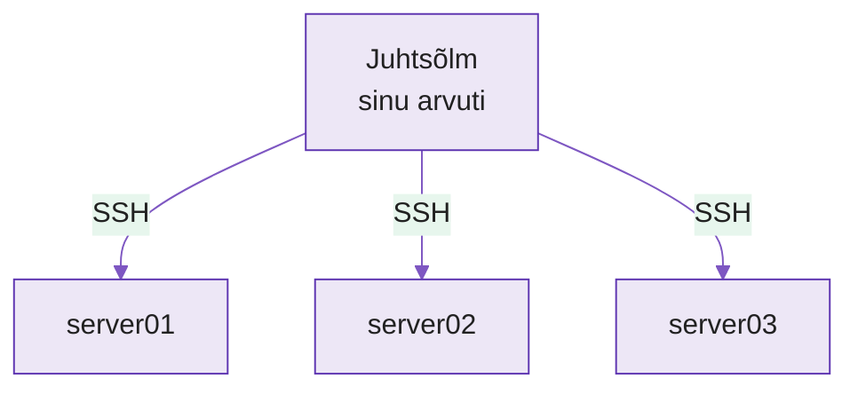
  <figcaption>Joonis 3.5. Ansible ühendub serveritega SSH kaudu; serverites on vaja ainult SSH-d ja Pythonit, agenti ei paigaldata (Talvik, 2025).</figcaption>
</figure>

Siin on kaks poolt. **Juhtsõlm** (control node) on masin, kust Ansible käivitatakse (sinu arvuti või näiteks GitHub Actionsi runner). **Hallatav sõlm** (managed node) on masin, mida Ansible seadistab (meie kursusel Alma sõlmed `proxmox1`–`proxmox3`). Lisaks on **SSH-kasutaja** (remote user) ehk kasutaja, kelle nime all Ansible serverisse sisse logib, näiteks `kasutaja` või `ubuntu`.

Ansible'il ei ole serveris erilisi õigusi. See saab teha täpselt seda, mida SSH-kasutajal ja `sudo` reeglitel on lubatud teha, ei rohkem ega vähem. Serveris on vaja ainult kahte asja, mis on Linuxis tavaliselt juba olemas: SSH-teenust, et ühenduda, ja Pythonit, et Ansible'i mooduleid käivitada.

Ansible ise on paigaldatud juhtsõlme. Windowsi hallatakse veidi teisiti (tavaliselt WinRM-i kaudu), kuid meie kursusel on kõik sihtmasinad Linuxid, seega seda ei pea arvestama.

### Inventory: hallatavate serverite nimekiri

Et Ansible teaks, milliste serveritega suhelda, hoiab see nende nimekirja **inventory-failis**. Kõige lihtsamal juhul on see serverite loend, üks server rea kohta. Kasulikumaks muutub inventory siis, kui koondad serverid **rühmadesse**: nii saad ühe käsuga hallata korraga kõiki veebiservereid või kõiki andmebaasiservereid. Rühma nimi kirjutatakse nurksulgudesse ja selle alla loetletakse rühma serverid:

```ini
[webservers]
web01 ansible_host=192.168.1.10 ansible_user=kasutaja
web02 ansible_host=192.168.1.11 ansible_user=kasutaja

[databases]
db01 ansible_host=192.168.1.20 ansible_user=kasutaja
```

Loeme näite rea kaupa lahti. `[webservers]` ja `[databases]` on serverite rühmad. `web01` on inimesele mugav hüüdnimi, mis on palju loetavam kui IP-aadress; kui serveri aadress kunagi muutub, tuleb seda muuta ainult ühes kohas. `ansible_host` määrab serveri tegeliku IP-aadressi või DNS-nime.

`ansible_user` määrab kasutaja, kellena Ansible SSH kaudu sisse logib. Rühma nimele (`webservers`) viitab playbook hiljem oma `hosts:` real. Nii saab sama playbook sihtida üht serverit, tervet rühma või kõiki hoste korraga (`all`).

Kui inventory asukohta ei ole määratud, otsib Ansible vaikimisi faili `/etc/ansible/hosts`. Meie hoiame inventory't alati projektikaustas, sest siis läheb see koos playbook'iga Giti ja on osa versioonihallatud projektist.

### Inventory parameetrid

Hüüdnime järele saab kirjutada parameetreid, mis täpsustavad, kuidas Ansible selle serveriga ühendub. Enamikul neist on mõistlik vaikeväärtus, nii et tavaliselt piisab `ansible_host`-ist ja `ansible_user`-ist, kuid valikuid on rohkem (tabel 3.3).

??? note "Tabel 3.3. Levinumad inventory parameetrid"
    | Parameeter | Mille jaoks | Näide |
    |---|---|---|
    | `ansible_host` | serveri IP või DNS-nimi | `192.168.1.10` |
    | `ansible_connection` | ühendusviis | `ssh` (Linux), `winrm` (Windows), `local` (kohalik masin) |
    | `ansible_port` | SSH port (vaikimisi 22) | `2222` |
    | `ansible_user` | kasutaja, kellena sisse logida | `kasutaja`, `ubuntu` |
    | `ansible_password` | ühenduse parool, väldi seda | (vaata hoiatust allpool) |

Mõni neist vajab selgitust. `ansible_connection` määrab ühendusviisi: Linuxi puhul SSH, Windowsi puhul WinRM. Kui väärtus on `local`, töötab Ansible otse kohalikus masinas ega ühendu kuhugi. See sobib katsetamiseks, kui eraldi serverit pole käepärast:

```ini
[local]
localhost ansible_connection=local
```

`ansible_port` määrab ühenduse pordi. Kuna SSH kuulab vaikimisi porti 22, ei pea seda tavaliselt kirjutama. Seda on vaja muuta ainult siis, kui server kuulab mõnda muud porti.

!!! warning "Ära hoia paroole tavatekstina"
    Viimane parameeter, `ansible_password`, vajab hoiatust. See salvestab SSH-parooli inventory-faili loetava tekstina ja see fail läheb Giti, kus kõik seda näevad. Nii ei tehta.

    Õige lahendus on paroolita SSH-võtmega autentimine, mis seadistati 1. nädala praktikumis: Ansible kasutab sama SSH-võtit ja parooli ei ole failis vaja. Tootmiskeskkonna saladused (API-võtmed, andmebaasi paroolid) hoitakse Ansible Vaultis, mis need krüpteerib; selleni jõuame N4-s. Meie kursusel piisab SSH-võtmest.

### INI või YAML: kaks vormingut

Inventory't saab kirjutada kahes vormingus. Sobiv vorming sõltub keskkonna suurusest: väikeses ettevõttes on mõni server, rahvusvahelises kontsernis sadu.

Väikese keskkonna jaoks piisab lihtsast **INI-vormingust**. Iga rühm on nurksulgudes pealkiri, mille alla loetled serverid:

```ini
[webservers]
web1
web2

[databases]
db1
db2
```

Suurema ja keerukama keskkonna jaoks on **YAML-vorming** struktureeritum ja paindlikum. Sama serverite kogum näeb YAML-is välja nii: kõik on võtme `all` all, selle all on `children`, edasi iga rühm ja hostid veel ühe taseme võrra sügavamal:

```yaml
all:
  children:
    webservers:
      hosts:
        web1:
        web2:
    databases:
      hosts:
        db1:
        db2:
```

Seda on rohkem kirjutada, kuid keskkonna kasvades tasub struktuur end ära. Mõlemad vormingud lubavad servereid rühmitada vastavalt vajadusele: rolli järgi (veebi-, andmebaasi-, rakendusserverid), asukoha järgi (USA, Euroopa, Aasia) või mis tahes muu kriteeriumi alusel. Rühmad määrad ise. Meie kursusel kasutame INI-vormingut, sest see on meie mahu jaoks kõige selgem, kuid YAML-vormingus inventory'ga võid mujal kokku puutuda.

### Rühmade hierarhia: ülem- ja alamrühmad

Suure organisatsiooni veebiserverid võivad asuda eri kohtades, osa USA-s ja osa Euroopas. Igas asukohas on mõni asukohapõhine seade, kuid suur osa konfiguratsioonist on kõigil ühine. Iga asukoha jaoks võiks teha eraldi rühma, kuid siis tuleks ühine osa igas rühmas dubleerida ja dubleerimine põhjustab vigu.

Lahendus on rühm, mis sisaldab teisi rühmi (**ülem- ja alamrühm**). Loo ülemrühm `webservers` ja selle alla alamrühmad `webservers_us` ja `webservers_eu`. Ühise konfiguratsiooni saab määrata ülemrühma tasemel, kus see kehtib kõigile, ja asukohapõhised seaded alamrühma tasemel. INI-vormingus märgitakse alamrühmad järelliitega `:children`:

```ini
[webservers_us]
web1
web2

[webservers_eu]
web3
web4

[webservers:children]
webservers_us
webservers_eu
```

Nii sihib `hosts: webservers` playbook'is korraga kõiki nelja serverit, `hosts: webservers_eu` aga ainult Euroopa servereid. YAML-vormingus teeb sama võtmesõna `children:`, mida nägid juba ülalpool vormingu näites.

<figure markdown="span">
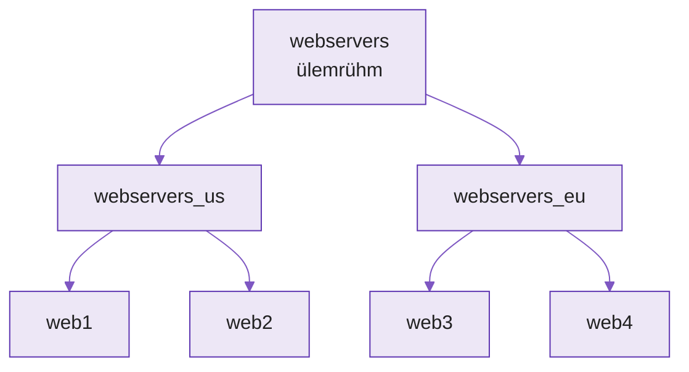
  <figcaption>Joonis 3.6. Ülemrühm webservers sisaldab alamrühmi; hosts: webservers sihib kõiki nelja serverit, hosts: webservers_eu ainult Euroopa servereid (Talvik, 2025).</figcaption>
</figure>

Ülem- ja alamrühmale antakse eri seaded muutujate (group_vars) abil; selle teemani jõuame N4-s. Praegu piisab teadmisest, et rühm võib sisaldada teisi rühmi ja nii saab dubleerimist vältida.

## 7. YAML: keel, millel kõik playbook'id põhinevad

Iga Ansible'i playbook on **YAML-fail** ehk lihttekst, mis sisaldab andmeid (meie puhul konfiguratsiooni). YAML-i kasutavad ka Docker Compose ja GitHub Actions. Kui oled näinud XML-i või JSON-i, saad sellest kiiresti aru. Siin on samad andmed JSON-is ja YAML-is (YAML on loetavam):

```json
{ "nimi": "nginx", "port": 80, "paketid": ["nginx", "curl", "git"] }
```

```yaml
nimi: nginx
port: 80
paketid:
  - nginx
  - curl
  - git
```

### Võti-väärtus

Kõige lihtsam andmestruktuur YAML-is on võtme ja väärtuse paar. Kirjutad võtme, siis kooloni ja seejärel väärtuse:

```yaml
puuvili: õun
vedelik: vesi
liha: kana
```

Kooloni järel peab olema tühik: `puuvili: õun` on õige, `puuvili:õun` on vale. See tundub tühine, kuid on üks sagedasemaid vigu.

### Loend (list)

Mitme asja loetlemiseks kasutad loendit. Iga element läheb eraldi reale ja selle ette kirjutatakse sidekriips:

```yaml
puuviljad:
  - õun
  - banaan
  - viinamari
```

Sidekriips (`-`) märgib iga kirje loendi elemendina. Loend on järjestatud. `õun, banaan` ei ole sama mis `banaan, õun`, sest järjekord loeb.

### Sõnastik (dictionary)

Sõnastik koondab ühe kirje alla mitu omadust, näiteks ühe puuvilja koos toitumisandmetega:

```yaml
banaan:
  kalorid: 105
  rasv: 0.4
  süsivesikud: 27
```

Pane tähele tühikuid iga omaduse ees. Kõik ühe kirje omadused peavad olema taandatud sama arvu tühikutega ja just siin teevad algajad sageli vigu. Kolm sama taandega omadust tähendavad, et kalorid, rasv ja süsivesikud kuuluvad kõik `banaan`-i alla. Kui taandad ühe neist sügavamale:

```yaml
banaan:
  kalorid: 105
    rasv: 0.4          # liiga sügav taane
```

satub `rasv` justkui `kalorid`-i alla. Kuid `kalorid`-il on juba väärtus (105), selle alla ei saa enam sõnastikku panna ja YAML annab vea. Erinevalt loendist on sõnastik järjestamata: omaduste järjekord ei loe ja pole vahet, kas `rasv` on enne või pärast `süsivesikud`-it.

### Pesastamine: sõnastike loend, sõnastik sõnastikus

Neid struktuure saab üksteise sisse panna ja selleks on lihtne rusikareegel: üks objekt kirjeldatakse sõnastikuga, mitu objekti loendiga.

Üks auto on üks objekt, seega kirjeldatakse seda sõnastikuga. Mõne omaduse väärtus võib omakorda olla sõnastik ja nii tekib sõnastik sõnastiku sees:

```yaml
auto:
  värv: sinine
  mudel:               # sõnastik sõnastiku sees
    nimi: Corolla
    aasta: 2020
  hind: 15000
```

Kui autosid on mitu, on tegemist loendiga. Kui vajad ainult nimesid, piisab lihtsast stringide loendist. Kui vajad iga auto kõiki andmeid, on iga element eraldi sõnastik ja nii tekib **sõnastike loend**:

```yaml
autod:
  - nimi: Corolla
    aasta: 2020
  - nimi: Civic
    aasta: 2019
```

### Kommentaarid

Iga rida, mis algab trellidega (`#`), on kommentaar ja YAML jätab selle täielikult arvestamata. Kommentaaridesse kirjutatakse selgitusi:

```yaml
# see on kommentaar
nginx_port: 80   # ka rea lõpus
```

### YAML playbook'is

Playbook ongi koostatud nendest struktuuridest, mis on üksteise sisse pandud. Vaata selle teadmisega uuesti nginx'i näidet:

```yaml
- name: Seadista veebiserver   # play = sõnastik (loendi element)
  hosts: webservers
  tasks:                       # tasks = loend
    - name: Paigalda nginx     #   task = sõnastik
      ansible.builtin.package: #     mooduli parameetrid = sõnastik
        name: nginx
        state: present
```

Playbook on **play'de loend**, iga play on sõnastik, `tasks` on omakorda **sõnastike loend** ja mooduli parameetrid on jälle sõnastik. Kui YAML-i struktuur on selge, ei ole playbook'is midagi uut: see koosneb tuttavatest osadest tuttavas järjekorras. VS Code näitab taande tühikuid ja märgib YAML-i vead kohe ära, seega hoia see praktikumis avatud.

## 8. Playbook, play, task, moodul

Enne esimese playbook'i kirjutamist teeme selgeks neli mõistet, mida algajad sageli segi ajavad. Need on pesastatud suuremast väiksemani ja kui erinevused on selged, loed iga playbook'i palju kindlamalt.

<figure markdown="span">
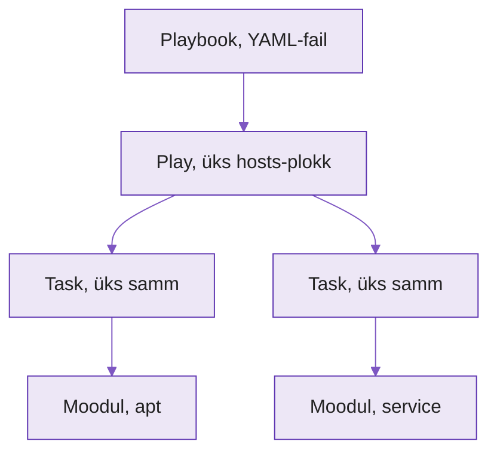
  <figcaption>Joonis 3.7. Playbook koosneb play'dest, play ülesannetest (task) ja iga task kasutab üht moodulit (Talvik, 2025).</figcaption>
</figure>

**Playbook** on kogu YAML-fail ehk plaan tervikuna. **Play** on selle sees üks plokk, mis seob ühe rühma servereid (`hosts:` rida) ülesannete hulgaga. **Task** on üks samm play sees, näiteks "paigalda nginx". **Moodul** on tööriist, mida task oma töö tegemiseks kasutab (`apt`, `copy`, `service`). Task ütleb, *mida* teha; moodul määrab, *millega* seda tehakse.

Vaatame terviklikku playbook'i, mis seadistab nginx'i veebiserveri, ja loeme selle rea kaupa lahti:

```yaml
---
- name: Seadista veebiserver     # play nimi, ilmub väljundis
  hosts: webservers              # rühm inventory'st
  become: true                   # käivita root-õigustega (sudo)

  tasks:
    - name: Paigalda nginx
      ansible.builtin.package:    # valib Almas dnf-i, Ubuntus apt-i
        name: nginx
        state: present            # "present" = peab olemas olema

    - name: Käivita ja luba nginx
      ansible.builtin.service:
        name: nginx
        state: started
        enabled: true             # käivitub ka pärast taaskäivitust
```

Kolm sidekriipsu (`---`) tähistavad YAML-dokumendi algust. Rida `- name:` annab play'le inimesele loetava nime, mis kuvatakse väljundis ja muudab `PLAY RECAP`-i lugemise palju lihtsamaks. `hosts: webservers` ütleb, et see play käivitub kõigis inventory rühma `webservers` serverites.

`become: true` tähendab, et tööd tehakse `sudo` õigustega (vaata osa 10). `tasks:` all algavad tegevused ja iga task kasutab üht moodulit: `ansible.builtin.package` paketihalduseks (Almas kasutab see `dnf`-i, Ubuntus `apt`-i) (`name: nginx`, `state: present` tähendab, et nginx peab olema paigaldatud) ja `service` teenuse käivitamiseks. Sama näite samm-sammult leiad juhendist [Getting started with Ansible](https://docs.ansible.com/ansible/latest/getting_started/).

<figure markdown="span">
  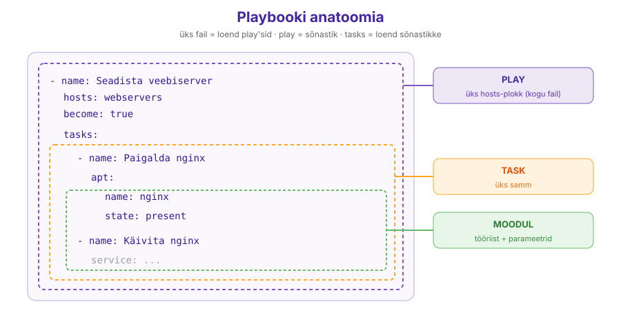
  <figcaption>Joonis 3.8. Sama playbook märgistatult: välimine plokk on play, iga samm on task ja task kasutab üht moodulit koos parameetritega (Talvik, 2025).</figcaption>
</figure>

Siin tuleb kasuks see, mida YAML-ist juba tead. Playbook on **play'de loend** ja iga play on sõnastik, seega play omaduste (`name`, `hosts`, `tasks`) järjekord ei loe: kui vahetad `name` ja `hosts` omavahel, on kood ikka kehtiv. Kuid `tasks` on loend ja loend on järjestatud, seega seal järjekord loeb.

Kui vahetad "Paigalda nginx" ja "Käivita nginx" omavahel, käsid Ansible'il käivitada teenuse enne, kui pakett on paigaldatud. Seetõttu on YAML-i taane ja struktuur nii olulised ning neid tuleb hoolikalt jälgida.

### Moodulid: valmis tööriistad

Moodul on Ansible'i valmis tegevus ja mooduleid on üle kolme tuhande. Neid ei pea pähe õppima: iga mooduli dokumentatsioonis on parameetrid ja näited. Alguses piisab vähestest moodulitest, peamised on tabelis 3.4.

??? note "Tabel 3.4. Levinumad `ansible.builtin` moodulid"
    | Moodul | Milleks |
    |---|---|
    | `ping` | kontrollib Ansible'i ühendust hostiga |
    | `apt` | paigaldab/eemaldab Debiani/Ubuntu pakette |
    | `dnf` | paigaldab/eemaldab RHEL/Fedora/Alma pakette |
    | `package` | üldisem paketimoodul (valib ise apt/dnf) |
    | `copy` | kopeerib faili juhtsõlmest serverisse |
    | `template` | loob faili Jinja2 malli põhjal |
    | `service` | käivitab/peatab/taaskäivitab teenuse |
    | `user` | haldab Linuxi kasutajaid |
    | `file` | haldab faile, kaustu ja õigusi |

Need baasmoodulid kuuluvad kollektsiooni `ansible.builtin` ja neid võib kirjutada kas täisnimega (`ansible.builtin.apt`) või lühidalt (`apt`). Täisnimi ehk **FQCN** (fully qualified collection name) näitab täpselt, millisest kollektsioonist moodul pärineb, ja just nii soovitab Ansible mooduleid tänapäeval kirjutada. Praktiline näide: vanemates juhendites kasutatakse RHEL-i ja Alma pakettide jaoks moodulit `yum`, kuid tänapäeval kasutatakse moodulit `ansible.builtin.dnf` (parameetrid on samad; moodul `yum` eemaldati ansible-core 2.17-s ja see suunatakse nüüd moodulile `dnf`).

Kõik olemasolevad moodulid loetleb käsk `ansible-doc -l` ja üksiku mooduli dokumentatsiooni näitab `ansible-doc <nimi>`. Lisamooduleid saab paigaldada `ansible-galaxy` abil, kuid kursusel piisab baasmoodulitest kõigeks, mida teeme. Baasmoodulite nimekiri on lehel [`ansible.builtin`](https://docs.ansible.com/ansible/latest/collections/ansible/builtin/).

### Ansible'i sõnavara ühe pilguga

Tabelis 3.5 on kogu sõnavara, millega Ansible'i juures kokku puutud. Osa mõisteid õpid juba täna, osa hilisematel nädalatel.

??? note "Tabel 3.5. Ansible'i mõisted ja kus neid kursusel käsitleme"
    | Mõiste | Millele vastab | Millal |
    |---|---|---|
    | Inventory | milliste serveritega räägime? | N3 |
    | Group | millised serverid on sama rolliga? | N3 |
    | Playbook | mida ja kellele teeme? | N3 |
    | Play | üks plokk, mis sihib hoste | N3 |
    | Task | üks tegevus play sees | N3 |
    | Module | valmis tööriist tegevuse tegemiseks | N3 |
    | Variable | muudetav väärtus (paketi nimi, port) | N3 |
    | Handler | tegevus, mis käivitub ainult muudatuse korral | N4 |
    | Template | Jinja2 mall dünaamilise faili loomiseks | N4 |
    | Role | korduvkasutatavaks organiseeritud sisu | N11 |
    | Collection | moodulite ja rollide pakett | N11 |

## 9. Muutujad: üks playbook, palju väärtusi

Tegelikus töös vajab playbook peaaegu alati muutujaid. Kui domeen, port või IP-aadress on playbook'is kõvakodeeritud, tuleb iga serveri või keskkonna jaoks teha eraldi fail ja neid käsitsi sünkroonis hoida. Muutuja hoiab väärtust ühes kohas ja sama playbook töötab erinevate väärtustega. Muutujaid oled tegelikult juba näinud: inventory's olevad `ansible_host` ja `ansible_user` on samuti muutujad.

Kõige lihtsam on muutuja määrata playbook'is endas, ploki `vars:` all:

```yaml
- name: Seadista veebiserver
  hosts: webservers
  vars:
    domain_name: example.ee
    nginx_port: 80
  tasks:
    - name: ...
```

Muutuja kasutamiseks kirjuta selle nimi kahekordsete looksulgude vahele (`{{ }}`). Väärtuse asemel kirjutad muutuja:

```yaml
    server_name: "{{ domain_name }}"
```

Käivitamisel asendab Ansible `{{ domain_name }}` muutuja väärtusega. Üks süntaksireegel: kui väärtus algab muutujaga, pane see jutumärkidesse (`"{{ domain_name }}"`), muidu tõlgendab YAML looksulgu valesti. Kui muutuja on stringi keskel, ei ole jutumärke vaja.

### Muutujatüübid: mida väärtus võib sisaldada

Ansible'is kasutatakse viit põhilist muutujatüüpi ja need on iga playbook'i ehituskivid. **String** on tavaline tekst (`username: admin`). **Number** on täisarv või kümnendarv, millega saab teha aritmeetikat (`max_connections: 100`).

**Boolean** on `true` või `false` ja seda kasutatakse sageli tingimustes (`debug_mode: true`). Ansible käsitleb tõesena ka väärtusi `yes`/`on`/`1` ja väärana `no`/`off`/`0`, kuid selguse huvides kasuta `true`/`false`.

**Loend (list)** on järjestatud kogum, mille elemendid võivad olla mis tahes tüüpi:

```yaml
paketid:
  - nginx
  - postgresql
  - git
```

Kogu loendile viitad kujul `{{ paketid }}`; üksikule elemendile pääsed ligi indeksiga: `{{ paketid[0] }}` annab `nginx` (indeks 0 tähistab esimest elementi).

**Sõnastik (dictionary)** sisaldab võtme ja väärtuse paare:

```yaml
kasutaja:
  nimi: admin
  roll: administraator
```

Kogu sõnastikule viitad kujul `{{ kasutaja }}`; üksiku väärtuse leiad võtme kaudu: `{{ kasutaja.nimi }}` annab `admin`.

### Milline väärtus kehtib, kui muutuja on mitmes kohas

Sama muutuja võib olla korraga määratud mitmes kohas eri väärtustega. Milline neist kehtib? Ansible rakendab määranguid kindlas järjekorras ja hilisem kirjutab varasema üle. Kui rühm `web_servers` määrab `dns_server: 10.5.5.3`, aga hostile `web2` on määratud host-muutuja `dns_server: 10.5.5.4`, saab `web2` esmalt rühma väärtuse, kuid hosti väärtus kirjutab selle üle ja kehtima jääb 10.5.5.4. Järjekord lihtsustatult madalaimast kõrgeimani:

1. rollide vaikimisi muutujad (`roles/*/defaults/`), kirjutatakse kõige kergemini üle
2. rühma muutujad (`group_vars`)
3. hosti muutujad (`host_vars`), kirjutavad üle rühma muutujad
4. play-taseme `vars:`, kirjutavad üle mõlemad eelmised
5. extra-vars (`-e` käsurealt), kehtib alati ja kirjutab üle kõik muud

<figure markdown="span">
  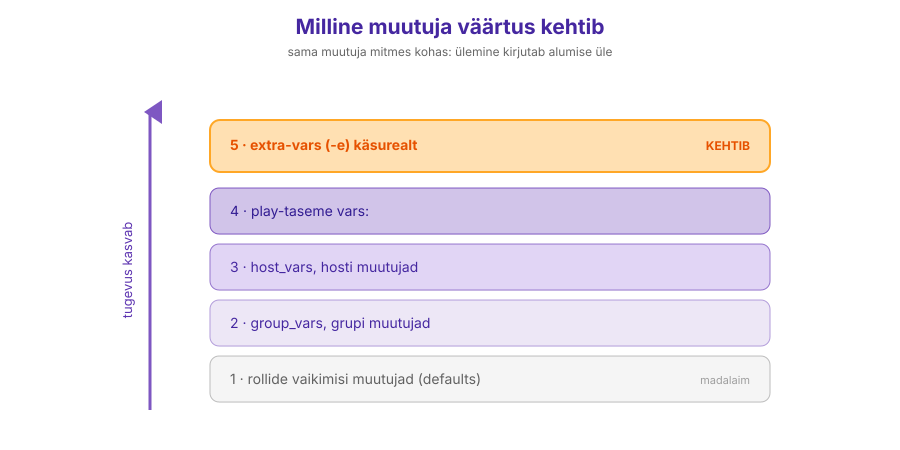
  <figcaption>Joonis 3.9. Kui muutuja on määratud mitmes kohas, kehtib ülemine: extra-vars kirjutab üle kõik muud, rollide defaults kirjutatakse kõige kergemini üle (Talvik, 2025).</figcaption>
</figure>

Rusikareegel: mida spetsiifilisem ja hilisem on määrang, seda tõenäolisemalt see kehtib.

### `register`: salvesta ühe ülesande tulemus

Mõnikord on vaja ühe ülesande väljundit hiljem kasutada. Selleks lisa ülesandele direktiiv `register` ja anna muutujale nimi:

```yaml
tasks:
  - name: Loe /etc/hosts
    shell: cat /etc/hosts
    register: result

  - name: Kuva tulemus
    debug:
      var: result.stdout
```

Esimese ülesande väljund salvestatakse muutujasse `result` ja teine ülesanne kasutab seda. Muutuja on selle hosti jaoks kättesaadav kuni playbook'i käivitamise lõpuni. Mida `result` sisaldab, sõltub moodulist: `shell`/`command` puhul on seal `rc` (tagastuskood, `0` tähendab õnnestumist), ajaandmed ning `stdout` ja `stderr`.

Üksiku välja saad kätte nii: `{{ result.stdout }}`, `{{ result.rc }}`. Registreeritud muutuja kuulub sellele hostile, kus see loodi. Kiire viis tulemust ilma `debug`-moodulita näha on `ansible-playbook -v`.

### Muutuja ulatus (scope): kus muutuja on nähtav

Nagu programmeerimises, määrab **ulatus**, kus muutuja on nähtav. Hosti ulatus: hostile määratud muutuja on nähtav ainult selle hosti jaoks: `web2` muutuja `dns_server` ei ole nähtav `web1`-le ega `web3`-le. Play ulatus: play sees `vars:` abil määratud muutuja kehtib ainult selles play's ja teine play seda ei näe. Globaalne ulatus: extra-vars (`-e`) on nähtav kõigis play'des.

<figure markdown="span">
  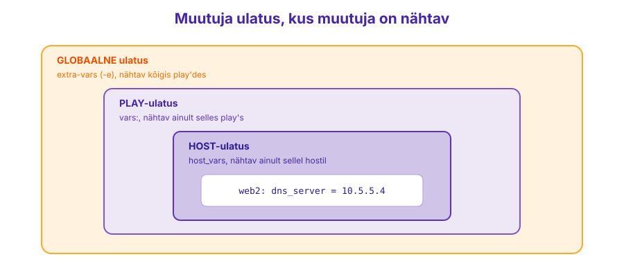
  <figcaption>Joonis 3.10. Host-muutuja on nähtav ainult oma hostil, play-muutuja oma play's ja globaalne muutuja (extra-vars) kõikjal (Talvik, 2025).</figcaption>
</figure>

### Erimuutujad (magic variables)

Kuna host-muutuja on seotud oma hostiga, tekib küsimus, kuidas `web1` ülesanne pääseb ligi väärtusele, mis on määratud `web2`-le. Selleks on **erimuutujad** (Ansible'i dokumentatsioonis *magic variables*): sisseehitatud muutujad, mis võimaldavad lugeda andmeid üle hostide ja rühmade. **`hostvars`** loeb teise hosti muutujaid: `hostvars['web2'].dns_server`. **`groups`** annab rühma hostid (`groups['webservers']`).

**`group_names`** annab rühmad, kuhu praegune host kuulub. `inventory_hostname` on hosti nimi inventory-failis (mitte FQDN). Kahte muutujat ei tohi segi ajada: `ansible_playbook_python` on Python juhtsõlmes (sinu masinas), `ansible_python_interpreter` aga hallataval serveril, kus ülesanded käivituvad.

### Faktid: muutujad, mille Ansible ise kogub

Seni oled kõik muutujad ise määranud, kuid osa muutujaid kogub Ansible ise. Need on **faktid**. Kui playbook käivitub ja Ansible ühendub sihtmasinaga, kogub see kõigepealt hulga teavet: süsteemi kohta (arhitektuur, OS ja selle versioon, protsessor, mälu), võrgu kohta (liidesed, IP-aadressid, FQDN, MAC-aadressid), seadmete kohta (kettad, vaba ruum) ning ka kuupäeva ja kellaaja.

Fakte kogub moodul `setup` automaatselt. Isegi kui playbook'is on ainult üks task, näed väljundis kahte: esimene on "Gathering Facts" (mida sa ise ei kirjutanud), teine on sinu task.

Fakte saad vaadata, kui annad moodulile `debug` muutujaks `ansible_facts`:

```yaml
- name: Kuva faktid
  debug:
    var: ansible_facts
```

Üksiku fakti loed sõnastikust: `ansible_facts.distribution` annab OS-i nime. Vanemates juhendites kasutatakse otse muutujat `ansible_distribution`. See töötas, sest Ansible lisas iga fakti ka eraldi tipptaseme muutujana, kuid see kuju on aegumas (seade `inject_facts_as_vars` lülitatakse tulevikus vaikimisi välja).

Seetõttu harju lugema fakte sõnastikust `ansible_facts`, sest see kuju jääb kehtima. Vanemates juhendites näed `when`-tingimustes lühikuju `ansible_os_family`, mis on sama mis `ansible_facts['os_family']`.

Faktid muudavad playbook'i kohandatavaks: kettaid või teenuseid seadistades saab teha otsuseid selle põhjal, mida Ansible masinast leidis (nt mälu hulk või OS). Kui playbook fakte ei kasuta, saab nende kogumise välja lülitada, mis kiirendab käivitamist:

```yaml
- hosts: webservers
  gather_facts: false
```

Nüüd käivitub ainult sinu task ja fakte ei koguta. Sama käitumist juhib ka `ansible.cfg` seade `gathering`: `implicit` kogub fakte vaikimisi, kui play's pole `gather_facts: false`; `explicit` ei kogu fakte, kui play's pole `gather_facts: true`; `smart` kogub iga hosti fakte käivitamise jooksul ainult ühe korra. Play seade `gather_facts` on konfiguratsioonifaili seadest tähtsam. Fakte kogutakse ainult nende hostide kohta, mida playbook sihib.

Sellest piisab juba kohandatava playbook'i kirjutamiseks. Muutujaid saab hoida ka väljaspool playbook'i eraldi failides (`group_vars/`, `host_vars/`), et jagada sama väärtust mitme playbook'i ja eri keskkondade (test/tootmine) vahel. Tundlikud väärtused (paroolid, API-võtmed) krüpteeritakse Ansible Vaultiga. Failipõhine korraldus ja Vault on N4 (dünaamiline konfiguratsioon) teema.

## 10. Become: ülesanne root-õigustega

Enamik serveri seadistamise toiminguid vajab root-õigusi: paketi paigaldamine, teenuse käivitamine, faili kirjutamine kataloogi `/etc`. Samas ei logi Ansible tavaliselt otse root-kasutajana sisse, sest root-kasutaja otse sisselogimine on turvakaalutlustel sageli keelatud. Selle asemel logitakse sisse tavakasutajana ja root-õigusi kasutatakse ainult siis, kui see on vajalik.

Rida `become: true` käivitab ülesanded vaikimisi `sudo` kaudu. Selle võib lisada kogu play'le (nagu meie nginx'i näites, kus kõik ülesanded vajavad root-õigusi) või ühele task'ile, kui ainult see samm neid vajab. Kui midagi on vaja teha mõne muu kasutajana (näiteks `postgres`), on selleks eraldi `become_user` ([privilege escalation](https://docs.ansible.com/ansible/latest/playbook_guide/playbooks_privilege_escalation.html)).

See järgib **vähimate õiguste põhimõtet** (principle of least privilege): iga tegevus saab täpselt need õigused, mida see vajab, ja mitte rohkem. Root-õigused antakse ainult sinna, kus neid vaja on, ja tavatöö tehakse tavakasutajana.

Kui `become` on puudu, annab Ansible näiteks vea `Permission denied` või `Failed to lock apt`, sest tavakasutajal ei ole õigust pakette paigaldada. Sellise vea korral kontrolli kõigepealt, kas task vajab root-õigusi ja kas `become` on sisse lülitatud. Praktikumis eemaldad `become`-i meelega, näed seda viga ja lisad rea tagasi.

## 11. Tingimused ja tsüklid: when ja loop

Seni käivituvad kõik task'id alati. Sageli on aga vaja, et task käivituks ainult teatud tingimusel (näiteks ainult teatud operatsioonisüsteemis). Selleks on `when`.

### `when`: käivita ainult tingimusel

Näiteks tuleb paigaldada nginx, kuid Debianil põhinevad süsteemid kasutavad paketihaldurit `apt` ning Red Hat ja Alma kasutavad `dnf`-i. Kahe eraldi playbook'i asemel teed ühe, kus igal task'il on tingimus:

```yaml
tasks:
  - name: Paigalda nginx (Debian)
    ansible.builtin.apt:
      name: nginx
      state: present
    when: ansible_facts['os_family'] == "Debian"

  - name: Paigalda nginx (Red Hat / Alma)
    ansible.builtin.dnf:
      name: nginx
      state: present
    when: ansible_facts['os_family'] == "RedHat"
```

Tingimus loeb fakti `ansible_facts['os_family']`, mille väärtus on OS-i perekond (`Debian`, `RedHat`, `Suse`). `apt`-task käivitub ainult Debiani perekonna süsteemides, `dnf`-task ainult Red Hati perekonna süsteemides; teine task jäetakse vahele (`skipped`). Kõik tingimuste võimalused on lehel [Conditionals](https://docs.ansible.com/ansible/latest/playbook_guide/playbooks_conditionals.html).

<figure markdown="span">
  ![when hargneb fakti ansible_facts['os_family'] järgi apt ja dnf vahel](../images/n03_when_haru.svg)
  <figcaption>Joonis 3.11. when laseb ühel playbook'il hargneda fakti järgi: apt-task käivitub Debianil, dnf-task Red Hatil (Talvik, 2025).</figcaption>
</figure>

Paar üksikasja. Võrdlemiseks kasuta kahte võrdusmärki (`==`). Tingimusi saab kombineerida: `or` korral käivitub task, kui kehtib vähemalt üks tingimus (`ansible_facts['os_family'] == "RedHat" or ansible_facts['os_family'] == "Suse"`); `and` korral peavad kehtima mõlemad (`ansible_facts['os_family'] == "Debian" and ansible_facts['distribution_version'] == "22.04"`).

Üks märkus puudutab otseselt meie kursust: selle lihtsa paigalduse võiks kirjutada ka ilma tingimuseta, kasutades moodulit `ansible.builtin.package`, mis valib sihtmasinale õige paketihalduri (apt/dnf) ise. Siis ei ole harusid vaja. `when`-i tuleb siiski osata, sest seda on vaja kohe, kui tingimus on keerulisem kui OS-i tüüp.

Millist fakti tingimuses kasutada? Kõige laiem on `ansible_facts['os_family']`, mis rühmitab distributsioonid perekondadesse (`Debian`, `RedHat`, `Windows`). Kasuta seda, kui task peab hõlmama kõiki Debiani- või Red Hati-tüüpi masinaid, sest see sobib kõige rohkematele süsteemidele. Täpsema tingimuse jaoks annab `ansible_facts['distribution']` konkreetse nime (`Ubuntu`, `AlmaLinux`), `ansible_facts['distribution_major_version']` peaversiooni (`24`, `9`) ja `ansible_facts['architecture']` protsessori arhitektuuri (`x86_64`).

Enne tingimuste kirjutamist vaata, milliseid väärtusi server tegelikult annab: kas ad-hoc käsuga `ansible <host> -m setup`, mis kuvab kõik faktid, või lisa playbook'i debug-task, mis kuvab `ansible_facts`. Nii ei pea arvama, milline on võtme täpne kuju. (Pea meeles: kui `gather_facts: false`, faktid puuduvad, seega ära kasuta fakte, mida pole kogutud.)

Mitu tingimust eraldi ridadel `when:` all tähendab sama mis nende ühendamine `and`-iga, kuid on loetavam:

```yaml
    when:
      - ansible_facts['distribution'] == "Ubuntu"
      - ansible_facts['distribution_major_version'] == "24"
```

### loop: korda sama task'i

Serverisse on vaja luua mitu kasutajat. Sama task'i kopeerimine iga kasutaja jaoks töötab, kuid on kohmakas ja dubleerimine teeb hoolduse tülikaks. Parem on üks task, mis käib kõik kasutajad läbi. Selleks on `loop`.

`loop` käivitab sama task'i mitu korda ja salvestab iga kord parajasti töödeldava väärtuse muutujasse `item`. Kasutajanime asemel kirjutad `{{ item }}`:

```yaml
- name: Loo kasutajad
  ansible.builtin.user:
    name: "{{ item }}"
    state: present
  loop:
    - joe
    - george
    - ravi
```

Tsüklit võib ette kujutada eraldi task'idena: esimene loob kasutaja `joe`, teine `george`, kolmas `ravi`. Moodul on sama, iga kord on erinev ainult `item`. Playbook jääb korrastatuks ja kordust on palju vähem.

<figure markdown="span">
  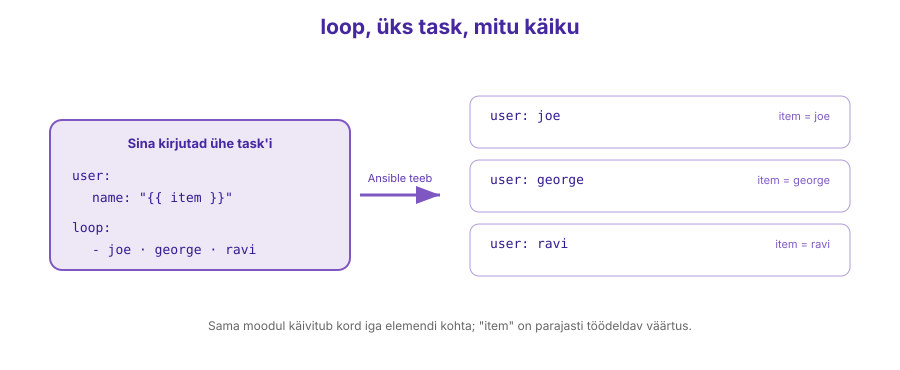
  <figcaption>Joonis 3.12. loop teeb ühest task'ist mitu käivitust; item hoiab iga kord loendi järgmist väärtust (Talvik, 2025).</figcaption>
</figure>

Kui iga kirje vajab mitut väärtust, näiteks nime ja kasutaja ID-d, kasuta stringide loendi asemel sõnastike loendit ja loe iga välja kujul `item.<võti>`:

```yaml
- name: Loo kasutajad ID-ga
  ansible.builtin.user:
    name: "{{ item.name }}"
    uid: "{{ item.uid }}"
    state: present
  loop:
    - { name: joe, uid: 1001 }
    - { name: george, uid: 1002 }
```

Nüüd on `item` sõnastik: `item.name` annab nime ja `item.uid` ID. Kui andmed muutuvad keerukamaks, aitab neist aru saada sama võte: kujuta tsüklit ette eraldi task'idena.

Vanemates juhendites kasutatakse `loop`-i asemel `with_items`-i. See teeb sama asja ja annab sama tulemuse, kuid tänapäeval soovitatakse kasutada `loop`-i. `with_items`-i tuleb siiski ära tunda, kui sellega kokku puutud.

`with_`-perekonda kuulub veel palju võtmesõnu: `with_file` (failid), `with_url` (URL-id), `with_mongodb` (andmebaasid) jt. Kõik `with_`-eesliitega võtmesõnad kasutavad **otsingupluginaid** (lookup plugins) ehk väikesi programme, mis toovad andmeid failidest, URL-idest, andmebaasidest või süsteemidest nagu Kubernetes. Alguses piisab loendi läbimiseks `loop`-ist.

### `when` tsükli sees

`when`-i saab kasutada ka koos loendiga. Järgmises näites on paketid muutujas ja igal paketil on nimi ning lipp `required`:

```yaml
vars:
  packages:
    - { name: nginx, required: true }
    - { name: mysql, required: true }
    - { name: apache, required: false }

tasks:
  - name: Paigalda kohustuslikud paketid
    ansible.builtin.package:
      name: "{{ item.name }}"
      state: present
    loop: "{{ packages }}"
    when: item.required
```

`loop` käib loendi läbi ja `when: item.required` paigaldab elemendi ainult siis, kui selle `required` on `true`. nginx ja mysql paigaldatakse, apache jäetakse vahele. Task'i korratakse iga elemendi kohta ja muutuja `item` viitab parajasti töödeldavale elemendile.

### Tingimus eelmise task'i tulemuse põhjal

`when`-i saab siduda ka `register`-iga (mida nägid muutujate juures). Järgmine näide kontrollib teenust ja annab teada, kui see ei tööta:

```yaml
tasks:
  - name: Kontrolli nginx olekut
    ansible.builtin.command: systemctl is-active nginx
    register: result
    changed_when: false      # ainult loeb, ei muuda midagi
    failed_when: false       # mitte-töötav teenus ei ole playbook'i viga

  - name: Teata, kui teenus ei tööta
    ansible.builtin.debug:
      msg: "nginx on maas!"
    when: result.stdout != "active"
```

`systemctl is-active` väljastab `active`, kui teenus töötab, ja muul juhul näiteks `inactive` või `failed` ning lõpetab siis nullist erineva koodiga. Ilma `failed_when: false`-ta loeks Ansible selle task'i ebaõnnestunuks ja teise task'ini ei jõutaks. `changed_when: false` ütleb, et see task ainult loeb andmeid, nii et see ei riku idempotentsust (osa 5). Nii kohandub üks playbook iga masinaga, mida see haldab.

### Faktid ja muutujad: host ja kavatsus

`when` kasutab kahte eri liiki andmeid. Faktid kirjeldavad, *milline host on* (milline OS, milline arhitektuur). Muutujad kirjeldavad, *mida sina soovid* (milline keskkond, millised seaded). `when` seob need kaks.

Muutujapõhine näide: arendus-, test- ja tootmiskeskkond vajavad veidi erinevat käitumist. Määrad muutuja `app_env` ja lased sellel tingimusi juhtida. Muutuja `app_env` on parem määrata inventory's, `group_vars`-is või `host_vars`-is kui task'i real, sest siis saab sama playbook'i eri keskkondades faili muutmata uuesti kasutada.

Tüüpiline korduvkasutuse muster: enamik samme (pakettide paigaldamine, kataloogid, õigused, konfiguratsioonifailid) käivitub igas serveris ilma tingimuseta. Ainult väike osa on keskkonnapõhine, näiteks teenuse käivitamine ainult tootmises. Seda väljendab üks `when` selle task'i juures:

```yaml
  - name: Käivita rakendus (ainult tootmises)
    ansible.builtin.service:
      name: app
      state: started
    when: app_env == "production"
```

Tulemuseks on üks playbook, mida saab rakendada kõikjal, kuid mis käivitab teenuse ainult seal, kus see on ette nähtud. Faktid näitavad, milline on host, muutujad näitavad, mida soovid, ja `when` seob need kokku.

## 12. Töövoog: õige järjekord juba esimesest päevast

Vaja on paigaldada oluline uuendus sadadesse serveritesse. Kirjutad playbook'i, oled sellega rahul ja käivitad selle kohe tootmises. Playbookis on aga väike viga, mis uuendamise asemel peatab teenuse igas serveris. Tulemuseks on pikk katkestus ja kiirustav töö, et kõik uuesti tööle saada.

Selle vea oleks avastanud üks vahele jäänud samm: kontroll. Kui playbook'i enne käivitamist kontrollida, tulevad vead välja ohutult ja enne tootmisse jõudmist. Seetõttu ei tohi playbook'i käivitada põhimõttel "vaatame, mis juhtub", eriti tootmisserveris. Hea harjumus on järgida kindlat sammude järjekorda, mis annab enne tegelikke muudatusi kindluse:

```bash
# 1. Kas Ansible näeb hoste?
ansible all -i inventory.ini -m ping

# 2. Kas playbook'i süntaks on korras? (ei ühendu serveriga)
ansible-playbook -i inventory.ini nginx.yml --syntax-check

# 3. Mis muutuks, kui käivitaks? (ei muuda midagi)
ansible-playbook -i inventory.ini nginx.yml --check

# 4. Rakenda muudatused
ansible-playbook -i inventory.ini nginx.yml

# 5. Kontrolli tulemust (sõlme seest: Alma tulemüür blokeerib pordi 80 väljast)
ssh proxmox1 "curl -s localhost"
```

<figure markdown="span">
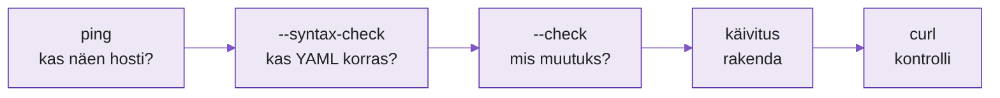
  <figcaption>Joonis 3.13. Hea harjumus: kontrolli ühendust ja süntaksit, vaata proovikäivitusega muudatused üle, alles siis rakenda ja kontrolli tulemust (Talvik, 2025).</figcaption>
</figure>

Esimene samm, moodul `ping`, kontrollib, kas Ansible jõuab hostini. See ei ole ICMP-ping: moodul kontrollib SSH-ühendust ja Pythoni olemasolu. Teine samm, `--syntax-check`, kontrollib playbook'i YAML-i ja süntaksivigu serveriga ühendumata.

Kolmas samm on proovikäivitus: `--check` käivitab playbook'i nagu tavaliselt, kuid ei tee ühtegi muudatust ja näitab ainult, millised task'id oleksid olnud `changed`. Kui lisad ka võtme `--diff`, näed failide täpseid erinevusi rea kaupa. Alles neljas samm teeb muudatused tegelikult ja viies kontrollib tulemust.

Ansible näitab iga ülesande olekut ja võtab lõpus kõik kokku jaotises `PLAY RECAP`. Olekud on tabelis 3.6.

??? note "Tabel 3.6. `PLAY RECAP` olekud"
    | Olek | Tähendus |
    |---|---|
    | `ok` | olek oli juba õige, midagi ei tehtud |
    | `changed` | serveris muudeti midagi |
    | `failed` | ülesanne ebaõnnestus |
    | `skipped` | tingimus ei täitunud, ülesanne jäeti vahele |
    | `unreachable` | serverini ei jõutud (SSH katki, server maas) |

`--syntax-check` ja `--check` peaksid olema harjumus algusest peale. Enamik levinud mooduleid (`package`, `copy`, `service`) toetab proovikäivitust, nii et plaani saab enne muudatusi üle vaadata. See ei asenda katsetamist testkeskkonnas ega tulemuse kontrolli ([check mode](https://docs.ansible.com/ansible/latest/playbook_guide/playbooks_checkmode.html)). (Märkus: kõik moodulid ei toeta proovikäivitust ja sellised ülesanded jäetakse `--check`-i ajal vahele.)

Võtmega `--diff` näed täpselt, mis muutuks. Näiteks konfiguratsioonifaili lisatav rida on märgitud plussmärgiga:

```diff
+ server_name example.ee;
```

Vea korral osutab `--syntax-check` täpsele kohale: kui YAML-ist on koolon puudu, peatub Ansible, näitab faili, rea ja veeru numbrit ning märgib veakoha noolega. Nii saab vea kiiresti parandada juba enne, kui playbook serverisse jõuab.

### ansible-lint: stiili ja kvaliteedi kontroll

`--check` ja `--diff` kontrollivad, mida playbook teeb. `ansible-lint` kontrollib, kuidas see on kirjutatud. Mida rohkem playbooke koguneb, seda olulisem on, et need oleksid ühtlased ja loetavad, ning selleks ongi lint. See on käsureatööriist, mis loeb läbi playbook'id, rollid ja kollektsioonid ning märgib ära vead, stiiliprobleemid ja kahtlased konstruktsioonid.

Käivita:

```bash
ansible-lint nginx.yml
```

Lint väljastab iga probleemi kohta ühe rea koos failinime ja reanumbriga, nii et on kohe näha, kust viga otsida. Iga rida lõpeb reegli ID-ga, mis koosneb kategooriast ja nurksulgudes täpsustusest. Näiteks `yaml[indentation]` (ebaühtlane taane), `name[casing]` (task'i nimi peaks algama suurtähega), `name[missing]` (task'il pole nime), `command-instead-of-shell` (kasutasid `shell`-i seal, kus piisaks `command`-ist; `shell` on aeglasem ja seda tasub kasutada ainult siis, kui on vaja torusid või keskkonnamuutujate laiendamist). Kui `ansible-lint` probleeme ei leia, lõpetab see väljumiskoodiga 0 ja kokkuvõttes on näha 0 viga ja 0 hoiatust.

Hea tava on lisada `ansible-lint` oma töövoogu, eriti CI-protsessi (N7). Siis kontrollitakse iga muudatust automaatselt samade reeglite järgi ja playbook'id jäävad ka kasvades ühtlaseks.

## 13. Väike mugavus: `ansible.cfg`

Võtme `-i inventory.ini` kirjutamine iga käsu järele muutub kiiresti tüütuks. Ansible'il on selleks lihtne lahendus: kui projektikaustas on fail nimega `ansible.cfg` ja käivitad Ansible'i sellest kaustast, loeb Ansible seaded sealt automaatselt. Näiteks:

```ini
[defaults]
inventory = inventory.ini
host_key_checking = False
```

Kui see fail on olemas, ei pea inventory asukohta enam iga kord käsureale kirjutama, sest Ansible leiab selle ise:

```bash
ansible all -m ping           # leiab inventory ise
ansible-playbook nginx.yml    # ilma -i liputa
```

Rida `host_key_checking = False` jätab esimesel ühendumisel ära küsimuse "kas oled kindel? (yes/no)", mis praktikumis muidu iga uue serveri juures ette tuleb. See lülitab välja SSH hostivõtme kontrolli, mis kaitseb võltsserveri eest. Seda tehakse ainult kinnises laborivõrgus, mitte tootmises. `ansible.cfg`-l on palju rohkem valikuid ja sel failil võib olla mitu asukohta, mida Ansible loeb kindlas järjekorras ([Ansible'i seaded](../ansible-config.md)). Praegu piisab sellest ühest seadest.

## 14. Failistruktuur: projekti ülesehitus

Kasulik nõuanne kohe alguseks: hoia projekt algusest peale ühes kaustas ja korras, selle asemel et luua igas tunnis uus juhuslik kaust. Kursuse jooksul kujuneb repo umbes selliseks:

```text
ansible-projekt/
├── inventory.ini
├── nginx.yml            # playbook
├── index.html           # kopeeritav fail
├── templates/           # Jinja2 mallid (N4)
├── group_vars/          # rühma muutujad (N4)
├── roles/               # rollid (N11)
└── README.md
```

Esimesel korral on olemas ainult mõni fail: inventory, esimene playbook, üks HTML-leht ja README:

```text
ansible-projekt/
├── inventory.ini
├── nginx.yml
├── index.html
└── README.md
```

Ülejäänud kaustad (mallid, muutujad, rollid) lisanduvad nädalate kaupa, kui nende teemadeni jõuame. Nii püsib projekt korras ja on alati selge, kuhu mis kuulub.

## 15. Ansible töökohas

Samamoodi hallatakse servereid ka töökohtades. Suurtes veebiteenustes töötab tuhandeid nginx'i eksemplare ja iga kord, kui konfiguratsioon muutub, peab muudatus jõudma kõigisse serveritesse täpselt, kiiresti ja vigadeta. Käsitsi SSH kaudu ei ole see võimalik. Ansible'i playbook käivitub automaatselt CI/CD-konveierist, rakendab iga kord sama seadistuse ja `git log` näitab, kes, mida ja millal muutis.

Süsteemiintegraatorid kasutavad Ansible'it klientide taristu seadistamisel just seetõttu, et sama playbook rakendab test- ja tootmiskeskkonnas sama seadistusloogikat, kasutades kummagi keskkonna jaoks oma väärtusi. Nii kaob tuntud probleem "meil töötab, teil ei tööta". Kui server tuleb kunagi nullist uuesti üles seada, olgu põhjuseks riistvararike, uus keskkond või katastroofist taastumine, ei pea keegi meenutama, mida sinna omal ajal seadistati. Vastus on playbook'is, mis on Gitis, üle vaadatud ja valmis uuesti käivitamiseks.

See on sama mõte nagu eelmisel nädalal Gitiga: käsitsi tehtud ja dokumenteerimata töö on alati haavatavam kui koodina kirja pandud töö. Erinevus on selles, et nüüd kirjeldatakse koodina rakenduse asemel serveri enda olekut.

## Kokkuvõte

??? abstract "Kokkuvõte"
    - Ansible loeb YAML-faile ja rakendab serverites soovitud oleku. See on tööriist, mis töötab sinu arvutis või CI-s.
    - Deklaratiivne lähenemine kirjeldab soovitud olekut (`state:`), sammud valib moodul.
    - Idempotentsus: korduv käivitus ei muuda midagi. `ok` tähendab, et olek oli juba õige, `changed`, et midagi muudeti.
    - `shell:` ja `command:` annavad vaikimisi iga kord `changed`. Eelista spetsiaalset moodulit või kasuta `creates`/`changed_when`.
    - Push-mudel: juhtsõlm ühendub SSH kaudu, serveris on vaja ainult SSH-d ja Pythonit.
    - Playbook (fail) koosneb play'dest (`hosts`-plokk), play task'idest ja iga task kasutab üht moodulit.
    - Muutujad: `vars:` ja `{{ }}`. Kõige nõrgem on rollide defaults, seejärel group_vars, host_vars ja play `vars:`, kõige tugevam on extra-vars.
    - `become: true` käivitab ülesande `sudo` kaudu; ilma selleta tuleb sageli viga `Permission denied`.
    - Töövoog: kõigepealt `ping`, siis `--syntax-check` ja `--check`, seejärel käivitus ja lõpuks kontroll `curl`-iga.

    Muutujate failid, Jinja2 mallid, handler'id ja Vault on N4 teema, rollid N11 ja automaatne käivitus CI/CD-st N7–N8.
