---
tags:
  - Ansible
  - Jinja2
  - Turvalisus
  - Praktikum
---

# Praktikum: muutujad, Jinja2 ja Vault

Täna ehitad N3 playbook'i edasi: väärtused lähevad muutujatesse, leht tehakse mallist, parool läheb krüpteeritud faili ja lõpus lisad ise teise teenuse. Kontroll-node on sinu arvuti (kodus sobib ka WSL2 või virtuaalmasin), sihtmärk on `proxmox1` ja mõisted on [loengus](lecture.md).

**Edenemine:** laboritahvel <http://192.168.125.187:8091/> (VPN-iga).

??? abstract "Õpiväljundid"

    Selle praktikumi lõpuks sa:

    1. Tõstad kõvakodeeritud väärtused `group_vars`-i
    2. Kirjutad Jinja2 malli ja tead, miks moodul `copy` seda ei töötle
    3. Paned handleri teenust uuesti laadima ainult siis, kui konfiguratsioonifail muutus
    4. Krüpteerid saladuse Vault'iga ja käivitad playbooki sellega
    5. Leiad veateate järgi vigade põhjuse (jutumärgid, undefined variable, mall ei asendu, no vault secrets)
    6. Ennustad enne käivitamist, mis muutub (`--check --diff`), ja selgitad, miks handler mõnikord ei käivitu
    7. Lisad ise uue teenuse (pakett, mall, teenus ja handler) ilma samm-sammulise juhiseta
    8. Leiad Ansible'i ametlikust dokumentatsioonist mooduli, parameetri, lubatud väärtused ja näite
    9. Kasutad Giti: töötad harul, teed sisukaid commit'e, võtad muudatuse `git revert`-iga tagasi ja vaatad üle paarilise pull request'i

??? note "Failid repositooriumis praktikumi lõpus"
    ```
    lab04/
    ├── inventory.ini
    ├── nginx.yml
    ├── group_vars/
    │   └── all/
    │       ├── main.yml        # tavalised muutujad
    │       └── vault.yml       # krüpteeritud saladus
    ├── templates/
    │   ├── index.html.j2
    │   ├── hallatud.conf.j2
    │   └── chrony-hallatud.conf.j2   # Osa 11
    ├── logid/
    └── kontroll.sh
    ```

Playbook, muutujad ja mallid on eraldi failides ja Ansible paneb need käivitamisel kokku.

<figure markdown="span">
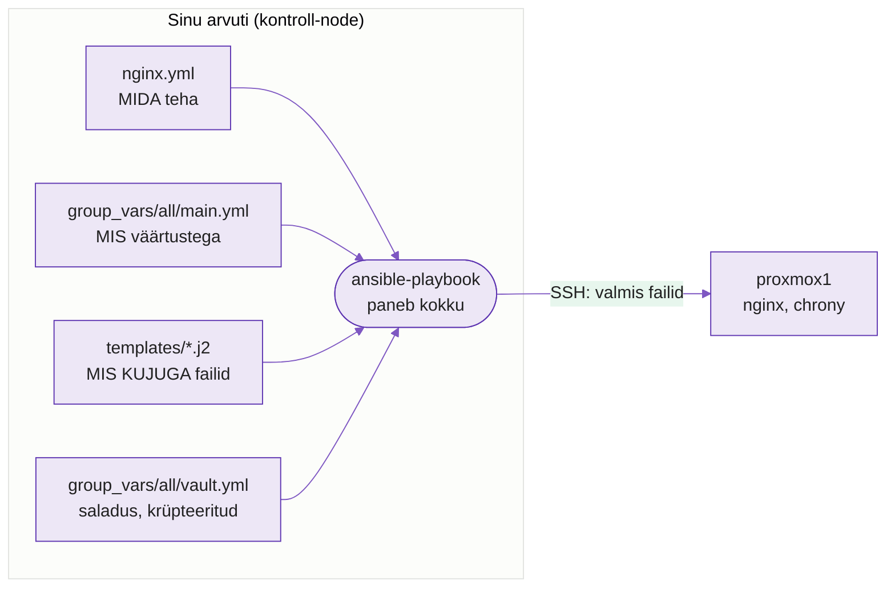
  <figcaption>Joonis 1. Eraldi on see, mida teha (playbook), milliste väärtustega (group_vars, vault) ja millise kujuga failid (mall). Ansible paneb need kokku sinu arvutis ja saadab sõlme valmis tulemuse (Talvik, 2026).</figcaption>
</figure>

Kui väärtus on otse playbookis, tuleb iga muudatuse jaoks playbooki muuta. Kui väärtus on eraldi failis, jääb playbook samaks ja muutub ainult see fail.

Sama põhimõte on Wordi kirjakoostes: mall on kiri „Lp `{{ nimi }}`“, `group_vars` on nimekiri ja `ansible-playbook` teeb igale saajale valmis kirja. Sõlme jõuab ainult valmis kiri.

??? info "Sõnastik"
    | Mõiste | Tähendus |
    |---|---|
    | Playbook | nimekiri "mida teha" (`nginx.yml`) |
    | Inventory | nimekiri "kus teha" (`inventory.ini`) |
    | Muutuja | nimi ja väärtus, näiteks `paketi_nimi` = `nginx` |
    | `group_vars/` | kaust, kust Ansible muutujaid ise loeb |
    | Mall (`.j2`) | fail, milles on kohad `{{ }}`; Ansible asendab need väärtustega |
    | Handler | task, mis käivitub ainult siis, kui mõni task kutsub seda `notify`-ga ja see task oli `changed` |
    | Vault | Ansible'i tööriist, mis krüpteerib faili parooliga |
    | `changed` / `ok` | Ansible tegi muudatuse / asi oli juba õige |
    | Idempotentsus | sama käivitus teist korda ei muuda enam midagi |

??? info "Kus käsk käivitub?"
    | Käsk | Kus käivitub |
    |---|---|
    | `ansible-playbook`, `ansible-vault`, `ansible-inventory`, `git`, `bash kontroll.sh` | sinu arvutis |
    | `ssh proxmox1 "curl -s localhost"` | jutumärkides olev käsk käivitub sõlmes, tulemus tuleb sinu terminali |

??? info "Ühe käsu anatoomia"
    Praktikumi lõpus on käsud sellised:

    ```bash
    ansible-playbook -i inventory.ini nginx.yml --vault-password-file .vault_pass --check --diff
    ```

    | Osa | Mida ütleb |
    |---|---|
    | `ansible-playbook` | käivita playbook |
    | `-i inventory.ini` | kuhu: sõlmede nimekiri |
    | `nginx.yml` | mida teha |
    | `--vault-password-file .vault_pass` | Vault'i parool on selles failis (muidu küsitakse) |
    | `--check` | kuivkäivitus: ära muuda midagi |
    | `--diff` | näita, mis failides muutuks |

??? info "Kuidas Ansible'i väljundit lugeda"
    ```text
    TASK [Paigalda nginx pakett] ***********
    ok: [proxmox1]                          <- oli juba õige, midagi ei muutnud
    TASK [Kopeeri index.html] **************
    changed: [proxmox1]                     <- muutis sõlme
    TASK [Meelega katki] *******************
    fatal: [proxmox1]: FAILED! => ...       <- viga, play katkeb siin

    PLAY RECAP *****************************
    proxmox1 : ok=3  changed=1  unreachable=0  failed=0  skipped=0
    ```

    | Sõna | Mida see tähendab |
    |---|---|
    | `ok` | asi oli juba õige, midagi ei muudetud |
    | `changed` | Ansible muutis sõlme |
    | `failed` | task ebaõnnestus, sõlme töö lõpeb siin |
    | `unreachable` | sõlmeni ei jõutud (SSH) |
    | `skipped` | task jäeti vahele |

Kui teine käivitus annab `changed=0`, on playbook idempotentne. Praktikumis kontrollid seda peaaegu igal sammul.

??? tip "Kui jääd hätta"
    1. Loe osa juures olevat plokki „Kuidas see töötab?“ ja vaata joonist.
    2. **Ennusta**, mis juhtub, ja alles siis käivita. Kui ennustus ja tulemus erinevad, uuri, miks.
    3. Ava Ansible'i ametlik dokumentatsioon ja otsi mooduli täisnime järgi (nt `ansible.builtin.service`). Vaata parameetreid, lubatud väärtusi ja näiteid.
    4. Küsi AI-lt selgitust: anna talle veateade, oma fail ja link dokumentatsioonile, mille juba läbi vaatasid, ning küsi, miks see viga tekib ja milline rida selle põhjustab.
    5. Küsi õpetajalt.

Rida **Ennusta** tähendab, et enne käsku mõtled läbi, mis juhtub. Vastus on kokkuvolditud plokis.

## Osa 0 · Töövoog: kuhu muudatused lähevad

Kõik muudatused lähevad harule `n04-vault`. Haru `main` jääb puutumata, kuni pull request on üle vaadatud. Loo haru enne esimest muudatust.

<figure markdown="span">
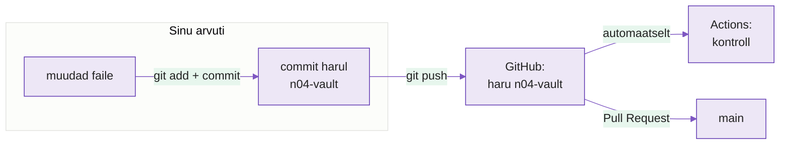
  <figcaption>Joonis 2. Muudatused lähevad harule `n04-vault` ja jõuavad `main`-i alles pull request'iga praktikumi lõpus (Talvik, 2026).</figcaption>
</figure>

1. Aktsepteeri Classroom 50 ülesanne, klooni repositoorium ja ava kaust VS Code'is. Kõik käsud käivitad selles kaustas oma arvutis.
2. Loo haru ja kontrolli, et oled selle peal:

```bash
git switch -c n04-vault
git branch --show-current
```

Teine käsk peab vastama `n04-vault`. Kui vastab `main`, ära muuda midagi enne, kui haru on olemas.

3. Tee commit pärast osasid 3, 5, 8, 10 ja 11, et saaksid vajadusel eelmise versiooni juurde tagasi minna:

```bash
git add -A
git status
git commit -m "Osa 3: muutujad group_vars-i"
```

`git status` näitab, mis commit'i läheb. Seal ei tohi olla faili `.vault_pass` (see tekib osas 8 ja enne seda lisad selle `.gitignore`-i).

Commit'i sõnum kirjeldab muudatust, näiteks `Osa 3: muutujad group_vars-i`. Sõnumid `asjad`, `veelkord` ja `test` ei ütle, mis muutus. Praktikumi lõpus peab `git log --oneline` näitama, mida ja mis järjekorras tegid.

??? note "Git-käsud"
    | Käsk | Mida see teeb |
    |---|---|
    | `git status` | näitab, mis on muutunud ja mis on commitisse minemas |
    | `git diff` | näitab, mida täpselt muutsid (enne `git add`-i) |
    | `git add -A` | paneb kõik muudatused commit'i ootele |
    | `git commit -m "..."` | salvestab ajalukku |
    | `git log --oneline` | näitab ajalugu, üks rida commit'i kohta |
    | `git restore .` | tühistab commit'imata muudatused |
    | `git revert HEAD` | teeb uue commit'i, mis tühistab viimase commit'i |
    | `git push` | saadab commit'id GitHubi |

4. Saada haru GitHubi pärast esimest commit'i ja seejärel pärast iga osa:

```bash
git push -u origin n04-vault
```

Iga push käivitab GitHubis automaatkontrolli (Actions). Alguses on tulemus punane, sest töö on pooleli.

5. Praktikumi lõpus avad pull request'i harust `n04-vault` harusse `main` (vt [Töö esitamine](#too-esitamine)).

!!! warning "Tegid juba commit'i `main`-il?"
    Loo haru sealt, kus oled, ja vii `main` tagasi GitHubi versioonile:

    ```bash
    git switch -c n04-vault
    git branch -f main origin/main
    ```

    Commit jääb harule `n04-vault` ja `main` on jälle sama mis GitHubis.

## Osa 1 · Algseis

Starteris on N3 lõpu `nginx.yml` (`package`, `service` ja `copy`) ja `index.html`. Kui sul on oma töötav N3 versioon, võid selle asemele kopeerida. Kontrolli, et playbook töötab:

```bash
ansible-playbook -i inventory.ini nginx.yml
```

Tulemus peab olema `changed=0`. Kui playbook ei tööta, paranda see enne, sest järgmised osad muudavad sama faili.

## Osa 2 · Kõvakodeeritud väärtus muutujaks

Paketi nimi on otse task'i sees. Lisa play-tasandile `vars:` plokk (`hosts:` ja `become:` kõrvale):

```yaml
  vars:
    paketi_nimi: nginx
```

Kasuta muutujat task'is, meelega ilma jutumärkideta:

```yaml
    - name: Paigalda nginx pakett
      ansible.builtin.package:
        name: {{ paketi_nimi }}
        state: present
```

Käivita playbook:

```bash
ansible-playbook -i inventory.ini nginx.yml
```

Ansible annab vea `We could be wrong, but this one looks like it might be an issue with missing quotes`.

??? question "Leia põhjus enne parandamist"
    YAML-is tähendab `{` sõnastiku algust. Kui väärtus algab `{{`-ga, loeb YAML seda sõnastikuna. Mis näitab, et väärtus on tekst?

Paranda rida: `name: "{{ paketi_nimi }}"`. Käivita uuesti: tulemus on `changed=0`, sest serveris ei muutunud midagi. Paketi nimi on nüüd task'ist eraldi.

## Osa 3 · Muutuja välisfaili: undefined variable

**Dokumentatsioon:** [Using variables](https://docs.ansible.com/ansible/latest/playbook_guide/playbooks_variables.html)

??? info "Kuidas see töötab?"
    Muutujal on nimi ja väärtus. Playbookis on ainult nimi: `{{ paketi_nimi }}`. Väärtus `nginx` on failis `group_vars/all/main.yml`. Ansible loeb selle faili ise, ilma et playbookis sellele viidataks, ja asendab nime väärtusega.

<figure markdown="span">
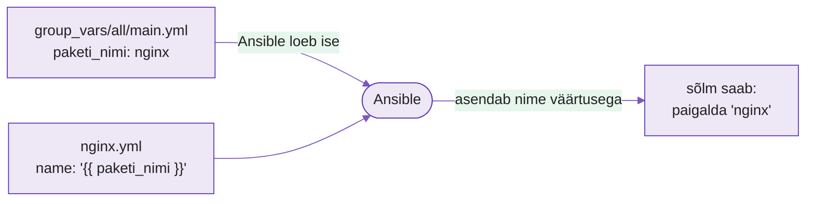
  <figcaption>Joonis 3. Playbookis on ainult muutuja nimi; väärtus tuleb failist, mida Ansible leiab kausta nime järgi (Talvik, 2026).</figcaption>
</figure>

Seetõttu peab kausta ja faili nimi olema täpne. Ansible otsib kausta `group_vars/` inventory kõrvalt. Kui nimi on vale, jääb fail lugemata ja viga tuleb alles siis, kui muutujat kasutatakse.

Tõsta väärtused playbookist välja. Loo kaust ja fail (`inventory.ini` kõrvale):

```bash
mkdir -p group_vars/all
```

`group_vars/all/main.yml`:

```yaml
paketi_nimi: nginx
omaniku_nimi: Mari Maasikas     # sinu tegelik nimi
```

Kustuta `vars:` plokk playbookist. Nüüd tee meelega viga: nimeta muutuja failis valesti (`pakett_nimi`) või pane kaust vale nimega (`vars/all/`). Käivita.

Ansible annab vea `'paketi_nimi' is undefined`.

??? question "Leia põhjus"
    Ansible otsib `group_vars/`-i inventory (või playbooki) kõrvalt, ja kausta `all/` sisu kehtib kõigile hostidele. Nimi peab tähthaaval klappima. Põhjusi on kaks. Kumb neist on sinu failides?

Vaata, milliseid muutujaid Ansible sinu hostile loeb:

```bash
ansible-inventory -i inventory.ini --host proxmox1
```

Kas `paketi_nimi` on väljundis? Kui pole, jäi fail lugemata. Vea `undefined variable` korral käivita see käsk esimesena.

Paranda viga ja käivita playbook: tulemus on `changed=0`. Käivita `ansible-inventory` uuesti ja veendu, et muutuja on nüüd olemas.

??? tip "Kaust `all/` või fail `all.yml`"
    Mõlemad töötavad. Kaust lubab grupil hoida mitut faili. Osa 6-s lisad sinna krüpteeritud `vault.yml`.

    Kui paneksid selle `group_vars/vault.yml`-ks, loeks Ansible seda grupi nimega `vault` muutujateks. Sellist gruppi pole ja saladus ei jõuaks kuhugi.

## Osa 4 · `template` ja `copy`: miks `{{ }}` ei asendu

**Dokumentatsioon:** [`ansible.builtin.template`](https://docs.ansible.com/ansible/latest/collections/ansible/builtin/template_module.html), [Templating (Jinja2)](https://docs.ansible.com/ansible/latest/playbook_guide/playbooks_templating.html)

??? info "Kuidas see töötab?"
    `copy` saadab faili muutmata, nii et ka `{{ }}` jääb faili. `template` asendab `{{ }}` väärtustega kontroll-node'is (kursusel sinu arvutis) ja saadab sõlme valmis teksti. Sõlmes ei ole Jinja2-t vaja.

<figure markdown="span">
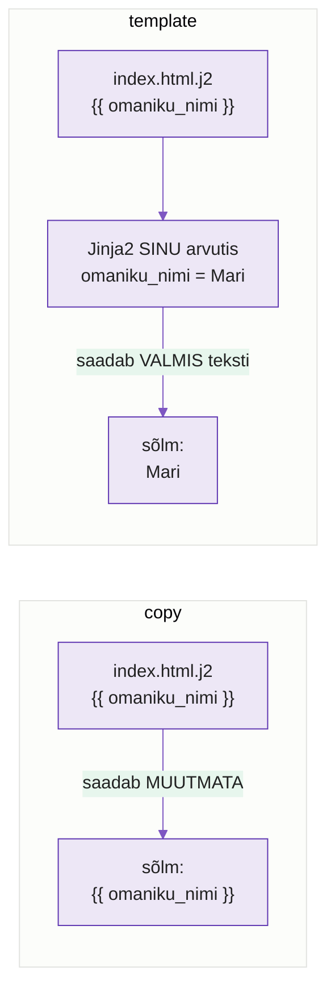
  <figcaption>Joonis 4. Sama mall, kaks moodulit. Ainult `template` asendab `{{ }}` väärtustega (Talvik, 2026).</figcaption>
</figure>

Starteri `index.html` on staatiline. Tee sellest mall `templates/index.html.j2`:

```html
<h1>Ansible töötab: {{ omaniku_nimi }}</h1>
<p>Server: {{ inventory_hostname }}</p>
```

Muuda ainult `src` rida, moodul jääb meelega `copy`:

```yaml
    - name: Kopeeri index.html
      ansible.builtin.copy:
        src: templates/index.html.j2
        dest: /usr/share/nginx/html/index.html
        mode: '0644'
```

**Ennusta:** mis tekst on lehel pärast käivitust ja mitu task'i on `changed`?

```bash
ansible-playbook -i inventory.ini nginx.yml
ssh proxmox1 "curl -s localhost"
```

??? success "Oodatav tulemus"
    Lehel on sõna-sõnalt `{{ omaniku_nimi }}`.

??? question "Leia põhjus"
    `copy` viib faili muutmata. Kes `{{ }}` asendab ja mis moodulis?

Paranda: vaheta moodul `ansible.builtin.copy` mooduliks `ansible.builtin.template`. Käivita playbook ja tee `curl` uuesti: nüüd on lehel sinu nimi ja `proxmox1`. Muutujat `inventory_hostname` sa kuhugi ei kirjutanud. See on Ansible'i erimuutuja, milles on hosti nimi inventory's.

## Osa 5 · Handler: laadi nginx uuesti ainult muudatuse korral

Lisa serverile konfiguratsioonifail, mis lisab igale vastusele päise. Mall `templates/hallatud.conf.j2`:

```nginx
add_header X-Hallatud "ansible-{{ inventory_hostname }}";
```

Uus task, meelega ilma `notify`-ta:

```yaml
    - name: Nginx lisakonfiguratsioon
      ansible.builtin.template:
        src: templates/hallatud.conf.j2
        dest: /etc/nginx/conf.d/hallatud.conf
        mode: '0644'
```

```bash
ansible-playbook -i inventory.ini nginx.yml
ssh proxmox1 "curl -sI localhost"
```

Task oli `changed` ja fail on sõlmes, aga vastuses pole päist `X-Hallatud`.

??? question "Leia põhjus"
    Nginx loeb konfiguratsiooni käivitamisel. Fail muutus, aga töötav teenus seda uuesti ei loe. Task `service` väärtusega `state: started` ei tee midagi, sest teenus juba töötab. Mis peab juhtuma pärast konfiguratsioonifaili muutust?

Paranda: lisa task'ile `notify` ja playbooki lõppu `handlers:` (`tasks:`-iga samal tasemel):

```yaml
      notify: Laadi nginx uuesti

  handlers:
    - name: Laadi nginx uuesti
      ansible.builtin.service:
        name: nginx
        state: reloaded
```

**Ennusta:** kas päis ilmub järgmisel käivitusel, kui `notify` ja handler on nüüd olemas?

Käivita playbook ja vaata päist.

??? success "Oodatav tulemus"
    Päist ikka pole.

??? question "Leia põhjus: miks ikka mitte?"
    Vaata task'i olekut: see on `ok`. Fail oli juba eelmisest käivitusest paigas. Millal handler käivitub?

Paranda: muuda mallis väärtust (näiteks `"ansible-{{ inventory_hostname }}-v2"`) ja käivita playbook. Task on `changed`, handler käivitub play lõpus ja `curl -sI localhost` näitab päist `X-Hallatud`. Käivita veel kord: task on `ok`, handlerit ei kutsuta ja nginx-i uuesti ei laadita.

??? info "Kuidas see töötab?"
    Nginx loeb oma seadistuse ainult käivitamisel. Kui fail muutub, töötab nginx edasi vana seadistusega, kuni teenus uuesti laaditakse. `notify` märgib, et fail muutus ja nginx tuleb uuesti laadida. **Handler** on task, mis teeb uuesti laadimise. See käivitub üks kord play lõpus ja ainult siis, kui märge on tehtud.

<figure markdown="span">
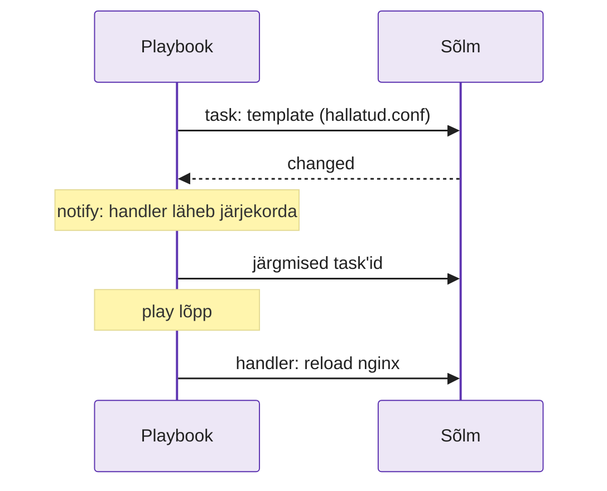
  <figcaption>Joonis 5. Handler käivitub play lõpus ja ainult siis, kui teda kutsunud task oli `changed` (Talvik, 2026).</figcaption>
</figure>

??? note "Kolm olukorda handleri käivitumise kohta"
    | Olukord | Task | Handler | Päis uueneb? |
    |---|---|---|---|
    | Fail muutus, play lõppes edukalt | `changed` | käivitub (play lõpus) | jah |
    | Fail oli juba õige | `ok` | ei käivitu | pole vaja, on juba õige |
    | Fail muutus, aga play katkes hiljem | `changed` | ei käivitu | ei (vt osa 10) |

### Lubatud väärtused dokumentatsioonist

Kui Ansible annab vea `value of state must be one of: ...`, on lubatud väärtused mooduli dokumentatsioonis.

1. Ava [`ansible.builtin.service`](https://docs.ansible.com/ansible/latest/collections/ansible/builtin/service_module.html) dokumentatsioon ja leia parameeter `state`.
2. Kirjuta üles kõik lubatud `state` väärtused.
3. Leia, milline neist sobib nginx-i konfiguratsiooni muutuse rakendamiseks ilma teenust peatamata.
4. Loo fail `logid/dokumendid.txt` ja lisa sinna read:

```text
Moodul: ansible.builtin.service
URL: https://docs.ansible.com/ansible/latest/collections/ansible/builtin/service_module.html
Parameeter: state
Valik: reloaded
Põhjus: nginx peab pärast konfiguratsiooni muutumist seadistuse uuesti sisse lugema.
```

Osades 11 ja 12 lisad sellesse faili veel ridu. Vaata ka: [Handlers](https://docs.ansible.com/ansible/latest/playbook_guide/playbooks_handlers.html).

## Osa 6 · Vault: saladuse krüpteerimine

**Dokumentatsioon:** [Protecting sensitive data with Ansible vault](https://docs.ansible.com/ansible/latest/vault_guide/index.html)

Vault'i juures tuleb eristada krüpteeritud faili, parooli ja paroolifaili. Krüpteeritud fail `vault.yml` võib olla Gitis, sest ilma paroolita seda avada ei saa. Vault'i parool ja fail `.vault_pass`, milles parool on, Giti ei lähe. Faili on vaja, et parooli ei peaks iga kord sisestama.

<figure markdown="span">
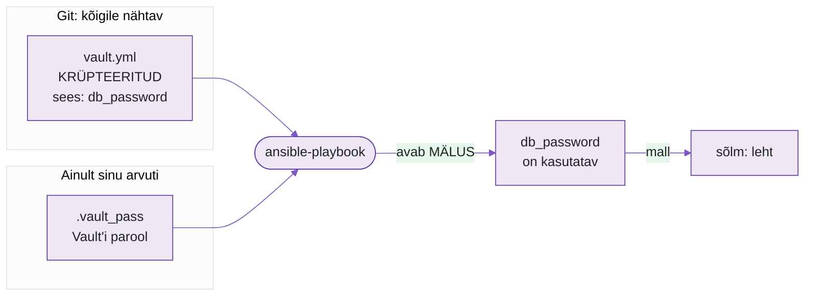
  <figcaption>Joonis 6. Krüpteeritud fail on Gitis ja parool sinu arvutis. Ansible dekrüpteerib Vault'i sisu käivituse ajal mälus. Kui saladus satub mallist tehtud faili, on see sõlmes selge tekstina (Talvik, 2026).</figcaption>
</figure>

??? note "`db_password` ja Vault'i parool on kaks eri asja"
    | | Mis see on | Kus see on | Gitis? |
    |---|---|---|---|
    | `db_password` = `SuperSalajane123` | rakenduse saladus | `vault.yml` sees | jah, aga krüpteeritult |
    | Vault'i parool | parool, mille mõtled välja osas 6 | sinu peas ja `.vault_pass` | ei |
    | `.vault_pass` | fail, milles on Vault'i parool | sinu arvuti | ei (`.gitignore`) |

`ansible-vault` avab redaktori, vaikimisi `vi`. Vali mugavam:

```bash
export EDITOR=nano        # või: export EDITOR="code --wait"
```

Loo krüpteeritud fail. Ansible küsib Vault'i parooli: mõtle see välja ja jäta meelde.

```bash
ansible-vault create group_vars/all/vault.yml
```

Kirjuta redaktoris:

```yaml
db_password: SuperSalajane123
```

Salvesta, sulge redaktor ja vaata faili sisu:

```bash
cat group_vars/all/vault.yml
```

Failis on rida `$ANSIBLE_VAULT;1.1;AES256` ja numbrid, saladust ennast näha pole. Lisa `index.html.j2` lõppu rida, mis näitab, kas muutuja jõudis kohale (saladust ennast lehele ei panda):

```html
<p>Saladus laetud: {{ db_password is defined }}</p>
```

## Osa 7 · No vault secrets: Vault ilma paroolita

Käivita nagu seni:

```bash
ansible-playbook -i inventory.ini nginx.yml
```

Ansible annab vea `Attempting to decrypt but no vault secrets found`.

??? question "Leia põhjus"
    Ansible leidis `group_vars/all/vault.yml`, aga see on krüpteeritud ja sa ei andnud parooli. Milline lipp on käsust puudu?

Paranda käsk:

```bash
ansible-playbook -i inventory.ini nginx.yml --ask-vault-pass
ssh proxmox1 "curl -s localhost"
```

Leht näitab `Saladus laetud: True`.

!!! warning
    Vale parooliga tuleb viga `Decryption failed`. Kui parool on kadunud, ei saa faili enam avada ja tuleb luua uus.

## Osa 8 · Vault'i parool faili

Parooli iga kord sisestamine on tüütu ja CI/CD ei saa seda teha. Pane parool faili, aga lisa faili nimi enne `.gitignore`-i:

```bash
echo ".vault_pass" >> .gitignore
echo "<sinu Vault'i parool>" > .vault_pass
chmod 600 .vault_pass
git status
```

Faili `.vault_pass` läheb parool, mille mõtlesid välja osas 6 (Ansible küsis seda `create` ajal). `SuperSalajane123` on `vault.yml` sees olev saladus ja see siia ei käi.

`git status` ei tohi faili `.vault_pass` näidata. Kui näitab, on `.gitignore` rida vale ja see tuleb enne edasiminekut parandada.

Kontrolli, milline `.gitignore` rida faili välja jätab:

```bash
git check-ignore -v .vault_pass
```

Väljund näitab `.gitignore` faili, rea numbri ja mustri. Kui väljundit pole, ei ignoreeri Git seda faili.

```bash
ansible-playbook -i inventory.ini nginx.yml --vault-password-file .vault_pass
```

Playbook töötab parooli küsimata.

??? question "Mõtle"
    `vault.yml` võib Gitis olla, `.vault_pass` mitte. Miks? Ja kui `.vault_pass` kord commititakse ja siis kustutatakse, kas see on siis turvaline?

Edaspidi lisa kõigile käskudele `--vault-password-file .vault_pass`.

## Osa 9 · Kuivkäivitus: ennusta ja kontrolli

**Dokumentatsioon:** [Validating tasks: check mode and diff mode](https://docs.ansible.com/ansible/latest/playbook_guide/playbooks_checkmode.html)

Seni nägid tulemust alles pärast käivitamist. Tootmises on vaja enne teada, mis muutub. Selleks on lipud `--check` (kuivkäivitus, sõlme ei muudeta) ja `--diff` (näitab failide muudatusi).

<figure markdown="span">
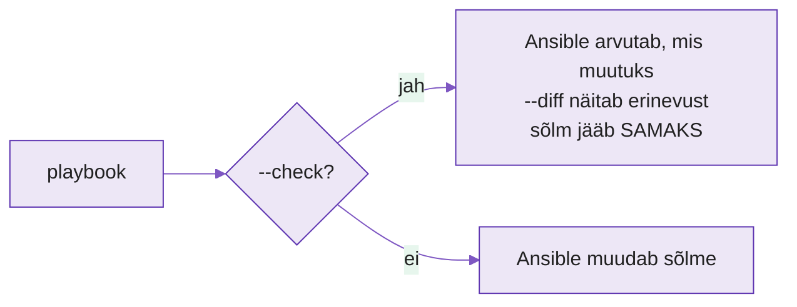
  <figcaption>Joonis 7. `--check` näitab, mis muutuks, aga sõlme ei muuda. Ilma selleta muudab Ansible sõlme (Talvik, 2026).</figcaption>
</figure>

1. Muuda `group_vars/all/main.yml`-is `omaniku_nimi` väärtust (lisa lõppu ` (test)`).
2. **Ennusta:** mitu task'i on `changed`? Mis rida lehes muutub?
3. Käivita kuivkäivitusena:

```bash
ansible-playbook -i inventory.ini nginx.yml --vault-password-file .vault_pass --check --diff
```

4. Võrdle diff'i oma ennustusega. Seejärel veendu, et sõlmes ei muutunud midagi:

```bash
ssh proxmox1 "curl -s localhost"
```

5. Muuda nimi tagasi. Kuna `--check` sõlme ei muutnud, annab tavaline käivitus nüüd `changed=0`.

??? question "Mõtle"
    Diff näitas täpselt, mis muutuks, ilma et sõlmes midagi muutunud oleks. Millises olukorras aitaks see tootmisserveris vea ära hoida?

!!! warning "Mida Vault ei kaitse"
    Käivita `ansible-inventory -i inventory.ini --host proxmox1 --vault-password-file .vault_pass`. Mida näed `db_password` kohal? Mida see tähendab, kui jagad terminali ekraani või `--diff` väljund läheb CI logisse?

    Kui Vault'i väärtus satub renderdatavasse faili, võib see tulla nähtavale `--diff` väljundis. `no_log: true` peidab task'i väljundi, aga kõiki kohti see ei kaitse. Seetõttu ära jaga sellist väljundit ega saada seda kaitsmata logidesse.

## Osa 10 · Katkine play: handler ei käivitu

Kui play katkeb, jäävad kutsutud handlerid käivitamata. Selles osas kontrollid seda ise.

??? info "Kuidas see töötab?"
    Kui task ebaõnnestub, lõpetab Ansible selle sõlme töö ja ka ootel olevad handlerid jäävad käivitamata. Fail on sõlmes juba uus, aga nginx töötab vana seadistusega. Järgmisel käivitusel on fail juba õige (`ok`) ja handlerit ei kutsuta. Veateadet enam ei tule, aga nginx töötab ikka vana seadistusega.

<figure markdown="span">
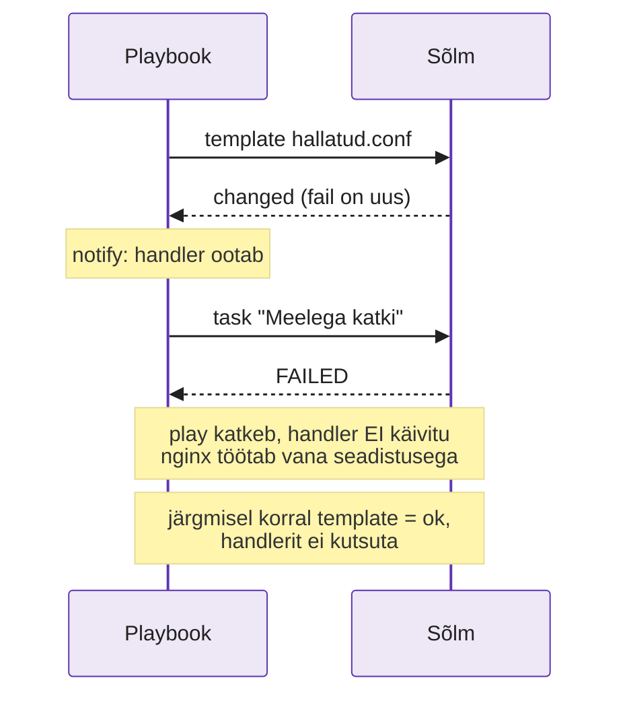
  <figcaption>Joonis 8. Kui play katkeb, jääb sõlm poolikusse olekusse ja järgmine käivitus seda ei märka (Talvik, 2026).</figcaption>
</figure>

Tee play meelega katki: lisa `tasks:` lõppu task, mis alati ebaõnnestub.

```yaml
    - name: Meelega katki
      ansible.builtin.command: /bin/false
```

Muuda mallis `hallatud.conf.j2` väärtust (näiteks `-v3`).

**Ennusta:** kas päis uueneb?

Käivita playbook ja seejärel `ssh proxmox1 "curl -sI localhost"`.

??? success "Oodatav tulemus"
    Play katkes (`failed=1`), template task oli `changed`, aga ridu `RUNNING HANDLER` pole ja päis on vana.

Eemalda task „Meelega katki“ ja käivita playbook uuesti. Template on nüüd `ok`, sest fail on juba sõlmes, ja handlerit ei kutsuta. Vaata päist.

??? question "Leia põhjus"
    Päis on ikka vana, vigu pole, kõik `ok`. Kus on vana väärtus ja miks Ansible ei tea, et midagi on valesti? Kuidas seda tootmises märgata?

Olukorra saab parandada kahel viisil:

- Käsitsi: `ssh proxmox1 "sudo systemctl reload nginx"`. Pärast seda on päis õige.
- Ennetavalt: pane task „Meelega katki“ tagasi, muuda väärtust (`-v4`) ja käivita playbook lipuga `--force-handlers`. Siis käivitub handler ka katkenud play korral. Lipp ei paranda katkist task'i, see käivitab ainult järjekorras olevad handlerid.

```bash
ansible-playbook -i inventory.ini nginx.yml --vault-password-file .vault_pass --force-handlers
```

Playbookis on jälle task „Meelega katki“. Seekord ära kustuta seda käsitsi, võta muudatus tagasi Gitiga:

```bash
git add -A
git commit -m "Osa 10: meelega katki (katse)"
git revert HEAD --no-edit
git log --oneline
```

`git revert` ei kustuta ajalugu. See teeb uue commit'i, mis tühistab eelmise, nii et ajaloos on näha nii katse kui ka tagasivõtmine. `git restore` tühistab ainult muudatused, mida pole veel commit'itud.

Käivita playbook, kuni tulemus on `changed=0`.

??? question "Mõtle"
    Millal kasutad `git restore .` ja millal `git revert`? Mis juhtub sinu ajalooga, kui kasutaksid `git reset --hard` ja oleksid juba `push`-inud?

## Osa 11 · Iseseisev: lisa teine teenus

**Dokumentatsioon:** [`ansible.builtin.service`](https://docs.ansible.com/ansible/latest/collections/ansible/builtin/service_module.html), [chrony](https://chrony-project.org/documentation.html)

Selles osas kirjutad playbooki osa ise. Kasuta sama mustrit nagu nginx-iga: pakett, mall, teenus ja handler.

Lisa sõlmele chrony, mis sünkroniseerib kella. Kui sõlmede kellad lähevad lahku, ei klapi logide ajad ja TLS-sertifikaatide kontroll võib ebaõnnestuda.

??? info "Kuidas see töötab?"
    Chrony konfiguratsioonis on iga NTP serveri jaoks üks rida. `` kordab rida iga loendi elemendi kohta. Kui lisad loendisse uue serveri, tekib konfiguratsioonifaili uus rida ilma malli muutmata.

<figure markdown="span">
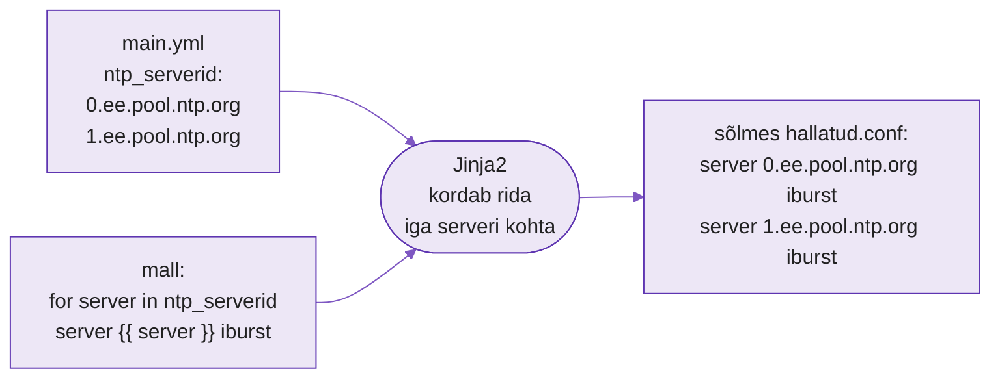
  <figcaption>Joonis 9. Mall teeb loendi igast elemendist ühe rea. Loend muutub, mall jääb samaks (Talvik, 2026).</figcaption>
</figure>

Osa on valmis, kui:

- [ ] `chrony` pakett on paigaldatud ja teenus `chronyd` töötab ning on lubatud (`enabled`)
- [ ] NTP serverite loend on muutujas `ntp_serverid` failis `group_vars/all/main.yml` (vähemalt 2 serverit)
- [ ] Konfiguratsioonifail on mall (`templates/chrony-hallatud.conf.j2`), mis kasutab `` tsüklit serverite jaoks ja alustab rida `# {{ ansible_managed }}`
- [ ] Muudatuse korral taaskäivitab `chronyd` handler
- [ ] Teine käivitus annab `changed=0`
- [ ] `ssh proxmox1 "chronyc sources"` näitab sinu seadistatud NTP allikaid

Enne alustamist vaata, mis sõlmes juba on:

```bash
ssh proxmox1 "systemctl is-active chronyd; grep -n confdir /etc/chrony.conf; ls /etc/chrony.d"
```

Lisafail läheb kausta `/etc/chrony.d/`. Kui `confdir` rida puudub, küsi õpetajalt abi.

!!! warning "Kaks nime"
    Pakett on `chrony`, aga teenus on `chronyd`. Paketi ja teenuse nimi on sageli erinev.

??? example "Uuri ise: `reloaded` või `restarted`?"
    1. Ava `ansible.builtin.service` dokumentatsioon ja vaata, milliseid `state` väärtusi saad kasutada.
    2. Uuri sõlmes, kas `chronyd` oskab konfiguratsiooni uuesti laadida: `ssh proxmox1 "systemctl show chronyd -p CanReload"`. Dokumentatsioon näitab, mida Ansible'i moodul lubab, ja `CanReload` näitab, kas teenus oskab konfiguratsiooni uuesti lugeda.
    3. Lisa `logid/dokumendid.txt` faili, kumba valid ja miks.

??? tip "Vihje 1: muutuja"
    Loend YAML-is: `ntp_serverid:` ja selle all `- 0.ee.pool.ntp.org`, `- 1.ee.pool.ntp.org`. Mallis: `` … ``.

??? tip "Vihje 2: mall"
    Chrony konfiguratsioonifaili rida on `server <nimi> iburst`. Mallis kordub see üks rida iga serveri kohta.

??? tip "Vihje 3: kontroll"
    Kui käivitad playbooki teist korda midagi muutmata, peab tulemus olema `changed=0`. Kui lisad kolmanda serveri, muutub ainult chrony malli task ja käivitub handler; nginx-i task'id jäävad `ok`.

??? success "Näidislahendus: vaata alles pärast oma katset"
    `group_vars/all/main.yml`:

    ```yaml
    ntp_serverid:
      - 0.ee.pool.ntp.org
      - 1.ee.pool.ntp.org
    ```

    `templates/chrony-hallatud.conf.j2`:

    ```jinja
    # {{ ansible_managed }}
    
    server {{ server }} iburst
    
    ```

    `nginx.yml`: lisa `tasks:` alla:

    ```yaml
        - name: Paigalda chrony
          ansible.builtin.package:
            name: chrony
            state: present

        - name: Chrony seadistus
          ansible.builtin.template:
            src: templates/chrony-hallatud.conf.j2
            dest: /etc/chrony.d/hallatud.conf
            mode: '0644'
          notify: Taaskäivita chronyd

        - name: Käivita ja luba chronyd
          ansible.builtin.service:
            name: chronyd
            state: started
            enabled: true
    ```

    ja `handlers:` alla:

    ```yaml
        - name: Taaskäivita chronyd
          ansible.builtin.service:
            name: chronyd
            state: restarted
    ```

Kontrolli tulemust: lisa kolmas server loendisse `ntp_serverid`, käivita playbook ja vaata `PLAY RECAP`-i. Kas muutus ainult see, mis pidi? Seejärel käivita uuesti: tulemus peab olema `changed=0`.

??? question "Mõtle"
    Teise teenuse lisamisel playbooki ülesehitus ei muutunud: lisandusid task'id, üks mall ja üks muutuja. Mis oleks juhtunud, kui serverite loend oleks otse mallis? Kus muudaksid seda kümne sõlme jaoks?

## Osa 12 · Vigade otsimine

Seni tekitasid vigu juhendi järgi ja teadsid, mida oodata. Töökohas veateadet ette ei tea. Selles osas valid vea ise, ennustad enne käivitamist, mis juhtub, ja otsid põhjuse veateate ja tööriistade abil.

Kui midagi on valesti, ära muuda faile juhuslikult. Otsi põhjust selle skeemi järgi:

<figure markdown="span">
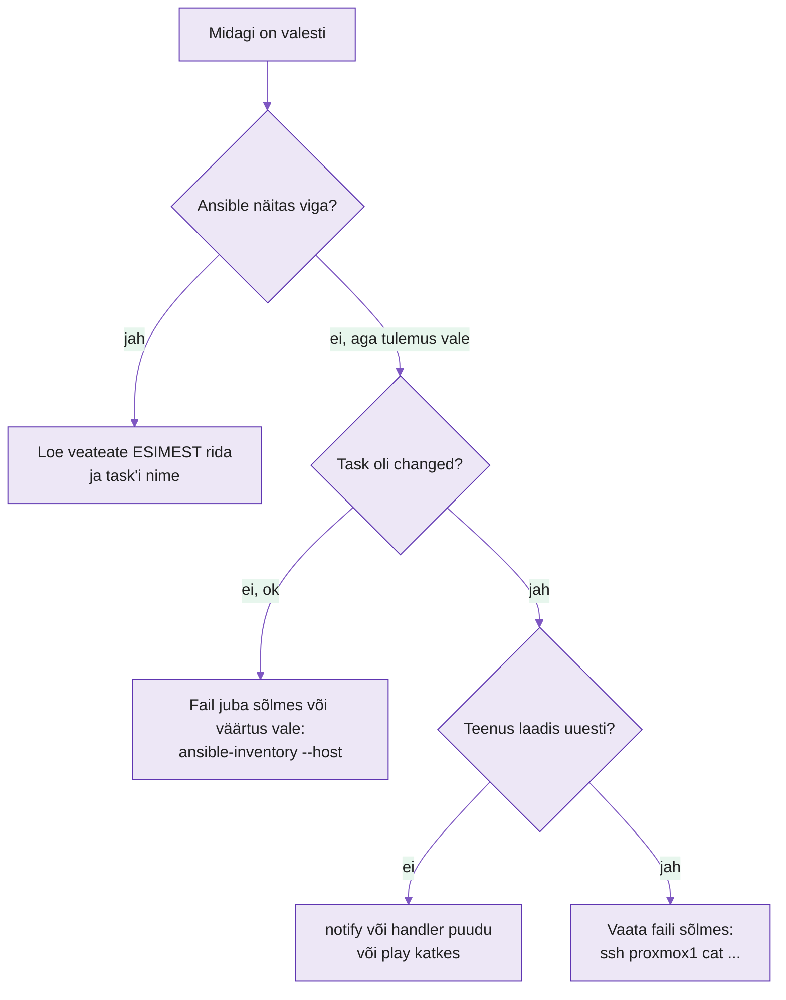
  <figcaption>Joonis 10. Kõigepealt vaata, kas Ansible andis veateate. Alles siis vaata task'i olekut (Talvik, 2026).</figcaption>
</figure>

Tee nii:

1. Enne alustamist tee harul `n04-vault` commit (`git add -A && git commit -m "töötav"`; `.vault_pass` commit'i ei lähe). Nii saad pärast iga viga töö käsuga `git restore .` taastada.
2. Vali tabelist kolm viga. Enne iga vea tegemist ennusta, mis veateade tuleb või mida lehel näed.
3. Tee viga, käivita playbook ja võrdle tulemust ennustusega. Põhjust otsi veateate, `--check --diff`, `ansible-inventory --host` ja `git diff` abil. Vähemalt ühe vea puhul leia vastus ametlikust dokumentatsioonist ja lisa link faili `logid/dokumendid.txt`.
4. Taasta töö käsuga `git restore .` ja võta järgmine viga.

??? note "Valitavad vead"
    Enne iga viga muuda mallis `hallatud.conf.j2` väärtust (`-v5`), et task oleks `changed` ja `notify` vead tuleksid nähtavale.

    | # | Mida muuta | Mida näed |
    |---|---|---|
    | 1 | `notify:` nimi kirjaveaga (`Laadi nginx uuseti`) | `The requested handler ... was not found` |
    | 2 | Tõsta `vault.yml` kausta `group_vars/` (`all/` väljast) | `Saladus laetud: False`, viga puudub |
    | 3 | Mallis `{{ omaniku_nimi }}` → `{{ omanik_nimi }}` | `'omanik_nimi' is undefined` |
    | 4 | `dest: /etc/ngnix/conf.d/hallatud.conf` | `Destination directory ... does not exist` |
    | 5 | Handleris `state: reloaded` → `state: reload` | `value of state must be one of: ...`; õige väärtus tuleb leida ametlikust `ansible.builtin.service` dokumentatsioonist |
    | 6 | Eemalda `notify:` täielikult | Vigu pole, aga päis ei uuene (vaikne viga) |

??? tip "Kui päis ikka ei uuene pärast parandust"
    Kui fail jõudis sõlme juba eelmisel katsel, on template nüüd `ok` ja handlerit ei kutsuta (vt osa 10). Muuda väärtust uuesti (`-v6`).

??? question "Mõtle pärast"
    Milline viga oli kõige raskem leida ja miks? Mis oli esimene asi, mida kontrollisid? Mis oleks selle teinud kiiremaks?

Enne edasiminekut käivita `git status`: muudatusi ei tohi olla, välja arvatud osa 11 omad. Käivita playbook, kuni tulemus on `changed=0`.

## Osa 13 · Tõendid ja kontroll

<figure markdown="span">
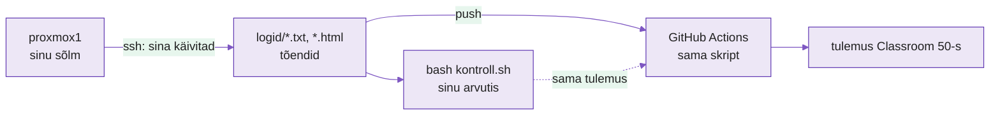
  <figcaption>Joonis 11. GitHub ei pääse sinu sõlmeni. Seetõttu salvestad tõendid sinu arvutis kausta `logid/` ja kontroll loeb ainult neid faile (Talvik, 2026).</figcaption>
</figure>

Käivita playbook viimast korda midagi muutmata (`changed=0`) ja salvesta tõendid:

```bash
mkdir -p logid
ansible-playbook -i inventory.ini nginx.yml --vault-password-file .vault_pass | tee logid/play_recap.txt
ssh proxmox1 "curl -s localhost"  > logid/leht.html
ssh proxmox1 "curl -sI localhost" > logid/pais.txt
ssh proxmox1 "chronyc sources"    > logid/chrony.txt
```

Käivita sama kontroll, mis GitHubis:

```bash
bash kontroll.sh
```

Testid 1–6 peavad olema läbitud, test 7 kontrollib kodutööd.

??? warning "Tüüpilised vead"
    | Veateade | Põhjus | Lahendus |
    |---|---|---|
    | `might be an issue with missing quotes` | Väärtus algab `{{`-ga ilma jutumärkideta | `"{{ x }}"` |
    | `'x' is undefined` | `group_vars/` vales kohas või nimi ei klapi | `ansible-inventory --host`; kaust `inventory.ini` kõrvale, nimi täpselt |
    | Leht näitab `{{ muutuja }}` | `copy`, mitte `template` | `ansible.builtin.template` |
    | Konfiguratsioonifail muutus, teenus ei laadi seda | `notify` puudu või task oli `ok` | `notify` ja `handlers:`; handler käivitub ainult `changed` korral |
    | Handlerit ei käivitatud, kuigi fail muutus | Eelmine käivitus katkes enne handlerit | Käsitsi `reload` või `--force-handlers` |
    | `The requested handler ... was not found` | `notify` nimi ≠ handleri `name` | Nimed tähthaaval samaks |
    | `value of state must be one of: ...` | Vale `state` väärtus (`reload` ≠ `reloaded`) | Vaata mooduli dokumentatsiooni |
    | `Destination directory ... does not exist` | `dest` tee kirjaviga | Kontrolli tee sõlmes (`ssh ... ls`) |
    | `no vault secrets found` | Krüpteeritud fail, parooli ei antud | `--ask-vault-pass` / `--vault-password-file` |
    | `Decryption failed` | Vale Vault'i parool | Kasuta õiget parooli; ilma selleta faili avada ei saa |
    | `Saladus laetud: False` | `vault.yml` ei ole `group_vars/all/` all | Tõsta `group_vars/all/vault.yml` |

??? note "Kontrollnimekiri"
    - [ ] Playbookis pole kõvakodeeritud väärtusi, need on `group_vars/all/main.yml`-is
    - [ ] "undefined variable" puhul käivitad kohe `ansible-inventory --host`
    - [ ] Tead, miks mall vajab moodulit `template`
    - [ ] Selgitad, miks handler ei käivitunud, kui task oli `ok`
    - [ ] Ennustad enne käivitamist `--check --diff` abil, mis muutub
    - [ ] Selgitad, mis juhtub handleriga, kui play katkeb, ja kuidas seda parandada
    - [ ] Lisasid ise teise teenuse (pakett, mall, teenus ja handler) ilma juhendita
    - [ ] Leidsid tabelist valitud vea põhjuse veateate ja tööriistade abil
    - [ ] Leiad mooduli parameetri ja lubatud väärtused ametlikust dokumentatsioonist ning oled need kirja pannud (`logid/dokumendid.txt`)
    - [ ] `vault.yml` on krüpteeritud, `.vault_pass` on `.gitignore`-is
    - [ ] `bash kontroll.sh` testid 1–6 on läbitud

## Töö esitamine

Töö on harus `n04-vault`: saada see GitHubi, ava pull request harusse `main` ja lisa selle link GitHub Projecti. Kodutöö lisad samasse pull request'i ([kodutöö](homework.md)).

```bash
git push -u origin n04-vault
```

Vaata üle paarilise pull request: sakis **Files changed** kirjuta vähemalt ühe rea juurde kommentaar ja vali **Approve** või **Request changes**. Pärast ülevaatust liida oma pull request (**Merge**), sest automaatkontroll vaatab haru `main`. Faili `.vault_pass` repositooriumi ei panda. Tulemuse näed Classroom 50-s.

## Lisaülesanded

??? example "1 · Kolm sõlme"
    Lisa `[web]` alla `proxmox2` ja `proxmox3`. Kas iga leht näitab oma serveri nime?

??? example "2 · Saladus diff'is"
    Tee mall `templates/rakendus.env.j2` (`DB_PASSWORD={{ db_password }}`), pane sõlme `/etc/rakendus.env` (`mode: '0600'`, `owner: root`). Käivita `--check --diff`. Näed parooli? Lisa task'ile `no_log: true` ja käivita uuesti. Mis muutus? Miks on see CI logide jaoks oluline?

??? example "3 · `backup`"
    Lisa `hallatud.conf` task'ile `backup: true`, muuda väärtust ja vaata sõlmes `ls /etc/nginx/conf.d/`. Mis faile näed? Miks ei jää varukoopia nginx-i poolt loetavaks?

??? example "4 · Filtrid"
    Kasuta lehel `{{ omaniku_nimi | upper }}` ja `{{ keskkond_nimi | default('LABOR') }}`. Mis juhtub, kui `keskkond_nimi` pole kuskil määratud, kui `default` on ja kui pole?

??? example "5 · Parooli vahetus"
    `ansible-vault rekey group_vars/all/vault.yml`. Mis juhtub vana `.vault_pass`-iga?

??? example "6 · `encrypt_string`"
    Krüpteeri `db_password` üksiku väärtusena ja pane `main.yml`-i. Mis on eelis ja puudus võrreldes eraldi `vault.yml`-iga? Tee see eraldi harul, sest automaatkontroll otsib `db_password` rida failist `vault.yml`.
