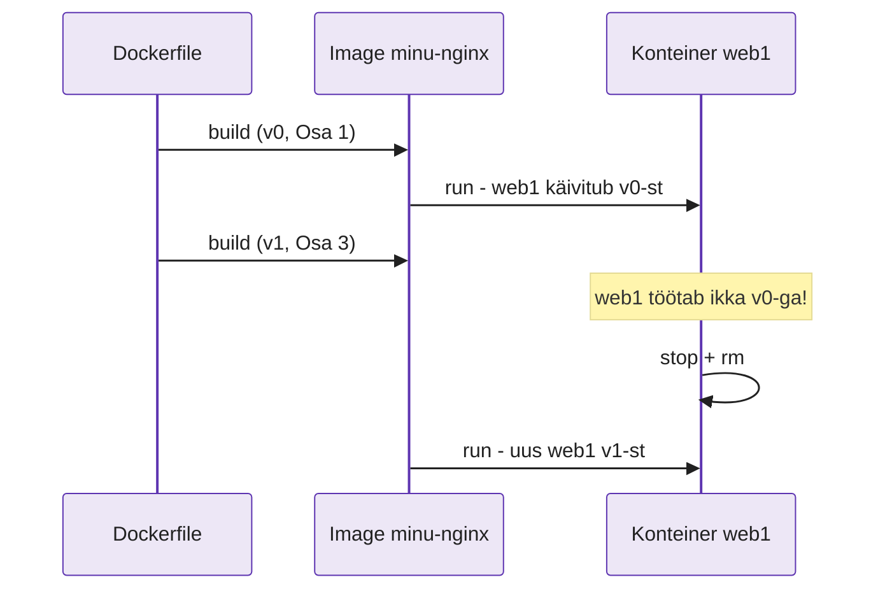
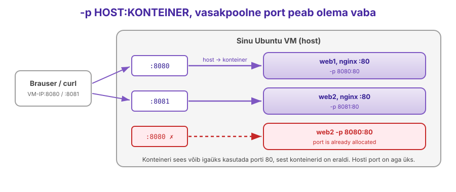
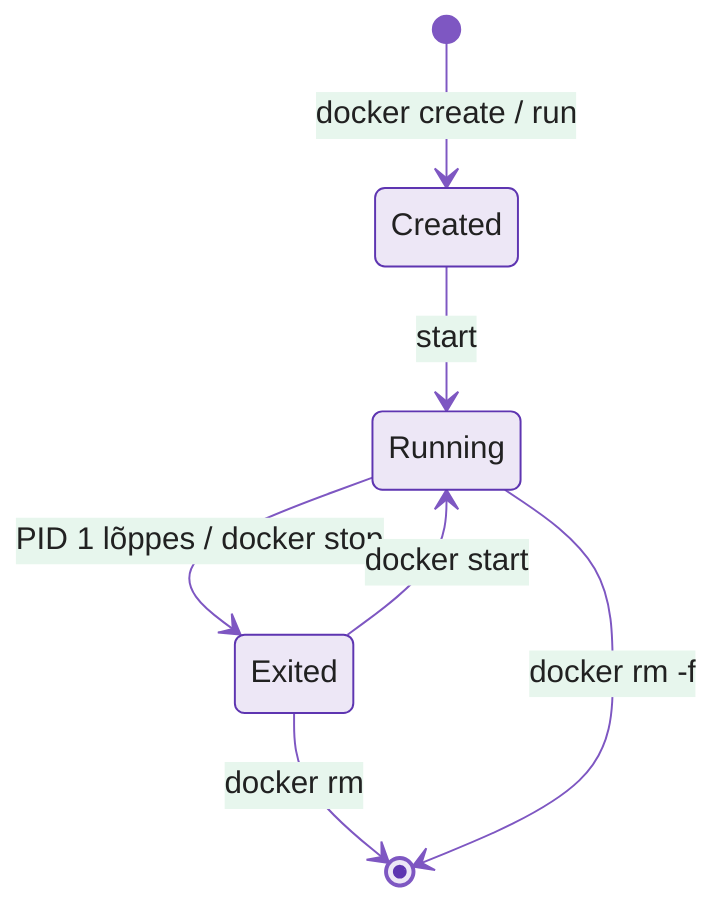

---
tags:
  - Docker
  - Konteinerid
  - Praktikum
---

# Praktikum: Docker

Täna ehitad Dockeriga image'i, käivitad sellest konteinereid, saadad image'i Docker Hubi ja käivitad selle teises masinas Podmaniga. Töö käib kooli AlmaLinuxi virtuaalmasinas SSH ja VS Code'i kaudu: `localhost` tähendab seda VM-i ja brauseris avad aadressi `http://<VM-IP>:8080`.

**Edenemine:** laboritahvel <http://192.168.125.187:8091/> (VPN-iga).

??? abstract "Õpiväljundid"

    Praktikumi lõpuks oskad:

    1. ehitada töötava image'i ja käivitada konteineri ilma juhendisse vaatamata;
    2. leida tüüpiliste Dockeri vigade põhjuse veateate järgi;
    3. selgitada, miks image'i uuesti ehitamine ei uuenda töötavat konteinerit, ja olukorra parandada;
    4. kasutada vigade otsimiseks käskude `docker ps` ja `docker logs` väljundit;
    5. eemaldada katsete käigus loodud konteinerid ja taastada lähteolukorra.

<figure markdown="span">
  
  <figcaption>Joonis 5.9. Praktikumi tervikpilt: üks image liigub sinu VM-ist Docker Hubi ja sealt teise VM-i. Iga kast on üks praktikumi osa (Talvik, 2026).</figcaption>
</figure>

Rida **Ennusta** tähendab, et enne käsku mõtled läbi, mis juhtub. Vastus on kokkuvolditud plokis.

## Osa 0 · Dockeri paigaldamine virtuaalmasinasse

Osa lõpuks: `docker run --rm hello-world` näitab `Hello from Docker!`.

Sinu VM-is on AlmaLinux (RHEL-i perekond, paketihaldur `dnf`). AlmaLinuxiga on kaasas Red Hati Podman, kursusel kasutatakse aga Docker Engine'it Dockeri enda repositooriumist, sama, mida kasutab automaatkontroll. Podmaniga tutvud osas 14.

Eemalda paketid, mis on Dockeriga vastuolus (kui neid pole, näed teadet `No match` ja see on korras), lisa Dockeri repositoorium ja paigalda Docker. Samad sammud on kirjas Dockeri juhendis [Install Docker Engine on RHEL](https://docs.docker.com/engine/install/rhel/):

```bash
sudo dnf remove -y podman runc buildah
sudo dnf install -y dnf-plugins-core
sudo dnf config-manager --add-repo https://download.docker.com/linux/rhel/docker-ce.repo
sudo dnf install -y docker-ce docker-ce-cli containerd.io docker-buildx-plugin docker-compose-plugin
sudo systemctl enable --now docker
sudo usermod -aG docker $USER
```

Logi välja ja SSH-ga uuesti sisse: rühma muudatus hakkab kehtima alles uues sisselogimisseansis. Kontrolli:

```bash
docker version
docker run --rm hello-world
```

Näed teksti `Hello from Docker!`. Kui saad vea `permission denied ... docker.sock`, siis sa ei loginud uuesti sisse.

??? warning "Kui `dnf` annab vea `conflicting requests`"
    AlmaLinuxi vaikimisi paketid `podman`, `runc` ja `buildah` on veel paigaldatud. Käivita uuesti `sudo dnf remove -y podman runc buildah` ja seejärel paigalduskäsk.

Vaata, millega käsk `docker` suhtleb:

```bash
docker version            # kaks plokki: Client ja Server
systemctl status docker   # dockerd deemon
ls -l /var/run/docker.sock
```

??? question "Leia põhjus"
    Miks näitab `docker version` kahte versiooni? Millisele kasutajale ja rühmale kuulub `docker.sock`? Seosta vastus [loengu joonisega Dockeri arhitektuurist](lecture.md#3-kuidas-docker-sees-tootab): miks annab `usermod -aG docker` sisuliselt root-õigused?

??? tip "Tee sama Ansible'iga"
    Sama saab teha playbook'iga: Dockeri repositooriumi jaoks `yum_repository` või `get_url`, pakettide jaoks moodul `dnf`, moodul `user` parameetritega `groups: docker, append: true` ja moodul `service` parameetritega `state: started, enabled: true`. Nii saad Dockeri igasse serverisse ühe käsuga: Ansible haldab serverit, Docker rakendust.

??? note "Host on Alma, image on Ubuntu, kas see on viga?"
    Ei ole. Praktikumis ehitad image'i `ubuntu:24.04` baasil, kuigi VM-is on AlmaLinux. Konteiner toob kaasa oma kasutajaruumi (paketid, `apt`, failid), aga kasutab hosti tuuma. Osas 0.3 näed seda ise.

### 0.1 VS Code: Docker otse VM-is

Osa lõpuks: VS Code'i vasakul ribal on konteinerite ikoon ja seal on näha image `hello-world`.

1. VS Code'is on sul juba laiendus **Remote - SSH** (N1). Ühenda VM-iga (`F1` → *Remote-SSH: Connect to Host*).
2. VM-iga ühendatud aknas ava Extensions ja paigalda [Container Tools](https://code.visualstudio.com/docs/containers/overview) (`ms-azuretools.vscode-containers`, Microsoft; varem kandis nime "Docker"). Vajuta *Install in SSH: ...*, sest laiendus peab töötama VM-is, kus on Docker.
3. Vasakule ribale tekib konteinerite ikoon. Seal näed image'eid ja konteinereid, saad vaadata logisid (*View Logs*), minna konteineri sisse (*Attach Shell*), konteinereid peatada ja kustutada. `Dockerfile`-is pakub laiendus kooditäiendusi ja märgib vead.

Kui laiendus näitab viga `permission denied`, on põhjus sama mis eespool: VS Code'i SSH-sessioon algas enne `usermod`-i. Vali `F1` → *Remote-SSH: Kill VS Code Server on Host* ja ühenda uuesti.

Laiendus teeb töö mugavamaks, aga ei asenda käske. Kirjuta käsud terminali, sest serveris graafilist liidest ei ole.

### 0.2 Docker Hubi konto

Osa lõpuks: `docker login` ütleb `Login Succeeded`.

Docker Hub on image'ide hoidla, kust tulevad `ubuntu`, `nginx` ja `python` ning kuhu laadid osas 9 üles oma image'i.

1. Ava [Docker Hubi registreerimisleht](https://hub.docker.com/signup). Vali tasuta *Personal* konto. Kirjuta kasutajanimi väiketähtedega, see tuleb image'i nimesse (`kasutaja/minu-nginx`).
2. Docker Hubis vali: profiil → **Account settings → Personal access tokens → Generate new token**. Nimeks pane `alma-vm`, õigusteks **Read & Write**. Kopeeri token kohe, seda näidatakse ainult üks kord.
3. Logi VM-is sisse tokeniga (parooli asemel):

```bash
docker login -u <kasutaja>
# Password: kleebi token
```

Näed teksti `Login Succeeded`.

!!! warning "Kus token nüüd on?"
    Käsk `cat ~/.docker/config.json` näitab, et token on seal base64-kodeeritud ja krüpteerimata. Seepärast kasutatakse parooli asemel tokenit: tokeni saad Docker Hubis igal ajal tühistada. Faili `config.json` ega tokenit Giti ei panda.

Sisselogimine tõstab ka tõmbamise piirmäära, mis kooli ühise IP-aadressi tagant ilma sisselogimiseta kiiresti täis saab.

### 0.3 Tõmba image ja vaata konteinerisse

Osa lõpuks: oskad öelda, mitu korda on `-alpine` väiksem, ja oled olnud konteineri sees.

Enne oma image'i ehitamist vaata valmis image'it. Tõmba see konkreetse tag'iga:

```bash
docker pull ubuntu:24.04
docker images
```

Tõmba nginx kahes variandis ja võrdle tag'e:

```bash
docker pull nginx:1.27
docker pull nginx:1.27-alpine
docker images nginx
docker inspect --format '{{index .RepoDigests 0}}' nginx:1.27
```

??? warning "Kui `docker pull` annab vea `toomanyrequests`"
    Docker Hubi sisselogimata kasutaja piirmäär on täis. Logi sisse käsuga `docker login` (osa 0.2) ja proovi uuesti.

??? question "Võrdle"
    Mitu korda väiksem on `-alpine`? Mis on `@sha256:...` ja miks see ei muutu, kuigi `1.27` võib homme viidata uuele image'ile? Millise tag'i saaksid, kui kirjutaksid lihtsalt `docker pull nginx`?

Mine konteinerisse interaktiivselt:

```bash
docker run -it --rm ubuntu:24.04 bash
```

Oled nüüd konteineris (käsuviip muutus). Proovi:

```bash
cat /etc/os-release
ps aux
uname -r
exit
```

Nüüd tee sama VM-is:

```bash
cat /etc/os-release
uname -r
docker ps -a
```

??? question "Leia põhjus"
    `os-release` näitab konteineris Ubuntut, VM-is AlmaLinuxit, aga `uname -r` on mõlemas sama (Alma tuum, `el9`). Miks? `ps aux` näitas konteineris ainult paari protsessi, kus on kõik VM-i protsessid? (Vihje: konteiner on hosti protsess, mis näeb ainult oma nimeruumi.) Miks pole konteinerit `docker ps -a` väljundis?

## Osa 1 · Alus: töötav image

Osa lõpuks: `curl localhost:8080` näitab nginx'i tervituslehte.

Klooni oma Classroom 50 repositoorium (`lab-05-...`), loo haru ja kaustad:

```bash
git clone <sinu-repo-url> lab05 && cd lab05
git switch -c n05-docker
mkdir -p nginx logid && cd nginx
```

Kõik nginx'i failid tulevad kausta `nginx/`.

Loo fail `Dockerfile` (täpselt selle nimega). Edaspidi lisad sellele ridu ükshaaval. Kõik Dockerfile'i käsud on kirjas [Dockerfile'i juhendis](https://docs.docker.com/reference/dockerfile/).

```dockerfile
FROM ubuntu:24.04
RUN apt update && apt install -y nginx
CMD ["nginx", "-g", "daemon off;"]
```

Ehita ja käivita. Lipud `-d`, `-p` ja `--name` on kirjas [`docker run` dokumentatsioonis](https://docs.docker.com/reference/cli/docker/container/run/).

```bash
docker build -t minu-nginx .
docker run -d -p 8080:80 --name web1 minu-nginx
curl localhost:8080
```

`curl` näitab nginx'i tervituslehte. Kui ei näita, paranda see enne edasiminekut.

??? warning "Kui `curl` annab vea `Connection refused`"
    Kontrolli `docker ps`. Kui `web1` seal pole, näitab `docker logs web1`, miks. Kui konteiner töötab, vaata, kas käsus oli `-p 8080:80`.

## Osa 2 · Viga ja selle põhjus

Osa lõpuks: image'i ehitamine õnnestub, sest Dockerfile'is on `-y`.

Nüüd teed meelega levinud vea. Lisa paigaldusse teine pakett (`curl`), aga jäta `-y` teadlikult ära. Muuda keskmine rida selliseks:

```dockerfile
RUN apt update && apt install nginx curl
```

Ehita:

```bash
docker build -t minu-nginx .
```

apt küsib `Do you want to continue? [Y/n]`, katkestab (`Abort.`) ja build lõpeb veaga `exit code: 1`.

??? question "Leia põhjus enne parandamist"
    Miks töötab sama `apt install nginx curl` sinu enda terminalis, aga image'i ehitamisel mitte? Mis vahe on interaktiivsel terminalil ja ehituskeskkonnal?

Paranda: pane `-y` tagasi. `-y` vastab kõigile küsimustele jah, sest build-keskkonnas pole kedagi, kes vastaks:

```dockerfile
RUN apt update && apt install -y nginx curl
```

Ehita uuesti:

```bash
docker build -t minu-nginx .
```

Nüüd build õnnestub. Dockerfile'is kasuta `apt install` käsuga alati `-y`.

## Osa 3 · Laiendus: oma sisu image'isse

Osa lõpuks: uus image on ehitatud (leht on veel vana, see on meelega nii).

Praegu näitab nginx vaikimisi lehte. Asenda see oma lehega: loo kausta `nginx/` fail `index.html`:

```html
<h1>Versioon 1</h1>
```

Lisa `Dockerfile`-i üks uus rida `CMD` rea ette:

```dockerfile
COPY index.html /var/www/html/index.html
```

Ehita image ja proovi vana konteineriga.

**Ennusta:** mida `curl` nüüd näitab: „Versioon 1“, vana vaikimisi lehe või vea?

```bash
docker build -t minu-nginx .
curl localhost:8080
```

??? success "Oodatav tulemus"
    `curl` näitab ikka vana lehte. Põhjuse leiad osas 4.

## Osa 4 · Image'i uuesti ehitamine ei uuenda konteinerit

Osa lõpuks: `curl localhost:8080` näitab `Versioon 1`.

Uus image on ehitatud, aga `curl` näitab vana lehte. Vaata konteinereid ja image'eid:

```bash
docker ps
docker images
```

`docker ps` näitab, et `web1` töötab. `docker images` näitab, et `minu-nginx` on äsja ehitatud (vaata veergu `CREATED`).

??? question "Leia põhjus"
    `web1` käivitati 1. osas vanast image'ist. `docker build` tegi uue image'i, aga töötavat konteinerit see ei muutnud. Image'i uuesti ehitamine ei muuda olemasolevat konteinerit. Uue image'i kasutamiseks tuleb luua uus konteiner. Miks Docker konteinerit automaatselt ei uuenda? (Vihje: mis juhtuks tootmises, kui katkine image uuendaks kõik konteinerid ise?)

Paranda olukord: peata ja kustuta vana konteiner ning käivita uus.

```bash
docker stop web1
docker rm web1
docker run -d -p 8080:80 --name web1 minu-nginx
curl localhost:8080
```

Nüüd näitab `curl` lehte „Versioon 1“. Uue image'i kasutamiseks peata vana konteiner (`stop`), kustuta see (`rm`) ja käivita uus (`run`).

<figure markdown="span">

  <figcaption>Joonis 5.11. `docker build` loob uue image'i, aga töötavat konteinerit ei muuda, konteiner jääb selle image'i juurde, millest see käivitati (Talvik, 2026).</figcaption>
</figure>

## Osa 5 · Port on juba kinni

Osa lõpuks: kaks konteinerit töötavad portidel `8080` ja `8081`, tõend on failis `logid/docker-ps.txt`.

Proovi käivitada teine konteiner samast image'ist sama hostipordiga:

```bash
docker run -d -p 8080:80 --name web2 minu-nginx
```

Saad vea `port is already allocated`.

??? question "Leia põhjus"
    `web1` kasutab juba porti 8080. Kaks konteinerit ei saa kasutada sama hosti porti. Mis on lahendus, kui tahad, et mõlemad töötaksid korraga? (Vihje: kumb number `-p X:80` sees on hosti port?)

Ebaõnnestunud katse lõi konteineri `web2`, aga ei käivitanud seda. Käsk `docker ps -a` näitab seda olekus `Created`. Kustuta see ja anna `web2`-le teine hosti port:

```bash
docker ps -a
docker rm web2
docker run -d -p 8081:80 --name web2 minu-nginx
curl localhost:8081
```

Nüüd töötavad mõlemad konteinerid samast image'ist, portidel `8080` ja `8081`. Salvesta tõend:

```bash
docker ps > ../logid/docker-ps.txt
```

<figure markdown="span">
  
  <figcaption>Joonis 5.12. Igal konteineril on sees oma port 80; hosti port on üks ja seda saab kasutada ainult üks konteiner (Talvik, 2026).</figcaption>
</figure>

## Osa 6 · Konteiner lõpetab kohe töö

Osa lõpuks: `docker ps` näitab `web3` olekuks `Up`.

Muuda `Dockerfile`-is `CMD` rida selliseks (võta `daemon off;` ära):

```dockerfile
CMD ["nginx"]
```

Ehita ja käivita uus konteiner:

```bash
docker build -t minu-nginx .
docker run -d -p 8082:80 --name web3 minu-nginx
docker ps
```

`web3` pole `docker ps` väljundis. Konteiner lõpetas kohe töö.

Käsk [`docker logs`](https://docs.docker.com/reference/cli/docker/container/logs/) näitab konteineri väljundit ka siis, kui konteiner on juba lõpetanud:

```bash
docker ps -a
docker logs web3
```

??? question "Leia põhjus"
    Ilma `daemon off;` läheb nginx taustale ja põhiprotsess (PID 1) lõpeb kohe. Konteiner töötab täpselt nii kaua kui selle põhiprotsess. Kui konteineri põhiprotsess lõpetab töö, peatub ka konteiner. Mida teeb `daemon off;`, et konteiner jääks tööle?

<figure markdown="span">

  <figcaption>Joonis 5.13. Konteiner töötab nii kaua kui PID 1. Ilma `daemon off;` läheb nginx taustale, PID 1 lõpeb ja konteiner on kohe olekus `Exited` (Talvik, 2026).</figcaption>
</figure>

Paranda: pane `daemon off;` tagasi:

```dockerfile
CMD ["nginx", "-g", "daemon off;"]
```

Peatunud `web3` on ikka olemas (`docker ps -a`) ja nimi on seetõttu kinni. Eemalda see enne:

```bash
docker rm web3
docker build -t minu-nginx .
docker run -d -p 8082:80 --name web3 minu-nginx
docker ps
```

Seekord jääb `web3` tööle.

## Osa 7 · Koristamine

Osa lõpuks: `docker ps -a` on tühi.

Nüüd on kolm konteinerit ja üks image. Peata ja kustuta konteinerid:

```bash
docker ps -a
docker stop web1 web2 web3
docker rm web1 web2 web3
docker ps -a
```

Kontrolli, et midagi ei jäänud alles ja et image on endiselt olemas:

```bash
docker images
```

??? question "Mõtle"
    Miks nõuab Docker, et konteiner oleks enne kustutamist peatatud (`stop` enne `rm`)? Mis võiks valesti minna, kui `rm` lõpetaks töötava konteineri kohe?

Kui tahad ka image'i eemaldada:

```bash
docker system df        # kui palju ruumi image'id ja vahemälu võtavad
docker rmi minu-nginx
docker image prune -f   # eemaldab varasematest build'idest jäänud nimeta (<none>) image'id
```

??? warning "Kui `docker rmi` annab vea `image is being used`"
    Sellest image'ist käivitatud konteiner on veel olemas (ka peatatuna). Vaata `docker ps -a`, eemalda konteiner käsuga `docker rm <nimi>` ja proovi uuesti.

## Osa 8 · Seadistatav image tavakasutajaga

Osa lõpuks: väljundis on `olen appuser`, tõend on failis `logid/turve.txt`.

Loo uus kaust, et see ei läheks nginx'i failidega segamini:

```bash
cd .. && mkdir turve && cd turve
```

`Dockerfile`:

```dockerfile
FROM alpine:3.20
ENV TERVITUS="Tere"
CMD ["sh", "-c", "echo $TERVITUS, olen $(whoami)"]
```

Ehita ja käivita, esimest korda vaikimisi tervitusega ja teist korda muutujaga:

```bash
docker build -t turve .
docker run --rm turve
docker run --rm -e TERVITUS="Hei" turve
```

Väljundis on `olen root`. Lisa `CMD` rea ette kaks rida:

```dockerfile
RUN adduser -D appuser
USER appuser
```

Ehita ja käivita uuesti, nüüd on väljundis `olen appuser`. Salvesta tõend:

```bash
docker build -t turve .
docker run --rm turve | tee ../logid/turve.txt
```

??? question "Mõtle"
    Mis vahe on `ENV`-il ja `ARG`-il? Proovi: lisa rida `ARG VERSIOON=1` ja `CMD`-sse `$VERSIOON`: miks on see töötavas konteineris tühi? Ja miks ei tohi parooli kunagi `ENV`-i kirjutada? (Vihje: `docker inspect turve`.)

Kustuta image ja mine tagasi repositooriumi juurkausta:

```bash
docker rmi turve && cd ..
```

## Osa 9 · Avalda oma image Docker Hubis

Osa lõpuks: sinu image on Docker Hubis näha ja `docker run kasutaja/minu-nginx:v1` töötab.

Ehita nginx'i image uuesti (osas 7 kustutasid selle) ja anna sellele Docker Hubi nimi koos tag'iga:

```bash
cd nginx
docker build -t minu-nginx .
docker tag minu-nginx <kasutaja>/minu-nginx:v1
docker images            # sama IMAGE ID, kaks nime
docker push <kasutaja>/minu-nginx:v1
```

Ava `https://hub.docker.com/r/<kasutaja>/minu-nginx`: image on avalik ja tag `v1` on näha.

??? warning "Kui `docker push` annab vea `denied: requested access to the resource is denied`"
    Image'i nimes pole sinu Docker Hubi kasutajanime või sa pole sisse loginud. Kontrolli nime (`docker images`), vajaduse korral tee uuesti `docker tag minu-nginx <kasutaja>/minu-nginx:v1` ja `docker login`.

??? info "Docker Hub pole ainus koht"
    **Register** (registry) on server, kus hoitakse image'eid. Docker Hub on vaikimisi valik, aga `tag` ja `push` töötavad kõigiga ühtemoodi, muutub ainult nime algus:

    | Register | Nimi | Kus kasutatakse |
    |---|---|---|
    | Docker Hub | `docker.io/kasutaja/app:v1` (lühidalt `kasutaja/app:v1`) | Avalikud image'id, vaikimisi valik |
    | GitHub Container Registry | `ghcr.io/kasutaja/app:v1` | Kood GitHubis, CI GitHub Actionsis |
    | Quay.io (Red Hat) | `quay.io/kasutaja/app:v1` | RHEL-i ja OpenShifti keskkonnad |
    | Pilveteenuste registrid | AWS ECR, Azure ACR, Google Artifact Registry | Ettevõtte rakendused pilves |
    | Oma register | `registry.firma.ee/app:v1` (`registry:2`, Harbor, GitLab) | Sisevõrk, privaatsed image'id |

    Ettevõtted hoiavad oma image'eid tavaliselt privaatses registris, mitte avalikus Docker Hubis. Sama image'i `ghcr.io`-sse laadimine on lisaülesanne D.

Kontrolli, et image töötab ka mujal: kustuta kohalik koopia ja tõmba image tagasi:

```bash
docker rmi minu-nginx <kasutaja>/minu-nginx:v1
docker run -d --rm -p 8080:80 --name hub-test <kasutaja>/minu-nginx:v1
curl localhost:8080
docker stop hub-test
echo "<kasutaja>/minu-nginx:v1" > ../logid/dockerhub.txt
cd ..
```

??? question "Mõtle"
    `docker run` leidis image'i, kuigi sa kustutasid selle. Kust? Mida peaks keegi teine tegema, et sinu lehte oma VM-is näha? Miks on tag `v1` parem kui `latest`?

## Osa 10 · Tegelik rakendus: Flask konteinerisse

Osa lõpuks: `curl localhost:5000` näitab `Tere konteinerist!`.

Seni pakkisid valmis nginx'i. Nüüd pakid image'isse oma rakenduse koodi. Loo repositooriumi juurkausta kaust `flask`:

```bash
mkdir flask && cd flask
```

Loo fail `app.py`:

??? example "Fail `app.py`"

    ```python
    from flask import Flask

    app = Flask(__name__)

    @app.route("/")
    def index():
        return "Tere konteinerist!"

    if __name__ == "__main__":
        app.run(port=5000)
    ```

`requirements.txt`:

```text
flask==3.0.3
```

`Dockerfile` kirjuta ise ([loengu näide](lecture.md#5-dockerfile-kuidas-image-ehitatakse)): `FROM python:3.12-slim`, `WORKDIR /app`, kõigepealt `COPY requirements.txt .` ja `RUN pip install --no-cache-dir -r requirements.txt`, seejärel `COPY . .`, `EXPOSE 5000` ja `CMD ["python", "app.py"]`.

```bash
docker build -t flask-app .
docker run -d -p 5000:5000 --name flask1 flask-app
curl localhost:5000
```

Saad vea `curl: (56) Recv failure` või `Connection reset`. Konteiner töötab (`docker ps`), aga ei vasta.

```bash
docker logs flask1
```

??? question "Leia põhjus"
    Logis on `Running on http://127.0.0.1:5000`. Kelle `127.0.0.1` see on, VM-i või konteineri? Kuhu suunab `-p 5000:5000` liikluse? Miks töötaks sama `app.py` sinu sülearvutis probleemideta?

Paranda `app.py` viimane rida: `app.run(host="0.0.0.0", port=5000)`. Uue image'i kasutamiseks peata ja kustuta vana konteiner (osa 4):

```bash
docker build -t flask-app .
docker stop flask1 && docker rm flask1
docker run -d -p 5000:5000 --name flask1 flask-app
curl localhost:5000
```

`curl` näitab teksti `Tere konteinerist!`, sama näed brauseris aadressil `http://<VM-IP>:5000`.

## Osa 11 · Kihid ja vahemälu: miks ridade järjekord on oluline

Osa lõpuks: build'i väljundis on `pip install` real `CACHED`, tõend on failis `logid/cache.txt`.

Muuda `app.py`-s tervitust (nt `"Tere, versioon 2!"`), ehita uuesti ja salvesta väljund:

```bash
docker build -t flask-app . 2>&1 | tee ../logid/cache.txt
```

Vaata väljundit: `pip install` real on `CACHED`. Kood muutus, teegid mitte, seega Docker Flaski uuesti ei paigaldanud.

Nüüd tee meelega valesti: tõsta Dockerfile'is rida `COPY . .` rea `RUN pip install` ette. Muuda uuesti `app.py`-d ja mõõda aega:

```bash
time docker build -t flask-app .
```

??? question "Võrdle"
    Kas `pip install` käivitus nüüd uuesti? Miks, mis muutus kihis, millest `pip` sõltub? Kui projektis on 200 teeki ja CI ehitab image'i 30 korda päevas, kui palju aega selline järjekord raiskab? (Vaata [loengu joonist kihtide kohta](lecture.md#7-imagei-nimi-tag-ja-register).)

Taasta õige järjekord: kõigepealt `requirements.txt` ja `pip install`, siis kood. Automaatkontroll vaatab seda järjekorda.

```bash
docker stop flask1 && docker rm flask1
cd ..
```

## Osa 12 · Mitmeetapiline ehitamine (multi-stage build): väike lõppimage

Osa lõpuks: `curl localhost:8084` näitab sinu `leht.md` sisu ja image on väiksem kui 100 MB.

Lehe ehitamiseks on vaja tööriistu (Python ja teegid), aga lehe serveerimiseks ainult nginx'i. Tootmise image'is pole Pythonit vaja.

```bash
mkdir multistage && cd multistage
```

`leht.md` (kirjuta midagi enda kohta):

```markdown
# Minu multi-stage leht

See leht ehitati Pythoni konteineris, aga seda serveerib nginx.
```

Dockerfile'is on kaks etappi. Esimene teeb Pythoniga Markdownist HTML-i, teine kopeerib valmis faili nginx'i image'isse:

??? example "Fail `Dockerfile`"

    ```dockerfile
    # Etapp 1: ehitamine - Python + markdown teek
    FROM python:3.12-slim AS build
    RUN pip install --no-cache-dir markdown==3.7
    WORKDIR /src
    COPY leht.md .
    RUN python -m markdown leht.md > index.html

    # Etapp 2: lõppimage - ainult nginx + valmis HTML
    FROM nginx:1.27-alpine
    COPY --from=build /src/index.html /usr/share/nginx/html/index.html
    ```

Ehita, käivita ja võrdle image'ide suurusi:

```bash
docker build -t multistage .
docker run -d --rm -p 8084:80 --name ms multistage
curl localhost:8084
docker images | grep -E "multistage|python|nginx"
docker stop ms
```

??? question "Võrdle"
    Kui suur on `multistage` võrreldes `python:3.12-slim`-iga? Kas lõppimage'is on Python? (Proovi: `docker run --rm multistage python --version`.) Kuhu jäi etapp 1? Miks on see ka turvalisuse küsimus?

```bash
cd ..
```

## Osa 13 · Andmed: bind mount ja volume

Osa lõpuks: kui muudad faili VM-is, muutub leht kohe; failis `logid/volume.txt` on kaks rida.

Konteiner on ajutine: selle kirjutatav kiht kustutatakse koos konteineriga. Andmete alleshoidmiseks on kaks viisi.

**Bind mount**: VM-i kaust ühendatakse otse konteinerisse (arenduses: muudad faili ja leht muutub kohe, uut build'i pole vaja):

```bash
docker run -d --rm -p 8083:80 --name bind \
  -v $(pwd)/nginx:/usr/share/nginx/html:ro \
  nginx:1.27-alpine
curl localhost:8083
```

Saad vea `403 Forbidden`, kuigi fail on olemas ja õigused on korras.

??? question "Leia põhjus"
    AlmaLinuxis on SELinux sisse lülitatud (`getenforce` näitab `Enforcing`). SELinux ei lase konteineril lugeda faile, millel pole konteineri silti. Ubuntus seda viga ei teki, seepärast töötab internetist leitud õpetus, aga sinu serveris mitte.

Paranda: lisa lipp `Z` (Docker määrab failidele konteineri jaoks sobiva SELinuxi sildi):

```bash
docker stop bind
docker run -d --rm -p 8083:80 --name bind \
  -v $(pwd)/nginx:/usr/share/nginx/html:ro,Z \
  nginx:1.27-alpine
curl localhost:8083
```

Muuda nüüd VM-is faili `nginx/index.html` ja käivita uuesti `curl`: muudatus on kohe näha. Lõpuks peata konteiner: `docker stop bind`.

**Volume**: Dockeri hallatud andmeala, mis jääb alles ka pärast konteineri kustutamist (näiteks andmebaaside jaoks):

```bash
docker volume create andmed
docker run --rm -v andmed:/data alpine:3.20 sh -c 'echo "salvestatud $(date)" >> /data/log.txt'
docker run --rm -v andmed:/data alpine:3.20 sh -c 'echo "salvestatud $(date)" >> /data/log.txt'
docker run --rm -v andmed:/data alpine:3.20 cat /data/log.txt | tee logid/volume.txt
docker volume ls
```

??? question "Mõtle"
    Kolm konteinerit käivitati `--rm`-iga ja kustutati kohe. Miks on `log.txt`-s kaks rida? Kus VM-is need andmed füüsiliselt asuvad? (`docker volume inspect andmed`.) Mis juhtuks konteineris oleva andmebaasiga ilma volume'ita pärast `docker rm`-i?

## Osa 14 · Podman teises Alma VM-is

Osa lõpuks: teises VM-is töötab sinu Docker Hubi image Podmaniga, tõend on failis `logid/podman.txt`.

AlmaLinuxi ja RHEL-i vaikimisi konteineritööriist on [Podman](https://podman.io/docs). Kasuta oma teist Proxmoxi Alma masinat (N1 inventory'st). Seal Dockerit pole ja seda sinna ei paigaldata.

```bash
ssh <teine-vm>
sudo dnf install -y podman
podman version
```

`podman version` näitab ühte plokki (Client), Docker näitas kahte. Ka `usermod`-i pole vaja.

Käivita oma Docker Hubi image tavakasutajana, ilma `sudo`-ta:

```bash
podman run -d -p 8080:80 --name web1 <kasutaja>/minu-nginx:v1
```

Podman küsib *Please select an image* ja pakub valikuks `docker.io`, `quay.io` jt. Docker eeldab alati Docker Hubi, Podman ei eelda. Kirjuta image'i täisnimi:

```bash
podman run -d -p 8080:80 --name web1 docker.io/<kasutaja>/minu-nginx:v1
curl localhost:8080
podman ps | tee podman-ps.txt
```

`curl` näitab sinu lehte. Sama image töötab ilma ümberehitamiseta, sest Docker ja Podman kasutavad sama OCI standardit.

Võrdle Dockeriga:

```bash
systemctl status docker          # sellist teenust pole
ps -ef | grep -E "dockerd|podman" | grep -v grep
podman top web1 user huser       # konteineris "root", aga hostis sina
podman run -d -p 80:80 docker.io/<kasutaja>/minu-nginx:v1
```

Viimane käsk annab vea `rootlessport cannot expose privileged port 80`.

??? question "Leia põhjus"
    1. Miks pole Podmanil deemonit ja mida see tähendab, kui konteineri protsess lõpetab veaga töö?
    2. `podman top` näitas konteineris kasutajat `root`, hostis aga sinu kasutajat. Mis on rootless ja miks on see turvalisem kui Dockeri `docker` grupp?
    3. Miks ei saa tavakasutaja kasutada porti 80, aga porti 8080 saab? Kuidas Docker seda lubas?
    4. Miks küsis Podman registrit, aga Docker mitte?

Kopeeri tõend esimesse VM-i (kus asub sinu repositoorium):

```bash
exit                                       # tagasi esimesse VM-i
scp <teine-vm>:podman-ps.txt logid/podman.txt
```

??? tip "Podman ja automaatne käivitus"
    Kuna deemonit pole, ei saa Podman ise täita nõuet `--restart always`. Podmanis käivitab konteineri pärast taaskäivitust systemd (*Quadlet*: `~/.config/containers/systemd/web1.container`). Failivorming on kirjas [Podmani dokumentatsioonis](https://docs.podman.io/en/latest/markdown/podman-systemd.unit.5.html).

??? note "Kontrollnimekiri"

    - [ ] Ehitad töötava nginx'i image'i nullist, mälu järgi
    - [ ] Selgitad, miks vajab `apt install` Dockerfile'is `-y`-d
    - [ ] Kui uus build ei muuda töötavat konteinerit, tead, et vaja on `stop`, `rm` ja `run`
    - [ ] `port is already allocated`: tead põhjust ja lahendust
    - [ ] Kohe lõppenud konteiner: oskad kasutada `docker logs`-i ja tead PID 1 loogikat
    - [ ] Oskad teha `docker ps -a` tühjaks
    - [ ] Selgitad, miks konteineris on sama `uname -r` kui VM-is
    - [ ] Kasutad konkreetset tag'i (`ubuntu:24.04`) ja tead, miks `latest` ei sobi
    - [ ] Oskad panna image'i töötama tavakasutajana (`USER`)
    - [ ] Flask vastab konteineris ja tead, miks `127.0.0.1` ei tööta
    - [ ] Dockerfile'is on harva muutuvad read üleval ja tihti muutuvad all
    - [ ] Multi-stage: ehitustööriistad ei jõua lõppimage'isse
    - [ ] Tead bind mount'i ja volume'i erinevust ning SELinuxi lippu `:Z` AlmaLinuxis
    - [ ] Podman käivitab sama image'i rootless'ina: tead, mis on deemon ja miks Podmanil seda pole
    - [ ] Sinu image on Docker Hubis ja `docker run kasutaja/minu-nginx:v1` töötab ka tühjas masinas

## Töö esitamine

Töö on harus `n05-docker`. Kirjuta repositooriumi faili `README.md` vähemalt 150 sõna pikkune selgitus, milles vastad järgmistele küsimustele:

1. Miks on käsu `uname -r` väljund konteineris ja virtuaalmasinas sama (osa 0.3)?
2. Miks image'i uuesti ehitamine ei uuendanud konteinerit `web1` (osa 4)?
3. Miks lõpetas konteiner töö, kui `daemon off;` puudus (osa 6)?
4. Miks vajas Flask aadressi `0.0.0.0` (osa 10)?
5. Miks andis bind mount'iga katse vastuse `403` (osa 13)?
6. Milliseid kahte erinevust Dockeri ja Podmani vahel ise märkasid (osa 14)?

```bash
git add . && git commit -m "N5 Docker lab" && git push -u origin n05-docker
```

Ava pull request harusse `main` ja liida see (**Merge**). Tulemuse näed Classroom 50-s.

??? note "Failid repositooriumis"
    ```text
    lab05/
    ├── README.md            # vastused esitamise küsimustele (min 150 sõna)
    ├── nginx/
    │   ├── Dockerfile       # lõppseis: ubuntu:24.04, -y, daemon off;
    │   └── index.html
    ├── turve/
    │   └── Dockerfile       # USER, mitte root
    ├── flask/
    │   ├── app.py           # 0.0.0.0
    │   ├── requirements.txt
    │   └── Dockerfile       # requirements ENNE koodi
    ├── multistage/
    │   ├── leht.md
    │   └── Dockerfile       # 2x FROM, COPY --from
    └── logid/
        ├── docker-ps.txt    # web1 ja web2 Up (Osa 5)
        ├── turve.txt        # "olen appuser" (Osa 8)
        ├── dockerhub.txt    # kasutaja/minu-nginx:v1 (Osa 9)
        ├── cache.txt        # build väljund, pip CACHED (Osa 11)
        ├── volume.txt       # 2 rida "salvestatud" (Osa 13)
        └── podman.txt       # podman ps teisest VM-ist (Osa 14)
    ```

## Lisaülesanded

??? example "A · `docker exec`"
    Käivita oma nginx'i image'ist uuesti konteiner `web1` (`docker run -d -p 8080:80 --name web1 minu-nginx`). Mine selle sisse (`docker exec -it web1 bash`) ja muuda käsitsi faili `/var/www/html/index.html`. Tee `docker stop web1` ja `docker start web1`. Kas muudatus säilis? Aga pärast `rm` ja `run`? Selgita vahet.

??? example "B · `--no-cache`"
    Liigu kausta `nginx/` ja ehita image ilma vahemäluta: `docker build --no-cache -t minu-nginx .`. Miks on see aeglasem? Millal seda vaja on?

??? example "C · Image failina teise VM-i"
    Tee `docker tag minu-nginx minu-nginx:v1` ja vaata `docker images` (kas IMAGE ID on sama?). Seejärel salvesta image failiks käsuga `docker save -o nginx.tar minu-nginx:v1`, kopeeri fail `scp`-ga oma teise Alma VM-i (osa 14) ja laadi see seal käsuga `podman load -i nginx.tar`. Käivita konteiner. Osas 9 tegid sama Docker Hubi kaudu, see on failipõhine variant suletud võrgu jaoks.

??? example "D · GHCR"
    Loo GitHubis *Settings → Developer settings → Personal access tokens (classic)* alt token õigusega `write:packages`. Tee `docker login ghcr.io -u <github-kasutaja>`, `docker tag minu-nginx ghcr.io/<github-kasutaja>/minu-nginx:v1` ja `docker push ...`. Vaata GitHubi profiilis jaotist *Packages*. Mis vahe on avaliku ja privaatse paketi tõmbamisel?

??? example "E · Teine port konteineris"
    Pane nginx konteineri sees kuulama porti 8000 (selleks tuleb konfiguratsioonifail `COPY`-ga image'isse kopeerida). Mis muutub `-p` väärtuses?
