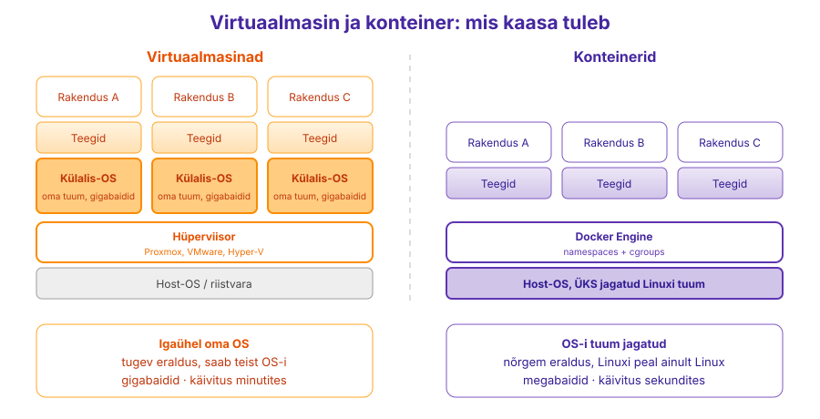
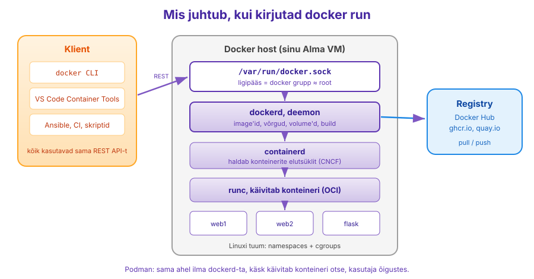
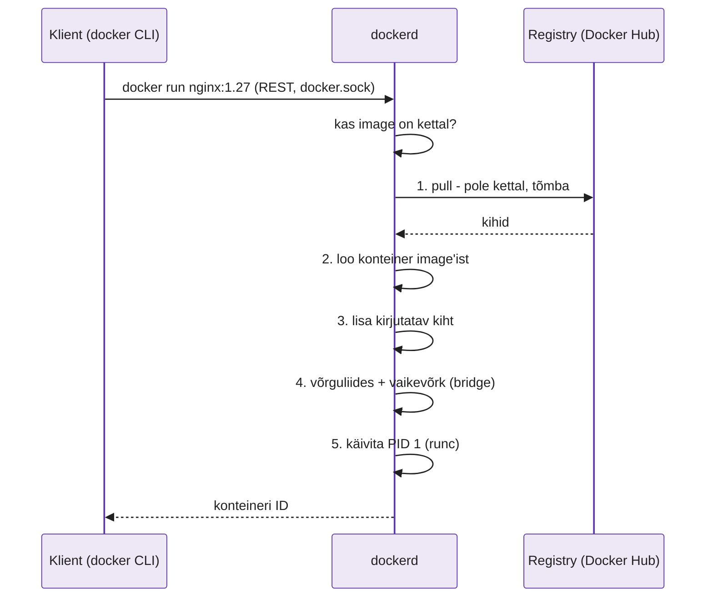
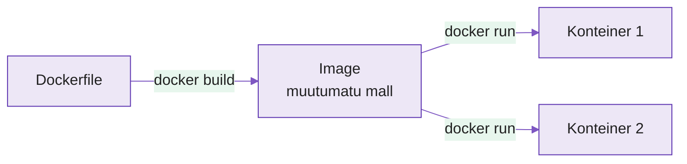
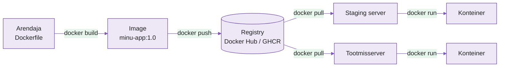
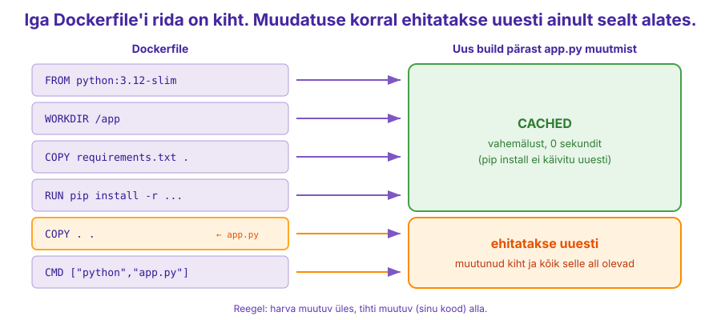
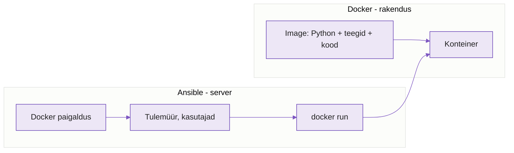

---
tags:
  - Docker
  - Konteinerid
  - Automatiseerimine
---

# Loeng: rakenduse pakkimine ja ümberpaigutamine

Sama kood võib arendaja masinas töötada ja serveris katki minna, sest keskkond on erinev: teine Pythoni versioon, teised teegid või teine OS. Konteiner lahendab selle nii, et rakendus liigub koos oma keskkonnaga ja käitub igas masinas ühtemoodi.

??? abstract "Õpiväljundid"
    Pärast loengut ja praktikumi oskad:

    - selgitada, miks rakendus töötab ühes masinas ja teises mitte
    - võrrelda virtuaalmasinat ja konteinerit
    - eristada image'i, konteinerit, kihti ja tag'i
    - lugeda ja kirjutada lihtsat Dockerfile'i
    - käivitada konteinerit ja leida Dockeri käskudega vea põhjus
    - põhjendada, millal kasutada Ansible'it ja millal Dockerit

## 1. „Töötab minu masinas“

Ansible seadistab serveri: paketid, konfiguratsiooni ja teenused. Alles jääb teine probleem: rakendus ise.

Näiteks töötab Pythoni rakendus arendaja sülearvutis, kus on Python 3.11 ja kindlate versioonidega teegid. Serveris on Python 3.9, mõned teegid on vanemad ja üks puudub. Seal lõpetab rakendus töö veaga, mida arendaja masinas ei tekkinud.

Erinevusi võib olla ka OS-is, keskkonnamuutujates ja failiõigustes. Iga selline erinevus on koht, kus „töötab minu masinas“ muutub „ei tööta serveris“.

Konteineri puhul ei kohandata serverit rakenduse järgi: rakendus võtab oma keskkonna kaasa. Sama pakk käitub ühtemoodi, ükskõik kus see käivitatakse.

## 2. Virtuaalmasin ja konteiner

Füüsilises serveris on üks OS ja tavaliselt üks rakendus. Rakendus kasutab 10% protsessorist, ülejäänu seisab tühjalt, aga voolu ja ruumi võtab terve masin. Uue serveri saamine võtab nädalaid (ost, tarne, paigaldus). Riistvararike peatab kõik, mis selles masinas töötab. Kui panna kaks rakendust samasse masinasse, segavad need teineteist (sama Python, samad pordid).

**Virtualiseerimine** jagab ühe füüsilise masina mitmeks **virtuaalmasinaks (VM)**: igal VM-il on oma virtuaalne riistvara ja oma terve operatsioonisüsteem. Ressursse jagab hüperviisor (Proxmox, VMware, VirtualBox, Hyper-V). Ka sinu kooli AlmaLinuxi masin on Proxmoxi VM.

Virtualiseerimise eelised:

- riistvara on täielikult kasutuses (kümned VM-id ühes serveris);
- VM-id on üksteisest eraldatud: kui üks läheb katki, töötavad teised edasi;
- uue VM-i saab minutitega;
- enne riskantset muudatust saab teha hetktõmmise (**snapshot**) või varukoopia;
- VM-i saab kolida teise füüsilisse serverisse (migratsioon);
- ühes masinas võivad olla eri OS-id (Windows ja Linux).

**Konteiner** kasutab hosti Linuxi tuuma ja oma tuuma kaasa ei too. Kaasas on ainult rakendus ja selle teegid. Eraldatuse tagab Linuxi tuum ise: namespaces annavad oma protsessid, võrgu ja failisüsteemi, cgroups piiravad protsessori- ja mälukasutust.

??? note "Tabel 5.1. VM ja konteiner"

    | | Virtuaalmasin | Konteiner |
    |---|---|---|
    | Mis on kaasas | Terve OS + tuum + rakendus | Rakendus + teegid, tuum jagatud |
    | Suurus | Gigabaidid | Megabaidid |
    | Käivitus | Minutid | Sekundid |
    | Isolatsioon | Tugev (eraldi tuum) | Nõrgem (jagatud tuum) |
    | Teine OS (nt Windows Linuxi peal) | Saab | Ei saa |
    | Tüüpiline kasutus | Server, erinevad OS-id, tugev eraldus | Rakendused, mikroteenused, CI/CD |

<figure markdown="span">
  
  <figcaption>Joonis 5.1. VM toob kaasa terve OS-i, konteiner ainult rakenduse ja teegid; tuum on ühine. Konteinerite eraldatuse tagab hosti tuum (Talvik, 2026).</figcaption>
</figure>

Konteinerite eelised on teisaldatavus (sama image töötab sülearvutis, serveris ja pilves), kiirus (käivitub sekunditega ja sobib automaatseks skaleerimiseks), kergus (ühte VM-i mahub kümneid konteinereid), korratavus (Dockerfile on kood, sama sisend annab sama tulemuse) ja eraldatus (igal rakendusel on oma teegid, mis ei sega teisi). Konteinerid sobivad hästi mikroteenustele ja CI/CD-le.

??? note "Tabel 5.2. VM-i ja konteineri kasutusjuhud"

    | Olukord | Valik | Miks |
    |---|---|---|
    | Samas riistvaras on vaja nii Windowsi kui ka Linuxit | VM | Konteiner ei too oma tuuma |
    | Tugev turvaeraldus (eri kliendid, vaenulik kood) | VM | Eraldi tuum = väiksem rünnakupind |
    | Vana süsteem, terve server koos OS-iga | VM | See ei ole üks rakendus |
    | Veebirakendus, API, mikroteenused | Konteiner | Kiire, kerge, skaleeritav |
    | CI/CD testid, puhas keskkond igaks käivituseks | Konteiner | Käivitub ja kaob sekunditega |
    | "Töötab minu masinas", arendus ja tootmine peavad olema samad | Konteiner | Sama image igal pool |
    | Kursuse labor | Mõlemad | Proxmoxi VM, selles Docker |

VM ja konteiner ei välista teineteist: sageli töötavad konteinerid VM-i sees. Täpselt nii on ka praktikumis: Docker töötab sinu Proxmoxi AlmaLinuxi VM-is, aga konteineris töötab hoopis Ubuntu. Distributsioon on erinev, tuum sama.

??? question "Mõtle"
    Praktikumis näed `uname -r` väljundit nii VM-is kui konteineri sees. Ennusta: kas need on samad või erinevad? Miks?

??? info "Kust konteinerid tulid"

    Docker ei leiutanud konteinerit, see tegi konteineri kasutamise lihtsaks. Idee on üle 40 aasta vana:

    <figure markdown="span">
    ```mermaid
    %%{init: {'theme':'base','themeVariables':{'primaryColor':'#ede7f6','primaryBorderColor':'#5e35b1','primaryTextColor':'#212121','lineColor':'#7e57c2'}}}%%
    graph LR
        A[1979<br/>chroot<br/>Unix V7] --> B[2000<br/>FreeBSD jails]
        B --> C[2004<br/>Solaris Zones]
        C --> D[2006–2008<br/>cgroups Google<br/>+ namespaces Linuxis]
        D --> E[2008<br/>LXC]
        E --> F[2013<br/>Docker<br/>dotCloud]
        F --> G[2014<br/>Kubernetes<br/>Google]
        G --> H[2015<br/>OCI standard]
        H --> I[2018–19<br/>Podman<br/>Red Hat]
    ```
      <figcaption>Joonis 5.2. Konteinerite ajalugu: vajalikud tuuma võimalused olid olemas juba enne Dockerit; Docker lisas lihtsa tööriista, image'i vormingu ja Docker Hubi (Talvik, 2026).</figcaption>
    </figure>

    - **chroot (1979)**: protsess näeb ainult osa failisüsteemist. See oli esimene eraldi juurkataloog.
    - **FreeBSD jails (2000), Solaris Zones (2004)**: lisaks failidele on eraldi ka protsessid, võrk ja kasutajad.
    - **cgroups + namespaces (Linux, 2006–2008)**: Google'i insenerid lisasid tuuma ressursipiirangud (cgroups); namespaces eraldavad protsessid, võrgu ja failisüsteemi. Need kaks koos ongi konteiner.
    - **LXC (2008)**: esimesed täisväärtuslikud Linuxi konteinerid, mida oli aga keeruline kasutada.
    - **Docker (2013)**: ettevõte dotCloud lõi lihtsa käsurea, `Dockerfile`-i, kihilise image'i ja registry (Docker Hub). Konteinerist sai arendaja tööriist.
    - **Kubernetes (2014)**: Google avaldas orkestreerija paljude konteinerite haldamiseks.
    - **OCI (2015)**: [Open Container Initiative](https://opencontainers.org): image'i ja käivitamise standard. Tänu sellele töötab Dockeriga ehitatud image ka Podmanis ja Kubernetes'is.
    - **Podman (Red Hat, versioon 1.0 aastal 2019)**: Dockeriga ühilduv, aga töötab ilma deemonita ja ilma root-õigusteta.

## 3. Kuidas Docker sees töötab

"Docker" tähendab kolme asja: **Docker Engine** (tarkvara, mis konteinereid käitab), **Docker, Inc.** (ettevõte, mis müüb Docker Desktopi ja Docker Hubi tasulisi plaane) ja **avatud lähtekoodiga projekt**. Engine'i lähtekood on projektis [Moby](https://github.com/moby/moby); [Dockeri ametlikus GitHubis](https://github.com/docker) on CLI (`docker/cli`), Compose (`docker/compose`), Buildx ja dokumentatsioon (`docker/docs`). Ametlike image'ide (`nginx`, `python`...) retseptid on [`docker-library`](https://github.com/docker-library/official-images) all. Kõigi osade juhendid on [Dockeri dokumentatsioonis](https://docs.docker.com). Kursusel kasutame Docker Engine'i versiooni 29.x AlmaLinux 9 repositooriumist `docker-ce`.

Dockeril on **klient-server-arhitektuur**:

<figure markdown="span">
  
  <figcaption>Joonis 5.3. Käsk `docker` ise midagi ei käivita, see saadab päringu deemonile, mis teeb töö ära containerd ja runc abil (Talvik, 2026).</figcaption>
</figure>

- **Klient** (`docker` CLI, VS Code laiendus, Ansible): saadab käsu REST API kaudu. Klient võib asuda ka teises masinas.
- **`/var/run/docker.sock`**: Unixi sokkel, mille kaudu klient deemoniga räägib. Kui kasutaja pole `docker` grupis, tuleb viga `permission denied ... docker.sock`. `docker` grupi liige on sisuliselt root, sest kes pääseb soklile ligi, saab käivitada konteineri, mis ühendab enda sisse kogu hosti failisüsteemi (`/`).
- **`dockerd`**: deemon, mis haldab **Dockeri objekte**: image'id, konteinerid, **võrgud** (konteinerite omavaheline suhtlus) ja **volume'd** (andmed, mis jäävad alles ka pärast konteineri kustutamist, N6).
- **containerd** ja **runc**: need käivitavad konteineri. Docker andis containerd CNCF-ile (2017) ja runc-i OCI-le; samu komponente kasutab ka Kubernetes. Podmanil `dockerd` vahelüli puudub.

Käsk `docker run nginx:1.27` teeb viis sammu:

<figure markdown="span">

  <figcaption>Joonis 5.4. `docker run` tõmbab vajadusel image'i, loob konteineri, lisab kirjutatava kihi ja võrgu ning käivitab protsessi (Talvik, 2026, ByteByteGo selgituse põhjal).</figcaption>
</figure>

Ülevaatejoonis, kus build, pull ja run on ühel pildil, on lehel [ByteByteGo, How does Docker work?](https://bytebytego.com/guides/how-does-docker-work/).

Image on kirjutuskaitstud. Konteineri käivitamisel lisatakse selle peale õhuke **kirjutatav kiht**: kõik, mida konteineris muudad (näiteks fail, mida muutsid `docker exec`-iga, või logid), salvestub sinna. `docker stop` ja `docker start` jätavad selle alles, `docker rm` kustutab selle. Järelikult on konteiner ajutine: olulised andmed kuuluvad volume'isse, seadistus image'isse (Dockerfile'i).

??? question "Mõtle"
    Tootmises parandati `docker exec`-iga konteineri sees konfiguratsioonifaili ja kõik töötab. Järgmisel nädalal paigaldatakse uus versioon (`rm` ja `run` uuest image'ist). Mis juhtub parandusega ja kuidas oleks pidanud tegema?

## 4. Image ja konteiner

**Image** on muutumatu mall, failide, teekide ja seadistuste komplekt, mis on kettale salvestatud. Image ise midagi ei tee, ei käivitu ega kasuta protsessoriaega.

**Konteiner** on image'i käivitatud eksemplar, protsess, millel on oma failisüsteem (image'ist), oma võrguliides ja oma eraldatud keskkond.

Analoogia: image on retsept, konteiner on retsepti järgi valminud roog. Sama retsepti järgi saad teha sama rooga nii mitu korda, kui tahad, ja see tuleb iga kord samasugune, sest retsept ei muutu. Programmeerimises: image on klass, konteiner on objekt. Sama vahet selgitab näidetega [OpenReplay algajate juhend](https://blog.openreplay.com/beginner-guide-docker-images-containers/).

<figure markdown="span">

  <figcaption>Joonis 5.5. Ühest image'ist saab käivitada mitu identset konteinerit (Talvik, 2026).</figcaption>
</figure>

Kui konteiner lõpetab töö veaga või kustutad selle, jääb image samaks. Uus konteiner samast image'ist algab täpselt samast olekust.

## 5. Dockerfile: kuidas image ehitatakse

Image'i ehitamiseks kirjutatakse [Dockerfile](https://docs.docker.com/reference/dockerfile/), mis kirjeldab samm-sammult, mis image'isse läheb. Näide Flask-rakendusele:

```dockerfile
FROM python:3.12-slim

WORKDIR /app

COPY requirements.txt .
RUN pip install -r requirements.txt

COPY . .

EXPOSE 5000

CMD ["python", "app.py"]
```

- `FROM` määrab baasimage'i, siin Python 3.12 kergel Debiani baasil.
- `WORKDIR` määrab töökataloogi.
- `COPY requirements.txt .` kopeerib enne ülejäänud koodi ainult sõltuvuste faili. Kui `requirements.txt` ei muutu, võtab Docker selle kihi vahemälust ja ehitamine on kiirem.
- `RUN pip install` paigaldab teegid image'isse.
- Teine `COPY` kopeerib ülejäänud koodi.
- `EXPOSE` dokumenteerib pordi.
- `CMD` on käsk, mis käivitatakse konteineri käivitumisel.

```bash
docker build -t minu-flask-app .
```

`-t` annab image'ile nime, punkt näitab, et Dockerfile on praeguses kaustas. Sama tee algusest lõpuni läbib [Dockeri alustamise juhend](https://docs.docker.com/get-started/).

## 6. Põhikäsklused

```bash
docker build -t minu-app .        # ehita image Dockerfile'ist
docker run -d -p 5000:5000 minu-app  # käivita konteiner
docker ps                          # töötavad konteinerid
docker stop <id>                   # peata
docker rm <id>                     # kustuta peatatud konteiner
docker logs <nimi>                 # konteineri väljund - esimene koht vigade otsimisel
docker exec -it <nimi> bash        # shell töötava konteineri sisse
docker run -it --rm ubuntu:24.04 bash  # interaktiivne ühekordne konteiner
docker pull nginx:1.27             # tõmba image registry'st
docker images / docker rmi <image> # image'id kettal / kustuta
docker system prune                # koristus: peatatud konteinerid, kasutamata image'id
```

`-d` käivitab konteineri taustal, `-p 5000:5000` seob konteineri sisemise pordi hosti pordiga, ilma selleta ei pääse rakendusele konteinerist väljast ligi.

Konteineri saab käivitada kolmel viisil:

- taustal (`-d`): teenused ja veebiserver;
- interaktiivselt (`-it`): uurimiseks, saad terminali konteineri sees;
- nimega (`--name web1`): siis ei pea juhuslikku ID-d kopeerima.

`--rm` kustutab konteineri automaatselt, kui see lõpetab töö.

## 7. Image'i nimi, tag ja registry

Image'i täisnimi koosneb mitmest osast:

```text
ghcr.io / hkhk-automation / minu-nginx : v1
registry   nimeruum (kasutaja)  repo       tag
```

Kui kirjutad lühikese nime, lisab Docker puuduvad osad ise: `nginx` = `docker.io/library/nginx:latest` (Docker Hub, ametlik image, tag `latest`).

**Tag** on silt, mis viitab ühele image'ile. Ühel image'il võib olla mitu silti:

??? note "Tabel 5.3. Tag'id ja digest"

    | Tag | Mida tähendab | Muutub? |
    |---|---|---|
    | `nginx:1.27.3` | Täpne versioon | Praktiliselt mitte |
    | `nginx:1.27` | Uusim 1.27.x | Jah, iga paranduse järel |
    | `nginx:1` | Uusim 1.x | Jah, tihti |
    | `nginx:latest` | Ainult vaikimisi nimi, mille hooldaja võib panna ükskõik millisele versioonile | Jah, ettearvamatult |
    | `nginx:1.27-alpine`, `python:3.12-slim` | Variant: väiksem baas (Alpine, slim Debian) | Nagu versioon |
    | `nginx@sha256:4c0f...` | **Digest**: image'i sisu räsi | Mitte kunagi |

`latest` ei tähenda uusimat versiooni. See on tag, mille Docker võtab, kui sa ise tag'i ei kirjuta. Täna on see üks versioon, kuu pärast teine: sama Dockerfile ehitab erineva image'i ja probleem „töötab minu masinas“ on tagasi. Seetõttu:

- tootmises kasuta alati konkreetset tag'i (`nginx:1.27`), kriitilises kohas isegi digest'i (`@sha256:...`), sest tag'i saab teisele image'ile ümber tõsta, digest'i ei saa;
- pane oma image'ile versioon (`v1`, `1.0.3` või Giti commit'i lühiräsi), siis tead täpselt, mis tootmises töötab, ja saad vajadusel tagasi minna (kui `v2` on katki, käivita `docker run ...:v1`).

Image'eid hoitakse registry's. Kõige tuntum on [Docker Hub](https://hub.docker.com): kui kirjutad `FROM nginx`, tuleb image sealt. Teised on näiteks GitHub Container Registry (`ghcr.io`), Quay.io (Red Hat) ja ettevõtete oma registry'd. `docker pull` tõmbab image'i alla, `docker push` laadib selle üles (et jagada oma image'it meeskonnaga; vaja on `docker login`).

Docker Hubis vaata image'i lehel kolme asja:

- märgis: *Docker Official Image* (Docker hooldab, näiteks `nginx`, `python`, `ubuntu`) või *Verified Publisher* (avaldab tootja ise). Need on usaldusväärsed. Suvaline `kasutaja123/nginx` võib sisaldada ükskõik mida;
- vahekaart **Tags** näitab, millised versioonid on olemas (`1.27`, `1.27-alpine`, `latest`...);
- ametliku image'i nime ees pole kasutajanime: `nginx` on sama mis `docker.io/library/nginx`.

Oma image'i saab teistega jagada kolmel viisil:

```bash
# 1. Registry kaudu (tavaline)
docker tag minu-app:1.0 kasutaja/minu-app:1.0   # uus nimi samale image'ile
docker login
docker push kasutaja/minu-app:1.0
# teine inimene: docker pull kasutaja/minu-app:1.0

# 2. Failina (ilma internetita, nt suletud võrk)
docker save -o minu-app.tar minu-app:1.0
# teine inimene: docker load -i minu-app.tar

# 3. Dockerfile Gitis: teine inimene ehitab ise (docker build)
```

`docker tag` ei kopeeri midagi, sama image saab lihtsalt veel ühe nime. `docker images` näitab mõlemat nime sama `IMAGE ID`-ga.

Kettaruum: iga uus build jätab vanad kihid alles. `docker system df` näitab, kui palju ruumi image'id, konteinerid ja vahemälu võtavad; `docker image prune` kustutab nimeta (`<none>`) image'id, `docker system prune` kõik kasutamata objektid.

Docker Hub piirab sisselogimata tõmbamiste arvu. Kui terve klass tõmbab image'eid kooli ühe IP-aadressi tagant, võib piir täis saada ja siis aitab `docker login` (tasuta konto).

<figure markdown="span">

  <figcaption>Joonis 5.6. Sama image (sama tag) jõuab registry kaudu muutmata kujul igasse keskkonda, seepärast käitub see igal pool ühtemoodi (Talvik, 2026).</figcaption>
</figure>

**Kiht** (layer) tekib iga Dockerfile'i rea kohta. Docker salvestab kihid vahemällu ja ehitab uuesti alles muutunud kihist alates. Seepärast on järjekord oluline: harva muutuvad osad (OS, teegid) on üleval ja tihti muutuv kood all, nagu `requirements.txt` näites.

<figure markdown="span">
  
  <figcaption>Joonis 5.7. Kui muudad koodi, tulevad OS ja teegid vahemälust; uuesti ehitatakse ainult muutunud kiht ja kõik selle all olevad kihid (Talvik, 2026).</figcaption>
</figure>

## 8. Turvalisem ja seadistatav image

Allolev Dockerfile ehitab sama Flaski image'i nii, et rakendus töötab tavakasutajana ja osa seadistusest tuleb muutujatest.

??? example "Fail `Dockerfile`: mitte-root kasutaja, `ARG` ja `ENV`"

    ```dockerfile
    FROM python:3.12-slim

    ARG APP_VERSION=1.0          # ainult ehitamise ajal: docker build --build-arg APP_VERSION=2.0
    ENV APP_ENV=production       # kehtib ka töötavas konteineris; üle kirjutatav: docker run -e APP_ENV=dev

    WORKDIR /app
    COPY requirements.txt .
    RUN pip install --no-cache-dir -r requirements.txt
    COPY . .

    RUN useradd --create-home appuser
    USER appuser                 # sellest reast alates ei käivitata käske ega rakendust root'ina

    CMD ["python", "app.py"]
    ```

Vaikimisi töötab konteineris kõik root'ina. Kui rakenduses on turvaauk, saab ründaja konteineris root-õigused. `USER` vähendab võimalikku kahju.

Turvareeglid, mis sobivad igale Dockerfile'ile:

- baasimage on ametlik (Docker Official Image) või tuntud tootjalt; suvalisest `kasutaja123/python` image'ist ei tea, mis seal sees on;
- tag on konkreetne, sest `latest` muutub ettearvamatult;
- vähem pakette tähendab vähem turvaauke: kasuta `-slim` või `alpine` image'eid ja ära paigalda tööriistu igaks juhuks;
- rakendus töötab tavakasutajana (`USER`);
- saladused ei kuulu image'isse: paroole ei panda `ENV`-i ega `ARG`-i ega kopeerita `COPY`-ga. Igaüks saab image'i lahti pakkida ja saladus jääb kihti alles ka siis, kui mõni hilisem rida selle kustutab.

Need ja teised soovitused (kihtide järjekord, tag'id, `.dockerignore`) on Dockeri lehel [Building best practices](https://docs.docker.com/build/building/best-practices/).

**Mitmeetapiline build (multi-stage)**: ehitustööriistad (kompilaator, `npm`, `pip`-i vahemälu) ei pea lõppimage'isse jõudma:

```dockerfile
FROM node:20-alpine AS build      # etapp 1: ehita
WORKDIR /app
COPY package*.json ./
RUN npm ci
COPY . .
RUN npm run build

FROM nginx:1.27-alpine            # etapp 2: ainult tulemus
COPY --from=build /app/dist /usr/share/nginx/html
```

Lõppimage'is on ainult nginx ja valmis failid: see on sadu megabaite väiksem ja vähemate pakettidega, seega ka vähemate turvaaukudega.

Andmeid ei hoita konteineris. Konteiner on ajutine (kirjutatav kiht kaob `rm`-iga). Püsivate andmete jaoks on kaks võimalust:

- **Volume**: Dockeri hallatud andmeala: `docker volume create andmed`, `docker run -v andmed:/var/lib/mysql ...`: näiteks andmebaasidele.
- **Bind mount**: hosti kaust ühendatakse konteinerisse: `docker run -v $(pwd):/app ...`: arenduses, sest koodi muudatus on kohe näha.

Täpsemalt räägime sellest N6-s koos Compose'iga.

## 9. Docker ja Podman

AlmaLinuxis ja RHEL-is on vaikimisi [Podman](https://podman.io/docs): Red Hati tööriist, mis ühildub Dockeriga. Käsud on samad (`podman build`, `podman run`, `podman ps`), image'id on samad (OCI standard) ja enamasti töötab isegi `alias docker=podman`.

??? note "Tabel 5.4. Docker ja Podman"

    | | Docker | Podman |
    |---|---|---|
    | Arhitektuur | Taustal deemon `dockerd` (root) | Deemonit pole, iga käsk on tavaline protsess |
    | Root | Deemon töötab root-õigustes; `docker` grupp ≈ root | Vaikimisi rootless: töötab kasutaja enda õigustes |
    | Pod'id | Ei | Jah, mitu konteinerit koos, nagu Kubernetes'is |
    | Compose | `docker compose` | `podman compose` / `podman-compose` |
    | Kus kasutatakse | Igal pool: arendajad, CI, Docker Desktop | RHEL/Alma/Fedora serverid, turvatundlikud keskkonnad |

Kursusel kasutatakse Dockerit, sest see on valdkonnas levinuim tööriist, enamik juhendeid ja CI-süsteeme eeldab seda ning Compose (N6) töötab Dockeriga kõige sujuvamalt. Samas on `docker` grupi liige sisuliselt root ja Podmani rootless-mudel on turvalisem. RHEL-i kasutavas ettevõttes kohtad Podmani ja samad käsud töötavad ka seal. Praktikumi osas 14 paigaldad teise Alma VM-i Podmani ja käivitad seal sama image'i.

## 10. Ökosüsteem: Desktop, Compose, orkestreerimine

??? note "Tabel 5.5. Konteinerite ökosüsteem"

    | Tööriist | Mis see on | Kus kohtad |
    |---|---|---|
    | **Docker Engine** | Deemon + CLI + API Linuxis | Serverid, meie VM |
    | **Docker Desktop** | Windowsi ja Maci rakendus: Engine VM-is, CLI, Compose, Kubernetes, graafiline liides. Suurfirmadele tasuline | Arendaja sülearvuti |
    | **Docker Compose** | Mitu konteinerit ühest YAML-failist, ühe käsuga (`docker compose up`) | N6 |
    | **Docker Swarm** | Dockeri enda lihtne orkestreerija mitmele serverile | Väiksemad paigaldused |
    | **Kubernetes** | Orkestreerijate standard: paigaldus, uuendused, koormuse jaotamine, tervisekontroll, skaleerimine. Google'i Borgi järeltulija, avaldatud 2014, CNCF-is alates 2015 | Suured süsteemid, pilv (EKS, AKS, GKE, OpenShift) |
    | **Docker Scout** / Trivy | Image'i turvaaukude skannimine | CI/CD, DevSecOps |

Kus konteinereid kasutatakse:

- **Mikroteenused**: rakendus on jagatud väikesteks iseseisvateks teenusteks (kasutajad, maksed, otsing). Iga teenus on oma konteineris ning seda uuendatakse ja skaleeritakse eraldi.
- **CI/CD**: iga test käivitatakse puhtas konteineris; sama image läheb testist tootmisse (N7).
- **Pilve kolimine ja hübriidpilv**: sama image töötab oma serveris, AWS-is ja Azure'is; teenusepakkuja vahetamiseks ei pea rakendust ümber ehitama.
- **Containers as a Service**: pilveteenus käitab sinu konteinereid ise (AWS ECS/Fargate, Azure Container Apps, Google Cloud Run).
- **AI/ML**: mudel ja täpselt õiged teekide versioonid (CUDA, PyTorch) on ühes pakis.

Konteinerid on eraldatud, aga mitte täielikult. Ühine tuum tähendab, et tuuma turvaauk mõjutab kõiki konteinereid. Seepärast kasuta tavakasutajat (`USER`) ja ametlikke image'eid, skanni image'id enne tootmist ja käivita võõrast koodi eraldi VM-is.

## 11. Docker ja Ansible: millal kumba kasutada

Need ei konkureeri omavahel. Ansible haldab serverit: OS-i, kettaid, kasutajaid ja teenuseid. Docker pakib ühe rakenduse koos sõltuvustega nii, et see käitub igal pool ühtemoodi.

Praktikas kasutatakse neid koos: Ansible'i playbook seadistab serveri (paigaldab Dockeri, avab pordid, kontrollib kettaruumi) ja käivitab siis konteineri. Serverit haldab Ansible, rakendust Docker.

<figure markdown="span">

  <figcaption>Joonis 5.8. Ansible valmistab serveri ette ja käivitab konteineri; mis on konteineri sees, määrab image (Talvik, 2026).</figcaption>
</figure>

Kui konteinereid on kümneid või sadu mitmel serveril, võtab nende haldamise üle **orkestreerija** (vt Tabel 5.5). N6-s tuleb vahesamm: Docker Compose, millega käivitad mitu teenust ühes masinas.

Kui kahtled, kas kasutada Ansible'it või Dockerit, küsi: kas see on osa serverist (tulemüür, kasutajad, ketas) või osa rakendusest (Pythoni versioon, teegid, kood)? Esimesel juhul Ansible, teisel Docker.

## 12. Miks see on töökohas oluline

Suurtes meeskondades liigub sama image muutmata kujul arendaja masinast testkeskkonda (staging) ja sealt tootmisse. Kui image läbib testkeskkonnas testid, on kindel, et tootmises käivitub täpselt sama kood samade teekidega.

Nii kaob probleem „töötab minu masinas“. Arendaja annab serverile valmis paki, milles on kõik vajalik olemas. Kui tootmises tekib viga, käivitad sama image'i oma masinas ja näed täpselt sama viga.

## Kokkuvõte

??? abstract "Kokkuvõte"

    - VM virtualiseerib riistvara ja toob kaasa oma OS-i, konteiner jagab hosti tuuma. Konteiner on kergem ja kiirem, aga eraldatus on nõrgem.
    - Image on muutumatu mall, konteiner on selle käivitatud eksemplar. Dockerfile kirjeldab, kuidas image ehitatakse.
    - Tag on silt, digest on sisu. `latest` on ainult vaikimisi nimi, tootmises kasuta konkreetset tag'i.
    - Turvaline image: ametlik baasimage, vähe pakette, `USER`, saladused image'ist väljas. Multi-stage build teeb image'i väikeseks.
    - Konteineri kirjutatav kiht kaob `rm`-iga, püsivad andmed lähevad volume'isse.
    - `docker` grupp on sisuliselt root. Podman ühildub Dockeriga ja töötab ilma deemonita.
    - Ansible haldab serverit, Docker pakib rakendust.
