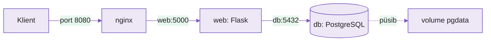

---
tags:
  - Docker
  - DockerCompose
  - Konteinerid
---

# Loeng — Mitme teenuse käitamine koos

**Kestus:** ~35 minutit
**Tase:** algaja — eeldame, et tead nädal 5 käske `docker build` ja `docker run`

---

!!! abstract "Õpiväljundid"
    Pärast loengut oskad:

    - selgitada, miks päris rakendus vajab mitut konteinerit
    - kirjeldada `docker-compose.yml` struktuuri
    - käivitada ja peatada mitme konteineri stacki ühe käsuga
    - eristada, mis on Compose'is teenus, võrk ja volume
    - põhjendada, miks andmebaasi andmed lähevad volume'i, mitte konteinerisse
    - hoida paroolid `.env` failis, mitte `docker-compose.yml`-is

---

## 1. Miks mitu konteinerit?

Eelmisel nädalal pakkisime Flaski rakenduse ühte image'isse ja käivitasime selle üksiku konteinerina. Demoks sobib, aga päris rakendusel on rohkem osi: Flask vajab andmebaasi (PostgreSQL) ja tihti ka nginx-i enda ees, mis tegeleb HTTPS-iga ja jagab liiklust.

Miks mitte panna kõik — Flask, PostgreSQL, nginx — ühte konteinerisse? Tehniliselt saab, praktikas on see halb mõte. Kui kõik on ühes, ei saa andmebaasi uuendada rakendust puudutamata, ei saa nginx-i taaskäivitada Flaski protsessi segamata ega üht komponenti eraldi skaleerida. Iga komponent oma konteineris = iga osa vastutus on eraldi.

<figure markdown="span">

  <figcaption>Joonis 6.1. Kolm teenust ühes stackis; väljapoole on avatud ainult nginx.</figcaption>
</figure>

---

## 2. docker-compose.yml — struktuur

Mitme konteineri käivitamine ükshaaval `docker run`-iga on tüütu ja veaohtlik — pordid, võrgud ja järjekord tuleb iga kord meeles pidada. Compose kogub kogu kirjelduse ühte faili.

```yaml
services:
  web:
    build: ./app
    environment:
      DATABASE_URL: postgresql://postgres:${POSTGRES_PASSWORD}@db:5432/appdb
    depends_on:
      - db

  db:
    image: postgres:16
    environment:
      POSTGRES_PASSWORD: ${POSTGRES_PASSWORD}
      POSTGRES_DB: appdb
    volumes:
      - pgdata:/var/lib/postgresql/data

  nginx:
    image: nginx:1.27
    ports:
      - "8080:80"
    volumes:
      - ./nginx/default.conf:/etc/nginx/conf.d/default.conf
    depends_on:
      - web

volumes:
  pgdata:
```

`services` kirjeldab kolme teenust. `web` ehitatakse kohapeal kaustast `./app` (`build`), `db` ja `nginx` tulevad valmis image'itena — konkreetse tag'iga, mitte `latest` (meenuta nädal 5). `ports` seob konteineri pordi väljapoole. Siin on see ainult nginx-il: `web` ja `db` räägivad ainult sisevõrgus.

`depends_on` määrab käivitusjärjekorra. Tähelepanu: see ootab ainult, et konteiner **käivituks**, mitte et PostgreSQL oleks päriselt päringuteks valmis. Selle lahendab `healthcheck` (labi lisaülesanne) või rakenduse enda uuesti proovimine.

`volumes` faili lõpus loob nimega volume'i `pgdata` andmete hoidmiseks. Võrku pole vaja eraldi kirjeldada: Compose loob stackile ise ühe sisevõrgu, kuhu kõik teenused kuuluvad.

!!! warning
    Compose on YAML. "Lihtne, nad ütlesid." Kaks tundi hiljem otsid, miks `depends_on` ei tööta — ja põhjus on üks tühik vale koha peal. Taane on Compose'is tähendus, mitte iluvõte. Kasuta redaktorit, mis taanet näitab, ja kontrolli faili käsuga `docker compose config`.

---

## 3. Põhikäsklused

```bash
docker compose up -d           # käivita kõik teenused taustal, ehita puuduvad image'id
docker compose up -d --build   # ehita image'id uuesti (kui muutsid koodi)
docker compose ps              # mis teenused töötavad
docker compose logs web        # ühe teenuse logi
docker compose restart nginx   # taaskäivita üks teenus (nt pärast konfi muutmist)
docker compose config          # näita lõplikku faili, muutujad asendatud
docker compose down            # peata ja eemalda kõik konteinerid + võrk
```

`down` on üks käsk mitme asemel (mitte kolm `docker stop` + kolm `docker rm`). Tähelepanu: `up -d` ehitab image'i ainult siis, kui seda veel pole. Kui muutsid `app.py`-d, on vaja `--build`.

---

## 4. Võrgud

Compose loob teenuste vahele sisevõrgu, kus iga teenus on kättesaadav **oma nime järgi**. Flaski andmebaasiaadressis pole IP-d, vaid teenuse nimi `db`:

```
postgresql://postgres:parool@db:5432/appdb
```

`db` on DNS-nimi, mille Compose ise sisevõrgus lahendab. IP-d ei tasu kasutada: konteineri IP muutub iga uue käivitusega. Ka `127.0.0.1` ei sobi — konteineri sees tähendab see **seda sama konteinerit**, mitte andmebaasi.

Väljastpoolt on nähtav ainult see, mis on `ports` all — meie näites nginx-i port 8080 (VM-i port 80 on juba nädal 3 nginx-i käes, `8080:80` tähendab: VM-i 8080 → konteineri 80). Andmebaasil pole `ports` sektsiooni, nii et see pole väljastpoolt üldse ligipääsetav, ainult sama stacki teenused näevad seda. See pole piirang, see on kaitse.

---

## 5. Volumes

Konteiner on ajutine. Kustutad PostgreSQL-i konteineri ja käivitad uue — selle failisüsteem on jälle puhas, nagu image algselt oli. Kui andmebaasi andmed oleksid konteineri sees, kaoksid need iga kord.

Volume hoiab andmeid konteinerist **väljaspool**, hostmasina kettal. Konteiner näeb volume'i tavalise kaustana, aga andmed elavad konteinerist sõltumatult. Kustutad konteineri, käivitad uue sama volume'iga — andmed on alles.

Seepärast on meie failis `pgdata:/var/lib/postgresql/data`: PostgreSQL kirjutab sinna ja volume tagab, et andmed püsivad üle konteineri elutsükli. `docker compose down` volume'i ei kustuta, `docker compose down -v` kustutab.

---

## 6. Miks tööl oluline

Suur makse- või veebiteenus koosneb kümnetest komponentidest — backend, andmebaas, cache, sõnumijärjekord — igaüks eraldi konteinerina. Ükski ei tööta üksi, kõik sõltuvad üksteisest ja kogu kooslus peab käivituma samamoodi arendaja masinas ja tootmises.

Compose teeb selle korratavaks. Uus meeskonnaliige ei paigalda käsitsi PostgreSQL-i, Redist ja kõike muud — üks fail, üks käsk (`docker compose up -d`) ja tal on sama keskkond mis kõigil teistel. Erinevused keskkondade vahel (paroolid, domeenid) tulevad keskkonnamuutujatest, mitte failistruktuuri muutmisest.

---

## 7. Paroolid välja: .env

Kui parool on `docker-compose.yml`-is, läheb see koos failiga Giti ja GitHubi. Nädalas 4 lahendasime sama probleemi Ansible Vaultiga, Compose'is on lihtsam viis: fail `.env` samas kaustas.

```
POSTGRES_PASSWORD=MinuSalajaneParool
```

Compose loeb `.env` ise sisse ja asendab `docker-compose.yml`-is iga `${POSTGRES_PASSWORD}` selle väärtusega. `.env` lisatakse `.gitignore`-i, Giti läheb ainult compose-fail ilma paroolita.

Kui muutuja nimes on trükiviga, ei anna Compose viga — ainult hoiatuse `variable is not set. Defaulting to a blank string` ja asendab tühja tekstiga. Seepärast kontrolli `docker compose config` väljundit.

---

## Kokkuvõte

- **Iga komponent oma konteineris** — rakendus, andmebaas ja proxy eraldi, mitte üks suur konteiner
- **docker-compose.yml kirjeldab kogu stacki ühes failis** — teenused, pordid, sõltuvused, volume'id
- **Põhikäsklused:** `up -d`, `up -d --build`, `ps`, `logs`, `config`, `down`
- **Teenused leiavad üksteist nime järgi** — `db` on Compose'i sisevõrgus DNS-nimi, mitte IP
- **Väljapoole on nähtav ainult `ports` all kirjas olev** — andmebaas ilma `ports`-ita jääb sisevõrku
- **Andmebaasi andmed lähevad volume'i, mitte konteinerisse** — konteiner on ajutine, volume püsiv
- **Paroolid on `.env` failis**, mis ei lähe Giti

---

## Allikad

| Allikas | URL |
|---|---|
| Docker Compose | <https://docs.docker.com/compose/> |
| Compose file referents | <https://docs.docker.com/reference/compose-file/> |
| Muutujad Compose'is | <https://docs.docker.com/compose/how-tos/environment-variables/variable-interpolation/> |
| Compose Getting Started | <https://docs.docker.com/compose/gettingstarted/> |

**Versioonid:** Docker Compose `v2`, `postgres:16`, `nginx:1.27`.

---

*Järgmine: praktikumis paned kokku Flask + PostgreSQL + nginx stacki.*
