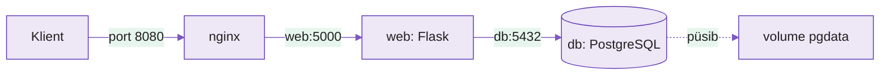

---
tags:
  - Docker
  - DockerCompose
  - Konteinerid
---

# Loeng: mitme teenuse koos käitamine

N5-s pakkisid Flaski rakenduse image'isse ja käivitasid selle üksiku konteinerina. Täna paned rakenduse, andmebaasi ja nginx'i tööle ühe failiga.

??? abstract "Õpiväljundid"
    Pärast loengut ja praktikumi oskad:

    - selgitada, miks tegelik rakendus vajab mitut konteinerit
    - kirjeldada `docker-compose.yml` struktuuri
    - käivitada ja peatada mitme konteineri stacki ühe käsuga
    - eristada, mis on Compose'is teenus, võrk ja volume
    - põhjendada, miks andmebaasi andmed lähevad volume'i
    - hoida paroolid `docker-compose.yml`-ist eraldi failis `.env`

## 1. Mitu konteinerit

Õppenäites piisab ühest konteinerist, aga tegelikul rakendusel on rohkem osi: Flask vajab andmebaasi (PostgreSQL) ja sageli ka enda ette pöördproksiks nginx'i, mis tegeleb HTTPS-iga ja jagab liiklust.

Kõik kolm (Flask, PostgreSQL, nginx) saaks paigutada ühte konteinerisse, aga see on halb mõte. Kui kõik on ühes, ei saa andmebaasi uuendada rakendust puudutamata, ei saa nginx'i taaskäivitada Flaski protsessi segamata ega üht komponenti eraldi skaleerida. Kui iga komponent on oma konteineris, saab iga osa eraldi uuendada, taaskäivitada ja skaleerida.

<figure markdown="span">

  <figcaption>Joonis 6.1. Kolm teenust ühes stackis; väljapoole on avatud ainult nginx (Talvik, 2026).</figcaption>
</figure>

## 2. docker-compose.yml: struktuur

Mitme konteineri käivitamine ükshaaval `docker run`-iga on tüütu ja veaohtlik, sest pordid, võrgud ja järjekord tuleb iga kord meeles pidada. [Docker Compose](https://docs.docker.com/compose/) kogub kogu kirjelduse ühte faili. Näidisfailis on kolm teenust. Andmebaasi parool tuleb muutujast `${POSTGRES_PASSWORD}`, mille väärtus on kohalikus failis `.env` (osa 7). Seda faili repositooriumi ei lisata.

??? example "Fail `docker-compose.yml`"

    ```yaml
    services:
      web:
        build: ./app
        environment:
          DATABASE_URL: postgresql://postgres:${POSTGRES_PASSWORD}@db:5432/appdb
        depends_on:
          - db

      db:
        image: postgres:16
        environment:
          POSTGRES_PASSWORD: ${POSTGRES_PASSWORD}
          POSTGRES_DB: appdb
        volumes:
          - pgdata:/var/lib/postgresql/data

      nginx:
        image: nginx:1.27
        ports:
          - "8080:80"
        volumes:
          - ./nginx/default.conf:/etc/nginx/conf.d/default.conf
        depends_on:
          - web

    volumes:
      pgdata:
    ```

`services` kirjeldab kolme teenust. `web` ehitatakse kohapeal kaustast `./app` (`build`). `db` ja `nginx` tulevad valmis image'itena konkreetse tag'iga, sest `latest` muutub ettearvamatult. `ports` avaldab konteineri pordi hosti kaudu. Siin on see ainult nginx'il, sest `web` ja `db` suhtlevad ainult sisevõrgus.

Kõik võtmed on kirjas [Compose'i failivormingu juhendis](https://docs.docker.com/reference/compose-file/). Kursusel kasutatakse Compose'i versiooni 2 ning image'eid `postgres:16` ja `nginx:1.27`.

Fail `nginx/default.conf` suunab nginx'ile saabuvad päringud teenusele `web` pordil 5000. Seepärast saab brauser pöörduda nginx'i poole, kuigi Flaski porti hostis ei avaldata.

Näites kasutatud `depends_on`-i lühikuju määrab käivitusjärjekorra, aga ei taga, et PostgreSQL juba ühendusi vastu võtab. Selleks on `healthcheck` koos tingimusega `condition: service_healthy` (praktikumi lisaülesanne) või rakenduse ühenduse korduskatsed.

`volumes` faili lõpus loob nimega volume'i `pgdata` andmete hoidmiseks. Võrku pole vaja eraldi kirjeldada: Compose loob stackile ise ühe sisevõrgu, kuhu kõik teenused kuuluvad.

!!! warning
    Compose'i fail on YAML ja taandel on selles sisuline tähendus. Üks tühik vales kohas võib muuta näiteks `depends_on` kehtetuks. Kasuta redaktorit, mis taanet näitab, ja kontrolli faili käsuga `docker compose config`.

## 3. Põhikäsud

```bash
docker compose up -d           # käivita kõik teenused taustal, ehita puuduvad image'id
docker compose up -d --build   # ehita image'id uuesti (kui muutsid koodi)
docker compose ps              # mis teenused töötavad
docker compose logs web        # ühe teenuse logi
docker compose restart nginx   # taaskäivita üks teenus (nt pärast konfiguratsioonifaili muutmist)
docker compose config          # näita lõplikku faili, muutujad asendatud (ka paroolid!)
docker compose down            # peata ja eemalda kõik konteinerid + võrk
```

`down` asendab kolme `docker stop` ja kolme `docker rm` käsku. `up -d` ehitab image'i ainult siis, kui seda veel pole, nii et pärast `app.py` muutmist on vaja `--build`. Samad käsud ühe väikese rakenduse näitel on [Compose'i alustamise juhendis](https://docs.docker.com/compose/gettingstarted/).

## 4. Võrgud

Compose loob teenuste vahele sisevõrgu, kus iga teenus on kättesaadav oma nime järgi. Flaski andmebaasiaadressis on IP-aadressi asemel teenuse nimi `db`:

```
postgresql://postgres:parool@db:5432/appdb
```

`db` on DNS-nimi, mille Compose ise sisevõrgus lahendab. Konteineri IP-aadressi ei tasu konfiguratsiooni kirjutada: see võib konteineri uuesti loomisel muutuda. Ka `127.0.0.1` ei sobi, sest konteineri sees tähendab see sama konteinerit.

Väljastpoolt on nähtav ainult see, mis on `ports` all, meie näites nginx'i port 8080 (`8080:80` suunab VM-i pordi 8080 konteineri porti 80). Andmebaasi porti ei avaldata hosti pordina. Rakendus ühendub andmebaasiga Compose'i võrgu kaudu aadressil `db:5432` ja selleks ei pea andmebaasi porti väljapoole avama.

## 5. Volumes

Konteineri kirjutatav kiht kustutatakse koos konteineriga. Kui andmed on ainult seal, kaovad need konteineri eemaldamisel. Seepärast hoitakse andmebaasi andmed eraldi andmeköites ehk **volume**'is.

Volume hoiab andmeid konteinerist väljaspool, hosti kettal. Konteiner näeb volume'i tavalise kaustana, aga andmed on konteinerist sõltumatud. Kui kustutad konteineri ja käivitad uue sama volume'iga, on andmed alles.

Seepärast on meie failis `pgdata:/var/lib/postgresql/data`: PostgreSQL kirjutab sinna ja volume hoiab andmed alles ka siis, kui konteiner kustutatakse. `docker compose down` volume'i ei kustuta. `docker compose down -v` kustutab volume'i koos andmetega: kasuta seda ainult siis, kui tahad katseandmed kustutada.

## 6. Miks see on töökohas oluline

Suur makse- või veebiteenus koosneb kümnetest komponentidest (taustarakendus, andmebaas, vahemälu, sõnumijärjekord), igaüks eraldi konteineris. Ükski ei tööta üksi, kõik sõltuvad üksteisest ja kogu kooslus peab käivituma samamoodi arendaja masinas ja tootmises.

Compose teeb selle korratavaks. Uus meeskonnaliige ei pea PostgreSQL-i, Redist ja muud käsitsi paigaldama: ühe faili ja ühe käsuga (`docker compose up -d`) on tal sama keskkond mis teistel. Erinevused keskkondade vahel (paroolid, domeenid) tulevad keskkonnamuutujatest ja fail jääb samaks.

## 7. Paroolide eraldamine Compose'i failist

Kui parool on `docker-compose.yml`-is, läheb see koos failiga Giti ja GitHubi. Ansible Vault (N4) krüpteerib saladused. Selles Compose'i näites hoiame parooli eraldi kohalikus failis `.env` samas kaustas. See on tavaline tekstifail, mitte krüpteeritud hoidla, ja seepärast seda repositooriumi ei lisata.

```
POSTGRES_PASSWORD=MinuSalajaneParool
```

Compose loeb `.env` ise sisse ja [asendab](https://docs.docker.com/compose/how-tos/environment-variables/variable-interpolation/) `docker-compose.yml`-is iga `${POSTGRES_PASSWORD}` selle väärtusega. `.env` lisatakse `.gitignore`-i, Giti läheb ainult Compose'i fail ilma paroolita.

Kui muutuja nimes on trükiviga, ei anna Compose viga, ainult hoiatuse `variable is not set. Defaulting to a blank string` ja asendab muutuja tühja väärtusega. Seepärast kontrolli `docker compose config` väljundit. Selles väljundis on asendatud paroolid näha, seega ära jaga seda ega lisa repositooriumi.

## Kokkuvõte

??? abstract "Kokkuvõte"

    - Iga komponent (rakendus, andmebaas, proxy) on oma konteineris.
    - `docker-compose.yml` kirjeldab kogu stacki: teenused, pordid, sõltuvused ja volume'id.
    - Põhikäsud on `up -d`, `up -d --build`, `ps`, `logs`, `config` ja `down`.
    - Teenused leiavad üksteist nime järgi: `db` on Compose'i sisevõrgus DNS-nimi.
    - Väljapoole on nähtav ainult see, mis on `ports` all.
    - Andmebaasi andmed on volume'is, paroolid failis `.env`, mis Giti ei lähe.
