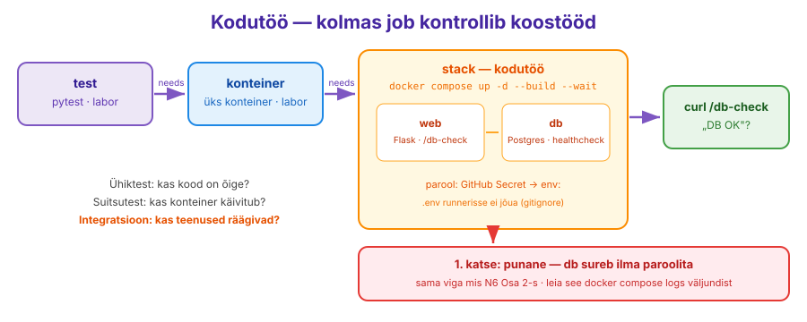

---
tags:
  - CI
  - GitHubActions
  - DockerCompose
  - Kodutöö
---

# Kodutöö — CI testib terve stacki

**Eeldused:** labor on tehtud: `ci.yml`-is on `test` ja `konteiner`, PR `n07-ci` on roheline. Nädal 6 labor: `web` + `db`, `/db-check`, `.env`.

## Ülesanne

Laboris kontrollis CI üht konteinerit üksinda. Päris rakendus ei ela üksi: N6-s nägid, et Flask võib töötada ja andmebaas võib töötada, aga omavahel nad ikka ei räägi (vale host, puuduv parool). Neid vigu ei leia ühiktest ega üksiku konteineri suitsutest.

Lisa CI-sse kolmas job `stack`, mis käivitab **Compose'iga Flaski koos PostgreSQL-iga** ja kontrollib, et `/db-check` vastab `DB OK`.

<figure markdown="span">
  
  <figcaption>Joonis 7.8. Kolmas job kontrollib teenuste koostööd, mitte üht teenust. Esimene katse on punane meelega (Talvik, 2026).</figcaption>
</figure>

## Sammud

### 1. Haru

```bash
git switch n07-ci && git pull
git switch -c n07-kodu
```

### 2. Rakendus oskab andmebaasi küsida

Vii N6 labi Osa 3 `/db-check` route oma repo `flask/app.py`-sse ja lisa `psycopg2-binary` faili `flask/requirements.txt`. Pane kood ise kokku: N6-s tegid seda kaustas `~/lab06/app`, nüüd tuleb see repo kausta `flask/`.

Kontrolli lokaalselt, et vanad testid töötavad edasi:

```bash
source .venv/bin/activate
pip install -r flask/requirements.txt
pytest flask -v
```

!!! question "Uus route vajab ka testi?"
    `/db-check` vajab päris andmebaasi, seega `test_client()`-iga seda ilma baasita testida ei saa. Selle kontrollib `stack` job. Mõtle: mis vahe on testil, mis vajab ainult koodi, ja testil, mis vajab terve stacki?

### 3. `compose.yaml` repo juurde

Kirjuta repo juurkausta `compose.yaml` N6 labi põhjal. Ainult **kaks teenust** (`web` ja `db`, nginx-it pole vaja). Erinevused N6-st:

| N6 laboris | Siin |
|---|---|
| `build: ./app` | `build: ./flask` |
| `depends_on: [db]` | `db` vajab [`healthcheck`](https://docs.docker.com/reference/compose-file/services/#healthcheck)-i (`pg_isready`), `web` ootab `condition: service_healthy` (N6 lisaülesanne 1) |
| parool `.env`-ist | sama: `${POSTGRES_PASSWORD}`, `${POSTGRES_DB}` |

Testi lokaalselt **enne**, kui CI-sse paned:

```bash
docker compose up -d --build --wait
curl localhost:5000/db-check
docker compose down -v
```

`DB OK`? Edasi. ([`--wait`](https://docs.docker.com/reference/cli/docker/compose/up/) ootab, kuni teenused on `healthy`; `pg_isready` kohta vaata [PostgreSQL image'i lehte](https://hub.docker.com/_/postgres).)

### 4. Job `stack`

Lisa `ci.yml`-i kolmas job. Nõuded:

1. jookseb alles pärast `konteiner`-it (`needs`);
2. [`docker compose up -d --build --wait`](https://docs.docker.com/reference/cli/docker/compose/up/);
3. `curl` aadressile `/db-check` — sama `-f` ja `--retry` loogika, mis laboris Osa 6;
4. kukkumise korral näitab `docker compose logs` (`if: failure()`);
5. lõpus **alati** `docker compose down -v` (`if: always()`).

Push. **Oodatav: punane.**

### 5. Diagnoosi

Ava `stack` job'i logi. Keri `docker compose logs` väljundini. Sealt leiad rea, mida oled varem näinud — N6 labi Osa 2-s.

??? question "Mõtle"
    Sinu masinas töötas sama `compose.yaml`. Mis fail on sinu masinas olemas, aga runneris mitte? Miks see seal ei ole — ja miks on hea, et ei ole?

### 6. Paranda

Runner vajab parooli, aga `.env` ei tohi GitHubi minna. Selleks on **GitHub Secrets**: krüpteeritud muutujad, mida workflow näeb, aga logis ja koodis neid pole. Miks see oluline on, vaata loengu [§7 „Konveier hoiab võtmeid"](lecture.md#konveier-hoiab-votmeid) ja koomiksit [Compromising CI/CD Pipelines](https://blog.gitguardian.com/security-zines-2-compromising-ci-cd-pipelines/).

[**Settings → Secrets and variables → Actions → New repository secret**](https://docs.github.com/en/actions/how-tos/write-workflows/choose-what-workflows-do/use-secrets), nimi `POSTGRES_PASSWORD`. Lab 07 repos on sul admin-õigus, seega saad selle ise lisada.

Workflow'is anna see `stack` job'i tasemel `env:` kaudu edasi (job'i all, `runs-on` kõrval), nii näevad seda kõik sammud (`${{ secrets.POSTGRES_PASSWORD }}`). Compose loeb muutujad shelli keskkonnast samamoodi nagu `.env`-ist; kui mõlemad on olemas, võidab shell ([Compose: muutujate järjekord](https://docs.docker.com/compose/how-tos/environment-variables/variable-interpolation/)). `POSTGRES_DB` võib olla otse `env:` all, see pole saladus.

Push → kolm rohelist job'i.

??? question "Mõtle"
    Proovi meelega lisada samm `run: echo $POSTGRES_PASSWORD`. Mida logis näed? Paljud meeskonnad paneksid CI testibaasi parooli lihtsalt otse `ci.yml`-i (`POSTGRES_PASSWORD: ci-ainult-test`). Millal on see okei ja millal mitte? Võrdle oma N4 Vaulti parooliga.

## Esita

PR `n07-kodu` → `main`, oota rohelisi check'e ja merge. Autograderi kontroll „BOONUS 8“ näitab tulemust, lisapunktid paneb õpetaja. PR-i kirjeldusse:

- link **punasele** `stack` run'ile (samm 4) ja **rohelisele** (samm 6);
- 2–3 lauset: mis rida logis näitas põhjust ja mida nägid `echo $POSTGRES_PASSWORD` sammu logis.

## Enesekontroll enne esitamist

- [ ] `pytest flask -v` läbib lokaalselt
- [ ] `docker compose up -d --build --wait` + `curl localhost:5000/db-check` annab sinu VM-is `DB OK`
- [ ] `ci.yml`-is on kolm job'i ahelas: `test` → `konteiner` → `stack`
- [ ] PR-il on kõik kolm rohelised
- [ ] `.env` **ei ole** repos (`git ls-files | grep .env` ei leia midagi)
- [ ] `stack` job'i viimane samm on `docker compose down -v` ja see jookseb ka punase run'i järel
- [ ] Parool on GitHub Secretis, mitte `ci.yml`-is
- [ ] PR-i kirjelduses on punane ja roheline run'i link ning põhjendus
