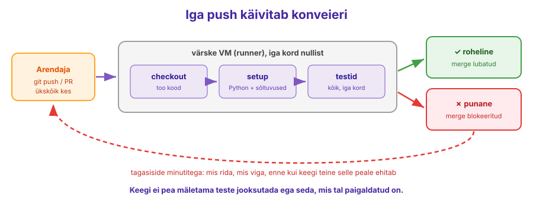
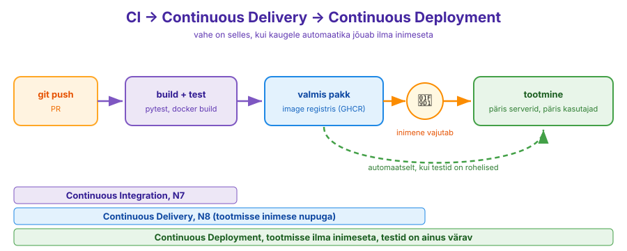
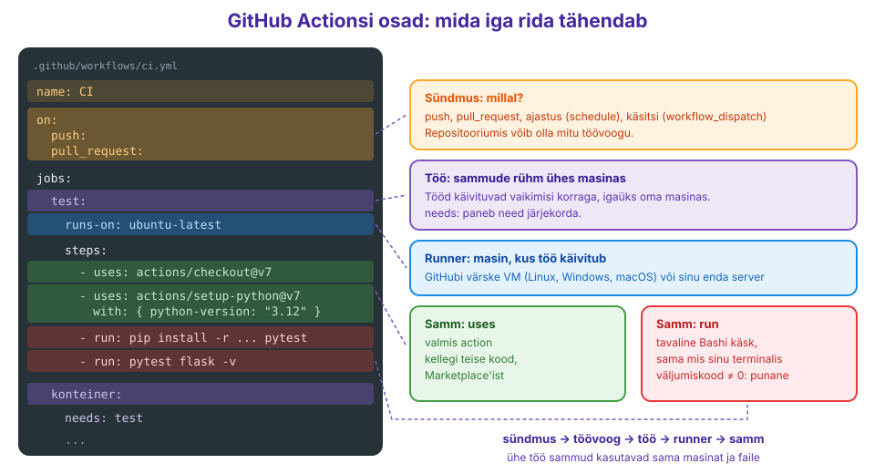
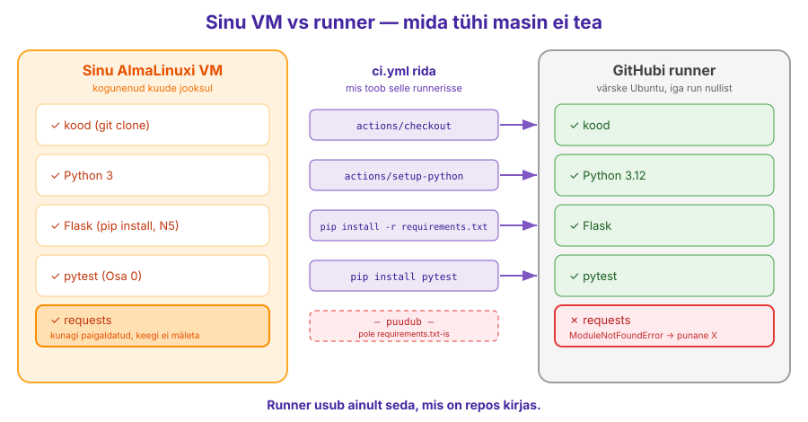
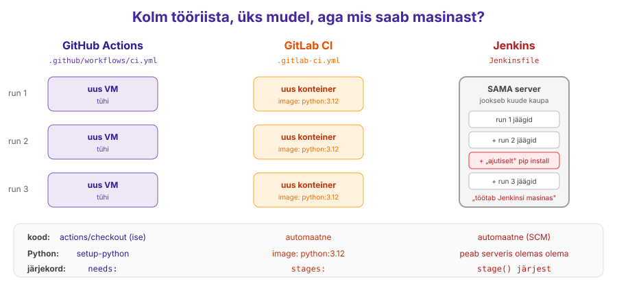

---
tags:
  - CI
  - GitHubActions
  - Testimine
  - Automatiseerimine
---

# Loeng — Automaatne testimine ja tarnekonveier (CI)

**Kestus:** ~40 minutit
**Tase:** eeldame, et tead nädal 2 PR-e ja `main`-i lukku ning nädal 5 Flaski rakendust ja `Dockerfile`'i. Teste pole sa varem kirjutanud — see tuleb täna.

---

!!! abstract "Õpiväljundid"
    Pärast loengut oskad:

    - selgitada, mis on CI ja mis probleemi see lahendab
    - eristada CI-d, Continuous Delivery't ja Continuous Deployment'i
    - tuua näiteid, mida sysadmin CI-ga kontrollib
    - kirjeldada, mis on automaattest ja kuidas see ütleb „korras" või „katki"
    - eristada ühiktesti ja suitsutesti
    - kirjeldada GitHub Actions workflow struktuuri (trigger, job, step, `needs`)
    - leida samad osad GitLab CI ja Jenkinsi konveierist
    - lugeda workflow'd ja ennustada, millal see katkeb
    - põhjendada, miks „töötab minu masinas" meeskonnas ei kanna

---

## 1. "Töötab minu masinas" — meeskonna mõõtkavas

Ühe inimese projektis on "töötab minu masinas" tüütu, aga elatav. Viie arendajaga see tapab.

Viis inimest samal rakendusel. Igaüks kirjutab oma tüki, jooksutab **oma** testid, näeb rohelist, teeb `git push`. Üks unustab jooksutada testi, mis katab teise mooduli — tema muudatus lõhkus midagi, aga tema testid seda ei näidanud, sest ta ei käivitanud kõiki. Kood läheb `main`-i. Keegi teine pull'ib tunni pärast, ehitab peale oma osa, ja **tema** masinas hakkab asi katki minema. Põhjuseta, tema meelest. Põhjus oli eelmises commitis, mis jõudis `main`-i ilma et keegi kõiki teste jooksutaks.

Teine variant samast loost: arendaja paigaldas oma masinasse teegi ja unustas selle `requirements.txt`-i kirjutada. Tema masinas töötab kõik. Serveris, kollega masinas ja Docker image'is mitte. Arendaja masin on aastatega täis kogunenud asju, mida keegi ei mäleta.

CI lahendab mõlemad jõuga: iga push käivitab **kõik** testid automaatselt, **värskes ja tühjas** masinas, mitte kellegi sülearvutis. Testid punased → koodi `main`-i ei lasta. Keegi ei pea "meeles pidama teste jooksutada" ega "mäletama, mis tal paigaldatud on".

<figure markdown="span">
  
  <figcaption>Joonis 7.1. Iga push käivitab konveieri värskes masinas; punane test blokeerib merge'i ja annab arendajale kohe teada, mis läks katki (Talvik, 2026).</figcaption>
</figure>

---

## 2. Mis on CI

**Continuous Integration (CI)** on töövõte, kus muudatused liidetakse ühisesse reposse **sageli ja väikeste tükkidena**, ja iga muudatuse peale käivitub automaatselt ehitamine ja testid. [GitHub](https://github.com/resources/articles/ci-cd) ütleb lühidalt: CI *„automatically builds, tests, and integrates code changes within a shared repository“*. [AWS](https://aws.amazon.com/devops/continuous-integration/) lisab, et CI-l on kaks poolt: **automaatika** (teenus, mis ehitab ja testib) ja **harjumus** (liida tihti, mitte kord kuus).

Vana mudel oli „liitmise päev": igaüks töötas nädalaid oma harus ja kõik pandi kokku korraga. Konfliktid ja katkised kohad tulid välja hilja, kui parandamine oli kallis ja stressirohke ([Red Hat](https://www.redhat.com/en/topics/devops/what-is-ci-cd) kutsub seda *merge day*). CI juures on iga push väike, testitud samm. Katki läks → tead minutitega, mitte nädalatega.

### CI reeglid

Need reeglid pani kirja [Martin Fowler](https://martinfowler.com/articles/continuousIntegration.html) juba 2000. aastal ja [IBM](https://www.ibm.com/think/topics/continuous-integration) kordab neid tänaseni. Tööriistast olenemata:

| Reegel | Mida see tähendab sulle |
|---|---|
| Üks ühine repo | Kõik, mis on vaja ehitamiseks ja testimiseks, on Gitis. Mitte kellegi sülearvutis. |
| Liida tihti | Väike PR iga päev, mitte suur kord kuus. |
| Iga muudatus ehitatakse ja testitakse automaatselt | Keegi ei pea mäletama. |
| Katkine build parandatakse **kohe** | Punane `main` on meeskonna prioriteet number üks. Peale ei ehitata. |
| Kiire tagasiside | Konveier, mis võtab tund aega, jäetakse vahele. Minutid, mitte tunnid. |
| Testi tootmise sarnases keskkonnas | Mitte otse tootmises ja mitte oma arvutis. |

*Tabel 7.1. CI ei ole tööriist, vaid harjumus. GitHub Actions, GitLab CI ja Jenkins on masinad, mis seda harjumust automatiseerivad.*

### Kas see on CI?

Väike e-pood, kolm inimest: arendaja Kertu, sysadmin Rasmus ja praktikant Marko. Kõigil on GitHub Actions olemas. Aga tööriist üksi ei tee veel CI-d.

| Mis meeskonnas päriselt toimub | CI? | Miks |
|---|---|---|
| Marko muudab ostukorvi koodi, teeb PR-i. Actions jooksutab 2 minutiga testid, üks kukub. Merge-nupp on hall. Marko parandab ja pushib, roheline, merge. | **Jah** | Iga muudatus testitakse automaatselt, punane peatab, parandatakse kohe. |
| Rasmus muudab `nginx.conf`-i. CI teeb `nginx -t` ja leiab puuduva semikooloni enne, kui fail serverisse jõuab. | **Jah** | Sysadmini konfifail on samuti kood. Viga leiti enne tootmist. |
| Actions'is on workflow, aga see käivitatakse käsitsi nupuga „enne suurt väljalaset“, kord kuus. | **Ei** | Testid jooksevad harva ja inimese mälu järgi. See on testimise nädal, mitte CI. |
| `main` on punane juba kaks nädalat. „Ah, see üks test on alati punane“, kõik mergivad edasi. | **Ei** | Tööriist on olemas, harjumus puudub. Punast keegi ei vaata, seega CI ei kaitse millegi eest. |
| Kertu töötab uue makseviisi kallal kuu aega oma harus ja merge'ib siis 3000 rida korraga. CI on roheline. | **Ei** | Liidetakse harva ja suurelt. Konfliktid ja vead tulevad välja korraga, kui parandamine on kõige kallim. |
| Workflow'is on üks samm: `run: echo "testid OK"`. Linnuke on alati roheline. | **Ei** | Roheline ei tähenda midagi, kui miski ei saa punaseks minna. |
| Marko paigaldas oma arvutisse teegi, testid läbivad tema masinas. Pushib otse `main`-i, ilma PR-ita, CI-d ei käivitu. | **Ei** | Kontroll toimus ainult tema masinas. „Töötab minu masinas“ ei ole kontroll. |

*Tabel 7.2. CI on see, mis juhtub iga muudatusega, mitte see, mis on Actions'i vahelehel.*

??? question "Mõtle"
    Vali tabelist üks „Ei“ rida. Mis peaks muutuma, et see muutuks „Jah“-ks: tööriist, reegel või harjumus?

### CI, Continuous Delivery, Continuous Deployment

„CI/CD" tähendab kolme järjestikust astet. Need erinevad selles, **kui kaugele** automaatika jõuab ilma inimeseta ([GitLab](https://about.gitlab.com/topics/ci-cd/), [GitHub](https://github.com/resources/articles/ci-cd)).

<figure markdown="span">
  
  <figcaption>Joonis 7.2. CI lõpeb testidega. Delivery valmistab väljalaske ette ja inimene vajutab nuppu. Deployment laseb ka ise välja (Talvik, 2026).</figcaption>
</figure>

| | Mis on automaatne | Kes otsustab tootmise üle |
|---|---|---|
| **Continuous Integration** | ehitus ja testid | — (tootmiseni ei jõuagi) |
| **Continuous Delivery** | + pakkimine, valmis väljalaskeks igal hetkel | inimene, ühe nupuvajutusega |
| **Continuous Deployment** | + väljalase tootmisse | keegi — testid on ainus värav |

*Tabel 7.3. Sel nädalal teed CI. Nädal 8 lisab Delivery: image läheb registrisse.*

Sama konveieri hea ülevaatejoonis (commit → build → test → staging → tootmine ühel pildil): [ByteByteGo — CI/CD pipeline explained in simple terms](https://blog.bytebytego.com/p/ep71-cicd-pipeline-explained-in-simple).

Continuous Deployment on võimalik ainult siis, kui teste usaldatakse täielikult, sest enne tootmist pole ühtegi inimest vahel. [GitHub](https://github.com/resources/articles/ci-cd) soovitab seepärast alustada Delivery'st ja liikuda Deployment'i alles siis, kui testid on selle usalduse välja teeninud.

### CI sysadminile

CI-st räägitakse tavaliselt arendajate keeles, aga sysadmini „kood" on samuti tekst Gitis: playbookid, skriptid, konfifailid, Dockerfile'id. Nendega saab teha täpselt sama: iga muudatus kontrollitakse enne, kui see ühtegi serverisse jõuab. [GitLab](https://about.gitlab.com/topics/ci-cd/) loeb ka infrastruktuuri ettevalmistamise CD osaks.

| Mida | Kontroll CI-s | Mida leiab | Kursusel |
|---|---|---|---|
| Ansible playbook | `ansible-playbook --syntax-check`, [`ansible-lint`](https://docs.ansible.com/projects/lint/) | taandevead, `command` mooduli asemel õige moodul | N3–N4 |
| Idempotentsus | playbook kaks korda konteineris, teine kord `changed=0` | playbook, mis muudab iga kord midagi | N3 |
| Bash-skript | [`shellcheck`](https://www.shellcheck.net/) | jutumärkideta muutujad, `cd` ilma veakontrollita | N2 `monitor.sh` |
| Konfifail | `nginx -t` konteineris, `yamllint` | katkine konf enne serverisse jõudmist | N3, Lab 04 Extra |
| Saladused | [`gitleaks`](https://github.com/gitleaks/gitleaks) | parool või webhook commitis | N2 `.env`, N4 Vault |
| Dockerfile | [`hadolint`](https://github.com/hadolint/hadolint) | `latest` tag, root-kasutaja | N5 |

*Tabel 7.4. Sama mõte, sysadmini failid.*

<figure markdown="span">
  
  <figcaption>Joonis 7.3. Sysadmini konveier: iga fail läbib oma kontrolli enne, kui ükski server seda näeb (Talvik, 2026).</figcaption>
</figure>

Reede, 16:55. Kolleeg muudab playbookis ühe rea ja käivitab selle 20 serveri peal. Taane on vale ja pooled serverid jäävad poolikusse seisu. CI oleks selle rea 30 sekundiga punaseks teinud, enne kui ükski server seda nägi.

---

## 3. Mis on automaattest

Seni kontrollisid oma tööd **käsitsi**: `curl localhost:5000`, vaatasid vastust silmaga, otsustasid ise, kas on õige. Automaattest on sama kontroll, aga kirja pandud koodina. Siis saab seda korrata tuhat korda ja ükski kord ei unune.

Pythonis on levinuim testiraamistik [**pytest**](https://docs.pytest.org/en/stable/getting-started.html). Test on tavaline funktsioon, mille nimi algab `test_`, ja sees on üks või mitu `assert`-i:

```python
from app import app


def test_avaleht_vastab():
    vastus = app.test_client().get("/")
    assert vastus.status_code == 200
    assert "Tere" in vastus.get_data(as_text=True)
```

`assert` tähendab: „see peab olema tõsi". Kui on, läheb pytest edasi. Kui ei ole, peatub test ja pytest näitab täpselt, mis oli oodatud ja mis tuli:

```text
E       AssertionError: assert 'Tervist' in 'Tere konteinerist!'
```

`app.test_client()` on Flaski sisseehitatud „võlts brauser" ([Flask: testimine](https://flask.palletsprojects.com/en/stable/testing/)). See saadab rakendusele päringu otse Pythoni sees, ilma serverit käivitamata ja porti avamata. Test võtab millisekundeid ega vaja Dockerit ega võrku.

### Kaks taset

| | Ühiktest | Suitsutest (*smoke test*) |
|---|---|---|
| Mida kontrollib | Üht funktsiooni või route'i koodi tasemel | Kas terve asi üldse käivitub ja vastab |
| Kuidas | `pytest` + `test_client()` | `docker build` → `docker run` → `curl` |
| Kiirus | Millisekundid | Kümned sekundid |
| Leiab | Loogikavead | Pakkimise ja käivitamise vead (nt N5 `127.0.0.1` vs `0.0.0.0`) |

*Tabel 7.5. Ühiktest ütleb, kas kood on õige. Suitsutest ütleb, kas see õige kood ka konteineris töötab.*

Nimi tuleb elektroonikast: lülita seade sisse ja vaata, kas suitsu tuleb. Kui tuleb, pole mõtet edasi testida.

Kumbki üksi ei piisa. N5-s nägid, et Flask võis olla täiesti korras, aga konteineris ei vastanud see ikka. Ühiktest seda poleks leidnud, suitsutest leiab.

---

## 4. GitHub Actions — struktuur

GitHub Actions on GitHubi sisseehitatud CI/CD. Workflow on YAML-fail kaustas `.github/workflows/`. GitHub näeb seda ja käivitab selle triggeri peale värskes virtuaalmasinas (**runner**). Kõik võtmesõnad on [workflow süntaksi juhendis](https://docs.github.com/en/actions/reference/workflows-and-actions/workflow-syntax).

```yaml
name: CI

on:
  push:
  pull_request:

jobs:
  test:
    runs-on: ubuntu-latest
    steps:
      - uses: actions/checkout@v7
      - run: echo "siia tulevad testid"
```

<figure markdown="span">
  
  <figcaption>Joonis 7.4. GitHub Actionsi osad ja read, mis neid failis tähistavad (Talvik, 2026, D. Mosyani ülevaate põhjal).</figcaption>
</figure>

Sama lahtiseletatult, koos GitHubi kasutajaliidese piltidega: [Understanding the basics of GitHub Actions](https://medium.com/@dmosyan/understanding-the-basics-of-github-actions-7787993d300c). Mida GitHub Actions veel oskab (Windows/macOS runnerid, matrix, Marketplace), näed [GitHub Actionsi lehelt](https://github.com/features/actions).

Kolm tasandit:

**Trigger** (`on:`) — millal käivitub. `push` iga push'i peale, `pull_request` iga PR-i peale. Saab piirata harudega (`branches: [main]`).

**Job** (`jobs:`) — kus ja millest koosneb. `runs-on: ubuntu-latest` = värske Ubuntu VM iga kord, ilma eelmise käivituse jääkideta. Iga job saab **oma** masina. Vaikimisi jooksevad job'id paralleelselt.

**Step** (`steps:`) — käsud järjest samas masinas. `uses:` käivitab kellegi teise valmis action'i (nt `actions/checkout` toob repo sisu masinasse), `run:` käivitab tavalise bash-käsu. Üks step kukub → järgnevad jäävad käivitamata, job on punane.

### Job'ide järjekord: `needs`

Kui üks job sõltub teisest, ütle seda `needs:`-iga:

```yaml
jobs:
  test:
    # ...
  konteiner:
    needs: test
    # ...
```

`konteiner` alustab alles siis, kui `test` on roheline. Kui `test` kukub, on `konteiner` hall („skipped"). Katkist koodi pole mõtet pakkima ega serverisse saatma hakata. Nädal 8 lisab samasse ritta kolmanda job'i: `needs: konteiner` → image registrisse.

---

## 5. Terviklik näide — rakenduse CI

```yaml
jobs:
  test:
    runs-on: ubuntu-latest
    steps:
      - uses: actions/checkout@v7
      - uses: actions/setup-python@v7
        with:
          python-version: "3.12"
      - run: pip install -r flask/requirements.txt pytest
      - run: pytest flask -v
```

Iga rida vastab ühele küsimusele, mida tühi masin ei tea:

| Samm | Küsimus, millele see vastab |
|---|---|
| `checkout` | Kus kood on? (Runneris pole ühtegi faili.) |
| `setup-python` | Milline Python? (Masin ei tule automaatselt õige versiooniga.) |
| `pip install -r ...` | Mida rakendus vajab? (Täpselt see, mis on repos kirjas — mitte see, mis arendaja masinas juhtumisi olemas on.) |
| `pytest` | Kas kõik töötab? |

<figure markdown="span">
  
  <figcaption>Joonis 7.5. Iga ci.yml rida vastab ühele asjale, mis sinu VM-is juba on ja runneris mitte. Mida pole repos kirjas, seda runneris ei ole (Talvik, 2026).</figcaption>
</figure>

*Tabel 7.6. Workflow on kirjeldus sellest, mida sinu masin vaikimisi teab ja runner mitte.*

Praktikumis kirjutad selle faili kokku ridahaaval ja näed iga puuduva rea viga oma silmaga.

---

## 6. Millal pipeline katkeb

Pipeline katkeb, kui mõni käsk lõpetab **exit code'iga ≠ 0**. Sama number, mida näed terminalis käsuga `echo $?`. pytest'i koodide täielik nimekiri on [pytest'i dokumentatsioonis](https://docs.pytest.org/en/stable/reference/exit-codes.html).

| Exit code | Tähendus | Näide CI-s |
|---|---|---|
| `0` | Kõik korras | Testid läbisid → samm roheline |
| `1` | Mõni test kukkus | `AssertionError` → viga **koodis** |
| `4` | pytest'i käsk on vale, nt kausta pole | `file or directory not found` → viga **workflow's** (nt checkout puudub) |
| `5` | Teste ei leitud | Testifaili nimi ei alga `test_`-iga |
| `127` | Käsku pole olemas | `pytest: command not found` → tööriist paigaldamata |

*Tabel 7.7. Exit code ütleb, kas viga on koodis või konveieris.*

Enamikus meeskondades on reegel: PR-i ei saa `main`-i mergida, kui nõutud check'id pole rohelised. See on **soovitud** käitumine, mitte viga. Parem, et konveier blokeerib merge'i kohe, kui et katkine kood jõuab `main`-i ja sealt tootmisse.

Meenuta Märtenit ja `main`-i lukku nädalast 2. Seal nõudsid, et keegi **inimene** vaataks muudatuse üle. CI lisab samasse lukku masina: `main` ruleset'is [**Require status checks to pass**](https://docs.github.com/en/repositories/configuring-branches-and-merges-in-your-repository/managing-rulesets/available-rules-for-rulesets). Inimene vaatab, kas lahendus on mõistlik; masin vaatab, kas see töötab. Kumbki ei asenda teist.

---

## 7. Sama mõte, teised tööriistad

GitHub Actions ei ole ainus CI. Eesti ettevõtetes näed sama tihti [**GitLab CI**](https://docs.gitlab.com/ci/yaml/)-d (pangad, riigiasutused, kes hoiavad koodi oma serveris) ja [**Jenkinsit**](https://www.jenkins.io/doc/book/pipeline/) (vanem, väga levinud, oma serveris). Tööriist vahetub, mõte jääb: **trigger → tühi masin → sammud järjest → exit code otsustab.**

Siin on sama konveier kolmes keeles. Ära õpi süntaksit pähe, vaid otsi igaühest üles samad osad.

=== "GitHub Actions"

    `.github/workflows/ci.yml`

    ```yaml
    on: [push, pull_request]

    jobs:
      test:
        runs-on: ubuntu-latest
        steps:
          - uses: actions/checkout@v7
          - uses: actions/setup-python@v7
            with:
              python-version: "3.12"
          - run: pip install -r flask/requirements.txt pytest
          - run: pytest flask -v

      konteiner:
        needs: test
        runs-on: ubuntu-latest
        steps:
          - uses: actions/checkout@v7
          - run: docker build -t flask-app ./flask
    ```

=== "GitLab CI"

    `.gitlab-ci.yml` (repo juurkaustas)

    ```yaml
    stages:
      - test
      - konteiner

    test:
      stage: test
      image: python:3.12
      script:
        - pip install -r flask/requirements.txt pytest
        - pytest flask -v

    konteiner:
      stage: konteiner
      image: docker:27
      services:
        - docker:27-dind
      script:
        - docker build -t flask-app ./flask
    ```

=== "Jenkins"

    `Jenkinsfile` (repo juurkaustas)

    ```groovy
    pipeline {
        agent any
        stages {
            stage('test') {
                steps {
                    sh 'python3 -m venv .venv'
                    sh '.venv/bin/pip install -r flask/requirements.txt pytest'
                    sh '.venv/bin/pytest flask -v'
                }
            }
            stage('konteiner') {
                steps {
                    sh 'docker build -t flask-app ./flask'
                }
            }
        }
    }
    ```

| Mõiste | GitHub Actions | GitLab CI | Jenkins |
|---|---|---|---|
| Fail | `.github/workflows/*.yml` | `.gitlab-ci.yml` | `Jenkinsfile` |
| Keel | YAML | YAML | Groovy |
| Kes jooksutab | runner | runner | agent |
| Masin | **värske VM** iga kord | **värske konteiner** `image:`-ist | sageli **püsiv server** |
| Koodi toomine | ise: `actions/checkout` | automaatne | automaatne (*Pipeline from SCM*) |
| Õige Python | `setup-python` action | `image: python:3.12` | peab serveris juba olemas olema |
| Järjekord | `needs:` | `stages:` | `stage`-id järjest |
| Saladused | Secrets | CI/CD Variables | Credentials |

*Tabel 7.8. Kolm tööriista, üks mudel.*

<figure markdown="span">
  
  <figcaption>Joonis 7.6. GitHub ja GitLab alustavad iga run'i nullist. Jenkinsi püsiv server kogub prügi ja toob „töötab minu masinas" tagasi (Talvik, 2026).</figcaption>
</figure>

Pane tähele rida **Masin**. GitHub ja GitLab alustavad iga kord nullist. Jenkinsi agent on tihti sama server, mis jookseb kuude kaupa. Sinna jääb maha eelmiste run'ide prügi ja keegi paigaldab sinna „ajutiselt" mõne teegi. Tulemus: „töötab Jenkinsi masinas" — sama probleem, mille vastu CI pidi aitama. Seepärast jooksutatakse tänapäeval ka Jenkinsis samme konteinerites (`agent { docker { image 'python:3.12' } }`).

### Konveier hoiab võtmeid

Konveier ei ainult testi. Varsti (nädal 8) saab ta õiguse image'eid registrisse panna, hiljem ka serveritesse SSH-ga sisse logida. Selleks vajab ta paroole, tokeneid ja võtmeid. Sellega muutub konveier ise **rünnakusihiks**: kes saab kätte CI saladused, saab kätte kõik, kuhu CI ligi pääseb.

Vaata koomiksit [Compromising CI/CD Pipelines with Leaked Credentials](https://blog.gitguardian.com/security-zines-2-compromising-ci-cd-pipelines/) (GitGuardian, Security Zines). Viie pildiga on seal läbi käidud, kuidas üks unustatud Jenkinsi parool viib terve tarneahela ülevõtmiseni.

Reeglid, mis kehtivad igas CI-s:

- saladus ei ole kunagi repos ega `ci.yml`-is, vaid tööriista saladuste hoidlas (GitHub **Secrets**, GitLab **CI/CD Variables**, Jenkins **Credentials**);
- saladus ei tohi logisse jõuda (GitHub peidab need `***`-ga, aga mitte siis, kui sa neid ise ümber kodeerid);
- igal tokenil on ainult need õigused, mida konveier vajab (nädal 8: `permissions:`).

Meenuta N4 Vaulti ja Lab 04 Extra `no_log: true`: sama mõte, teine tööriist.

---

## 8. Miks tööl oluline

Suurel makseteenusel jookseb tuhandeid automaatteste, mis katavad maksete loogikat ja valuutakonversioone. Iga pull request käivitab need **enne**, kui keegi muudatust üldse vaatama hakkab.

Muudatuse autor saab tagasiside mõne minutiga — mitte pärast release'i, kui viga on juba tootmises ja puudutab päris kasutajate raha. See kiirus on põhjus, miks CI on tänapäeval tavapraktika, mitte lisavõimalus. Tööintervjuul küsitakse „kas oled CI-d seadistanud?" sama loomulikult kui „kas oskad Giti?".

---

## Kokkuvõte

- **"Töötab minu masinas" ei kanna meeskonnas** — testimine peab olema automaatne, inimese mälust ja masinast sõltumatu
- **Automaattest = `assert`** — kirja pandud kontroll, mis ütleb ise „korras" või „katki"
- **Ühiktest** kontrollib koodi, **suitsutest** kontrollib, kas konteiner käivitub ja vastab
- **Workflow on `.github/workflows/` YAML-fail:** trigger (`on:`), job (`runs-on:`), steps
- **`uses:` = valmis action, `run:` = bash-käsk, `needs:` = job'ide järjekord**
- **Runner on tühi masin** — kõik, mida see vajab, peab olema repos kirjas
- **Pipeline katkeb exit code ≠ 0 peale** — number ütleb, kas viga on koodis või workflow's
- **CI + `main`-i lukk** = punase testiga koodi ei saa mergida
- **GitHub Actions, GitLab CI, Jenkins** — erinev süntaks, sama mudel: trigger → tühi masin → sammud → exit code
- **Konveier hoiab võtmeid** — saladused tööriista hoidlasse, mitte reposse ega logisse

---

*Järgmine: praktikumis kirjutad Flaskile testid ja ehitad CI workflow ridahaaval, nähes iga puuduva rea viga oma silmaga.*
