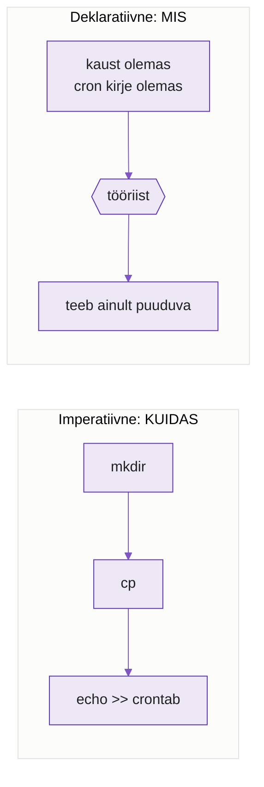
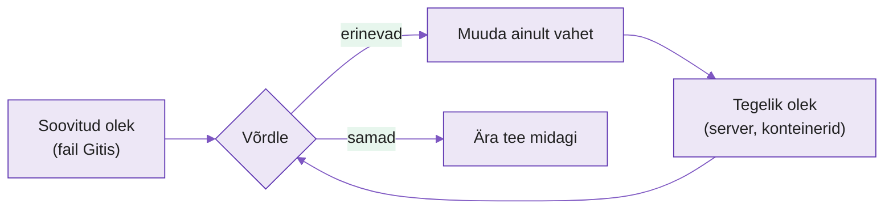
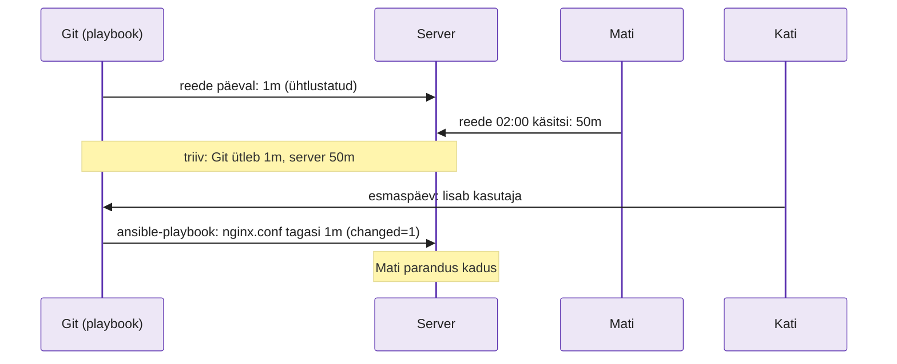
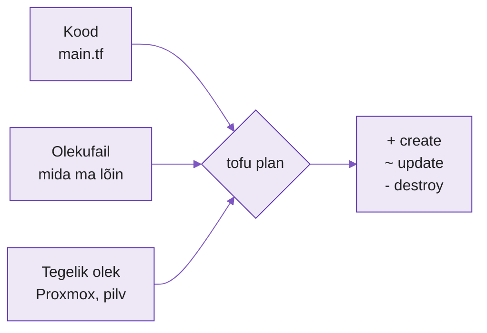
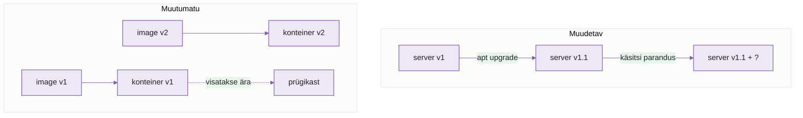
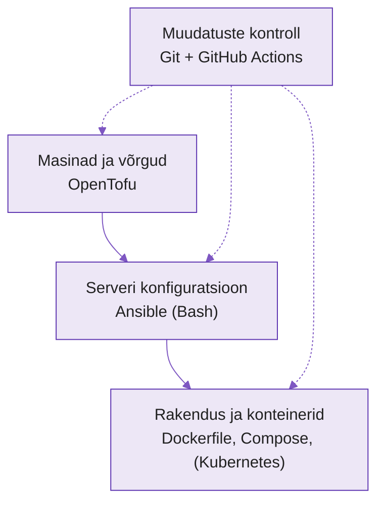

---
tags:
  - IaC
  - Ansible
  - Docker
  - OpenTofu
  - Iseseisev
---

# Loeng: infrastruktuur koodina, mõtteviis

**Kestus:** ~60 minutit iseseisvalt lugedes
**Tase:** eeldame nädalaid 2-7: Git ja Märteni `monitor.sh` (N2), Ansible (N3-4), Dockerfile (N5), Compose (N6), GitHub Actions (N7). Uut tööriista täna ei paigalda.

Täna on iseseisev nädal. Server ja Proxmox jäävad puhkama. Vaatad tagasi kõigele, mida oled kaheksa nädalaga teinud, ja paned selle ühte pilti. Loe loeng läbi, vasta iga osa lõpus olevatele küsimustele vihikus ja mine siis [praktikumi](lab.md). Praktikumis katsetad samu mõtteid Dockeriga oma silmaga.

---

!!! abstract "Õpiväljundid"
    Pärast loengut oskad:

    - eristada imperatiivset ja deklaratiivset lähenemist ja paigutada iga seni kasutatud tööriista ühte neist
    - selgitada, mis on soovitud olek ja kuidas tööriist ühtlustab tegeliku oleku soovitud olekuga
    - selgitada idempotentsust ja kontrollida seda tööriista väljundist
    - kirjeldada konfiguratsiooni triivi ja seda, mida järgmine automaatne jooks sellega teeb
    - eristada tööriista, mis mäletab olekut (OpenTofu), ja tööriista, mis ei mäleta (Ansible)
    - selgitada muudetava ja muutumatu infrastruktuuri vahet

---

## 1. Kaheksa nädalat, kuus tööriista

!!! abstract "Miks see oluline on?"
    Sa oled õppinud kuus tööriista, igaühel oma süntaks. Tööintervjuul ei küsita süntaksit. Küsitakse, miks valiksid ühe või teise. Selleks pead nägema, mis neil ühist on.

Kati alustas sügisel praktikat väikeses hostingufirmas. Esimesel päeval näitas vanem sysadmin Mati talle serverit, mida ta oli kuus aastat ise hooldanud.

„Siin on veebiserver. Nginx'i panin 2019. aastal, PHP versiooni vahetasin eelmisel talvel, tulemüüri reeglid on kuskil, pean järele vaatama.“

Kati küsis: „Kui see server homme ära põleb, kui kaua läheb uue ülesseadmisega?“

Mati mõtles. „Nädal? Kui ma mäletan kõike.“

See vastus on põhjus, miks see kursus olemas on. Kõik, mida oled kaheksa nädalaga teinud, on üks ja sama mõte erinevate tööriistadega: **kirjuta üles, mis peab olema, ja lase masinal see tekitada.** Seda mõtet nimetatakse **infrastruktuur koodina** (Infrastructure as Code, IaC).

| Nädal | Tööriist | Mida sa kirja panid | Sinu fail |
|---|---|---|---|
| N2 | Bash, Git | käsud järjest; muudatuste ajalugu | `monitor.sh` |
| N3-4 | Ansible | mis peab serveris olema | `nginx.yml`, `templates/*.j2` |
| N5 | Docker | kuidas image ehitada | `Dockerfile` |
| N6 | Docker Compose | millised konteinerid koos jooksevad | `docker-compose.yml` |
| N7 | GitHub Actions | mida iga push'i peale kontrollida | `.github/workflows/ci.yml` |
| N10 | OpenTofu | millised masinad ja võrgud on olemas | `main.tf` |

*Tabel 9.1. Iga nädal panid sa midagi koodi kujul kirja. Täna vaatame, mille poolest need kirjapanekud erinevad.*

Fail on Gitis, seega on sellel ajalugu, seda saab üle vaadata (PR) ja testida (CI). Mati mälu ei saa ühtegi neist.

??? question "Kontrolli ennast"
    1. Miks oli Mati vastus „nädal, kui ma mäletan kõike“ firmale ohtlik?
    2. Too oma laboritest üks fail, mille põhjal saaks keegi teine sinu tööd korrata ilma sinult midagi küsimata.

---

## 2. Imperatiivne ja deklaratiivne

!!! abstract "Miks see oluline on?"
    Need kaks sõna on IaC kõige olulisem jaotus. Kui tead, kummale poole tööriist kuulub, tead juba, kuidas ta käitub teisel käivitusel.

Mõtle restoranile. Sul on kaks võimalust süüa saada.

**Retsept.** Sa seisad köögis ja ütled kokale: „Võta pann. Pane pliit põlema. Vala õli. Löö kaks muna pannile. Oota kolm minutit.“ Sina vastutad iga sammu ja järjekorra eest. Kui pannil on juba munad, löövad nad sinna veel kaks.

**Tellimus.** Sa ütled ettekandjale: „Üks praemuna, palun.“ Köök otsustab ise, mis samme on vaja. Kui praemuna on juba valmis, tuuakse see lihtsalt lauale.

Esimene on **imperatiivne** (imperative) lähenemine: kirjeldad **samme**, kuidas midagi teha. Teine on **deklaratiivne** (declarative) lähenemine: kirjeldad **tulemust**, mis peab olema.

Meenuta Märteni `monitor.sh`-i N2-st. See on puhas retsept:

```bash
mkdir /opt/monitor
cp monitor.sh /opt/monitor/
echo "*/5 * * * * /opt/monitor/monitor.sh" >> /etc/crontab
```

Käivita see teist korda. `mkdir` annab vea, sest kaust on olemas. `echo >>` lisab crontabi **teise** sama rea ja nüüd jookseb monitor iga 5 minuti järel kaks korda.

Sama asi Ansible'iga, nagu N3-s kirjutasid:

```yaml
- name: monitori kaust on olemas
  ansible.builtin.file:
    path: /opt/monitor
    state: directory

- name: cron kirje on olemas
  ansible.builtin.cron:
    name: monitor
    minute: "*/5"
    job: /opt/monitor/monitor.sh
```

Pane tähele task'ide nimesid: „kaust **on olemas**“, „kirje **on olemas**“. Sa ei kirjuta „tee kaust“. Sa kirjeldad olekut. Ansible vaatab ise, kas kaust on juba olemas, ja kui on, ei tee midagi.

<figure markdown="span">

  <figcaption>Joonis 9.1. Imperatiivne skript täidab sammud alati uuesti. Deklaratiivne kirjeldus annab tööriistale eesmärgi ja tööriist otsustab ise, mis samme on vaja (Talvik, 2026).</figcaption>
</figure>

Töös on piir hägune. Dockerfile koosneb käskudest (`RUN apt install`, `COPY`), seega on ta oma olemuselt retsept. Aga tulemus, image, on üks kindel asi, mida saab käivitada ükskõik kui mitu korda. GitHub Actions'i `ci.yml` kirjeldab deklaratiivselt, **millal** konveier käivitub (`on: push`), aga `run:` read sees on tavalised bash-käsud. Ansible'is saad kirjutada `ansible.builtin.shell: mkdir /opt/monitor` ja siis on ka Ansible imperatiivne. Tööriist annab võimaluse, aga mõtteviisi valid sina.

??? question "Kontrolli ennast"
    1. Kumb on imperatiivne ja kumb deklaratiivne: navirakendusele sihtkoha andmine või sõbrale tee kirjeldamine „sõida 200 m otse, siis vasakule“?
    2. Miks lisab `echo ... >> /etc/crontab` teisel käivitusel probleemi, aga Ansible'i `cron` moodul mitte?
    3. Leia oma N5 `Dockerfile`-ist üks rida, mis on imperatiivne.

---

## 3. Soovitud olek ja ühtlustamine

!!! abstract "Miks see oluline on?"
    Deklaratiivne tööriist teeb iga kord sama tsüklit: vaatab, võrdleb, parandab. Kui see tsükkel on sul peas, saad ennustada iga deklaratiivse tööriista käitumist, ka nende oma, mida sa veel ei tunne.

Toas on termostaat. Sa keerad selle 21 kraadi peale. See on **soovitud olek** (desired state). Termomeeter näitab 18 kraadi. See on **tegelik olek** (actual state).

Termostaat ei küsi, kuidas toa sai 18-kraadiseks. Ta võrdleb kahte numbrit ja kui need erinevad, paneb kütte tööle. Kui tuba on 21 kraadi, ei tee ta midagi. Kui keegi teeb akna lahti ja tuba jahtub, paneb ta kütte uuesti tööle.

Seda nimetatakse **ühtlustamiseks** (reconciliation): tööriist loeb tegeliku oleku, võrdleb soovitud olekuga ja muudab ainult vahet.

<figure markdown="span">

  <figcaption>Joonis 9.2. Ühtlustamise tsükkel. Ansible, Docker Compose, OpenTofu ja Kubernetes teevad sama tsüklit, ainult „tegelik olek“ on igaühel erinev asi (Talvik, 2026).</figcaption>
</figure>

N6-s kirjutasid `docker-compose.yml` faili ja käivitasid `docker compose up -d`. Mis juhtub, kui käivitad seda teist korda? Compose loeb faili (soovitud olek), küsib Dockerilt, mis konteinerid jooksevad (tegelik olek), ja näeb, et kõik klapib. Väljundis on:

```text
 ✔ Container lab09-web-1    Running
 ✔ Container lab09-cache-1  Running
```

`Running` tähendab: „see on juba olemas ja sobib, ma ei puutunud seda“. Kui kustutad ühe konteineri käsitsi ja käivitad `up -d` uuesti, näeb Compose vahet ja loob ainult puuduva. Praktikumis teed täpselt seda.

| Tööriist | Soovitud olek | Tegelik olek |
|---|---|---|
| Ansible | playbook | mis on serveris (paketid, failid, teenused) |
| Docker Compose | `compose.yaml` | mis konteinerid jooksevad |
| OpenTofu | `.tf` failid | mis masinad ja võrgud pilves või Proxmoxis on |
| Kubernetes | YAML manifest | mis konteinerid klastris jooksevad |

*Tabel 9.2. Sama tsükkel, erinev maailm.*

??? question "Kontrolli ennast"
    1. Selgita termostaadi näitel, mis on soovitud olek ja mis tegelik olek.
    2. Compose näitab teisel käivitusel `Running`. Mida see ütleb sulle tegeliku ja soovitud oleku kohta?
    3. Miks ei saa bash-skript ühtlustada, kui ta ei kontrolli enne midagi?

---

## 4. Idempotentsus

!!! abstract "Miks see oluline on?"
    Automaatika käivitub sageli: iga push, iga öö, iga kord, kui keegi kahtleb. Kui iga käivitus midagi lõhub või topelt teeb, ei julge keegi seda käivitada ja automaatika jääb seisma.

Liftis on kaks sorti nuppe. Korruse nupp: vajutad „5“ üks kord või kümme korda, lift sõidab ikka viiendale korrusele. Sellist toimingut, mida võib korrata ja tulemus ei muutu, nimetatakse **idempotentseks** (idempotent).

Valguslüliti, mis iga vajutusega olekut vahetab, ei ole idempotentne. Kaks vajutust ja oled tagasi pimeduses.

Meenuta N3 praktikumi. Käivitasid `nginx.yml` playbooki kolm korda:

```text
1. kord:  ok=4  changed=3  failed=0
2. kord:  ok=4  changed=0  failed=0
3. kord:  ok=4  changed=0  failed=0
```

`changed=0` oli tõend, mille sa Lab 03 `logid/play_recap.txt` faili salvestasid. See ütleb: kõik oli juba soovitud olekus, Ansible kontrollis ja ei muutnud midagi.

Idempotentsus ei tule tasuta. Ansible'i moodulid (`package`, `file`, `copy`) on kirjutatud nii, et nad kontrollivad enne muutmist. `shell` ja `command` moodulid ei tea, mida su käsk teeb, ja näitavad iga kord `changed`. Bash'is saad idempotentsust ise ehitada:

| Mitte-idempotentne | Idempotentne |
|---|---|
| `mkdir /opt/app` | `mkdir -p /opt/app` |
| `echo "rida" >> fail` | `grep -qx "rida" fail \|\| echo "rida" >> fail` |
| `docker run --name web nginx` | `docker ps -a --format '{{.Names}}' \| grep -qx web \|\| docker run --name web nginx` |
| `useradd kati` | `id kati \|\| useradd kati` |

*Tabel 9.3. Bash-skripti saab teha idempotentseks, kui lisad enne iga muutust kontrolli. Deklaratiivne tööriist teeb seda sinu eest.*

??? question "Kontrolli ennast"
    1. Too oma elust üks idempotentne ja üks mitte-idempotentne tegevus.
    2. Playbook näitab teisel käivitusel `changed=2`. Mida see sulle ütleb ja kust otsiksid põhjust?
    3. Miks on idempotentsus eriti oluline, kui automaatika käivitub iga öö ise?

---

## 5. Triiv: keegi muutis serveris käsitsi

!!! abstract "Miks see oluline on?"
    Ükski meeskond ei ole nii distsiplineeritud, et keegi kunagi serverisse käsitsi ei läheks. Sa pead teadma, mis juhtub sellise muudatusega järgmisel automaatsel jooksul, sest muidu kaob kellegi parandus vaikselt ära.

Reede öösel kell 2 helistab klient: suured failid ei lae üles. Mati logib serverisse, avab `/etc/nginx/nginx.conf` ja muudab:

```text
client_max_body_size 1m;   →   client_max_body_size 50m;
```

`systemctl reload nginx`, töötab, Mati läheb magama. Playbooki ta ei muutnud, sest kell oli 2.

Nüüd on serveri tegelik olek ja Gitis olev soovitud olek erinevad. Seda nimetatakse **konfiguratsiooni triiviks** (configuration drift): server on vaikselt kirjeldusest eemale triivinud.

Esmaspäeval jooksutab Kati Ansible'i, sest lisas uue kasutaja. Ansible'i `template` moodul näeb, et `nginx.conf` ei vasta mallile, ja kirjutab faili üle. Tulemus näitab `changed=1`. Mati 50 MB on kadunud, klient helistab uuesti.

<figure markdown="span">

  <figcaption>Joonis 9.3. Triiv tekib käsitsi muudatusest ja kaob järgmisel deklaratiivsel jooksul. Kaob ka muudatus, kui see Giti ei jõudnud (Talvik, 2026).</figcaption>
</figure>

Kas Ansible tegi valesti? Ei. Ta tegi täpselt seda, milleks ta on: viis serveri tagasi kirjeldatud olekusse. Viga oli selles, et parandus jäi Gitist välja. Õige käik pärast öist häiret on hommikul sama muudatus playbooki panna ja PR teha.

Triivi saab ka **tuvastada** ilma midagi muutmata. `ansible-playbook --check --diff` näitab, mida Ansible muudaks, ja jätab serveri puutumata. Praktikumi lisaülesandes proovid seda.

??? question "Kontrolli ennast"
    1. Mis on triiv? Selgita Mati näite abil.
    2. Mis oleks pidanud Mati tegema esmaspäeva hommikul, et Kati jooks tema parandust üle ei kirjutaks?
    3. Ansible't jooksutatakse ainult siis, kui keegi seda käsitsi teeb. Mitu kuud võib triiv märkamatult kesta?

---

## 6. Olek: kes mäletab, mida ta lõi

!!! abstract "Miks see oluline on?"
    See on peamine vahe Ansible'i ja OpenTofu vahel, mida N10-s näed. Kui sa seda ei tea, kustutad ühel päeval koodist rea ja imestad, miks server ikka olemas on, või vastupidi, miks see kadus.

Ansible ei mäleta midagi. Iga kord, kui playbook jookseb, vaatab Ansible serverit justkui esimest korda. Ta ei tea, mis ta eelmisel korral tegi.

Proovi mõttes: N3 `nginx.yml` paigaldas nginx'i. Nüüd kustutad playbookist nginx'i task'i ja käivitad uuesti. Mis juhtub serveris? Mitte midagi. Nginx jääb paigaldatuks ja töötab edasi. Ansible ei mäleta, et ta selle kunagi pani, ja playbookis pole enam ühtegi rida, mis nginx'ist räägiks. Nginx'i eemaldamiseks pead kirjutama task'i `state: absent`.

**OpenTofu** (avatud lähtekoodiga Terraformi järglane, käsk `tofu`) töötab teisiti. Ta hoiab **olekufaili** (state file, `terraform.tfstate`), kuhu ta kirjutab iga asja, mille ta lõi: masina ID, IP-aadressi, ketta suuruse. Järgmisel korral võrdleb ta kolme asja: koodi, olekufaili ja seda, mis Proxmoxis või pilves tegelikult olemas on.

| Olukord | Ansible | OpenTofu |
|---|---|---|
| Kustutad koodist rea | asi jääb serverisse alles | `plan` näitab `destroy`: asi kustutatakse |
| Keegi kustutab VM-i käsitsi | Ansible ei saa VM-iga ühendust, task'id kukuvad | `plan` näitab `create`: VM luuakse uuesti |
| Keegi muudab serveris faili | järgmine jooks kirjutab üle (triiv) | OpenTofu ei vaata serveri sisse, ta haldab ainult masinat ennast |
| Olekufail läheb kaotsi | pole olekufaili | OpenTofu ei tea enam, mida ta lõi, ja proovib kõike uuesti luua |

*Tabel 9.4. Olekut mäletav ja mittemäletav tööriist. Mõlemad on deklaratiivsed, aga koodist rea kustutamine tähendab neile erinevat asja.*

<figure markdown="span">

  <figcaption>Joonis 9.4. OpenTofu võrdleb kolme asja. Olekufail on tema mälu: ilma selleta ei tea ta, mis on tema loodud ja mis kellegi teise oma (Talvik, 2026).</figcaption>
</figure>

Olekufail on väärtuslik ja ohtlik korraga. Seal võivad olla paroolid ja IP-aadressid, seega Giti seda ei panda (meenuta N4 `.gitignore` ja Vault). Meeskonnas hoitakse seda ühises kohas, et kaks inimest ei muudaks sama infrastruktuuri korraga.

??? question "Kontrolli ennast"
    1. Kustutasid playbookist nginx'i task'i ja jooksutasid uuesti. Miks nginx ikka töötab?
    2. Keegi kustutas Proxmoxis VM-i käsitsi. Mida näitab `tofu plan` järgmisel korral ja miks?
    3. Miks ei panda olekufaili Giti?

---

## 7. Muudetav ja muutumatu infrastruktuur

!!! abstract "Miks see oluline on?"
    Triivi saab vältida kahel viisil: kas parandad serverit pidevalt kirjelduse järgi või ei paranda seda kunagi ja vahetad välja. N5-s Dockeriga tegid juba teist.

Mati server on **muudetav** (mutable) infrastruktuur. See on üks ja sama masin kuus aastat. Sellele paigaldatakse uuendusi, muudetakse faile, lisatakse pakette. Iga muudatus on väike, aga aastatega koguneb masinasse asju, mida keegi ei mäleta. Ansible hoiab sellist masinat korras, aga ainult nende asjade osas, mis playbookis kirjas on.

**Muutumatu** (immutable) infrastruktuur tähendab: masinat või konteinerit pärast käivitamist ei muudeta. Kui on vaja uut versiooni, ehitatakse uus ja vana visatakse ära. Meenuta N5: kui muutsid `app.py`-d, ei läinud sa jooksvasse konteinerisse faili parandama. Ehitasid uue image'i ja käivitasid uue konteineri. See oli muutumatu infrastruktuur.

Inglise keeles räägitakse sellest **lemmikloomade ja kariloomade** (pets vs cattle) võrdlusega:

| | Lemmikloom (pet) | Kariloom (cattle) |
|---|---|---|
| Nimi | `mati-veeb-01`, kõik teavad teda | `web-7f3a`, number |
| Kui jääb haigeks | ravid, ööd läbi | asendad uuega |
| Kuidas tekkis | käsitsi, aastate jooksul | koodist, minutitega |
| Näide kursusel | Märteni server N2-s | Docker konteiner N5-6 |

*Tabel 9.5. Lemmikloom ja kariloom. Mida rohkem su masinad on kariloomad, seda vähem on triivi.*

<figure markdown="span">

  <figcaption>Joonis 9.5. Muudetav server kogub aja jooksul muudatusi, mida keegi ei mäleta. Muutumatu infrastruktuur ehitab iga kord uue ja viskab vana ära (Talvik, 2026).</figcaption>
</figure>

Firmades on tavaliselt mõlemat. Andmebaasiserver on sageli lemmikloom, sest andmeid ei saa lihtsalt minema visata. Veebiserverid on kariloomad. Oluline on teada, kumb mingi masin on, ja hoida lemmikloomi vähe.

??? question "Kontrolli ennast"
    1. Miks ei tekki Docker konteineris triivi samal moel nagu Mati serveris?
    2. Kas Lab 03 `proxmox1` oli lemmikloom või kariloom? Põhjenda.
    3. Too üks põhjus, miks andmebaas jääb sageli lemmikloomaks.

---

## 8. IaC spekter: kus iga tööriist asub

!!! abstract "Miks see oluline on?"
    Tööriistad ei konkureeri omavahel, nad katavad erinevaid kihte. Kui näed, mis kiht on kelle oma, oskad valida õige tööriista ja ei püüa Ansible'iga teha seda, milleks on OpenTofu.

Kujuta ette maja ehitamist. Kõigepealt on vaja krunti ja vundamenti (masinad, võrgud). Siis seinu ja juhtmeid (operatsioonisüsteem, paketid, konfiguratsioon). Siis mööblit (rakendused). Iga kihi jaoks on eri meister.

<figure markdown="span">

  <figcaption>Joonis 9.6. Kolm kihti ja üks tööriistapaar, mis hoiab kõiki kolme ajaloos ja testitud olekus (Talvik, 2026).</figcaption>
</figure>

| Tööriist | Kiht | Lähenemine | Idempotentne | Mäletab olekut |
|---|---|---|---|---|
| Bash skript | ükskõik mis | imperatiivne | ainult kui ise ehitad | ei |
| Ansible | serveri konfiguratsioon | deklaratiivne (moodulid) | jah, kui moodulid | ei |
| Dockerfile | image | imperatiivne sees, tulemus muutumatu | korduv build annab sama image, vahemälu jätab tehtu vahele | ei |
| Docker Compose | konteinerid | deklaratiivne | jah | Docker teab, mis jookseb |
| GitHub Actions | muudatuste kontroll | deklaratiivne päästik, imperatiivsed sammud | sõltub sammudest | ei |
| OpenTofu | masinad ja võrgud | deklaratiivne | jah | jah, olekufail |

*Tabel 9.6. Kõik kuus ühe pilguga. Praktikumi Osa 1-s täidad sama tabeli ise, iga lahtri põhjendusega ja viitega oma laborile.*

Git on kõigi all. Ilma Gitita on iga ülaltoodud fail lihtsalt fail sinu kettal ja sa oled tagasi Mati mälu juures.

??? question "Kontrolli ennast"
    1. Firma tahab Proxmoxi 10 uut VM-i, igaühele nginx'i ja seal Docker konteinerit. Milline tööriist teeb millise osa?
    2. Miks on Dockerfile tabelis „imperatiivne sees, tulemus muutumatu“?

---

## 9. Sild N10-le: OpenTofu

!!! abstract "Miks see oluline on?"
    Järgmisel kontaktkohtumisel lood OpenTofu'ga Proxmoxi masina. Kui tead juba, mis on plan, apply ja olekufail, jääb kohtumisel aega katsetamiseks.

OpenTofu kood näeb välja nii (lihtsustatud):

```hcl
resource "proxmox_vm_qemu" "veeb" {
  name   = "veeb-01"
  cores  = 2
  memory = 2048
}
```

See on puhas deklaratsioon: „peab olema üks VM nimega `veeb-01`, 2 tuuma, 2 GB mälu“. Ühtegi sammu pole.

Töövoog on kolm käsku:

| Käsk | Mida teeb | Analoogia |
|---|---|---|
| `tofu init` | laeb alla pistikprogrammi (provider), mis oskab Proxmoxiga rääkida | paigaldad Ansible'i kollektsiooni |
| `tofu plan` | võrdleb koodi, olekufaili ja tegelikku olekut ning **näitab**, mida teeks | `ansible-playbook --check --diff` |
| `tofu apply` | teeb plaani järgi muudatused ja uuendab olekufaili | `ansible-playbook` |

*Tabel 9.7. OpenTofu töövoog.*

`plan` väljundi viimane rida on alati sama kujuga:

```text
Plan: 1 to add, 0 to change, 0 to destroy.
```

Teisel käivitusel, kui midagi pole muutunud:

```text
No changes. Your infrastructure matches the configuration.
```

Tunned ära? See on OpenTofu `changed=0`.

OpenTofu ja Terraform on sama keel ja sama töövoog. Terraform muutis 2023. aastal litsentsi, kogukond tegi sellest avatud haru nimega OpenTofu. Kui tööpakkumises on kirjas Terraform, kehtib kõik, mida N10-s õpid. Käsu nimi on ainult erinev: `terraform plan` asemel `tofu plan`.

??? question "Kontrolli ennast"
    1. Mis vahe on `tofu plan` ja `tofu apply` vahel? Miks on hea neid eraldi käivitada?
    2. `plan` näitab `0 to add, 0 to change, 1 to destroy`, kuigi sa ei tahtnud midagi kustutada. Mis võis juhtuda?

---

## Kokkuvõte

Infrastruktuur koodina tähendab, et kõik, mis serveris ja selle ümber peab olema, on failides Gitis. Imperatiivne kood ütleb, kuidas; deklaratiivne ütleb, mis. Deklaratiivne tööriist võrdleb soovitud olekut tegelikuga ja muudab ainult vahet. Idempotentne tööriist võib joosta mitu korda ja tulemus on sama. Käsitsi muudatus tekitab triivi, mille järgmine jooks üle kirjutab. Ansible ei mäleta, mida ta lõi; OpenTofu mäletab olekufailis. Muutumatu infrastruktuur väldib triivi sellega, et vahetab välja, selle asemel et parandada.

### Mõisted ühe pilguga

| Mõiste | Selgitus | Kus nägid |
|---|---|---|
| **Imperatiivne** | kirjeldad samme | `monitor.sh` |
| **Deklaratiivne** | kirjeldad tulemust | `nginx.yml`, `docker-compose.yml` |
| **Soovitud olek** | mis peab olema | fail Gitis |
| **Ühtlustamine** | tööriist võrdleb ja parandab vahet | `docker compose up -d` |
| **Idempotentsus** | korduv käivitus ei muuda tulemust | `changed=0` |
| **Triiv** | server erineb kirjeldusest käsitsi muudatuse tõttu | Mati öine parandus |
| **Olekufail** | tööriista mälu sellest, mida ta lõi | OpenTofu `terraform.tfstate` (N10) |
| **Muutumatu infrastruktuur** | ei paranda, vaid ehitab uue ja vahetab | Docker image (N5) |
| **Pets vs cattle** | ravitav lemmikloom ja asendatav kariloom | Märteni server ja konteiner |

*Tabel 9.8. Mõisted ühe pilguga.*

## 🎯 Lõplik kontroll

1. Selgita retsepti ja tellimuse abil imperatiivse ja deklaratiivse vahet. Too näide oma laboritest.
2. Joonista vihikusse ühtlustamise tsükkel ja kirjuta iga kasti juurde, mis see Docker Compose'i puhul on.
3. Mis juhtub Mati käsitsi parandusega järgmisel Ansible'i jooksul ja kuidas seda vältida?
4. Kustutad koodist ühe ressursi. Mis juhtub Ansible'iga ja mis OpenTofu'ga?
5. Kas su N7 `ci.yml` on idempotentne? Põhjenda.
6. Kati firma tahab, et ühegi serveri kaotus ei võtaks rohkem kui tund. Mida sa neile soovitad?

---

*Praktikumis katsetad neid mõtteid Dockeriga: vaatad, kuidas Compose ühtlustab, kuidas bash-skript teisel korral kukub, ja kirjutad Mati triivi loo lõpuni.*
