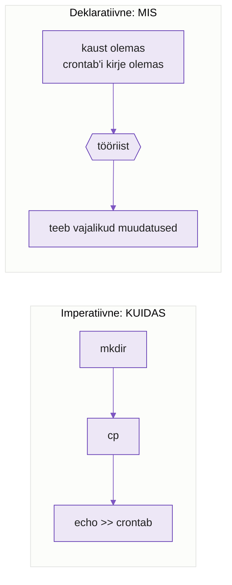
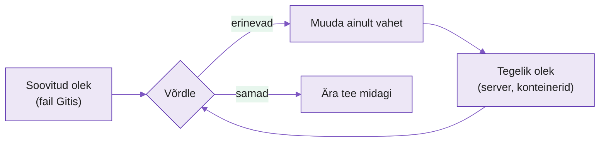
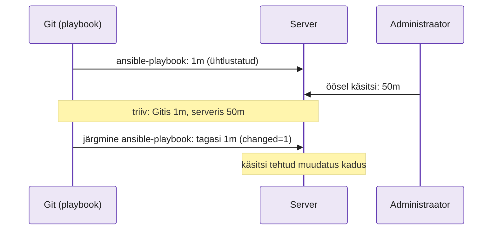
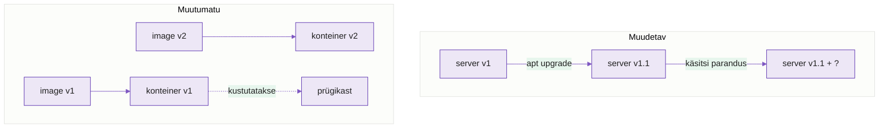
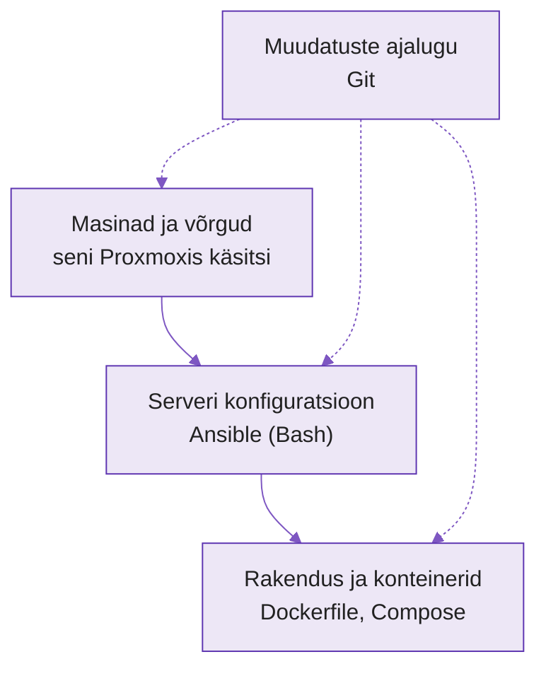

---
tags:
  - IaC
  - Ansible
  - Docker
  - Iseseisev
---

# Loeng: infrastruktuur koodina, mõtteviis

Sel nädalal õpid iseseisvalt ja Proxmoxi pole vaja. Loengus võrdled kursusel kasutatud tööriistu: mida igaüks kirjeldab ja mida ta teeb, kui masin ei vasta kirjeldusele.

??? abstract "Õpiväljundid"
    Pärast loengut oskad:

    - eristada imperatiivset ja deklaratiivset lähenemist ning selgitada, kumba lähenemist kursusel kasutatud tööriistad kasutavad
    - selgitada, mis on soovitud olek ja kuidas tööriist ühtlustab tegeliku oleku soovitud olekuga
    - selgitada idempotentsust ja kontrollida seda tööriista väljundist
    - kirjeldada konfiguratsiooni triivi ja seda, mida järgmine automaatne käivitus sellega teeb
    - selgitada muudetava ja muutumatu infrastruktuuri vahet

## 1. Käsitsi hallatav server

Paljudes ettevõtetes on server, mida on aastaid hooldatud käsitsi. Nginx paigaldati mitu aastat tagasi, PHP versiooni vahetati eelmisel talvel ja tulemüüri reeglid on kuskil kirjas. Keegi ei tea täpselt, mida kõike serverisse on paigaldatud ja kuidas see on seadistatud. Kui server rikki läheb, võtab uue serveri seadistamine päevi, sest iga seadistus tuleb meelde tuletada.

Kursusel kasutatud tööriistad lahendavad sama probleemi. Kõik, mis serveris peab olema, kirjutatakse faili ja tööriist seadistab masina selle faili järgi. Seda mõtteviisi nimetatakse **infrastruktuur koodina** (Infrastructure as Code, IaC).

??? note "Tabel 9.1. Kursusel kasutatud tööriistad ja failid"
    | Nädal | Tööriist | Mida failis kirjeldatakse | Fail |
    |---|---|---|---|
    | N2 | Bash, Git | käsud järjest; muudatuste ajalugu | `monitor.sh` |
    | N3–N4 | Ansible | mis peab serveris olema | `nginx.yml`, `templates/*.j2` |
    | N5 | Docker | kuidas image ehitada | `Dockerfile` |
    | N6 | Docker Compose | millised konteinerid koos töötavad | `docker-compose.yml` |

Fail on Gitis, seega on sellel ajalugu ja selle muudatusi saab üle vaadata. Seadistustest, mis on ainult inimese mälus, ei jää muudatuste ajalugu ja neid ei saa üle vaadata.

??? question "Kontrolli ennast"
    1. Miks on ettevõttele ohtlik, kui serveri seadistus on ainult ühe inimese mälus?
    2. Too praktikumidest üks fail, mille põhjal saaks keegi teine sinu tööd korrata ilma sinult midagi küsimata.

## 2. Imperatiivne ja deklaratiivne

Kui tead, kas tööriist kirjeldab samme või tulemust, oskad ennustada, mida ta teeb teisel käivitusel.

Võrdle kahte viisi toitu tellida. Võid kokale öelda iga sammu: „Võta pann, vala õli, löö kaks muna pannile.“ Kui pannil on juba munad, lisab kokk veel kaks. Teine võimalus on öelda: „Soovin taldrikule kahte praemuna.“ Köök otsustab, milliseid samme on vaja. Kui kaks praemuna on juba valmis, uusi ei praeta.

Esimene on **imperatiivne** (imperative) lähenemine: kirjeldad samme, kuidas midagi teha. Teine on **deklaratiivne** (declarative) lähenemine: kirjeldad tulemust, mis peab olema.

Monitooringuskripti paigaldamine Bashiga on imperatiivne:

```bash
mkdir /opt/monitor
cp monitor.sh /opt/monitor/
echo "*/5 * * * * /opt/monitor/monitor.sh" >> /etc/crontab
```

Kui käivitad selle teist korda, annab `mkdir` vea, sest kaust on olemas. Käsk `echo >>` lisab crontabi teise sama rea ja monitor käivitub iga 5 minuti järel kaks korda.

Sama Ansible'iga:

```yaml
- name: monitori kaust on olemas
  ansible.builtin.file:
    path: /opt/monitor
    state: directory

- name: skript on kaustas
  ansible.builtin.copy:
    src: monitor.sh
    dest: /opt/monitor/monitor.sh
    mode: "0755"

- name: crontab'i kirje on olemas
  ansible.builtin.cron:
    name: monitor
    minute: "*/5"
    job: /opt/monitor/monitor.sh
```

Ülesannete (task) nimed kirjeldavad olekut: kaust on olemas, skript on kaustas, kirje on olemas. Moodul kontrollib enne muutmist, kas kaust on juba olemas, ja kui on, ei tee midagi.

<figure markdown="span">

  <figcaption>Joonis 9.1. Imperatiivne skript täidab sammud alati uuesti. Deklaratiivse kirjelduse järgi otsustab tööriist, mis samme on vaja (Talvik, 2026).</figcaption>
</figure>

Praktikas pole piir alati selge. Dockerfile koosneb käskudest (`RUN apt install`, `COPY`), seega on see retsept. Tulemus, image, on aga üks kindel asi, mida saab käivitada ükskõik kui mitu korda. Ansible'is võid kirjutada `ansible.builtin.shell: mkdir /opt/monitor` ja siis on ka see task imperatiivne.

??? question "Kontrolli ennast"
    1. Kumb on imperatiivne ja kumb deklaratiivne: navirakendusele sihtkoha andmine või tee kirjeldamine „sõida 200 m otse, siis vasakule“?
    2. Miks tekitab `echo ... >> /etc/crontab` teisel käivitusel probleemi, aga Ansible'i `cron` moodul mitte?
    3. Leia `Dockerfile`-ist üks rida, mis on imperatiivne.

## 3. Soovitud olek ja ühtlustamine

Deklaratiivne tööriist teeb igal käivitusel sama tsükli: loeb tegeliku oleku, võrdleb seda soovitud olekuga ja kõrvaldab erinevused. Selle tsükli järgi saad ennustada ka nende tööriistade käitumist, mida sa veel ei tunne.

Termostaadi sihttemperatuur on 21 kraadi. See on **soovitud olek** (desired state). Termomeeter näitab 18 kraadi. See on **tegelik olek** (actual state). Termostaat võrdleb kahte numbrit ja kui need erinevad, lülitab kütte sisse. Kui toas on 21 kraadi, ei tee termostaat midagi. Kui aken tehakse lahti ja tuba jahtub, lülitub küte uuesti sisse.

**Ühtlustamine** (reconciliation) tähendab, et tööriist loeb tegeliku oleku, võrdleb seda soovitud olekuga ja teeb ainult need muudatused, mis on soovitud oleku saavutamiseks vajalikud.

<figure markdown="span">

  <figcaption>Joonis 9.2. Ühtlustamise tsükkel. Ansible ja Docker Compose teevad sama tsüklit, ainult tegelik olek on neil erinev (Talvik, 2026).</figcaption>
</figure>

Docker Compose loeb faili `docker-compose.yml` (soovitud olek) ja küsib Dockerilt, millised konteinerid töötavad (tegelik olek). Kui käivitad `docker compose up -d` teist korda ja midagi ei ole muutunud, on väljundis:

```text
 ✔ Container lab09-web-1    Running
 ✔ Container lab09-cache-1  Running
```

`Running` tähendab, et konteiner on olemas ja vastab failile, nii et Compose seda ei muutnud. Kui kustutad ühe konteineri käsitsi ja käivitad `up -d` uuesti, loob Compose ainult puuduva konteineri. Praktikumi lisaülesandes proovid seda.

??? note "Tabel 9.2. Sama tsükkel eri tööriistades"
    | Tööriist | Soovitud olek | Tegelik olek |
    |---|---|---|
    | Ansible | playbook | mis on serveris (paketid, failid, teenused) |
    | Docker Compose | `compose.yaml` | millised konteinerid töötavad |

??? question "Kontrolli ennast"
    1. Selgita termostaadi näitel, mis on soovitud olek ja mis tegelik olek.
    2. Compose näitab teisel käivitusel `Running`. Mida see ütleb tegeliku ja soovitud oleku kohta?
    3. Miks ei saa Bashi skript ühtlustada, kui see enne midagi ei kontrolli?

## 4. Idempotentsus

Automaatika käivitub sageli: pärast iga push'i, igal ööl ja alati, kui keegi tahab tulemust kontrollida. Kui iga käivitus midagi lõhub või teeb sama muudatuse topelt, ei julge keegi seda käivitada.

Lifti korrusenupp töötab alati samamoodi: vajutad „5“ üks kord või kümme korda ja lift sõidab ikka viiendale korrusele. Toimingut, mida võib korrata ja mille tulemus ei muutu, nimetatakse **idempotentseks** (idempotent). Valguslüliti, mis iga vajutusega olekut vahetab, ei ole idempotentne.

Kui käivitad Ansible'i playbook'i `nginx.yml` kolm korda, näed kokkuvõttes (`PLAY RECAP`):

```text
1. kord:  ok=4  changed=3  failed=0
2. kord:  ok=4  changed=0  failed=0
3. kord:  ok=4  changed=0  failed=0
```

`changed=0` tähendab, et kõik oli juba soovitud olekus. Ansible kontrollis iga task'i ja ei muutnud midagi.

Ansible'i moodulid (`package`, `file`, `copy`) kontrollivad enne muutmist, kas muudatust on vaja. Moodulid `shell` ja `command` ei tea, mida käsk teeb, ja näitavad vaikimisi iga kord `changed`. Seda saab muuta argumentidega `creates` ja `removes` või tingimusega `changed_when` ([moodul `command`](https://docs.ansible.com/ansible/latest/collections/ansible/builtin/command_module.html)). Bashi skripti saab teha idempotentseks, kui lisad enne iga muudatust kontrolli.

??? note "Tabel 9.3. Bashi käsud ilma kontrollita ja kontrolliga"
    | Mitteidempotentne | Idempotentne |
    |---|---|
    | `mkdir /opt/app` | `mkdir -p /opt/app` |
    | `echo "rida" >> fail` | `grep -qx "rida" fail \|\| echo "rida" >> fail` |
    | `docker run --name web nginx` | `docker ps -a --format '{{.Names}}' \| grep -qx web \|\| docker run --name web nginx` |
    | `useradd mtamm` | `id mtamm \|\| useradd mtamm` |

??? question "Kontrolli ennast"
    1. Too igapäevaelust üks idempotentne ja üks mitteidempotentne tegevus.
    2. Playbook näitab teisel käivitusel `changed=2`. Mida see tähendab ja kust otsiksid põhjust?
    3. Miks on idempotentsus eriti oluline, kui automaatika käivitub igal ööl ise?

## 5. Triiv: serveris muudeti midagi käsitsi

Ka siis, kui serverit hoitakse Ansible'iga, muudab keegi aeg-ajalt midagi käsitsi. Järgmine automaatne käivitus võib sellise muudatuse märkamatult kaotada.

Serveri nginx'i konfiguratsioonifaili loob Ansible malli järgi. Kasutajad ei saa üles laadida suuri faile. Administraator logib öösel serverisse, muudab failis `/etc/nginx/nginx.conf` rida `client_max_body_size 1m;` väärtuseks `50m` ja laadib nginx'i uuesti (`systemctl reload nginx`). Üleslaadimine töötab, aga playbook'i ja malli ta ei muuda.

Nüüd erinevad serveri tegelik olek ja Gitis kirjeldatud soovitud olek. Seda nimetatakse **konfiguratsiooni triiviks** (configuration drift): server on kirjeldusest eemale triivinud.

Järgmisel päeval käivitatakse playbook, sest serverisse on vaja lisada uus kasutaja. Moodul `template` näeb, et `nginx.conf` ei vasta mallile, ja kirjutab faili üle. Muudatus käivitab handler'i, mis laadib nginx'i konfiguratsiooni uuesti. Kokkuvõttes on `changed=1`, failis on jälle `1m` ja suuri faile üles laadida ei saa.

<figure markdown="span">

  <figcaption>Joonis 9.3. Triiv tekib käsitsi tehtud muudatusest ja kaob järgmisel deklaratiivsel käivitusel. Koos sellega kaob muudatus, mis Giti ei jõudnud (Talvik, 2026).</figcaption>
</figure>

Ansible tegi seda, mida playbook kirjeldab: seadistas faili malli järgi. Viga oli selles, et muudatus jäi Gitist välja. Pärast käsitsi parandust tuleb sama muudatus kirjutada malli või muutujasse ja teha pull request.

Triivi saab ka tuvastada ilma midagi muutmata. Käsk `ansible-playbook nginx.yml --check --diff` näitab, mida Ansible muudaks, ja jätab serveri puutumata. Failimoodulite puhul näeb ka sisu muudatust. Moodulid, mis kontrollrežiimi ei toeta, jäävad vahele ([kontrollrežiim](https://docs.ansible.com/ansible/latest/playbook_guide/playbooks_checkmode.html)). Praktikumi lisaülesandes proovid seda.

??? question "Kontrolli ennast"
    1. Mis on triiv? Selgita `client_max_body_size` näitel.
    2. Mida peab administraator tegema pärast käsitsi parandust, et järgmine käivitus seda üle ei kirjutaks?
    3. Playbook'i käivitatakse ainult siis, kui keegi seda käsitsi teeb. Kui kaua võib triiv märkamatult kesta?

## 6. Ansible ei pea arvestust loodud ressursside üle

Ansible ei pea eraldi arvestust ressursside üle, mille ta on loonud. Igal käivitusel kontrollib ta uuesti ainult neid ressursse, mis on playbook'is kirjas. Kui eemaldad playbook'ist paigaldusülesande, ei eemaldata varem paigaldatud tarkvara.

Playbook `nginx.yml` paigaldas nginx'i. Kui kustutad playbook'ist nginx'i task'i ja käivitad selle uuesti, jääb nginx serverisse ja töötab edasi. Playbook'is ei ole enam ühtegi rida nginx'i kohta ja Ansible'il ei ole kirjas, et ta selle kunagi paigaldas. Nginx'i eemaldamiseks on vaja task'i, kus on `state: absent`.

N10 tööriist OpenTofu salvestab oleku faili ja seetõttu käitub selles olukorras teisiti.

??? question "Kontrolli ennast"
    1. Kustutasid playbook'ist nginx'i task'i ja käivitasid selle uuesti. Miks nginx ikka töötab?

## 7. Muudetav ja muutumatu infrastruktuur

Triivi saab vältida kahel viisil. Võib serverit pidevalt kirjelduse järgi parandada või seda üldse mitte muuta ja vajaduse korral uuega asendada.

Käsitsi hoitud server on **muudetav** (mutable) infrastruktuur. See on üks ja sama masin aastaid: sellele paigaldatakse uuendusi, muudetakse faile ja lisatakse pakette. Iga muudatus on väike, aga aastatega koguneb masinasse seadistusi, mida keegi ei mäleta. Ansible hoiab sellist masinat soovitud olekus ainult nende seadistuste puhul, mis on playbook'is kirjas.

**Muutumatu** (immutable) infrastruktuur tähendab, et masinat või konteinerit pärast käivitamist ei muudeta. Uue versiooni jaoks ehitatakse uus ja vana kustutatakse. Kui Dockeri rakenduses muutub `app.py`, ei parandata faili töötavas konteineris. Ehitatakse uus image ja käivitatakse sellest uus konteiner.

Inglise keeles kasutatakse selle kohta võrdlust **lemmikloomad ja kariloomad** (pets vs cattle).

??? note "Tabel 9.4. Lemmikloom ja kariloom"
    | | Lemmikloom (pet) | Kariloom (cattle) |
    |---|---|---|
    | Nimi | `veeb-01`, kõik tunnevad seda | `web-7f3a`, number |
    | Kui on rikkis | parandatakse | asendatakse uuega |
    | Kuidas tekkis | käsitsi, aastate jooksul | koodist, minutitega |
    | Näide | käsitsi seadistatud server | Dockeri konteiner |

<figure markdown="span">

  <figcaption>Joonis 9.4. Muudetav server kogub aja jooksul muudatusi, mida keegi ei mäleta. Muutumatu infrastruktuuri puhul ehitatakse iga kord uus ja vana kustutatakse (Talvik, 2026).</figcaption>
</figure>

Ettevõtetes on tavaliselt mõlemat. Andmebaasiserver on sageli lemmikloom, sest andmeid ei saa lihtsalt kustutada. Veebiserverid on sageli kariloomad. Lemmikloomi tasub hoida vähe.

??? question "Kontrolli ennast"
    1. Töötava konteineri faili muudeti käsitsi. Kuidas taastab soovitud oleku konteineri asendamine uuega, mis on loodud samast image'ist?
    2. Kas virtuaalmasin, mille oled ise käsitsi ja Ansible'iga seadistanud, on lemmikloom või kariloom? Põhjenda.
    3. Too üks põhjus, miks andmebaas jääb sageli lemmikloomaks.

## 8. Millist kihti iga tööriist haldab

Tööriistad on eri kihtide jaoks. Masinad ja võrgud luuakse esimesena, siis seadistatakse operatsioonisüsteem, paketid ja konfiguratsioon ning viimasena paigaldatakse rakendused.

<figure markdown="span">

  <figcaption>Joonis 9.5. Kolm kihti ja Git, mis hoiab kõigi kolme kirjelduste ajalugu (Talvik, 2026).</figcaption>
</figure>

??? note "Tabel 9.5. Kursusel kasutatud tööriistade võrdlus"
    | Tööriist | Kiht | Lähenemine | Idempotentne | Salvestab oleku |
    |---|---|---|---|---|
    | Bashi skript | ükskõik milline | imperatiivne | ainult kui lisad kontrolli | ei |
    | Ansible | serveri konfiguratsioon | deklaratiivne (moodulid) | jah, moodulitega | ei |
    | Dockerfile | image | sees imperatiivne, tulemus muutumatu | korduv ehitus võib anda teise image'i, sest alusimage ja paketid muutuvad; vahemälu kasutab varasemate sammude tulemusi | ei |
    | Docker Compose | konteinerid | deklaratiivne | jah | Docker teab, millised konteinerid töötavad |

Git on kõigi kihtide all. Ilma Gitita on iga fail lihtsalt fail ühe inimese kettal.

??? question "Kontrolli ennast"
    1. Ettevõte tahab 10 serverisse nginx'i ja igasse serverisse Dockeri konteinerit. Milline tööriist teeb millise osa?
    2. Miks on Dockerfile tabelis „sees imperatiivne, tulemus muutumatu“?

??? abstract "Kokkuvõte"
    Infrastruktuur koodina tähendab, et soovitud infrastruktuur ja selle seadistused on kirjeldatud failides Gitis. Imperatiivne kood kirjeldab samme, deklaratiivne tulemust. Deklaratiivne tööriist kontrollib enda hallatavat olekut ja teeb vajalikud muudatused. Idempotentse toimingu kordamine ei tekita pärast soovitud oleku saavutamist uusi muudatusi. Käsitsi tehtud muudatus tekitab triivi. Kas järgmine käivitus selle parandab, sõltub sellest, mida tööriist haldab. Ansible ei pea arvestust loodud ressursside üle. Muutumatu infrastruktuuri puhul ei parandata masinat ega konteinerit käsitsi, vaid asendatakse see uuega.

    | Mõiste | Selgitus | Näide |
    |---|---|---|
    | Imperatiivne | kirjeldad samme | `monitor.sh` |
    | Deklaratiivne | kirjeldad tulemust | `nginx.yml`, `docker-compose.yml` |
    | Soovitud olek | mis peab olema | fail Gitis |
    | Ühtlustamine | tööriist võrdleb ja muudab erinevuse | `docker compose up -d` |
    | Idempotentsus | korduv käivitus ei muuda tulemust | `changed=0` |
    | Triiv | server erineb kirjeldusest käsitsi tehtud muudatuse tõttu | käsitsi muudetud `client_max_body_size` |
    | Muutumatu infrastruktuur | uus versioon ehitatakse uuena ja vana kustutatakse | Dockeri image |
    | Pets vs cattle | parandatav lemmikloom ja asendatav kariloom | käsitsi hoitud server ja konteiner |

??? question "Kontrolli ennast"
    1. Selgita süüa tellimise näitel imperatiivse ja deklaratiivse vahet. Too näide praktikumidest.
    2. Kirjelda ühtlustamise tsükli iga sammu Docker Compose'i näitel.
    3. Mis juhtub käsitsi parandusega järgmisel Ansible'i käivitusel ja kuidas seda vältida?
    4. Kustutad playbook'ist ühe task'i. Mis juhtub serveris?
    5. Ettevõte tahab, et ühe serveri kaotusest taastumine ei võtaks rohkem kui tund. Mida soovitad?
