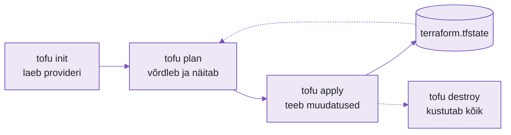

---
tags:
  - OpenTofu
  - IaC
  - Proxmox
---

# Loeng: infrastruktuuri kirjeldamine koodina (OpenTofu)

**Kestus:** umbes 35 minutit tunni alguses, siis [praktikum](lab.md).
**Eeldus:** N9 loeng ja praktikum: soovitud olek, ühtlustamine, triiv, olekufail. N9 README Osa 5 ennustused on kirjas.

N9-s võrdlesid Bashi, Ansible'it ja Docker Compose'i ning kirjutasid kaks ennustust tööriista kohta, mida sa veel ei kasutanud. Täna kirjeldad OpenTofuga kooli Proxmoxis ühe virtuaalmasina ja kontrollid mõlemat ennustust oma masinaga.

!!! abstract "Õpiväljundid"
    Pärast loengut ja praktikumi oskad:

    - selgitada, millist olekut OpenTofu haldab ja millist jätab Ansible'ile
    - lugeda `.tf` faili plokke: `terraform`, `provider`, `variable`, `resource`, `output`
    - kasutada töövoogu `tofu init`, `tofu plan`, `tofu apply`, `tofu destroy`
    - lugeda `tofu plan` väljundist, mida OpenTofu loob, muudab või kustutab
    - selgitada, miks olekufail ei lähe Giti, aga lukufail `.terraform.lock.hcl` läheb

---

## 1. N9 ennustused

N9 praktikumi lõpus vastasid kahele küsimusele:

1. Keegi kustutab Proxmoxis käsitsi masina, mille OpenTofu lõi. Mis juhtub OpenTofu järgmisel käivitusel?
2. Kustutad OpenTofu failist masina kirjelduse. Mis juhtub järgmisel käivitusel? Kas Ansible teeks sama?

Tunni alguses loeb igaüks oma vastused ette. Me ei arutle, kellel on õigus. Praktikumi osades 4 ja 5 teed mõlemad katsed läbi ja võrdled tulemust oma ennustusega.

---

## 2. OpenTofu ja Terraform

**OpenTofu** on tööriist, millega kirjeldatakse infrastruktuuri (virtuaalmasinad, võrgud, kettad, DNS-kirjed, pilveteenused) tekstifailides. Käsk on `tofu`.

OpenTofu sündis Terraformist. HashiCorp muutis 2023. aastal Terraformi litsentsi ja kogukond jätkas viimase avatud versiooniga eraldi projektina, mida haldab nüüd Linux Foundation. Keel (HCL), failide laiend `.tf` ja töövoog on samad. Kui tööpakkumises on kirjas Terraform, kehtib kõik, mida täna teed: `terraform plan` asemel kirjutad `tofu plan`.

OpenTofu ise ei tea Proxmoxist ega AWS-ist midagi. Iga süsteemi jaoks on eraldi **provider**: programm, mis tõlgib `.tf` faili kirjelduse selle süsteemi API päringuteks. Meie kasutame providerit [`bpg/proxmox`](https://search.opentofu.org/provider/bpg/proxmox/latest), sama, millega õpetaja loob monitooringu kursuse masinad.

| | Ansible | OpenTofu |
|---|---|---|
| Mida haldab | masina sisu: paketid, failid, teenused, kasutajad | masinat ennast: kas see on olemas, mitu tuuma, kui palju mälu |
| Kuidas ühendub | SSH kaudu masinasse | Proxmoxi (või pilve) API kaudu, masinasse ei logi |
| Mälu | ei mäleta eelmist käivitust | olekufail `terraform.tfstate` |
| Tüüpiline järjekord | teine samm: seadistab masina | esimene samm: loob masina |

*Tabel 10.1. Ansible ja OpenTofu haldavad eri kihti. Tavaliselt kasutatakse neid koos.*

??? question "Kontrolli ennast"
    1. Firma vajab uut veebiserverit, millel töötab nginx. Milline osa on OpenTofu töö ja milline Ansible'i oma?
    2. Miks ei pea OpenTofu masinasse SSH-ga sisse logima?

---

## 3. Fail, mis kirjeldab masinat

Praktikumis kirjutad faili `vm.tf`. Selle sisu on:

```hcl
resource "proxmox_virtual_environment_vm" "veeb" {
  name            = "tofu-${var.kasutaja}"
  node_name       = var.node_name
  vm_id           = var.vm_id
  pool_id         = "tofu-${var.kasutaja}"
  tags            = ["it24", "tofu"]
  stop_on_destroy = true

  clone {
    vm_id = var.template_id
    full  = false
  }

  cpu {
    type  = "x86-64-v2-AES"
    cores = 1
  }

  memory {
    dedicated = 1024
  }

  agent {
    enabled = true
  }
}

output "ip" {
  value = proxmox_virtual_environment_vm.veeb.ipv4_addresses[1][0]
}
```

Failis ei ole ühtegi sammu. See ütleb: Proxmoxis peab olema üks masin nimega `tofu-<kasutaja>`, mis on kloonitud mallist ja millel on üks tuum ja 1 GB mälu. Kuidas see tekib, otsustab OpenTofu koos provideriga.

Rida `resource "proxmox_virtual_environment_vm" "veeb"` sisaldab kahte nime. Esimene on **ressursi tüüp**, mille annab provider (Proxmoxi virtuaalmasin). Teine on **sinu antud nimi**, millega viitad sellele ressursile mujal failis. Koos moodustavad nad aadressi `proxmox_virtual_environment_vm.veeb`, mida näed hiljem `tofu plan` väljundis.

Kõik praktikumi failid kasutavad viit tüüpi plokke:

| Plokk | Mida kirjeldab | Praktikumi fail |
|---|---|---|
| `terraform` | OpenTofu versioon ja providerid, mida kood vajab | `versions.tf` |
| `provider` | kuidas providerid süsteemiga ühenduvad (aadress, token) | `versions.tf` |
| `variable` | sisend, mille väärtus tuleb väljastpoolt koodi | `variables.tf` |
| `resource` | hallatav objekt: masin, võrk, fail | `vm.tf` |
| `output` | väärtus, mille OpenTofu pärast `apply` käsku välja trükib | `vm.tf` |

*Tabel 10.2. HCL-i põhiplokid.*

`var.kasutaja` viitab muutujale, `proxmox_virtual_environment_vm.veeb.ipv4_addresses` viitab ressursi atribuudile. Atribuudi väärtus selgub alles siis, kui masin on olemas: masina IP-aadressi saab OpenTofu Proxmoxi kaudu masinas töötavalt guest agent'ilt.

Muutujate väärtused on failis `terraform.tfvars`. OpenTofu loeb selle faili automaatselt. Samamoodi lugesid N4-s Ansible'i muutujaid failist `group_vars` ja Vaulti krüpteeritud failist: kood on kõigil sama, väärtused on igaühel oma.

??? question "Kontrolli ennast"
    1. Mis on aadressis `proxmox_virtual_environment_vm.veeb` ressursi tüüp ja mis sinu antud nimi?
    2. Miks on API token muutujas, mitte otse failis `versions.tf`?

---

## 4. Töövoog: init, plan, apply, destroy

<figure markdown="span">

  <figcaption>Joonis 10.1. OpenTofu töövoog. Iga `plan` loeb olekufaili ja võrdleb seda koodi ja Proxmoxiga (Talvik, 2026).</figcaption>
</figure>

**`tofu init`** laeb alla providerid, mida `terraform` plokk nõuab, kausta `.terraform/`. Valitud versioonid ja nende kontrollsummad kirjutab ta faili `.terraform.lock.hcl`. Võrku on vaja ainult esimesel korral.

**`tofu plan`** küsib Proxmoxilt iga olekufailis oleva ressursi tegeliku oleku, võrdleb seda koodiga ja näitab, mida ta muudaks. Plaan ei muuda midagi. Iga ressursi ees on märk:

| Märk | Tähendus | Näide |
|---|---|---|
| `+` | luuakse | uus masin |
| `~` | muudetakse kohapeal | mälu 1024 → 2048 |
| `-` | kustutatakse | kirjeldus eemaldati koodist |
| `-/+` | kustutatakse ja luuakse uuesti | muutus atribuut, mida kohapeal muuta ei saa (näiteks `vm_id`) |

*Tabel 10.3. Plaani märgid.*

Plaani viimane rida võtab kokku: `Plan: 1 to add, 0 to change, 0 to destroy.` Kui muuta pole midagi, on väljundis `No changes. Your infrastructure matches the configuration.` See vastab Ansible'i `changed=0` reale.

**`tofu apply`** teeb muudatused ja kirjutab tulemuse olekufaili. Praktikumis salvestad plaani faili (`tofu plan -out=tfplan`) ja annad selle faili käsule `tofu apply tfplan`. Siis teeb OpenTofu täpselt need muudatused, mida plaanis lugesid. Ilma plaanifailita koostab `apply` plaani uuesti ja küsib kinnitust.

**`tofu destroy`** kustutab kõik ressursid, mis on olekufailis. Teisi masinaid Proxmoxis ta ei puuduta, sest ta ei tea nendest midagi.

!!! warning "Loe plaan enne apply'd"
    Plaani `-` rida tähendab, et midagi kustutatakse koos kõigi andmetega. Kui plaanis on kustutamine, mida sa ei oodanud, ära käivita `apply` käsku enne, kui tead põhjust.

??? question "Kontrolli ennast"
    1. Mille poolest erineb `tofu plan` käsust `ansible-playbook --check`?
    2. Miks on kasulik anda `apply` käsule salvestatud plaanifail?

---

## 5. Olekufail ja lukufail

OpenTofu kirjutab olekufaili `terraform.tfstate` iga ressursi, mille ta lõi: Proxmoxi VMID, sõlme, IP-aadressid ja kõik atribuudid. Fail on JSON. Selle järgi teab OpenTofu järgmisel käivitusel, et masin `tofu-<kasutaja>` on tema loodud ja tema hallata. Proxmoxi teisi masinaid olekufailis ei ole ja OpenTofu ei muuda neid.

Olekufail ei lähe Giti. Selles võivad olla saladused (bpg provider salvestab näiteks masina parooli, kui see on koodis), ja kui kaks inimest muudavad sama infrastruktuuri oma olekufailiga, ei klapi need enam omavahel. Meeskonnas hoitakse olekut ühises kohas (S3, GitLab, PostgreSQL), mida OpenTofu nimetab **backend**'iks. Meie kasutame vaikimisi kohalikku faili.

Lukufail `.terraform.lock.hcl` läheb Giti. Selles on provideri versioon ja kontrollsummad. Kui kolleeg või CI käivitab `tofu init`, saab ta täpselt sama versiooni. Sama rolli täidab Pythonis `requirements.txt` koos versiooninumbritega.

| Fail või kaust | Mis seal on | Gitis? |
|---|---|---|
| `*.tf` | infrastruktuuri kirjeldus | jah |
| `.terraform.lock.hcl` | provideri versioon ja kontrollsummad | jah |
| `.terraform/` | allalaetud provider (kümned MB) | ei |
| `terraform.tfstate` | mida OpenTofu lõi | ei |
| `terraform.tfvars` | muutujate väärtused, sh API token | ei |

*Tabel 10.4. Mis läheb Giti. Starteri `.gitignore` sisaldab juba õigeid ridu.*

??? question "Kontrolli ennast"
    1. Kustutad kogemata faili `terraform.tfstate`. Masin on Proxmoxis alles. Mida näitab järgmine `tofu plan`?
    2. Miks läheb Giti `.terraform.lock.hcl`, aga mitte `.terraform/`?

---

## 6. API token ja õigused

OpenTofu ühendub Proxmoxiga **API tokeniga**. Token kuulub sinu Proxmoxi kasutajale ja sellel on sinu õigused. Praktikumis lood tokeni ise Proxmoxi veebiliideses.

Õpetaja on andnud igale õppijale õiguse luua masinaid ainult oma pool'i (`tofu-<kasutaja>`) ja kloonida ühte AlmaLinuxi malli. Teiste masinaid ei saa sinu token muuta ega kustutada. Seda nimetatakse **vähimate õiguste põhimõtteks**: automaatika saab täpselt need õigused, mida ta vajab. Kui token lekib, piirdub kahju sinu pool'iga.

Token on saladus nagu parool. Ta on ainult failis `terraform.tfvars` (`.gitignore`-is) ja muutuja on märgitud `sensitive = true`, et OpenTofu ei trükiks seda välja.

---

## Kokkuvõte

OpenTofu kirjeldab infrastruktuuri `.tf` failides ja haldab seda providerite kaudu, meie puhul Proxmoxi API kaudu. Töövoog on `init`, `plan`, `apply` ja lõpuks `destroy`. Plaan näitab enne muutmist, mida luuakse (`+`), muudetakse (`~`) ja kustutatakse (`-`). OpenTofu mäletab olekufailis, mida ta lõi, ja võrdleb iga kord kolme asja: koodi, olekufaili ja Proxmoxi tegelikku olekut. Olekufail ja token ei lähe Giti, lukufail läheb.

| Mõiste | Selgitus |
|---|---|
| **provider** | programm, mis tõlgib kirjelduse ühe süsteemi API päringuteks (`bpg/proxmox`) |
| **resource** | hallatav objekt, näiteks virtuaalmasin |
| **variable** | sisend, mille väärtus on failis `terraform.tfvars` |
| **output** | väärtus, mille OpenTofu pärast `apply` käsku trükib (masina IP) |
| **plan** | võrdlus ja muudatuste nimekiri ilma muutmata |
| **olekufail** | `terraform.tfstate`, OpenTofu mälu |
| **lukufail** | `.terraform.lock.hcl`, provideri versioon |

*Tabel 10.5. Mõisted.*

??? question "Lõplik kontroll"
    1. Kirjelda oma sõnadega, mida teeb `tofu plan` enne, kui ta midagi välja trükib.
    2. Masin on loodud. Muudad failis `memory` väärtuse 1024 asemel 2048. Millise märgiga rida plaanis näed?
    3. Miks ei näe OpenTofu, kui keegi muudab masinas `/etc/nginx/nginx.conf` faili?
    4. Mida teeb `tofu destroy` masinatega, mis on Proxmoxis, aga ei ole olekufailis?
