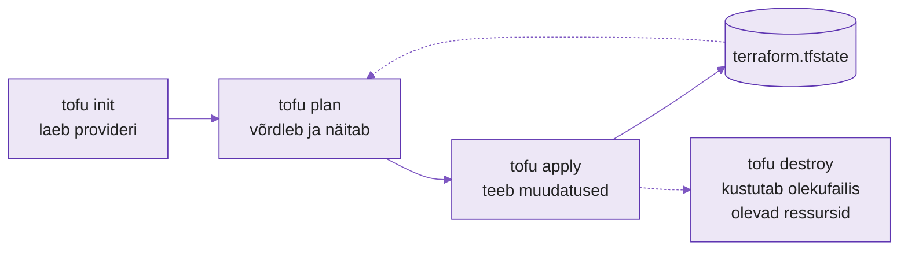

---
tags:
  - OpenTofu
  - IaC
  - Proxmox
---

# Loeng: infrastruktuuri kirjeldamine koodina (OpenTofu)

Ansible ja Docker Compose on deklaratiivsed tööriistad: failis on kirjeldatud soovitud olek ja tööriist muudab ainult seda, mis erineb. Täna kasutad sama mõtet virtuaalmasina loomisel. Kõigepealt kirjutad kaks ennustust, siis kirjeldad OpenTofuga kooli Proxmoxis ühe virtuaalmasina ja kontrollid mõlemat ennustust oma masinaga.

??? abstract "Õpiväljundid"
    Pärast loengut ja praktikumi oskad:

    - selgitada, millist olekut OpenTofu haldab ja millist jätab Ansible'ile
    - lugeda `.tf` faili plokke: `terraform`, `provider`, `variable`, `resource`, `output`
    - kasutada töövoogu `tofu init`, `tofu plan`, `tofu apply`, `tofu destroy`
    - lugeda `tofu plan` väljundist, mida OpenTofu loob, muudab või kustutab
    - selgitada, miks olekufail ei lähe Giti, aga lukufail `.terraform.lock.hcl` läheb

## 1. Kaks ennustust

OpenTofu on deklaratiivne tööriist nagu Ansible ja Docker Compose. Enne kui loed edasi, vasta selle põhjal, mida tead Ansible'ist, kahele küsimusele:

1. Keegi kustutab Proxmoxis käsitsi masina, mille OpenTofu lõi. Mis juhtub OpenTofu järgmisel käivitusel?
2. Kustutad OpenTofu failist masina kirjelduse. Mis juhtub järgmisel käivitusel? Kas Ansible teeks sama?

Võta Classroom 50-s vastu ülesanne **Lab 10 - OpenTofu** ([Classroom 50](https://classroom50.org/hkhk-automation/it24-automatiseerimine/assignments)), ava GitHubis oma repositooriumi fail `README.md` (pliiatsiikoon) ja kirjuta vastused README 0. ossa. Õiget vastust praegu ei oodata. [Praktikumi](lab.md) osades 4 ja 5 teed mõlemad katsed läbi ja võrdled tulemust oma ennustusega.

## 2. Infrastruktuur koodina: pilv ja Proxmox

**Infrastruktuur koodina** (Infrastructure as Code, IaC) tähendab, et serverid, võrgud, kettad ja muud ressursid kirjeldatakse tekstifailides ning tööriist loob need ise. Töökohas kasutatakse seda kõige sagedamini pilves. Ettevõte loob OpenTofu või Terraformiga AWS-is, Azure'is või Google Cloudis virtuaalmasinad (AWS-is EC2), võrgud (VPC), andmebaasid, DNS-kirjed ja kasutajaõigused. Uue keskkonna (näiteks testkeskkonna) loomine on siis üks käsk ja sama kood loob identse keskkonna ka teises regioonis.

Kooli laboril pilvekontot ei ole, seega teed sama kooli Proxmoxis. OpenTofu jaoks on Proxmox samasugune platvorm nagu AWS: mõlemal on API, millega saab masinaid luua ja kustutada. Töövoog on sama, muutuvad provider ja ressursside nimed.

**OpenTofu** on tööriist, millega infrastruktuur kirjeldatakse ja luuakse. Käsk on `tofu` ja ametlik dokumentatsioon on aadressil [opentofu.org/docs](https://opentofu.org/docs/intro/). OpenTofu on tehtud Terraformi põhjal: keel (HCL), `.tf` failid ja töövoog on samad. Kui tööpakkumises on Terraform, tunned selle ära: `terraform plan` asemel on `tofu plan`.

??? info "Miks on kaks tööriista"
    HashiCorp muutis 2023. aasta augustis Terraformi litsentsi. Uus litsents (BSL) lubab koodi lugeda ja kasutada, aga ei luba seda kasutada HashiCorpiga konkureerivas tootes. Ettevõtted, kelle töö põhines Terraformil, avaldasid [OpenTofu manifesti](https://opentofu.org/manifesto/) ja jätkasid viimase avatud versiooniga eraldi projektina. Projekti haldab Linux Foundation ja see kuulub [CNCF-i projektide](https://www.cncf.io/projects/opentofu/) hulka.

OpenTofu ise ei tea Proxmoxist ega AWS-ist midagi. Iga platvormi jaoks on eraldi **provider**: programm, mis tõlgib `.tf` faili kirjelduse selle platvormi API-päringuteks. Providerid on [OpenTofu registris](https://search.opentofu.org/), kus on iga provideri ressursid, näited ja argumentide kirjeldused. Praktikumis kasutad providerit [`bpg/proxmox`](https://search.opentofu.org/provider/bpg/proxmox/latest).

<figure markdown="span">
  
  <figcaption>Joonis 10.1. Sama tööriist ja sama töövoog, provider valib platvormi (Talvik, 2026).</figcaption>
</figure>

Allpool on sama masin kahel platvormil. Ploki struktuur on sama, erinevad ressursitüüp ja argumendid, mille annab provider.

=== "Proxmox (praktikum)"

    ```hcl
    resource "proxmox_virtual_environment_vm" "veeb" {
      name      = "tofu-${var.kasutaja}"
      node_name = var.node_name

      clone {
        vm_id = var.template_id      # AlmaLinuxi mall
      }

      memory {
        dedicated = 1024
      }
    }
    ```

=== "AWS"

    ```hcl
    resource "aws_instance" "veeb" {
      ami           = var.ami_id     # AlmaLinuxi image
      instance_type = "t3.micro"     # 2 vCPU, 1 GB mälu

      tags = {
        Name = "tofu-${var.kasutaja}"
      }
    }
    ```

AWS-i ressursse kirjeldab provider [`hashicorp/aws`](https://search.opentofu.org/provider/hashicorp/aws/latest) ja Azure'i omi [`hashicorp/azurerm`](https://search.opentofu.org/provider/hashicorp/azurerm/latest). Kui oskad lugeda ühe provideri dokumentatsiooni, oskad lugeda ka teisi.

??? question "Kontrolli ennast"
    1. Ettevõte kolib Proxmoxist AWS-i. Mis muutub `.tf` failides ja mis jääb samaks?
    2. Miks saab OpenTofu luua masina platvormis, mille kohta OpenTofu ise midagi ei tea?

## 3. OpenTofu ja Ansible

Ansible ja OpenTofu on mõlemad deklaratiivsed: kirjeldad soovitud olekut ja tööriist teeb ainult vajalikud muudatused. Erinevus on selles, mida nad haldavad. Ansible eeldab, et masin on juba olemas ja sellesse saab SSH-ga sisse logida. OpenTofu loob masina ise platvormi API kaudu ega logi masinasse kunagi sisse.

??? note "Tabel 10.1. Ansible ja OpenTofu haldavad eri kihti. Tavaliselt kasutatakse neid koos"
    | | Ansible | OpenTofu |
    |---|---|---|
    | Mida haldab | masina sisu: paketid, failid, teenused, kasutajad | masinat ennast: kas see on olemas, mitu tuuma, kui palju mälu, mis võrgus |
    | Kuidas ühendub | SSH kaudu masinasse | platvormi API kaudu (Proxmox, AWS, Azure) |
    | Mida vajab masinas | SSH-d, Pythonit ja kasutajat | mitte midagi, masinat ei pruugi veel olla |
    | Järjekord | ülesanded käivad playbook'is kirjutatud järjekorras | OpenTofu arvutab järjekorra viidete järgi (võrk enne masinat) |
    | Mida mäletab | iga käivitus kontrollib masinat uuesti | olekufail `terraform.tfstate` |
    | Tüüpiline järjekord | teine samm: seadistab masina | esimene samm: loob masina |

<figure markdown="span">
  
  <figcaption>Joonis 10.2. OpenTofu väljund (masina IP) on Ansible'i sisend (Talvik, 2026).</figcaption>
</figure>

Töökohas on tavaline järjekord selline: OpenTofu loob masinad ja trükib nende IP-aadressid välja (`output`), need lähevad Ansible'i inventory'sse ning Ansible paigaldab ja seadistab tarkvara. OpenTofu võib masinas teha ka esimese seadistuse (näiteks cloud-init lisab SSH-võtme), aga paketid ja teenused jäävad Ansible'i hallata. Meie kursusel loob OpenTofu masina Proxmoxi API kaudu ja Ansible seadistab selle SSH kaudu. OpenTofu ei näe, kas fail masinas muutus, sest ta ei logi masinasse.

??? question "Kontrolli ennast"
    1. Ettevõte vajab uut veebiserverit, millel töötab nginx. Milline osa on OpenTofu töö ja milline Ansible'i oma?
    2. Miks ei pea OpenTofu masinasse SSH-ga sisse logima?
    3. Kumb tööriist saab töötada enne, kui masinal on IP-aadress?

## 4. Fail, mis kirjeldab masinat

Praktikumis kirjutad faili `vm.tf`. Provider ja muutujad on starteris juba olemas (`versions.tf`, `variables.tf`). Faili `vm.tf` sisu on:

```hcl
resource "proxmox_virtual_environment_vm" "veeb" {
  name            = "tofu-${var.kasutaja}"
  node_name       = var.node_name
  vm_id           = var.vm_id
  pool_id         = "tofu-${var.kasutaja}"
  tags            = ["it24", "tofu"]
  stop_on_destroy = true

  clone {
    vm_id = var.template_id
    full  = false
  }

  cpu {
    type  = "x86-64-v2-AES"
    cores = 1
  }

  memory {
    dedicated = 1024
  }

  agent {
    enabled = true
  }
}

output "ip" {
  value = proxmox_virtual_environment_vm.veeb.ipv4_addresses[1][0]
}
```

Failis ei ole ühtegi sammu. See ütleb: Proxmoxis peab olema üks masin nimega `tofu-<kasutaja>`, mis on kloonitud mallist ja millel on üks tuum ja 1 GB mälu. Kuidas see tekib, otsustab OpenTofu koos provideriga.

Rida `resource "proxmox_virtual_environment_vm" "veeb"` sisaldab kahte nime. Esimene on **ressursitüüp**, mille annab provider (Proxmoxi virtuaalmasin). Teine on **sinu antud nimi**, millega viitad sellele ressursile mujal failis. Koos moodustavad nad aadressi `proxmox_virtual_environment_vm.veeb`, mida näed hiljem `tofu plan` väljundis.

Kõik praktikumi failid kasutavad viit tüüpi plokke:

??? note "Tabel 10.2. HCL-i põhiplokid"
    | Plokk | Mida kirjeldab | Praktikumi fail |
    |---|---|---|
    | `terraform` | OpenTofu versioon ja providerid, mida kood vajab | `versions.tf` |
    | `provider` | kuidas providerid süsteemiga ühenduvad (aadress, token) | `versions.tf` |
    | `variable` | sisend, mille väärtus tuleb väljastpoolt koodi | `variables.tf` |
    | `resource` | hallatav objekt: masin, võrk, fail | `vm.tf` |
    | `output` | väärtus, mille OpenTofu pärast `apply` käsku välja trükib | `vm.tf` |

`var.kasutaja` viitab muutujale, `proxmox_virtual_environment_vm.veeb.ipv4_addresses` viitab ressursi atribuudile. Atribuudi väärtus selgub alles siis, kui masin on olemas: masina IP-aadressi saab OpenTofu Proxmoxi kaudu masinas töötavalt guest agent'ilt.

Muutujate väärtused on failis `terraform.tfvars`. OpenTofu loeb selle faili automaatselt. Ansible'is on sama mõte: muutujad on failis `group_vars` ja saladused Vaultiga krüpteeritud failis. Kood on kõigil sama, väärtused on igaühel oma.

??? question "Kontrolli ennast"
    1. Mis on aadressis `proxmox_virtual_environment_vm.veeb` ressursitüüp ja mis sinu antud nimi?
    2. Miks on API-token muutujas ja ei ole kirjas otse failis `versions.tf`?

## 5. Töövoog: init, plan, apply, destroy

<figure markdown="span">

  <figcaption>Joonis 10.3. OpenTofu töövoog. Iga `plan` loeb olekufaili ja võrdleb seda koodi ja Proxmoxiga (Talvik, 2026).</figcaption>
</figure>

**`tofu init`** laeb alla providerid, mida `terraform` plokk nõuab, kausta `.terraform/`. Valitud versioonid ja nende kontrollsummad kirjutab see faili `.terraform.lock.hcl`. Võrku on vaja ainult esimesel korral.

**`tofu plan`** küsib Proxmoxilt iga olekufailis oleva ressursi tegeliku oleku, võrdleb seda koodiga ja näitab, mida see muudaks. Plaan ei muuda midagi. Iga ressursi ees on märk:

??? note "Tabel 10.3. Plaani märgid"
    | Märk | Tähendus | Näide |
    |---|---|---|
    | `+` | luuakse | uus masin |
    | `~` | muudetakse kohapeal | mälu 1024 → 2048 |
    | `-` | kustutatakse | kirjeldus eemaldati koodist |
    | `-/+` | kustutatakse ja luuakse uuesti | muutus atribuut, mida kohapeal muuta ei saa (näiteks `vm_id`) |

Plaani viimane rida võtab kokku: `Plan: 1 to add, 0 to change, 0 to destroy.` Kui muuta pole midagi, on väljundis `No changes. Your infrastructure matches the configuration.` See vastab Ansible'i `changed=0` reale.

**`tofu apply`** teeb muudatused ja kirjutab tulemuse olekufaili. Praktikumis salvestad plaani faili (`tofu plan -out=tfplan`) ja annad selle faili käsule `tofu apply tfplan`. Siis teeb OpenTofu täpselt need muudatused, mida plaanis lugesid. Ilma plaanifailita koostab `apply` plaani uuesti ja küsib kinnitust.

Praktikumis kasutad iga muudatuse juures kolme abikäsku. **`tofu fmt`** vormindab `.tf` failid ühtsesse kujusse (taanded, joondus). **`tofu validate`** kontrollib süntaksit ja viiteid ilma Proxmoxiga ühendumata. **`tofu state list`** näitab, mis ressursid on olekufailis ([käskude loetelu](https://opentofu.org/docs/cli/commands/)).

**`tofu destroy`** kustutab ressursid, mis on olekufailis. Praktikumis on see üks masin. Teisi masinaid Proxmoxis see ei puuduta. Enne kinnitust näitab `destroy` plaani: loe see läbi.

!!! warning "Loe plaan enne apply käsku"
    Plaani märk `-` tähendab kustutamist. Masina või ketta kustutamisel kaovad ka andmed. Kui plaanis on kustutamine, mida sa ei oodanud, ära käivita `apply` käsku enne, kui tead põhjust.

??? question "Kontrolli ennast"
    1. Mille poolest erineb `tofu plan` käsust `ansible-playbook --check`?
    2. Miks on kasulik anda `apply` käsule salvestatud plaanifail?

## 6. Olekufail ja lukufail

[Olekufailis](https://opentofu.org/docs/language/state/) `terraform.tfstate` on kirjas, milline Proxmoxi masin vastab koodi aadressile `proxmox_virtual_environment_vm.veeb`, ja selle masina andmed: VMID, sõlm ja IP-aadressid. Fail on JSON. Selle järgi teab OpenTofu järgmisel käivitusel, et masin `tofu-<kasutaja>` on tema hallata. Proxmoxi teisi masinaid olekufailis ei ole ja OpenTofu ei muuda neid.

Olekufail ei lähe Giti. Selles võivad olla saladused (bpg provider salvestab näiteks masina parooli, kui see on koodis), ja kui kaks inimest muudavad sama infrastruktuuri oma olekufailiga, ei klapi need enam omavahel. Meeskonnas hoitakse olekut ühises kohas (S3, GitLab, PostgreSQL), mida OpenTofu nimetab **backend**'iks. Meie kasutame vaikimisi kohalikku faili.

Lukufail `.terraform.lock.hcl` läheb Giti. Selles on provideri versioon ja kontrollsummad. Kui keegi teine või CI käivitab `tofu init`, laaditakse täpselt sama versioon. Sama rolli täidab Pythonis `requirements.txt` koos versiooninumbritega.

??? note "Tabel 10.4. Mis läheb Giti. Starteri `.gitignore` sisaldab juba õigeid ridu"
    | Fail või kaust | Mis seal on | Gitis? |
    |---|---|---|
    | `*.tf` | infrastruktuuri kirjeldus | jah |
    | `.terraform.lock.hcl` | provideri versioon ja kontrollsummad | jah |
    | `.terraform/` | allalaaditud provider (kümned MB) | ei |
    | `terraform.tfstate` | mida OpenTofu haldab | ei |
    | `tfplan` | salvestatud plaan, võib sisaldada saladusi | ei |
    | `terraform.tfvars` | muutujate väärtused, sh API-token | ei |

??? question "Kontrolli ennast"
    1. Kustutad kogemata faili `terraform.tfstate`. Masin on Proxmoxis alles. Mida näitab järgmine `tofu plan`?
    2. Miks läheb Giti `.terraform.lock.hcl`, aga mitte `.terraform/`?

## 7. API token ja õigused

OpenTofu ühendub Proxmoxiga **API-tokeniga**. Token kuulub sinu Proxmoxi kasutajale ja sellel on sinu õigused. Praktikumis lood tokeni ise Proxmoxi veebiliideses.

Sinu token saab luua masinaid ainult sinu **pool**'i (masinate rühm `tofu-<kasutaja>`) ja kloonida ühte AlmaLinuxi malli. Teiste masinaid see muuta ega kustutada ei saa. See on **vähimate õiguste põhimõte**: automaatika saab ainult need õigused, mida ta vajab. Kui token lekib, kustuta see kohe ja loo uus.

Token on saladus nagu parool. See on ainult failis `terraform.tfvars` (`.gitignore`-is) ja muutuja on märgitud `sensitive = true`, et OpenTofu ei trükiks seda välja. `sensitive` peidab väärtuse ainult ekraanilt, see ei krüpteeri midagi. Failides `terraform.tfvars`, `tfplan` ja `terraform.tfstate` võivad saladused olla avatekstina, seepärast ei lähe need Giti ([saladused olekufailis](https://opentofu.org/docs/language/state/sensitive-data/)). Terraformist erinevalt oskab OpenTofu olekufaili [krüpteerida](https://opentofu.org/docs/language/state/encryption/), meeskonnas kasutatakse seda koos ühise backend'iga.

## 8. OpenTofu meeskonnas: Spacelift

Praktikumis käivitad `tofu` oma virtuaalmasinas ja olekufail on sinu kaustas. Meeskonnas on vaja ühte olekufaili ja nähtavat ajalugu, kes mida muutis. Kui iga insener käivitab `apply` käsku oma arvutist, on igaühel oma olekufail ja oma API-võti ning logist ei näe, kes mida muutis. Seepärast käivitab OpenTofu tihti ühine platvorm.

Üks levinud platvorm on [Spacelift](https://spacelift.io/). Spacelift oli ka üks ettevõtetest, kes 2023. aastal OpenTofu projekti algatasid. Spacelift seob Giti repositooriumi kausta ja haru ühe **stack**'iga ([stack'i kirjeldus](https://docs.spacelift.io/concepts/stack)). Töövoog on näiteks selline:

1. Insener muudab `.tf` faili ja teeb pull request'i. Spacelift käivitab `tofu plan` ja paneb plaani PR-i juurde.
2. **Reeglid** ([policy](https://docs.spacelift.io/concepts/policy)) kontrollivad plaani automaatselt. Reegel võib näiteks keelata andmebaasi kustutamise või nõuda, et iga kustutamise kinnitab teine inimene.
3. Teine meeskonna liige vaatab plaani üle. Pärast pull request'i liitmist käivitab Spacelift `tofu apply`.
4. Olekufaili ja API-võtmeid hoiab Spacelift, inseneride arvutites neid ei ole.
5. **Triivi tuvastus** ([drift detection](https://docs.spacelift.io/concepts/stack/drift-detection)) käivitab `tofu plan` regulaarselt ja annab teada, kui keegi on infrastruktuuri käsitsi muutnud. Sellist erinevust koodi ja tegeliku oleku vahel nimetatakse triiviks.

<figure markdown="span">
  
  <figcaption>Joonis 10.4. OpenTofu meeskonnas: muudatus läbib plaani, reeglid ja ülevaatuse (Talvik, 2026).</figcaption>
</figure>

Spacelift oskab käivitada ka Terraformi, Ansible'it, Pulumit ja Kubernetese manifeste. Sama tüüpi platvormid on HashiCorpi HCP Terraform, env0 ja Scalr ning avatud lähtekoodiga Atlantis.

??? question "Kontrolli ennast"
    1. Mis probleemi lahendab Spacelift võrreldes sellega, et iga insener käivitab `tofu apply` oma arvutist?
    2. Miks käivitab Spacelift `tofu plan` juba pull request'i juures, enne merge'i?

??? abstract "Kokkuvõte"
    OpenTofu kirjeldab infrastruktuuri `.tf` failides ja haldab seda providerite kaudu, meie puhul Proxmoxi API kaudu. Töövoog on `init`, `plan`, `apply` ja lõpuks `destroy`. Plaan näitab enne muutmist, mida luuakse (`+`), muudetakse (`~`) ja kustutatakse (`-`). OpenTofu mäletab olekufailis, mida ta lõi, ja võrdleb iga kord kolme asja: koodi, olekufaili ja Proxmoxi tegelikku olekut. Olekufail ja token ei lähe Giti, lukufail läheb.


    | Mõiste | Selgitus |
    |---|---|
    | provider | programm, mis tõlgib kirjelduse ühe süsteemi API-päringuteks (`bpg/proxmox`) |
    | resource | hallatav objekt, näiteks virtuaalmasin |
    | variable | sisend, mille väärtus on failis `terraform.tfvars` |
    | output | väärtus, mille OpenTofu pärast `apply` käsku trükib (masina IP) |
    | plan | võrdlus ja muudatuste nimekiri ilma muutmata |
    | olekufail | `terraform.tfstate`, kirjas on OpenTofu loodud ressursid |
    | lukufail | `.terraform.lock.hcl`, provideri versioon |

??? question "Kontrolli ennast"
    1. Kirjelda oma sõnadega, mida teeb `tofu plan` enne, kui see midagi välja trükib.
    2. Masin on loodud. Muudad failis `memory` väärtuse 1024 asemel 2048. Millise märgiga rida plaanis näed?
    3. Miks ei näe OpenTofu, kui keegi muudab masinas `/etc/nginx/nginx.conf` faili?
    4. Mida teeb `tofu destroy` masinatega, mis on Proxmoxis, aga ei ole olekufailis?
