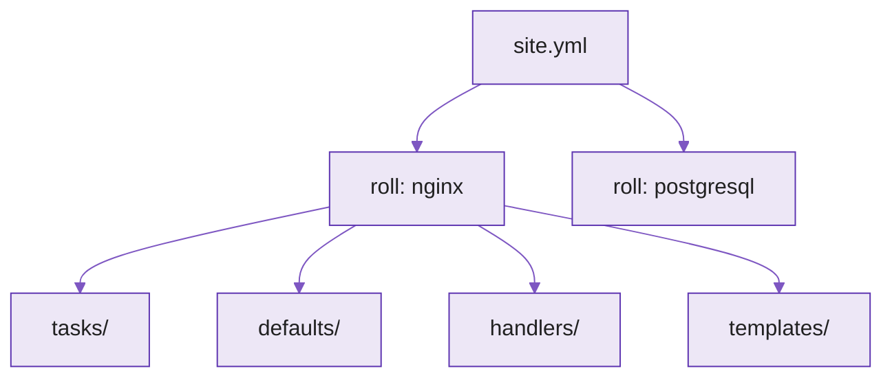

---
tags:
  - Ansible
  - Rollid
  - Konfiguratsioonihaldus
---

# Loeng: Ansible rollid

Nädalatel 3–4 kirjutasid playbook'i, mis seadistas ühe teenuse. Selles loengus jagad sama töö rollideks, et playbook jääks loetavaks ka siis, kui teenuseid on mitu.

??? abstract "Õpiväljundid"
    Pärast loengut oskad:

    - selgitada, mis on roll ja miks see on suurest playbook'ist parem ülesehitus;
    - kirjeldada rolli standardset kaustastruktuuri;
    - selgitada, kuidas rolli playbook'ist käivitatakse (`roles:` ja `include_role`);
    - põhjendada, millal kasutada rolli ja millal piisab playbook'ist.

## 1. Playbook, mis kasvas suureks

Nädalatel 3–4 olid ülesanded, muutujad ja mallid ühes failis kõrvuti. Ühe nginx-serveri jaoks on selline fail loetav. Kui sama fail peab seadistama nginx'i, PostgreSQL'i, tulemüüri ja monitooringu, kasvab saja reaga fail viiesajaliseks. Kuu aja pärast ei leia lugeja enam, kus PostgreSQL'i osa lõpeb ja tulemüüri osa algab.

Rollid lahendavad selle probleemi. Roll koondab seotud ülesanded, muutujad, mallid, failid ja handlerid kindla kaustastruktuuri alla, mille Ansible ise ära tunneb. Üks roll paigaldab nginx'i, teine PostgreSQL'i, kolmas tulemüüri. Iga roll on eraldi üksus, mida saab taaskasutada ja jagada.

Kui serveripargis on kümneid teenuseid (rakendusserverid, andmebaasid, vahemälu, koormusjaoturid), ei kirjutata iga serveritüübi jaoks playbook'i nullist. Meeskond koostab rollide kogumi, kus iga roll vastutab ühe teenuse eest, ja playbook paneb rollid sobivas järjekorras kokku.

<figure markdown="span">

  <figcaption>Joonis 11.1. site.yml käivitab rollid; igal rollil on oma kaustastruktuur (Talvik, 2025).</figcaption>
</figure>

## 2. Rolli struktuur

Roll on kindlate nimedega kaustade kogum. Ansible otsib igast kaustast faili `main.yml` ja teab kausta nime järgi, mida sellega teha. Kaustade täielik loetelu on Ansible'i dokumentatsioonis [Roles](https://docs.ansible.com/projects/ansible/latest/playbook_guide/playbooks_reuse_roles.html).

- `tasks/main.yml`: ülesannete loend (sama süntaks mis playbook'is).
- `defaults/main.yml`: vaikeväärtused, mida kõik muud muutujad üle kirjutavad.
- `handlers/main.yml`: handlerid (näiteks `restart nginx` pärast konfiguratsioonifaili muutmist).
- `templates/`: Jinja2 mallid (`.j2`).
- `files/`: staatilised failid, mis kopeeritakse muutmata.
- `vars/main.yml`: muutujad, mis kirjutavad üle peaaegu kõik teised väärtused; `meta/main.yml`: metaandmed (autor, litsents, sõltuvused).

Roll ei pea sisaldama kõiki kaustu, piisab neist, mida on vaja. Näide nginx'i rollist:

```
roles/nginx/
├── tasks/main.yml
├── defaults/main.yml
├── handlers/main.yml
├── templates/nginx.conf.j2
└── files/robots.txt
```

Ansible teab ise, et `templates/nginx.conf.j2` kuulub rolli juurde ja et `tasks/main.yml` tuleb käivitada. Rolli kirjutaja ülesanne on failide sisu.

## 3. `ansible-galaxy init`: skelett ühe käsuga

Kaustade käsitsi loomine on tüütu ja selles tekib kergesti viga. Käsk `ansible-galaxy init` loob kogu skeleti ([Galaxy Developer Guide](https://docs.ansible.com/projects/ansible/latest/galaxy/dev_guide.html)):

```bash
ansible-galaxy init nginx
```

Käsk loob kausta `nginx/` kõigi standardsete alamkaustadega. Iga `main.yml` on peaaegu tühi (päis ja kommentaar). Rolli saab luua otse projekti kausta `roles/`:

```bash
ansible-galaxy init --init-path roles/ nginx
```

!!! warning
    Kui sama nimega kaust on juba olemas, keeldub `init` seda üle kirjutamast. Võti `--force` asendab kausta, aga siis kaob kõik, mis kaustas oli. Ära kasuta `--force` harjumusest.

## 4. Rolli käivitamine: site.yml

Roll hakkab tööle alles siis, kui playbook selle käivitab. Tavaliselt on projektis üks keskne `site.yml`, mis määrab, millised rollid millistele gruppidele rakenduvad:

```yaml
# site.yml
- hosts: webservers
  become: true
  roles:
    - nginx
    - monitoring

- hosts: databases
  become: true
  roles:
    - postgresql
```

Ansible otsib rolle vaikimisi kaustast `roles/` playbook'i kõrval, seega piisab rolli nimest ja teed ei pea kirjutama. Playbook'i tasandil antud muutuja kirjutab üle rolli `defaults/` väärtuse. Milline väärtus võidab, kui sama muutuja on mitmes kohas, on kirjas tabelis [Variable precedence](https://docs.ansible.com/projects/ansible/latest/playbook_guide/playbooks_variables.html#variable-precedence-where-should-i-put-a-variable).

```yaml
  roles:
    - role: nginx
      vars:
        nginx_port: 8080
```

Teine võimalus on `include_role` või `import_role` ploki `tasks:` sees. See on kasulik siis, kui roll tuleb käivitada tingimusel:

```yaml
tasks:
  - include_role:
      name: nginx
    when: env == "production"
```

## 5. Galaxy: kogukonna rollid

Suur osa ülesandeid on standardsed (nginx, Docker, PostgreSQL) ja keegi on need juba rolliks kirjutanud. Ansible Galaxy on avalik rollide hoidla ([Galaxy User Guide](https://docs.ansible.com/projects/ansible/latest/galaxy/user_guide.html)):

```bash
ansible-galaxy role install geerlingguy.nginx
```

Mitu rolli korraga paigaldatakse failiga `requirements.yml`. Versioonid on failis kirjas ja paigaldust saab korrata, sama mõttega nagu Pythoni `requirements.txt`:

```yaml
- name: geerlingguy.nginx
- name: geerlingguy.postgresql
  version: "3.2.0"
```

```bash
ansible-galaxy install -r requirements.yml
```

Enne kogukonna rolli kasutamist vaata, millal seda viimati uuendati ja kui palju on allalaadimisi. Vana roll võib eeldada aegunud Ansible'i versiooni või kasutada moodulit, mis on kasutusest kõrvaldatud. Rangete turvanõuetega keskkonnas vaadatakse kolmanda osapoole rolli lähtekood enne tootmisse viimist alati üle. Roll ei ole usaldusväärne ainult sellepärast, et see on avalik, sama kehtib suvalise `docker pull` käsu kohta.

Standardsete teenuste jaoks alusta Galaxy rollist ja kohanda seda muutujatega. Ettevõttele omase loogika (näiteks oma rakenduse paigalduse) jaoks kirjuta roll ise.

Lehe käsud on kontrollitud Ansible core 2.17 versiooniga.

## Kokkuvõte

??? abstract "Kokkuvõte"

    - Roll koondab ülesanded, muutujad, mallid ja handlerid kindlasse struktuuri ning teeb suure playbook'i loetavaks.
    - Standardkaustad on `tasks/`, `defaults/`, `handlers/`, `templates/`, `files/`, `vars/` ja `meta/`; piisab neist, mida on vaja.
    - `ansible-galaxy init` loob skeleti, sisu kirjutad ise.
    - Roll käivitatakse loendiga `roles:` või `include_role`/`import_role` abil; Ansible otsib rolle kaustast `roles/`.
    - Playbook'i tasandil `vars:` kirjutab üle rolli `defaults/`.
    - Galaxy pakub valmis rolle, aga kolmanda osapoole roll vaadatakse enne tootmist üle.

*Edasi: [praktikum](lab_ansible_roles.md), kus lood oma rolli nullist.*
