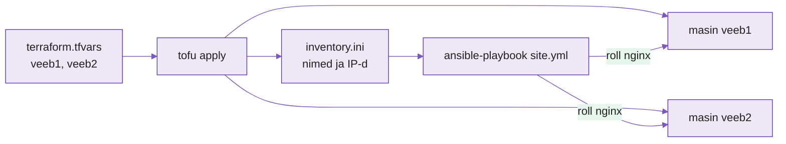

---
tags:
  - OpenTofu
  - Ansible
  - IaC
---

# Loeng: OpenTofu ja Ansible koos

N10-s lõi OpenTofu ühe virtuaalmasina ja N11-s paigaldas Ansible'i roll nginx'i. Täna ühendad need kaks tööriista: OpenTofu loob mitu masinat, kirjutab nende IP-aadressid Ansible'i inventory faili ja sama roll seadistab kõik masinad ühe käsuga.

??? abstract "Õpiväljundid"
    Pärast loengut ja praktikumi oskad:

    - selgitada, millist tööd teeb OpenTofu ja millist Ansible ning miks neid kasutatakse koos;
    - kirjeldada mitu sarnast masinat ühe ressursiplokiga, kasutades `for_each`-i ja muutujat;
    - anda OpenTofu tulemus edasi väljundi (`output`) ja genereeritud inventory faili kaudu;
    - selgitada, kuidas cloud-init paneb uude masinasse kasutaja SSH-võtme;
    - lisada serveriparki masina nii, et muutub ainult muutujate fail.

## 1. Kaks tööriista, kaks ülesannet

OpenTofu ja Ansible kirjeldavad mõlemad soovitud olekut koodina, aga vastutavad eri asjade eest. OpenTofu loob infrastruktuuri: virtuaalmasinad, kettad ja võrguliidesed. Ansible seadistab olemasoleva masina sisu: paketid, konfiguratsioonifailid ja teenused.

??? note "Tabel 12.1. OpenTofu ja Ansible kõrvuti"
    | | OpenTofu | Ansible |
    |---|---|---|
    | Mida teeb | Loob masina, ketta, võrguliidese | Paigaldab paketid, kirjutab konfiguratsioonifailid, käivitab teenused |
    | Millele vastab | Millised masinad on olemas? | Mis on masinate sees? |
    | Kust teab olekut | Olekufailist `terraform.tfstate` | Küsib iga kord masinalt endalt, olekufaili ei ole |
    | Kursusel | N10 | N3, N4, N11 |

Kumbki üksi jätab poole tööst tegemata. OpenTofu annab tühja masina, kus on ainult operatsioonisüsteem. Ansible eeldab, et masin on juba olemas ja et inventory's on selle aadress.

Kahe tööriista vahel on üks probleem: masina IP-aadressi teab alles OpenTofu pärast `apply` käsku, aga Ansible vajab seda inventory's. N10-s kopeerisid IP käsitsi. Kui masin luuakse uuesti, saab see DHCP-st tõenäoliselt uue aadressi ja käsitsi kirjutatud inventory on vale. Lahendus on lasta OpenToful inventory ise kirjutada.

<figure markdown="span">

  <figcaption>Joonis 12.1. OpenTofu loob masinad ja kirjutab inventory, Ansible loeb inventory'st aadressid ja seadistab masinad (Talvik, 2026).</figcaption>
</figure>

??? question "Kontrolli ennast"
    1. Kumb tööriist paigaldab nginx'i ja kumb määrab masina mälu?
    2. Miks ei ole käsitsi kirjutatud inventory OpenTofuga loodud masinate puhul hea lahendus?

    ??? success "Vastused"
        1. Nginx'i paigaldab Ansible, mälu määrab OpenTofu.
        2. Masina IP-aadress selgub alles loomisel ja võib uuesti loomisel muutuda. Käsitsi kirjutatud fail jääb siis vanaks.

## 2. Mitu masinat ühe plokiga

N10-s kirjeldas üks ressursiplokk ühte masinat. Teise masina jaoks võiks ploki kopeerida, aga kaks koopiat lähevad aja jooksul lahku: ühes parandatakse protsessori tüüp, teises mitte. Parem on kirjeldada masin üks kord ja anda eraldi nimekiri, milliseid masinaid on vaja.

Argument **`for_each`** loob ressursist ühe eksemplari iga kaardi (`map`) kirje kohta. Ploki sees on `each.key` kirje võti ja `each.value` selle väärtus ([for_each](https://opentofu.org/docs/language/meta-arguments/for_each/)).

```hcl
variable "masinad" {
  type = map(number)
}

resource "proxmox_virtual_environment_vm" "veeb" {
  for_each = var.masinad

  name  = "mtamm-${each.key}"
  vm_id = each.value
  # ülejäänud read on samad mis N10-s
}
```

Muutuja väärtus on failis `terraform.tfvars`. Võti on masina nimi ja väärtus on masina number Proxmoxis (VMID):

```hcl
masinad = {
  veeb1 = 41001
  veeb2 = 41002
}
```

OpenTofu tunneb iga masinat võtme järgi: aadressid on `proxmox_virtual_environment_vm.veeb["veeb1"]` ja `proxmox_virtual_environment_vm.veeb["veeb2"]`. Kui lisad kaardile kirje `veeb3`, näitab plaan ainult ühte uut masinat ja kaks olemasolevat jäävad puutumata. Kood ei muutu, muutub ainult andmete fail.

??? info "Miks mitte `count`"
    OpenTofus on ka argument `count`, mis loob ressursist N eksemplari ja tunneb neid järjekorranumbri järgi (`veeb[0]`, `veeb[1]`). Kui eemaldad nimekirja keskelt ühe masina, nihkuvad järgmiste numbrid ja OpenTofu tahab need masinad uuesti luua. `for_each` tunneb masinat nime järgi, seega ühe masina eemaldamine ei puuduta teisi.

## 3. Väljund ja inventory

**Väljund** (`output`) näitab pärast `apply` käsku väärtusi, mis selgusid masinate loomisel. N10-s oli väljund `ip` üks aadress. Mitme masina puhul on väljund kaart, kus iga masina nime juures on selle IP-aadress. Selle teeb `for`-avaldis:

```hcl
output "ip" {
  value = { for nimi, vm in proxmox_virtual_environment_vm.veeb : nimi => vm.ipv4_addresses[1][0] }
}
```

Avaldis käib läbi kõik masinad ja paneb iga nime juurde teise võrguliidese esimese aadressi. Esimene liides on `lo` (127.0.0.1), seepärast on indeks `[1][0]` nagu N10-s.

Inventory faili kirjutab provider [`hashicorp/local`](https://search.opentofu.org/provider/hashicorp/local/latest) ressursiga `local_file`. Faili sisu tuleb mallist funktsiooniga [`templatefile`](https://opentofu.org/docs/language/functions/templatefile/). OpenTofu mallis on tsükkel kujul `%{ for … }` ja väärtus kujul `${ … }`, Ansible'i Jinja mallis on samad asjad `` ja `{{ }}`.

```text
[web]
%{ for nimi, vm in masinad ~}
${nimi} ansible_host=${vm.ipv4_addresses[1][0]}
%{ endfor ~}
```

Kuna mall saab andmed masinate ressursist, kirjutab OpenTofu faili alles siis, kui masinad on olemas ja nende IP-d teada. Järjekorda ei pea eraldi kirja panema, OpenTofu leiab selle viidetest. Fail `inventory.ini` on genereeritud nagu olekufail ja seda Giti ei panda: iga `apply` kirjutab selle uuesti.

??? question "Kontrolli ennast"
    Masin `veeb2` kustutati Proxmoxis käsitsi ja `tofu apply` lõi selle uuesti. Mis juhtub failiga `inventory.ini`?

    ??? success "Vastus"
        Uus masin sai tõenäoliselt uue IP-aadressi. Mall annab siis teistsuguse sisu, plaan näitab faili muutust ja `apply` kirjutab faili uue aadressiga üle. Inventory'd ei pea käsitsi parandama.

## 4. SSH-võti uude masinasse

Ansible ühendub masinaga SSH kaudu. Mallist kloonitud masinas on kasutaja `kasutaja`, aga sinu SSH-võtit seal ei ole. N10 kodutöös kopeeriti võti käsuga `ssh-copy-id` ja parooliga. Kahe või kümne masina puhul ei ole see automatiseerimine.

**Cloud-init** on masinas töötav programm, mis loeb esimesel käivitusel seadistuse väikeselt virtuaalselt CD-lt: kasutaja nime, SSH-võtme ja võrgu seadistuse. Selle CD koostab Proxmox OpenTofu plokist `initialization` ([provideri dokumentatsioon](https://search.opentofu.org/provider/bpg/proxmox/latest/docs/resources/virtual_environment_vm)):

```hcl
initialization {
  datastore_id = "local-zfs"
  upgrade      = false

  ip_config {
    ipv4 {
      address = "dhcp"
    }
  }

  user_account {
    username = "kasutaja"
    keys     = [trimspace(file(pathexpand(var.ssh_public_key_path)))]
  }
}
```

Rida `upgrade = false` jätab ära kõigi pakettide uuendamise esimesel käivitusel, mida Proxmox muidu cloud-init'ilt nõuab. Funktsioon `file` loeb avaliku võtme faili, `pathexpand` muudab märgi `~` kodukataloogi teeks ja `trimspace` eemaldab faili lõpust reavahetuse. Kui masin käivitub, lisab cloud-init võtme kasutaja `kasutaja` faili `~/.ssh/authorized_keys` ja Ansible saab ühenduda ilma paroolita.

## 5. Masin juurde

Kahe tööriista koos kasutamise kasu on näha siis, kui serveripark muutub. Kui on vaja kolmandat veebiserverit, lisad failis `terraform.tfvars` kaardile ühe rea ja käivitad samad kaks käsku:

1. `tofu apply` loob ühe uue masina ja kirjutab inventory uuesti, nüüd kolme masinaga.
2. `ansible-playbook site.yml` käib läbi kõik kolm masinat.

Ansible'i kokkuvõttes on kahel vanal masinal `changed=0`, sest need on juba soovitud olekus. Uuel masinal on `changed` suurem kui null, sest seal paigaldati nginx ja kirjutati leht. See on idempotentsus kogu serveripargi tasemel: sama playbook sobib nii uuele kui ka vanale masinale ja muudab ainult seda, mis erineb.

Sama käivitus näitab ka **triivi** (*configuration drift*). Triiv tähendab, et masina tegelik olek on soovitud olekust erinema hakanud, näiteks keegi muutis konfiguratsioonifaili käsitsi. Kui vanal masinal on korduval käivitusel `changed` suurem kui null, oli seal triiv ja Ansible taastas koodis kirjeldatud oleku.

??? question "Kontrolli ennast"
    1. Mitu ressurssi lisab `tofu plan`, kui lisad kaardile `veeb3`?
    2. Milline kolmest masinast on pärast seda `ansible-playbook` väljundis `changed`?

    ??? success "Vastused"
        1. Ühe masina. Lisaks muutub fail `inventory.ini`, seega näitab plaan ka selle asendamist.
        2. Ainult `veeb3`. Kahel vanal masinal on `changed=0`.

Töökohas kirjeldatakse sel viisil kümneid masinaid ja mitut keskkonda. Muudatus tehakse pull request'iga, CI kontrollib koodi (`tofu validate`, `ansible-playbook --syntax-check`) ja pärast liitmist käivitatakse samad kaks käsku. Uus töötaja saab serveripargi ülesehituse teada failidest.

Lehe näited on kontrollitud OpenTofu 1.13, provideri `bpg/proxmox` 0.118 ja Ansible core 2.14 versiooniga.

??? abstract "Kokkuvõte"
    | Mõiste | Lühidalt |
    |---|---|
    | OpenTofu ja Ansible | OpenTofu loob masinad, Ansible seadistab nende sisu |
    | `for_each` | üks ressursiplokk, üks masin iga kaardi kirje kohta, masinat tuntakse nime järgi |
    | `output` | väärtus, mis selgub alles loomisel, näiteks masinate IP-aadressid |
    | `local_file` ja `templatefile` | OpenTofu kirjutab mallist Ansible'i inventory |
    | cloud-init | paneb esimesel käivitusel uude masinasse kasutaja ja SSH-võtme |
    | masin juurde | muutub ainult `terraform.tfvars`, Ansible muudab ainult uut masinat |
