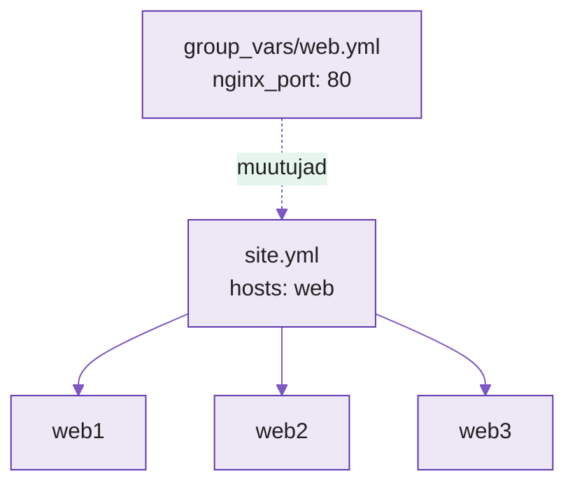

---
tags:
  - Ansible
  - IaC
  - Infrastruktuur
---

# Loeng: terve serveripark koodina

Nädalal 11 jagasid playbook'i rollideks. Selles loengus rakendad sama koodi mitmele serverile ja mitmele keskkonnale ning vaatad, kuidas Ansible ja Terraform koos töötavad.

??? abstract "Õpiväljundid"
    Pärast loengut oskad:

    - selgitada, mis vahe on playbook'il, mis paigaldab nginx'i, ja infrastruktuuril koodina;
    - kirjeldada, kuidas üks playbook haldab inventory gruppide abil mitut serverit korraga;
    - eristada `group_vars` ja `host_vars`: sama kood, erinev keskkond;
    - selgitada, millal kasutada Ansible'it ja millal Terraformi ning miks kumbki üksi ei piisa.

## 1. Mis on uut võrreldes nädalatega 3–4

Nädalatel 3–4 kirjutasid playbook'i, mis paigaldas nginx'i ühte serverisse. See oli automatiseerimine, aga veel mitte infrastruktuur koodina (IaC).

Vahe on ulatuses ja töökorralduses. Ühe serveri seadistamine on skript.

IaC on see, kui kakskümmend serverit kolmes keskkonnas (arendus, test, tootmine) on koodis kirjeldatud ja igaüks saab need sama failikomplektiga nullist üles seada. Kogu teadmine serverite seadistusest on failides ja Gitis, seda saab lugeda ja korrata. Kui üks server läheb katki, kustutatakse see ja playbook seadistab identse asemele.

??? info "Taust: *pets vs cattle*"
    Inglise keeles kirjeldatakse sama vahet väljendiga *pets vs cattle*. Käsitsi hooldatud server on nagu lemmikloom: tal on eripärad, mida teab ainult üks inimene, ja tema kadumine on suur probleem. Koodiga kirjeldatud server on asendatav: kui see läheb katki, luuakse koodi järgi uus.

## 2. Üks playbook, mitu serverit

Seni oli failis `inventory.ini` üks host. Töökohas on hoste mitu ja need on jagatud gruppidesse ([How to build your inventory](https://docs.ansible.com/projects/ansible/latest/inventory_guide/intro_inventory.html)):

```ini
[web]
web1.example.com
web2.example.com

[db]
db1.example.com

[production:children]
web
db
```

`[web]` ja `[db]` on grupid. `[production:children]` on **grupp gruppidest**. Kui playbook'is on `hosts: web`, käivitub see korraga kõigis veebiserverites: sama ülesanne, kakskümmend masinat, üks käsk. See on vastus nädala 1 küsimusele, mis saab siis, kui masinaid on 50.

<figure markdown="span">

  <figcaption>Joonis 12.1. Üks playbook rakendub kõigile grupi hostidele; group_vars annab neile ühised muutujad (Talvik, 2025).</figcaption>
</figure>

## 3. group_vars ja host_vars: sama kood, erinev keskkond

Kood on kõigis serverites sama. Arendusserver ei tohi aga kasutada tootmise parooli ja testserver ei tohi kasutada tootmise domeeni. Üks playbook peab andma igale keskkonnale omad väärtused.

Ansible loeb muutujad failinime järgi automaatselt ([Organizing host and group variables](https://docs.ansible.com/projects/ansible/latest/inventory_guide/intro_inventory.html#organizing-host-and-group-variables)):

- `group_vars/web.yml` rakendub kõigile grupi `[web]` hostidele;
- `group_vars/all.yml` rakendub kõigile hostidele (nägid seda nädalal 4);
- `host_vars/web1.example.com.yml` rakendub ainult sellele ühele hostile.

Seega annab sama `site.yml` koos rollidega arenduses ühe pordi ja tootmises teise, ilma et koodis midagi muutuks. Muutub ainult see, milline `group_vars` fail kehtib. Nädalal 4 panid muutujad faili `group_vars/all.yml` ühe masina jaoks. Mehhanism on sama, nüüd mitme masina jaoks.

IaC põhimõte on see, et kood kirjeldab struktuuri ja muutujad kirjeldavad keskkonda. Kui vahetad `group_vars` faili, saad teise keskkonna ja kood jääb puutumata.

## 4. Idempotentsus infrastruktuuri tasemel

Nädalal 3 nägid [idempotentsust](https://docs.ansible.com/projects/ansible/latest/reference_appendices/glossary.html#term-Idempotency) ühe ülesande tasemel: `changed` või `ok`. Infrastruktuuri tasemel on sama põhimõte veel kasulikum.

Kui kogu serveripargi soovitud olek on kirjeldatud playbook'is, on playbook'i käivitamine ühtlasi kontroll. `changed=0` kõigis hostides tähendab, et kõik serverid on täpselt sellises olekus, nagu kood kirjeldab. Kui ühes hostis on `changed=3`, on keegi või miski seda serverit käsitsi muutnud ja Ansible taastas koodis kirjeldatud oleku.

Nii leitakse ja parandatakse **triiv** (*configuration drift*). Triiv tähendab, et serveri tegelik olek on aja jooksul soovitud olekust erinema hakanud. Käsitsi hooldatud pargis lähevad serverid aeglaselt üksteisest lahku: üks sai turvapaiga, teine mitte, kolmandas muudeti konfiguratsioonifaili käsitsi. Keegi ei märka seda enne, kui midagi läheb katki.

IaC-ga saab playbook'i käivitada näiteks cron'iga ja triiv parandatakse automaatselt.

## 5. Ansible ja Terraform: millal kumbki

Nädalatel 10–11 kasutasid Terraformi. Nüüd kasutad Ansible'it samuti infrastruktuuri kirjeldamiseks.

Tööriistad teevad eri asju ja töökohtades kasutatakse neid sageli koos. Võrdlust saab lugeda ka HashiCorpi lehelt [Terraform vs. Chef, Puppet, etc.](https://developer.hashicorp.com/terraform/intro/vs/chef-puppet).

??? note "Terraform ja Ansible kõrvuti"

    | | Terraform | Ansible |
    |---|---|---|
    | Mida teeb | Loob infrastruktuuri (VM, võrk, ketas) | Seadistab olemasolevat (paketid, konfiguratsioonifailid, teenused) |
    | Küsimus | „Millised serverid on olemas?“ | „Mis on serverite sees?“ |
    | Mudel | Deklaratiivne, hoiab olekufaili | Deklaratiivne, olekufaili ei hoia |
    | Näide | Loo pilve 3 VM-i | Paigalda neisse nginx |

Terraform loob tühjad masinad (*provisioning*), Ansible seadistab need (*configuration*). Tavaline töövoog: Terraform loob 3 VM-i ja väljastab nende IP-aadressid, Ansible kasutab neid IP-aadresse inventory's ja seadistab masinad. Kumbki üksi jätab poole tööst tegemata: Terraform annab tühja serveri ja Ansible eeldab, et server on juba olemas.

Terraformiga saab ka serveri sisu seadistada (`local-exec` provisioner'id, mis käivitavad Bashi käske), aga siis on konfiguratsioon jagatud kahe tööriista vahel ja seda on raske hallata. Tööriist tuleb valida töö järgi.

## 6. Miks see töökohas oluline on

DevOpsi meeskonnas ei logita 20 serverisse käsitsi sisse. Server on koodis kirjeldatud, muudatus tehakse pull request'iga (nädal 2), CI kontrollib seda (nädal 7) ja playbook rakendab muudatuse. Uus töötaja saab serveri seadistuse teada failist `site.yml`. Kui server läheb katki, seadistab playbook uue.

See ühendab kogu kursuse: käsitsi tehtud ja dokumenteerimata teadmine on asendatud koodiga, mida terve meeskond näeb, versioonib ja üle vaatab.

Lehe käsud on kontrollitud Ansible core 2.17 versiooniga.

## Kokkuvõte

??? abstract "Kokkuvõte"

    - IaC ei ole üks playbook, vaid kogu serveripargi oleku kirjeldus koodis, mida saab korrata ja versioonida.
    - Üks playbook, mitu hosti: inventory grupid, `hosts: web` käivitub kõigis grupi hostides.
    - `group_vars` ja `host_vars`: sama kood, erinev keskkond; muutub ainult muutujafail.
    - Idempotentsus infrastruktuuri tasemel: `changed=0` näitab, et triivi ei ole, ja triiv parandatakse automaatselt.
    - Ansible seadistab, Terraform loob; töökohas kasutatakse mõlemat koos.

*Edasi: [praktikum](lab.md), kus laiendad ühe serveri playbook'i mitmele hostile, eraldad keskkonnad `group_vars` abil ja võrdled Ansible'it Terraformiga.*
