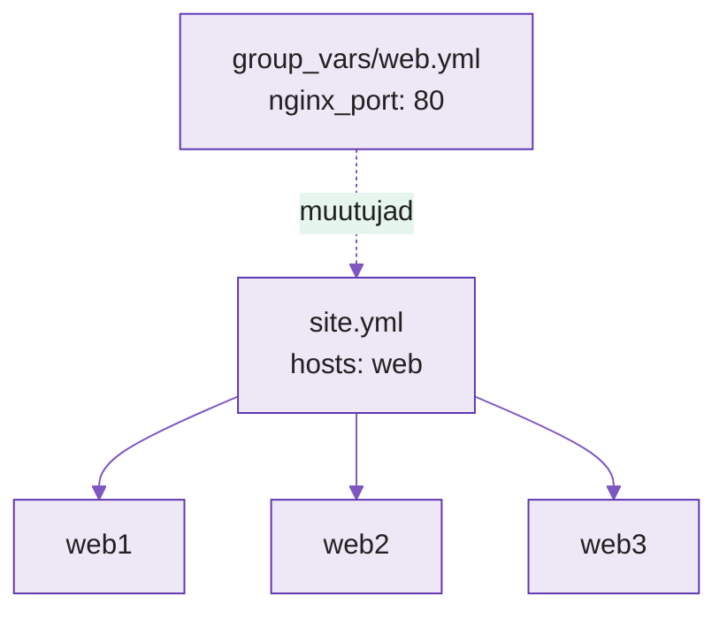

---
tags:
  - Ansible
  - IaC
  - Infrastruktuur
---

# Loeng: terve serveripark koodina

N11-s jagasid playbook'i rollideks. Täna rakendad sama koodi mitmele serverile ja mitmele keskkonnale ning vaatad, kuidas Ansible ja Terraform koos töötavad.

??? abstract "Õpiväljundid"
    Pärast loengut oskad:

    - selgitada, mis vahe on playbook'il, mis paigaldab nginx'i, ja infrastruktuuril koodina;
    - kirjeldada, kuidas üks playbook haldab inventory gruppide abil mitut serverit korraga;
    - eristada `group_vars` ja `host_vars`: sama kood, erinev keskkond;
    - selgitada, millal kasutada Ansible'it ja millal Terraformi ning miks kumbki üksi ei piisa.

## 1. Ühest serverist serveripargini

Playbook, mis paigaldab nginx'i ühte serverisse, on automatiseerimine, aga veel ei ole see infrastruktuur koodina (IaC). Vahe on ulatuses ja töökorralduses.

IaC tähendab, et kakskümmend serverit kolmes keskkonnas (arendus, test, tootmine) on koodis kirjeldatud ja igaüks saab need sama failikomplektiga nullist üles seada. Kogu teadmine serverite seadistusest on failides ja Gitis, seda saab lugeda ja korrata. Kui üks server läheb katki, kustutatakse see ja playbook seadistab identse asemele.

??? info "Taust: *pets vs cattle*"
    Inglise keeles kirjeldatakse sama vahet väljendiga *pets vs cattle*. Käsitsi hooldatud server on nagu lemmikloom: tal on eripärad, mida teab ainult üks inimene, ja tema kadumine on suur probleem. Koodiga kirjeldatud server on asendatav: kui see läheb katki, luuakse koodi järgi uus.

## 2. Üks playbook, mitu serverit

Ühe serveri seadistamisel on failis `inventory.ini` üks host. Töökohas on hoste mitu ja need on jagatud gruppidesse ([How to build your inventory](https://docs.ansible.com/projects/ansible/latest/inventory_guide/intro_inventory.html)):

```ini
[web]
web1.example.com
web2.example.com

[db]
db1.example.com

[production:children]
web
db
```

`[web]` ja `[db]` on grupid. `[production:children]` on **grupp gruppidest**. Kui playbook'is on `hosts: web`, käivitub see korraga kõigis veebiserverites. Sama ülesanne tehakse ühe käsuga kahekümnes masinas.

<figure markdown="span">

  <figcaption>Joonis 12.1. Üks playbook rakendub kõigile grupi hostidele; group_vars annab neile ühised muutujad (Talvik, 2026).</figcaption>
</figure>

## 3. group_vars ja host_vars: sama kood, erinev keskkond

Kood on kõigis serverites sama. Arendusserver ei tohi aga kasutada tootmise parooli ja testserver ei tohi kasutada tootmise domeeni. Üks playbook peab andma igale keskkonnale omad väärtused.

Ansible loeb muutujad failinime järgi automaatselt ([Organizing host and group variables](https://docs.ansible.com/projects/ansible/latest/inventory_guide/intro_inventory.html#organizing-host-and-group-variables)):

- `group_vars/web.yml` rakendub kõigile grupi `[web]` hostidele;
- `group_vars/all.yml` rakendub kõigile hostidele;
- `host_vars/web1.example.com.yml` rakendub ainult sellele ühele hostile.

Seega annab sama `site.yml` koos rollidega arenduses ühe pordi ja tootmises teise, ilma et koodis midagi muutuks. Muutub ainult see, milline `group_vars` fail kehtib.

IaC põhimõte on see, et kood kirjeldab struktuuri ja muutujad kirjeldavad keskkonda. Kui vahetad `group_vars` faili, saad teise keskkonna ja kood jääb puutumata.

## 4. Idempotentsus infrastruktuuri tasemel

[Idempotentsus](https://docs.ansible.com/projects/ansible/latest/reference_appendices/glossary.html#term-Idempotency) tähendab, et korduv käivitus ei muuda midagi, kui kõik on juba soovitud olekus. Ühe ülesande juures näed seda väljundis `ok` ja `changed`, aga kasulikum on see kogu serveripargi tasemel.

Kui kogu serveripargi soovitud olek on kirjeldatud playbook'is, on playbook'i käivitamine ühtlasi kontroll. `changed=0` kõigis hostides tähendab, et kõik serverid on täpselt sellises olekus, nagu kood kirjeldab. Kui ühes hostis on `changed=3`, on keegi või miski seda serverit käsitsi muutnud ja Ansible taastas koodis kirjeldatud oleku.

Nii leitakse ja parandatakse **triiv** (*configuration drift*). Triiv tähendab, et serveri tegelik olek on aja jooksul soovitud olekust erinema hakanud. Käsitsi hooldatud pargis lähevad serverid aeglaselt üksteisest lahku: üks sai turvapaiga, teine mitte, kolmandas muudeti konfiguratsioonifaili käsitsi. Keegi ei märka seda enne, kui midagi läheb katki.

IaC-ga saab playbook'i käivitada näiteks cron'iga ja triiv parandatakse automaatselt.

## 5. Ansible ja Terraform: millal kumbki

Terraform (ja OpenTofu) ning Ansible kirjeldavad mõlemad infrastruktuuri koodina, aga teevad eri asju ja töökohtades kasutatakse neid sageli koos. Võrdlust saab lugeda ka HashiCorpi lehelt [Terraform vs. Chef, Puppet, etc.](https://developer.hashicorp.com/terraform/intro/vs/chef-puppet).

??? note "Tabel 12.1. Terraform ja Ansible kõrvuti"
    | | Terraform | Ansible |
    |---|---|---|
    | Mida teeb | Loob infrastruktuuri (VM, võrk, ketas) | Seadistab olemasolevat (paketid, konfiguratsioonifailid, teenused) |
    | Küsimus | „Millised serverid on olemas?“ | „Mis on serverite sees?“ |
    | Mudel | Deklaratiivne, hoiab olekufaili | Deklaratiivne, olekufaili ei hoia |
    | Näide | Loo pilve 3 VM-i | Paigalda neisse nginx |

Terraform loob tühjad masinad (*provisioning*), Ansible seadistab need (*configuration*). Tavaliselt loob Terraform kolm virtuaalmasinat ja väljastab nende IP-aadressid ning Ansible kasutab neid inventory's ja seadistab masinad. Kumbki üksi jätab poole tööst tegemata: Terraform annab tühja serveri ja Ansible eeldab, et server on juba olemas.

Terraformiga saab ka serveri sisu seadistada (`local-exec` provisioner'id, mis käivitavad Bashi käske), aga siis on konfiguratsioon jagatud kahe tööriista vahel ja seda on raske hallata. Tööriist tuleb valida töö järgi.

## 6. Serveripark meeskonnas

DevOpsi meeskonnas ei logita 20 serverisse käsitsi sisse. Server on koodis kirjeldatud, muudatus tehakse pull request'iga, CI kontrollib seda ja playbook rakendab muudatuse. Uus töötaja saab serveri seadistuse teada failist `site.yml`. Kui server läheb katki, seadistab playbook uue.

Käsitsi tehtud ja dokumenteerimata teadmise asemel on kood, mida terve meeskond näeb, versioonib ja üle vaatab.

Lehe käsud on kontrollitud Ansible core 2.17 versiooniga.

??? abstract "Kokkuvõte"
    - IaC on kogu serveripargi oleku kirjeldus koodis, mida saab korrata ja versioonida.
    - Üks playbook, mitu hosti: inventory grupid, `hosts: web` käivitub kõigis grupi hostides.
    - `group_vars` ja `host_vars`: sama kood, erinev keskkond; muutub ainult muutujafail.
    - Idempotentsus infrastruktuuri tasemel: `changed=0` näitab, et triivi ei ole, ja triiv parandatakse automaatselt.
    - Ansible seadistab, Terraform loob; töökohas kasutatakse mõlemat koos.
